# The cards

Sixty-eight cards, listed as **Fluvy · …** in the card picker, each with a live preview and an editor form. The form is
the reference for a card's options: it shows what the card does by default, and a default you leave as it is is never
written into the configuration. It shows an option only where it acts — in the style chosen, with the card's other
options as they are — and an option it hides keeps its value for when it acts again. In YAML, a card is
`type: custom:<tag>` plus the entity or entities it draws and any option the editor offers. Each card has a page of
its own, opened from [the index of the cards](#everyday) at the end of this guide: its picture, the YAML that draws
it, every key it takes with what it does, its default and its values, the fields of its lists' items, and the older
names it still accepts (read, never written back); [the live demo](https://acosta290.github.io/fluvy/) has each one to
try. Every entity card also takes
`entity`, `name`, `icon`, `tap_action`, `hold_action`, `tone`, `color`, `card_color` (a quiet wash of a colour as
the card's own surface, its edge and dividers in it — see [the theme guide](theme.md#a-colour-per-card-and-per-item))
`card_opacity` (how solid its surface is, 0 to 100: under 100 the view's background shows through; left out, the
house's — see [the settings panel](settings-panel.md#cards)) and `unavailable` (how it looks while its device is out
of reach: `dashed`, the default, on the page's fill in a dashed hairline; `quiet`, as it is while off, still saying
"Unavailable"; left out, the house's — a tile of the tiles card may say its own);
a list card takes `title`. A card with a slider (the light, slider, tile, tiles, lights, media, fan, cover and helpers
cards) also takes `slider_style` (the style its sliders are drawn in: `ruler`, `bar`, `liquid` or, on a tile, `fill`;
left out or `house`, the house's — see [the settings panel](settings-panel.md#sliders)) and `slider_words` (the
figures under a bar or a liquid: `ends`, the ends and the middle, or `none`). A card with a head also takes `show_icon`: `auto` (the default: the circle gives way where
a long name in a narrow column needs its room, and only then), `always` (the circle stays while the name keeps a
few letters beside it: a smaller circle first, then none) or `never`; and `name_lines` (1.22): `1`, the default, or
`2`, its name in two balanced lines where one would end it in an ellipsis, an ellipsis only past the second, the head
a line taller whatever the name says, so cards side by side stay level (on the room lights and the room card,
`name_lines` is their tiles', below; a layout with no head of its own, a tile, a row or a banner, has none to take):

```yaml
type: custom:fluvy-energy-card
entity: sensor.inverter_e2_south_power
name_lines: 2   # "Inverter E2 South / MPPT total power", where one line said "Inverter E2 So…"
```

A card whose head carries a badge of its own, its state or a count (the lock, alarm, cover, vacuum, thermostat,
appliance, 3D printer, vehicle, humidity, timer, updates, gauge, distribution and bars cards, and the energy balance,
grid, car charger, batteries, energy devices, energy usage and production cards), also takes `show_badge` (1.22):
`false` hides it, and its word does not step down into the line under the name either; a badge you give a card
yourself (`badge`) still shows. The thermostat's `show_state` is its older name. The editor offers it beside the
icon's choice.

```yaml
type: custom:fluvy-cover-card
entity: cover.office_blind
show_badge: false   # no "Open" beside the name: the ruler and its words say it
```

An `icon` left out — a card's, a row's or a
tile's — is the one you set for the entity in Home Assistant (in its settings, or a helper's, a scene's or a script's
own), else Fluvy's glyph for its kind, drawn open or shut as it stands (a door, a gate, a garage, a window), else its
integration's or Home Assistant's own: a sensor of a class Fluvy has no glyph for takes Home Assistant's, one of no
class keeps Fluvy's trend arrow unless its integration has an icon for it. The index and the cards' pages are
generated from the code (`pnpm docs:cards`), their pictures by `pnpm docs:images`.

A `name` is your own words, or a name made of Home Assistant's parts as its own editor writes it: the entity's own
name, its device's, its area's or its floor's, one or a list of them (words of your own among them as
`{ type: text, text: … }`), joined by a space as Home Assistant's own cards join them. Left out, a card says the
entity's friendly name, as Home Assistant's cards do. A light named "Baum" on a device named "EG_GA_L_Baum" in the
area "Garten" has the friendly name "EG_GA_L_Baum Baum"; it reads "Baum" with

```yaml
name:
  type: entity
```

and "Baum Garten" with `[{ type: entity }, { type: area }]`. A card's editor offers Home Assistant's name picker for
its name, and for each item's name in its lists, wherever an entity is beside it; words you type stay words.

A card of a list (Entities, Tiles, Room lights, Openings, Bars, Readouts, Stat tiles, Distribution, Helpers, Actions,
Scenes, Cameras, Updates) also takes `names` (1.22): how it names every item that gives no `name` of its own.
`full`, the default, is the friendly name; `entity` is each entity's own name (its device's where it has none, as a
door that is its device's main entity), `device` its device's, and Home Assistant's parts are read as a `name` reads
them (`names: [{ type: entity }, { type: area }]`). A card of one device's entities reads them by their own names:

```yaml
type: custom:fluvy-entities-card
title: Washing machine
names: entity            # "Washing machine Power" reads "Power"
entities:
  - sensor.washing_machine_power
  - sensor.washing_machine_energy
  - binary_sensor.washing_machine_door
  - entity: sensor.washing_machine_time_left
    name: Ready in       # an item's own name always stands
```

An entity of no device (a helper) keeps its name whatever is asked, and a card tells no two alike apart: two
"Motion" rows of two sensors stay "Motion", so name those yourself, or ask for `device`. The editor offers *Names*
over the list while one of its entities belongs to a device. On the automatic dashboards the dashboard's own `names`
says it ([the automatic dashboards](automatic-dashboard.md#names)).

Every card holds from the floor of a narrow column — 152 px for a card that takes half a section, 211 px for a full
one — up to a wall's 520 px, in light and dark, in every language Fluvy speaks; `unavailable`, `unknown` and a
missing entity are drawn on purpose (a quiet surface, inert controls, a dash for the value), never as an error, and
at the size and in the anatomy the card has live, so a grid never jumps when a device goes offline. Names may be
shortened with an ellipsis; values never are: a reading too long for its room says itself shorter instead, a large
count in the language's short words ("5.1M queries", then "5.1M"), a figure without its unit, a moment as long ago as
it was ("12 days ago"). A card that takes an action changes on screen first and calls
the service after; sliders and dials send on release, not per frame. A card of a list with nothing in it (a filter
that matches nothing yet, the last entry taken out) shows its head and an empty panel in its own words, never an
error: `empty_text` says what nothing means there ("All closed"), and `hide_empty: true` lets the card step aside
until something is listed again (see [auto-entities](troubleshooting.md#a-list-filled-by-auto-entities)).

`tap_action` and `hold_action` are Home Assistant's actions: `more-info` (the default), `toggle`, `navigate`, `url`,
`perform-action` (and `call-service`, as it was written before Home Assistant 2024.8), `assist`, `fire-dom-event`
and `none`. The head is the card's button: a tap on its circle, its name, the line under it or the room up to what
trails them answers the tap, and a still press anywhere on it the hold (with a keyboard: Tab to it, Enter taps,
Shift+F10 or the menu key holds). A control in the head (a switch, a "…" button) keeps its own tap beside it, and the
body keeps its own controls, so a slide is never a tap; a mouse that drags never taps either. A tile answers both on
its whole surface, a large one around its switch and ruler; a player on its art and its words; a greeting with no
avatar on its words. A stat tile answers its own `tap_action` (its entity's details, with the history, by default)
and `hold_action` (nothing by default), and one whose entity cannot be read is no button. A head whose actions have
nothing to act on (a card of many entities has no details of its own) is no button at all. An action with a `confirmation` is asked about first, by Home Assistant's own dialog, and nothing
on the card moves before the answer.

## Details sheets

A `more-info` on a Fluvy card (the default tap of a head, a row's tap, a tile's hold) opens Fluvy's own sheet for the
kinds that have one, where Home Assistant's dialog opened before 1.20. Each sheet is built round one control, a dial,
with the entity's commands under it:

| Kind | The dial | Under it |
| --- | --- | --- |
| Light | Brightness, in the lamp's own colour | One step down, the switch, one step up; the light card's hue ruler or colour-temperature ruler and its quick colours; **Effect** where the light has effects |
| Climate, water heater, humidifier | The target (a low and a high for a range), what it measures as a dot outside the ring and under the figure | One step down, one step up; the modes as chips; **Preset**, **Fan**, **Swing** and **Horizontal swing** where a climate lists them |
| Cover, valve | Position | Open, stop, close; **Tilt** on a ruler, or as two steps where it only opens and closes |
| Media player | Volume | Power, previous, play or pause, next, mute; **Source** and **Sound mode**; the artwork in the head |
| Fan | Speed, in the fan's own speeds | One speed down, the switch, one speed up; **Oscillate**, **Direction**, **Preset** |

Only what the entity supports is drawn: a light that only switches, a fan with no speeds, a cover with no position and
a player with no volume to set draw their ring, lit while they are on, and their keys. An entity out of reach keeps
its sheet's anatomy, every control still.

The head says the entity's name over its area and its state; its **…** opens Home Assistant's own details of the
entity (its settings, its history, what it relates to, its attributes), and Close, Escape or a tap outside the sheet
closes it, the focus going back to what was tapped. At the foot, the entity's last 24 hours are drawn in the house's
chart style (how long it was on, or a thermostat's temperature), and a tap on them opens Fluvy's
[History](pages.md#history) for that entity. A sheet is a bottom sheet on a phone and a dialog in the middle of a wide
screen. It reads at the size of the card that opened it (a device that reads its dashboards at 125 % opens its sheets
at 125 %, and a screen too narrow for the dialog at that size gets the bottom sheet). Every sheet of Fluvy's keeps its
foot above the phone's system bar (the Companion app's too) and, when it is taller than the screen, stops short of the
top so a tap above it closes it; its body scrolls.

Every other entity opens Home Assistant's dialog as before, and so does every card that is not Fluvy's: Fluvy answers
only the `more-info` of its own cards.

The house chooses whose details open (the settings panel → Appearance → Cards → **Fluvy's details sheets**, on by
default; see [the settings panel](settings-panel.md#cards)), and an action may say its own with `details`:

```yaml
type: custom:fluvy-tile-card
entity: light.floor_lamp
tap_action:
  action: more-info
  details: home-assistant # this tile keeps Home Assistant's dialog
```

`details: fluvy` asks for the sheet in a house that keeps Home Assistant's dialog. `details` is read on every action
of a Fluvy card (`tap_action`, `hold_action`, a row's or a tile's own).

## Customisation

Every card exposes what to show (section switches such as `show_fan`), which items appear and in which order (subset
lists such as `modes: [off, heat, cool]`), and at least one other layout through `variant`. Chip rows fill the row by
default and are content-sized on request (`preset_style`, `fan_style`, `suction_style: chips`). Cards that list rows
(lock, alarm, camera, bars, stat tiles) take a `rows` list edited with Fluvy's own rows editor. A bars row turns
warning, and counts in the head's badge, under its `low` or over its `high`; a battery and a soil's moisture are low
under 20 % unless their row says otherwise. While a device is off,
the thermostat and the fan can keep to the essentials (`when_off: essentials`) — the thermostat its head, value and
modes, the fan its switch and speed ruler — and presets, fan speeds, oscillation and direction come back the moment a
mode or the switch wakes it (the water heater and the humidifier only have modes, so nothing hides on them).

A row of choices always shows the value in force. A fan speed, a preset, a mode, a select's option or a source that
the row does not offer (left out by the card's own list, past the row's six, or never listed by the device) stands
first, chosen, and takes no tap: an air conditioner running at `middle` while it offers Low and High says Mid, and a
thermostat with `modes: [heat, cool]` says Off while it is off. Choosing another value takes it away again.

A compact or mini tile keeps its name to one line, ending a long one in an ellipsis; `name_lines: 2` lets it take a
second line where one would cut it — on the tile and tiles cards, the template card, the room lights' tiles and the
room card's tiles and row. The tile is then a line taller whatever its name says (a compact one 88 instead of 76, 96
inside a card, a mini 124 instead of 108), so a row of tiles stays level.

A tile's `readouts` stand in a large tile's foot, two or three as its width holds; a compact or mini tile says the
first after its state ("On · 142 W"). `line_readouts: all` (1.22, on the tile and tiles cards and the room card's
tiles) says every one that can be read, in their order after the state and the level ("On · 70 % · 12 W · 0.4 kWh"):
where the line does not hold them all, the last gives way first, a reading whole or not at all, and the tile keeps its
height. A readout may be a sensor alone or, as the Grid card's, one with what it says of its own: `name` is its label
in a large tile's foot and stands before its figure on a line ("CPU 55 °C", so two temperatures read apart), and
`unit` and `decimals` are the unit and the decimals its figure reads in. The tile's editor lists them one by one.

```yaml
type: custom:fluvy-tile-card
entity: switch.nas
size: compact
line_readouts: all
readouts:
  - entity: sensor.nas_cpu_temperature
    name: CPU
  - entity: sensor.nas_disk_temperature
    name: Disk
  - entity: sensor.nas_power
    unit: kW
    decimals: 2
```

`readouts_layout: end` stands a compact tile's readouts at its row's end instead, as columns under their labels, as a
large tile's foot does: as many as hold whole beside the name and the state, from the first, and the rest on the line.
A tile too narrow for one column says them all on its line, so two tiles a row on a phone read as they would with
`line_readouts: all`. A mini or a large tile keeps its line and its foot.

```yaml
type: custom:fluvy-tiles-card
size: compact
columns: 1
readouts_layout: end
tiles:
  - entity: switch.washer
    readouts: [sensor.washer_power, sensor.washer_energy]
```

A sensor card's readouts are named by their measure when nothing is set ("Temperature", "Humidity"); `label` names
the card's own sensor, an entry's `name` names that entry, and each entry may take its own `color`:

```yaml
type: custom:fluvy-sensor-card
entity: sensor.office_climate_temperature
label: Inside
entities:
  - entity: sensor.office_climate_humidity
    name: Humidity
    color: teal
```

A chart is drawn in the house's chart style (fluvy's settings → Charts: `classic` from the factory, the chart every
card drew before 1.11) unless the card names its own with `chart`: `classic`, `soft` (a soft copy under the line,
hairlines at the quarters, Fluvy's knob at the line's end), `glow`, `minimal` (a thin line ending in its dot), `step`
(each reading held across its slot, on a scale of its own range), and, for a sensor alone whose readings add up (a
meter, energy, power, rain, gas, water, a price — not a temperature, a humidity or a pressure), `bars` and `columns`:
the window in at most 24 bars, an hour each over a day, each what the meter gained there or the slot's mean. The fine keys change
one thing of the style and are offered only where the style draws it — `curve` (`smooth`, `straight`, `step`), `fill`
(`gradient`, `flat`, `none`), `line_width` (`thin`, `regular`, `bold`), `glow`, `show_points` (`none`, `end`, `all`),
`show_grid` (`x`, `y`, `both`, `none`), `show_axis`, `highlight` (`min`, `max`, `both`, `current`) — and `animate:
false` draws the chart still. A card's own key wins over the house's setting, which wins over the style's own default;
a key the card never writes is the house's. A tile's spark is `minimal` where the card's style is, else classic.

```yaml
type: custom:fluvy-sensor-card
entity: sensor.living_room_temperature
chart: soft
line_width: thin
```

How much of the past a chart shows is the house's too (fluvy's settings → Charts: the last 12 hours from the factory,
24 before 1.18) unless the card says its own: `hours` on the sensor card (its chart, its several sensors and its tile's
spark) and the energy card's line, `span` on the Chart card. Its line is drawn calmly: its points on the house's round
times (12:00, 12:30 …), as far apart as the card's width holds them for its style's stroke, each the mean of the
readings around its time — or, with `points` (`5m`, `15m`, `30m`, `1h`; `auto` the house's from the factory), a point
every so often, each Home Assistant's reading then, so the line passes through what Home Assistant says at 12:00 (down
to a pixel apart, drawn thinner where its points stand closer than its stroke reads). Read with a finger or a mouse,
any of them says the reading itself at the round time nearest — the five-minute bucket, or the state then — never a
mean across it.

```yaml
type: custom:fluvy-sensor-card
entity: sensor.living_room_temperature
hours: 24
points: 30m
```

Every card that draws a chart takes `chart` the same way, each offered only the styles it draws: the energy card,
the history bars and production (their styles are in [the energy cards](energy.md)), the distribution's stack and the
bars card `classic` or `soft` (each part a pill, its ink deepening along it). A gauge card's ring takes `gauge`:
`ticks` (its dial since 1.0), `dial` (the thermostat's dial, read) or `ring` (a ring lit to the value, Fluvy's knob at
its end) — the bar and the signed ring keep their one look; the humidity card's ruler `ticks` (its marker, the classic
one) or `ruler` (read lit to the value, Fluvy's knob on it). A gauge that names none draws the house's where it can,
else its classic. The History page draws its charts in the house's style; it has no setting of its own.

A gauge card's ring may also move with what its sensor reads, each offered only for the sensors it reads: `liquid` (a
percentage, a humidity: two slow waves, the reading in the larger of water and air), `thermo` (a temperature: a sky
over the ground — snow falling on a drift when it is cold, a mild sun and a drifting cloud, heat haze over dry ground,
a desert with its saguaros from 35 °C), `tank` (a volume or a level: bubbles while it fills, as fast as it fills),
`battery` (its charge as a level, the warning's under 40 % and the danger's under 20 %; bubbles and the bolt while it
charges), `pulse` (power: rings that beat faster with more of it), `air` (wind, or a ventilation's flow: streamlines as
fast as the wind) and `sun` (power or irradiance from the sun: rays that lengthen and turn with it). How fast a tank
fills or a battery charges is read off the card's last hour; a moving gauge the sensor does not read (a sky for a
power) draws the ticks. The humidity card's band takes `liquid` too, its level the reading under the figure. Each
takes the column's width and the dial's height, so the card keeps its size. `animate: false` — the card's, else the
house's motion in fluvy's settings — rests a moving gauge on its first frame, still a wave, its bubbles, rings and
snow gone, as a system that asks for less motion does.

```yaml
type: custom:fluvy-gauge-card
entity: sensor.terrace_temperature
gauge: thermo
```

The Min / Max / Average row under the gauge, over its last `hours`, is the card's to shape: `show_stats: false`
leaves it out and the card 60 px shorter, and `stats` lists the figures it shows, in their order.

```yaml
type: custom:fluvy-gauge-card
entity: sensor.grid_power
stats: [max, average]
```

A light that only switches on and off (its `supported_color_modes` is `onoff` alone) draws the light card as its
head alone — the circle, the name, the state line and the switch, 84 px — in every style, and its editor offers only
what the bulb does: no layout, stepper or live update, no temperature ruler, no quick colours.

`show_brightness` says when the light card shows its light's brightness — its level and its ruler, and with them the
stepper, the temperature ruler and the quick colours: `true` (always, the default), `false` (never: the card is its
head alone, as a light that only switches is) or `when_on` (while the light is on: its head alone while the light is
off or cannot be read; turned on, the card eases open and the rest fades in, and turned off it fades out and eases
back, the cards under it moving with it, at once with reduced motion). The editor offers it where the bulb dims, and
while the brightness is never shown it offers none of the layout, the stepper, live update, the rulers or the quick
colours.

```yaml
type: custom:fluvy-light-card
entity: light.garden
variant: compact
show_brightness: when_on
```

A colour bulb's quick colours (`colors`) are the house's own, any number in any order: `warm`, `cool`, a Home
Assistant colour name, `#rrggbb`, `[r, g, b]`, `picker` (a round that opens the browser's colour picker), or any of
those with a `name` its round says. The editor edits them row by row — a colour (the words, the picker, or *Custom
colour* with a colour well) and a name — and shows the bulb's default six until the list is touched; a hex reads as
itself and a colour name as words ("Deep purple") when no name is given.

```yaml
type: custom:fluvy-light-card
entity: light.lamp
colors:
  - warm
  - color: "#ff2d55"
    name: Lila
  - color: [0, 128, 128]
    name: Teal
  - deep-purple
  - picker
```

A lit light card can show its light's colour on its whole surface (`tint`, 1.9): `on` while the light is on, `always`
with a quiet wash of it at rest too, `off` never. How much: `full` (the default) is a lit tile's fill in that colour —
the same on every palette as a tile's — `soft` a gentler wash, `brightness` a wash as strong as the lamp is bright
(a lamp at 10 % still reads lit), and `full_brightness` (1.17) as much of the whole fill as the lamp is bright: the
soft wash for a dim lamp, the very card `full` draws at 100 %, the steps between following the brightness as you drag.
Its words are the fill's own wherever they read on it, else the card's: on a solid palette in dark (Volt, Mint, Noir)
they change once, at one level, the same up and down. The colour is the card's own `color` when it has one
(*Primary* is the palette's accent; the editor's *State* follows the light), else its `tone`, else the light's: the
colour it glows, a group's lit members' by their brightness, the one you just tapped. A white shows its warmth (1.10)
on one scale, from Home Assistant's own colour for its temperature: a candle's (2,200 K) the warmest, 2,700 K warm,
4,000 K a little, 5,000 K nearly neutral, daylight (6,500 K) neutral, and a cool one, above it, cool — or the palette's
lit light with `light_whites: palette`. A light that only dims or only switches, and a white Home Assistant gives no
colour for, have no colour of their own and take the palette's lit light. Where a card says nothing of its surface, the
house decides (the settings panel → Appearance → Lights; off unless chosen):

```yaml
type: custom:fluvy-light-card
entity: light.sofa_lamp
tint: on
tint_strength: full_brightness
```

Tiles, a tiles group, a room's tiles and rows, and an entities card's rows can wear a lit bulb's colour as well
(`light_colors: true`, or the house's choice; the room lights card does unless told not to), a white by its warmth
or as the palette's light as above (`light_whites`). Every light a card draws follows one rule (1.10): its own `color`,
else its own `tone`, else its bulb's colour, else the card's `color`, else the card's `tone`, else the palette's lit
light — so a bulb's colour now comes before the card's. A light group wears its lit members' colours, weighed by their
brightness. The editors offer only what acts: the whites while the bulbs show their colours, the colour at rest
(`tint`) on a room lights card in tiles and on a room with tiles, a light's colours on a tile of a light.

```yaml
type: custom:fluvy-lights-card
area: bedroom
variant: tiles
light_whites: palette
```

The room lights card can carry a colour round (`show_color: true`, Discussion #137): a palette round in the head,
before the lights' rounds or the room's switch, whose own tap opens the room's colours for every light at once, while
the room's icon keeps switching the lights and the brightness ruler keeps setting the room. It opens Fluvy's colour
sheet: the light card's hue ruler (or the hue wheel, `color_control: wheel`) and quick colours (`colors`, the light
card's list) for the whole room, with the room's switch in its head; a colour chosen goes to every light of the room
in one call, each as Home Assistant fits it (a white bulb takes the nearest white), wakes a room that is off, and the
sheet says which lights take none. Where the card is one light or a light group, `color_action: more-info` opens Home
Assistant's details of it instead. The round shows only where a light of the room takes a colour, and in half a
column it steps to a "Colour" row under the body. It is off unless asked for, so a card that does not name it draws
as it did.

```yaml
type: custom:fluvy-lights-card
area: living_room
show_color: true
colors: [warm, cool, red, orange, '#8e44ad', picker]
```

A lamp on a plug can stand among a room's lights (a `switch`, as the automatic dashboards count one whose name says
it is a light): its round, chip or tile switches it as a switch, and the room's tap turns it on and off with the
lights, while the brightness ruler and the colours set the lights alone and it just comes on (1.19.1).

The history bars card reads a sensor's long-term statistics (`days` bars of a `period`: days, weeks or months; a
bar is what a meter gained, or a measurement's `mean`, `max` or `min`). Its head readouts (`head`) and the facts
under the chart (`facts`) are lists of kinds you compose in order — `total`, `average`, `highest`, `lowest`,
`today`, and the equivalents `co2` (× `co2_factor`, 0.4 kg a kWh), `trees` (22 kg a tree a year), `km` (5 km a
kWh), `money` (× `price`, in the house's currency), `share` (`of` another sensor) and `template` — each with its
own `name`, `icon`, `color`, `unit`, `decimals`, `factor` and `tap_action`. The factors are rough and yours to set.
Every part switches off (`show_values`, `show_axis`, `show_grid`, `show_dates`, `show_facts`, `show_head`), the
day in progress joins with `include_today`, and `variant: compact` keeps the bars and their dates, `mini` a row of
readouts and a sparkline:

```yaml
type: custom:fluvy-history-bars-card
entity: sensor.grid_export_energy
name: Feed-in to grid
icon: up
color: '#86B98C'
price: 0.19
facts:
  - kind: share
    of: sensor.solar_energy
    name: Share of production
    icon: tower
  - kind: money
    name: Revenue (est.)
  - kind: co2
    name: CO₂ avoided
```

By default a meter's bars are what Home Assistant counts (its long-term `change`, the Energy dashboard's numbers).
A counter that starts again from zero on a cycle — a day counter, a monthly rain gauge — is better read by its own
readings: `reset: day` (or `week`, `month`, `year`) reads it at each hour's or day's end, so a reset that comes as
two writes, a restart that reads 0 for a moment, or a `total` without `last_reset` is never counted twice or below
zero; `reset: never` reads a lifetime meter the same way. The editor names a utility meter's own cycle. `stat: state`
draws the reading at the end of each bar (a monthly gauge by month is each month's rain). A sensor with no state
class has no statistics: its bars come from the recorder's history, kept for its last days (`source: history` asks
for it always). Today is live, the average, the highest and the lowest are the finished bars', and the days before
a sensor existed stay empty. `negative_color` and `current_color` give the bars below zero and the one in progress
colours of their own; `unit` converts within energy, power, volume and distance:

```yaml
type: custom:fluvy-history-bars-card
entity: sensor.rain_this_month
days: 28
include_today: true
reset: month
unit: in
current_color: blue
```

## Templates in row text

In every list of rows (entities, lock, alarm, camera, bars, stat tiles, actions, helpers) a row's `secondary` may be
a Home Assistant template instead of a keyword or words of its own: anything with `{{ … }}` or `` is rendered
by Home Assistant and kept live, so the line changes as the entities it reads do. The row's own entity is `entity` in
the template and the person looking at the dashboard `user`; a template that fails renders an empty line, never its
own text. The editor's field takes a keyword or a template alike. A camera's rows are its history: each says when it
last changed, as the time of day, unless its `secondary` asks for another line (`state`, `area`, an attribute, a
template, `none`), and a row's `tone` or `color` shows on its circle. A row with no `tap_action` of its own opens its
entity's details, a select's its dropdown (see Helpers).

```yaml
type: custom:fluvy-entities-card
rows:
  - entity: climate.living
    secondary: "{{ state_attr('climate.living', 'current_temperature') }} °C · {{ states('sensor.humidity') }} %"
```

A row's time — the openings card's "2 h ago", a list row's *last change* line, a tile's, a person's — is Home
Assistant's `last_changed`, which a restart or a reload resets. Where the house keeps the real one (1.11: a
timestamp sensor such as `sensor.front_door_real_last_changed`, or an attribute of the entity's own), the row reads
it from there with `since`: the sensor's id, or `attribute:<name>`, as an ISO date or an epoch in seconds or
milliseconds; the editor offers the house's timestamp sensors, and takes any other typed. The openings card names one
for every row at once with `since_pattern` — `sensor.{id}_real_last_changed`, `{id}` the row's object id, `{entity}`
its whole id — and a row's own `since` wins. A sensor that is empty, unknown, unavailable or no moment at all leaves
the row on Home Assistant's own time.

```yaml
type: custom:fluvy-openings-card
since_pattern: sensor.{id}_real_last_changed
rows:
  - binary_sensor.front_door
  - entity: binary_sensor.garage_door
    since: attribute:last_opened
```

A row of the Entities card never cuts what ends it, however narrow its column (half a section is 152 px). The rows
give their circles to the names together; beside a switch, a chevron or a value the name then ends in its ellipsis;
a state of several words takes two lines; and where even so nothing would be left of the name, the state goes under
it. That row is a line taller and the card with it: the height the card declares is its rows of 60 (48 compact), which
a section's width always holds. The line under a name is said shorter before it would be cut: an age down to its
figure ("32 days ago", "32 d ago", "32 d"), in one form for the whole list, and a line no form of which holds is left
out (a screen reader still hears it whole).

## Sections and rows on a condition

The lists of the Bars and the Entities cards may stand in parts (1.19). A section among the rows is its label, in the
card's small capitals where a row's hairline would be: `type: section` with a `label`, as Home Assistant's own
entities card writes one, or `section: Upstairs` in a line. `line: true` draws a hairline from side to side over the
label, and `type: divider` is that hairline alone. The editor adds both under the rows' picker, and they are dragged
into place with the rows.

A row shows only while its `show_when` holds: its state a number `above` one, `below` one or between both, a `state`
that is a word (or one of a list), or a `state_not`; `entity` reads another entity in the row's place. Every part
given must hold, the bounds are strict, and a state that is no number (unavailable, unknown) is neither above nor
below one. `show_rows_when` on the card is the same condition for every row that names none, which is how a list
filled by auto-entities takes one. It is plain data compared with the state, never a template.

A label with no row showing under it is not drawn, nor is a hairline with no row showing on either side. The count in
the head ("2 low", "3 on") reads the rows that show, and with none showing the card is its empty panel in its
`empty_text`, or steps aside with `hide_empty: true`. The height the card declares to the grid and to the automatic
dashboards counts every row and section of its config; on a dashboard it is as tall as what it shows.

```yaml
type: custom:fluvy-bars-card
title: Batteries
show_rows_when: { below: 30 }     # every row
empty_text: Nothing under 30 %
rows:
  - type: section
    label: Downstairs
  - sensor.front_door_battery
  - entity: sensor.kitchen_window_battery
    show_when: { below: 50 }      # or a row its own
  - type: divider
  - section: Upstairs
    line: true
  - sensor.leak_sensor_battery
  - entity: sensor.guest_room_battery
    show_when: { entity: input_boolean.guests, state: 'on' }
```

## Groups by room

The Tiles card and the Scenes card may show which room a light or a scene belongs to (1.21): their list in groups,
each under a quiet label. Without these keys a card draws as it always did.

- **Sections of your own.** A section among the tiles or the scenes labels what follows it: `section: Kitchen` in a
  line, or `type: section` with a `label`, as the lists above write one. What stands before the first section has no
  label, and a label with nothing under it is not drawn. On the page there is no hairline: `line` and `type: divider`
  draw nothing here. The editor adds a section under the picker, and it is dragged into place.
- **The house's groups.** `group_by: area` gathers the list by room, `group_by: floor` by floor, each group under
  its name and what is in none last, under *Other*. The rooms stand in the house's order (the panel's *Dashboards ›
  Rooms in order*, [the settings panel](settings-panel.md#rooms-in-order)); while the house names none, as the list
  first names them. `group_order: name` sorts the groups A to Z on this card. A list's own sections are not read while
  it groups by the house.
- **Short names.** Inside a group that is a room or a floor of the house, a name reads without that name at either end
  (*Kitchen Pendant* under *Kitchen* is *Pendant*, *Luz de la cocina* is *Luz*), and without a first word every name
  of the group shares, three names at least (*Lights Cooking*, *Lights Dinner*, *Lights Evening* are *Cooking*,
  *Dinner*, *Evening*). A name is cut only as whole words, never to nothing, and never so that two read alike; where
  that cannot be told, it stays whole. A `name` of your own is never shortened. `short_names: false` keeps every name
  whole; `short_names: true` reads them short under a section of your own words too.
- **Scenes as chips.** `variant: chips` on the Scenes card draws the scenes as pills on one card: each group's fill
  their rows (four in a row while every name holds, else three, else two, a shorter last row sharing the width), and
  the last run one is filled. A tap runs the scene, a still press opens its details; a scene's own `icon` stands
  before its name and its `color` fills its pill while it is the last run. `columns` and `tint` are a tile's and do
  nothing here.

```yaml
type: custom:fluvy-scenes-card
title: Scenes
variant: chips
group_by: area              # or sections of your own, below
scenes:
  - scene.living_room_relax
  - scene.living_room_movie
  - scene.kitchen_cooking
  - entity: scene.kitchen_dinner
    name: Dinner for two    # your own words are never shortened
  - scene.good_night        # in no room: under "Other"
```

```yaml
type: custom:fluvy-tiles-card
size: large
columns: 2
tiles:
  - section: Kitchen
  - light.kitchen_pendant
  - light.kitchen_island
  - section: Evening        # not a room: the names under it stay whole
  - light.living_room_floor_lamp
  - entity: light.hallway
    name: Hall
```

```yaml
type: custom:fluvy-tiles-card
group_by: floor
group_order: name           # A to Z, whatever the house's order
short_names: false
entities:
  - light.kitchen_pendant
  - light.bedroom_ceiling
  - light.living_room_floor_lamp
```

A heading may be such a label on a dashboard written by hand: `heading_style: label` on the Heading card is its
`title` alone, in the same quiet words, 8 over the cards that follow it.

```yaml
type: custom:fluvy-heading-card
title: Kitchen
heading_style: label
```

The height a card declares counts its own sections; the groups the house makes of it are counted where the house is
read, on the automatic dashboards.

## Pictures of your own

The thermostat, the media and the appliance cards take a picture of your own, `image`: an address (`/local/tv.png` for
a file in Home Assistant's `www` folder, or one on the web), or an entity whose picture it is — the image entity an
integration gives a product picture with, a camera's still, a person's face. The thermostat shows it in its circle's
place beside the name, and it gives way in a narrow column as the circle does. The media card shows it on its plate
where the player has no artwork (`image_mode: fallback`, the default: a television on its tuner, a speaker at rest) or
always (`always`), drawn whole, never cropped. An address of any other kind than `https:`, `http:`, a path or
`data:image/` is never loaded, and out of reach the picture greys and fades with the card. A picture that will not
load gives way to what the card draws without one and is tried again by itself, so one Home Assistant could not serve
while it restarted comes back; an entity's picture is drawn again as it changes.

```yaml
type: custom:fluvy-media-card
entity: media_player.lounge_tv
image: /local/lounge-tv.png # or image.lounge_tv
image_mode: fallback
```

## A device's state in colour

The lock, cover (a blind, a garage door, a gate, a valve), alarm, vacuum (a lawn mower too), fan and thermostat cards
say their state in their circle and their badge. Where a narrow column leaves the badge no room beside the name, its
word leads the line under the name instead ("Unlocked · 21:40", then "Unlocked" alone), in the warning's or the
danger's colour while the state is one, so the state is said at every width (1.22). Your own `subtitle` is left as it
is where it says the state already. Their `tone` and `color` colour what the state is drawn in (a locked lock, an
open cover, an armed alarm, a working robot, a running fan, a heating thermostat); a warning stays the warning's.

Off by default, each of them can also show its state's colour beyond the circle (1.22), in the light card's words:

- `tint`: `off` (never, the default), `on` (while the device is active: unlocked, open or moving, armed or alerting,
  cleaning or returning, on, heating or cooling) or `always` (at rest too, where the rest has a colour: a locked lock's;
  a closed cover's or a disarmed alarm's has none). Left out, the house's ([settings panel](settings-panel.md#cards)).
- `tint_style`: `wash` (the default: a quiet wash of the state's colour over the card, its edge in the colour, every
  word on it at full contrast), `edge` (the card's edge alone, in the state's colour) or `control` (the control alone:
  the lock's knob; the other cards' controls say their state already). Left out, the house's.
- `state_colors`: a colour for each state, by the state as Home Assistant writes it (`unlocked`, `open`, `triggered`,
  `cleaning`, `heating` …): a tone (`danger`, `ok`, `warning`, `accent`, `water` …), a colour (`red`, `#2a9d8f`) or
  `none` (no colour). The circle, the badge, the word in the line, the control and the wash all follow it; a state
  left out keeps the card's own.

```yaml
type: custom:fluvy-lock-card
entity: lock.front_door
variant: compact
tint: always
tint_style: control # the knob alone; wash or edge for the whole card
state_colors:
  unlocked: danger
  locked: ok
```

A card that cannot reach its device keeps its out-of-reach look, never tinted; a see-through card takes the wash at its
own opacity; a card held by the Expander, which draws no surface of its own, says its state with its control and its
words. The editor offers all three under the card's colours, the style while the colour shows, and a colour for each
state in a folded group named with Home Assistant's words for them.

## Thresholds

The gauge, the sensor card, a readouts row, a stat tile, the tile, the tiles and a room's tiles can say a reading in a
colour past a figure you give it (1.22, #204): a grid voltage over 230 V in the warning's
colour and over 250 V in the danger's, a phone's battery under 20 % in the danger's. A card that names none draws as it
always did. The chart card's `thresholds` (1.11) are the same list, read by the same rule.

```yaml
type: custom:fluvy-gauge-card
entity: sensor.grid_voltage
min: 200
max: 260
thresholds:
  - value: 230 # from 230 V up
    tone: warning
    label: High # what the band is called: said beside the colour
  - value: sensor.max_voltage # an entity: its reading now, followed as it changes
    tone: danger
    label: Too high
    icon: mdi:flash-alert
tint: on # the card itself in the band's colour too
tint_style: wash # or edge
```

Each threshold of `thresholds`:

- `value`: where it starts, in the reading's unit. A figure (`230`), an entity (`sensor.max_voltage`: its reading now; a
  reading of another unit of its family converts, `kW` under a `W` sensor) or a template (`"{{ states('sensor.limit') |
  float(0) }}"`, rendered live by Home Assistant with the card's or the row's entity as `entity`). An entity is the
  better way where one holds the figure: it is read with the house's states, with no subscription of its own. A value
  that cannot be read (a template not answered yet, one that fails or says no figure, an entity out of reach or of
  another kind) is left out, so a card never shows a colour it has no ground for, and never breaks.
- `below: true`: it colours under its value; without it, from its value up.
- `tone`: one of the palette's (`ok`, `warning`, `danger`, `notice`, `accent`, `heat`, `water`, `solar` …), or `none`:
  what it claims is drawn as past no threshold, which ends a band (`value: 260, tone: none` over a `danger` at 250
  colours 250 to 260 alone).
- `color`: a colour of your own in the tone's place (`purple`, `#8844ff`).
- `label` and `icon`: what the band is called and its icon, said beside the colour so it is never the colour alone that
  says it (on e-ink, to a colour-blind eye): the label in the gauge's badge (your own `badge` wins), leading the sensor
  card's line ("High · Voltage · last 24 h") and the tile's ("High · 241 V"), after the name on a readout and a stat
  tile ("PHONE · LOW"); the icon in the reading's circle, or before the name where it has none.

A reading takes the threshold nearest to it that claims it: the highest it reaches upward, the lowest it is under
downward; where one of each claims it, the nearer, the one above on an even split. What takes the colour:

| Card | Its marks | `tint: on` |
| --- | --- | --- |
| Gauge (its ring, a moving gauge, the bar, the signed ring) | the dial or the bar and its ticks, the figure, the circle, the badge | a wash of the band or its edge |
| Sensor card, chart | the curve where it runs through a band, the bubble, the circle, the line | a wash or its edge |
| Sensor card, tile | the figure, the circle, the spark | a wash or its edge |
| Readouts | the row's figure | none |
| Stat tiles | a tile's figure and glyph, a row's figure and circle | a tile fills in the band, as `highlight` |
| Tile, Tiles, a room's tiles | the tile lit in the band's colour, as a leak's tile is in the warning's | none (the tile's own `tint` is its own) |
| Chart | the line and the bars, in each band's stretch of the scale | none |

On a list a row says its own: `thresholds` on a readout of `rows`, a stat tile of `tiles` or one of `rows`, a tile of
the tiles card's `tiles` or a room's.

```yaml
type: custom:fluvy-readouts-card
rows:
  - entity: sensor.phone_battery
    thresholds:
      - value: 20
        below: true
        tone: danger
        label: Low
  - sensor.living_room_temperature
```

`tint` is the device cards' (above), read for a reading: `off` (the default), or `on` while the reading is past a
threshold (`always` says the same), as a wash (`tint_style: wash`, the default) or the card's edge (`edge`). The
devices' default in the settings panel is theirs, never a reading's. A figure in a band's colour is always read as text
(at least 4.5:1 on the card, the page and the band's wash, in every palette and mode): a device colour's ink, made for
a glyph, is taken deeper for its words. The colour is a pure reading of the figure: it changes the moment the reading
crosses, with no memory of where it was, so two screens never disagree; a reading that hovers on a threshold eases
between the two. For an alert that must not flap, use an automation with a `for:` or a threshold helper with its
hysteresis, and give the card the helper's state to read.

The editor lists the thresholds one by one under the card's own fields, and over them the card's colour in its band
while one is named; a row's are Home Assistant's list in its form. The automatic dashboards write none.

## Cover

The cover card draws a blind, a shutter, a garage door, a gate or a valve: its position on a ruler standing upright
(open at the top), the tilt beside it, open, stop and close under them, and your favourites. In 1.22 it learns a few
things more, each off until you ask for it, so a card you already have draws as it did.

**The tilt as its slats.** `tilt_style: slats` draws the tilt as the window seen from the room, the blind down: five
slats over the daylight, thin where they lie level and thick where they stand shut, the light dimming as they close.
Its figure and its state in words ("Closed", "Partly open", "Open") stand beside it, and the house's ruler under it
sets the tilt: the slats follow your finger and the tilt is sent once, as you let go. Beside the position where the
card is wide enough (the card is then 16 taller), under the commands where it is not. `steps`, the default, keeps the
readout and its − and + buttons. A cover that only opens and closes its slats (no angle to set) keeps the buttons; a
card under about 200 wide, where the buttons had no room beside the position and the tilt could not be set, now puts
them under the commands, and says the position under an up-and-down sign where the word "Position" has no room
(1.22).

```yaml
type: custom:fluvy-cover-card
entity: cover.office_blind
tilt_style: slats
```

**Presets.** `position_presets` and `tilt_presets` are the places a tap sends the cover to, as chips under the
commands (the tilt's under its name, or right under its slats where those stand under the commands): percentages as
the card shows them, the ends said in words, the one in force lit. `favorites` stays for places with a name of their
own.

```yaml
type: custom:fluvy-cover-card
entity: cover.office_blind
position_presets: [0, 50, 100]
tilt_presets: [0, 50, 100]
```

**A cover counted its own way.** Home Assistant counts a cover's position from 0 (closed) to 100 (open), and its
tilt from 0 (closed) to 100 (open). Where your integration says the opposite, or you would rather count how far a
blind has come down, three keys turn the card's numbers round; the state's word ("Open", "Closed") and the open and
close commands stay Home Assistant's, since the card cannot know which of them your integration got right:

| Key | Answers | What the card does |
| --- | --- | --- |
| `invert_position: true` | My cover says 100 % when it is closed | Shows 100 − the reported position, the knob at the top when the cover is really open; what you choose is sent turned back. Open and close both stay live |
| `invert_tilt: true` | My cover's tilt says 100 % when the slats are closed | The same for the tilt: its figure, its slats, its presets and what is sent |
| `direction: down` | I count how far the blind has come down | Shows 100 − how far it is open, with "down" beside the figure, the ruler lit from the top down to the knob as the fabric hangs; `up`, the default, counts how far it is open |

Presets and favourites are read on the card's own figures, and sent as Home Assistant's. Tiles, the details sheet, the
room card, voice assistants and automations all read the cover as Home Assistant reports it, so a cover reported the
wrong way round is best put right at its source, where every one of them sees it once: KNX (`invert_position`,
`invert_angle`), MQTT (`position_open` and `position_closed`, or `tilt_min` and `tilt_max`), Zigbee2MQTT
(`invert_cover` in the device's settings) or a [template cover](https://www.home-assistant.io/integrations/cover.template/)
that turns it round. These keys are for a cover you cannot put right there.

```yaml
type: custom:fluvy-cover-card
entity: cover.bedroom_blind
invert_position: true   # it reports 100 % when it is down
invert_tilt: true
direction: down         # "35 % down": how far it has come down
```

**The ends' words.** `open_label` and `closed_label` rename the position ruler's ends and its presets' ends ("Up" and
"Down" for an awning, say); a word too long for the ruler's side ends in an ellipsis.

```yaml
type: custom:fluvy-cover-card
entity: cover.terrace_awning
open_label: Out
closed_label: In
```

The editor holds them in a folded **Position and tilt** group, each only where the cover can act on it. The automatic
dashboards write none of them.

## Thermostat

The thermostat card's badge says what the device is doing, not the mode it is in: **Heating**, **Idle**,
**Preheating**, **Defrosting**, a humidifier's **Humidifying**; the mode's word where the entity says no action. It
is Home Assistant's own word for the action where Fluvy speaks the page's language (the integration's, where it has
one), and it wears the action's tone: heating, preheating and defrosting the heat's, cooling the cool's, idle and off
quiet, whatever tone the card, its dial and its mode tiles keep for the mode. In a column too narrow for the badge
beside the name (half a section, a long name) the word leads the line under the name instead ("Heating · 46 % RH"),
so it is always said; `show_badge: false` hides it (`show_state`, its older name, still does).

What else the card says of what the device is doing is asked for, each off until it is:

| Key | What it says |
| --- | --- |
| `show_valve: true` | how far the valve is open, beside the word: "Heating · 42 %", "Idle · 0 %". Found on the climate itself (`valve_position`, ZHA's `pi_heating_demand`, Netatmo's `heating_power_request`), else a percentage sensor or number of its own device (`…_pi_heating_demand`, `…_valve_position`, `…_position`, Tado's `…_heating`, `…_valve_opening_degree`; never one of the device's settings), else the most open of the valves a Better Thermostat drives |
| `valve_entity`, `valve_attribute` | the sensor or the number that says it, or the climate's own attribute that does, where none is found or another is meant |
| `show_window: true` | "Window open" (or "Door open") in the warning tone while one is and the thermostat is on: as the climate says so itself (`window_open`, `door_open`, Better Thermostat's `heating_blocked_by`), else as a window or door sensor of its own device does. With Better Thermostat, what else holds the heating back is said in its own words ("No call for heat", "Valve maintenance") |
| `window_entity` | the window's or the door's sensor, where none is found or another is meant |
| `show_battery: true` | a battery at 20 % or less leads the line under the name, in the warning ink: "Battery 8 %". The battery sensor of the climate's own device, else the lowest of those a Better Thermostat reads |
| `battery_entity` | the battery sensor, where none is found or another is meant |
| `state_entity` | another entity whose state says the action, for a thermostat that says none: a sensor whose state is one of Home Assistant's actions (`heating`, `idle` …), or a switch (on: what the mode does; off: idle) |
| `humidity_entity` | the room's humidity from another sensor, where the climate measures none |

Nothing found, nothing said. None of it adds a row: the card is as tall as it was. The editor's **What it is doing**
group holds them, each sensor's picker showing what was found.

```yaml
# a room behind Better Thermostat: the valve it drives, the window it watches, its valves' batteries
type: custom:fluvy-thermostat-card
entity: climate.bedroom
variant: compact
show_valve: true
show_window: true
show_battery: true
```

```yaml
# a Zigbee valve on ZHA: its demand is on the climate itself, and the room's window sensor is named
type: custom:fluvy-thermostat-card
entity: climate.living_room_trv
show_valve: true
window_entity: binary_sensor.living_room_window
```

```yaml
# a thermostat that says no action: its heater's switch says it, a sensor the room's humidity
type: custom:fluvy-thermostat-card
entity: climate.hallway
state_entity: switch.hallway_heater
humidity_entity: sensor.hallway_humidity
```

A climate's or a humidifier's **tile** says it on its line with `show_action: true` (the tile card's, a tile's of the
tiles card or the whole group's, a room's tiles'): the word and what it is set to ("Heating · 21.5°", "Idle · 21.5°"),
"Window open" alone, and a large climate tile ends its head with what it measures ("20.8 °C") where it said its mode.
Its fill stays its mode's. A **room**'s climate row says it with the room card's own `show_action: true`. Fluvy's
**details sheet** says the same word as the card that opened it, and a row for each reading that card asked for:
Valve, Window, Battery.

```yaml
type: custom:fluvy-tiles-card
show_action: true
tiles:
  - climate.living_room
  - climate.bedroom
  - entity: humidifier.nursery
    show_action: false # this one keeps its state
```

Better Thermostat's action is the room's decision and a valve's opening is the valve's own: the two may disagree for a
moment ("Idle · 12 %" while a valve still closes). The automatic dashboards say all of it with one option,
[`thermostat_state: detailed`](automatic-dashboard.md#options).

## Media

The media card's line under the title is the player's own: who made what plays, else its state and when it last played,
or what a television that is on shows. `secondary` puts a line of your own in its place, in every style, the compact
row's too: words of your own, a template (rendered and kept live, the player is `entity` in it), or an entity, said as
its state with its unit — a status sensor's "On · TV · Volume 7 · Soundbar". Words that do not fit lose their last
` · ` parts, then end in an ellipsis; a player out of reach still says so in their place. A television
(`device_class: tv`) that is on and plays nothing Home Assistant can name — a tuner's channel, an app its integration
does not report as playing — is titled by its app or its input, else its name, never "Nothing playing", and its line
says its state and the rest.

```yaml
type: custom:fluvy-media-card
entity: media_player.lounge_tv
variant: mini
secondary: sensor.lounge_tv_status # or "{{ state_attr(entity, 'source') }} · {{ states('sensor.soundbar_volume') }}"
```

## TV remote

The remote card (#143) is a remote in Fluvy's hand for a television, a receiver, a console or a player: the head with
the power round; the player's sources as chips that fill their row; the D-pad, a ring of four arrows round OK between
its four keys (`dpad: ring`, the default) or the familiar grid of nine (`grid`); rewind · play/pause · forward; the
volume; the channel; the apps; keys of your own. `entity` is the player (`media_player`), `remote` the remote entity
that takes the keys (`remote.send_command`); either alone will do. Each key goes to the player's own service where it
has one (power, volume, mute, play and pause, previous and next, a source), else to the remote as its integration
takes it — the table knows Android TV Remote, Apple TV, Roku, LG webOS (its buttons on the player itself), Samsung and
Fire TV, read from their sources (Android TV Remote's arrows and OK also tried on a television) — else to a command of
your own (`commands: { back: KEY_RETURN }`, a word or an action). A key no part of the device takes is drawn disabled; the D-pad and the channel
are drawn where a remote is named (or the television is an LG). Held, an arrow, a volume or a channel key repeats.

`groups` names what is drawn and in what order: `source`, `dpad`, `transport`, `volume`, `apps` by default, `channel`
and `custom` by name; a group the device cannot take is not offered. `nav` names the four keys round the pad (back,
menu, subtitles, home by default), `transport` the playback rounds, `side_keys` puts the four beside the ring where the
column holds them (`auto`), always (`sides`) or in a row under it (`row`); `ok_label` writes the word on OK (`word`) or
leaves it plain. `volume: auto` draws the house's ruler where the device reports a level it can set and keys (down ·
mute · up) where it does not; `ruler`, `keys` and `stepper` (the 96 pill with a mute round) ask for one. `volume_entity`
routes the volume to a receiver or a soundbar: the row names it, says its level, and shows it off ("Off", the ruler
asleep) or out of reach ("—", the row still) while the television stays live.

The apps row shows the player's sources that name a platform — Netflix, Disney+, Prime Video, YouTube, Spotify and some
fifty more, matched whatever their case and spacing — each with its logo and its brand colour, the open one coloured;
`apps` lists your own instead (`app: netflix`, or a `source`, a `key`, a `tap_action`, with a `name`, an `icon`, a
`color` and an `image` of your own: `/local/logo.svg` or a web address in place of the logo), the editor offering the
platforms with their logos. On Android TV Remote an app the player does not list as a source opens with
`remote.turn_on`: by its platform's deep link where one is known, else by its application ID, which goes through the
Play Store and has not opened many apps since a change of the Play Store's (August 2026). A deep link is the reliable
way on Android TV (`netflix://`, `https://www.youtube.com`): `activity` gives an app one of your own, or an application
ID, over its platform's. `apps_style: circles` draws 44 circles in equal cells with their names under them (names all or
none, as many as hold a finger's 50, wrapping by count), `chips` filled chips; `apps_tint: always` colours every app at
rest, not only the open one. `custom` lists keys of your own, a key of the table or an action, as cells that fill the
column. `variant: compact` is the head and one row of `keys` (back, home, play/pause, volume down and up by default);
`pad` the head and the D-pad alone; `row` the media card's mini row with its `controls` (back, home, power). Off, the
power round takes the primary fill and every key stays alive (`off_keys: live`: the integrations that wake on any key
do) or power alone (`power`, the rest faded); out of reach the card keeps its size and anatomy in the dashed skin.
Heights at a 360 column: full 572 with the default groups, compact 144, pad 276, row 76.

```yaml
type: custom:fluvy-remote-card
entity: media_player.living_room_tv
remote: remote.living_room_tv
volume_entity: media_player.receiver
groups: [source, dpad, transport, volume, apps]
apps:
  - app: netflix
  - app: disneyplus
  - name: Radio
    icon: mdi:radio
    source: Live TV
custom:
  - name: Guide
    key: guide
  - name: Sleep
    icon: moon
    tap_action:
      action: perform-action
      perform_action: media_player.turn_off
      target: { entity_id: media_player.living_room_tv }
```

A Samsung television whose back key the table names otherwise:

```yaml
type: custom:fluvy-remote-card
entity: media_player.bedroom_tv
remote: remote.bedroom_tv
variant: compact
keys: [back, home, play_pause, volume_down, volume_up]
commands:
  back: KEY_RETURN
```

## Vacuum

The vacuum card is a robot vacuum's or a lawn mower's: the head with what the robot is doing; the readouts its
integration gives beside it (`area_entity`, `duration_entity`, `remaining_entity`, each only where it is named); the
battery on a gauge (the battery sensor of the robot's own device, or `battery_entity`; `show_battery: false` draws
none); Start or Pause, Stop, Return to dock and Locate, each where the robot takes it; and the suction's speeds as
chips (`suction_style`). `variant: compact` keeps the head and the commands.

**The drive pad (#178).** `show_drive: true` adds a Drive command to the row where the robot can be driven by hand.
Tapped, the battery and the suction give their room to the pad, the TV remote's ring with an arrow each way round
Stop, and the card stays exactly as tall as it was; the command reads Done. A tap on an arrow is one short step; an
arrow held keeps the robot moving and stops it as it is let go; Stop stands it still. The pad takes the focus as it
opens, so the keyboard's arrows drive too, and Escape is Done. Remote control ends with Done, after ten seconds
without a press, when the card leaves the page or the page is hidden, and before Start, Pause, Stop or Return to dock
is sent; a call Home Assistant refuses ends it too, the card in its error's tone for a moment. A compact card, a card
with no room for the ring (no battery or no suction drawn, a narrow column) and `drive_style: sheet` open the pad in
a sheet. `drive_speed` is `slow`, `normal` (the default) or `fast`. The robot moves while you hold: drive it where you
can see it.

The card knows how to drive a robot by its entity's integration, where Home Assistant offers the actions it needs:

| Integration | What the pad calls |
| --- | --- |
| Xiaomi Miio (`xiaomi_miio`) | `xiaomi_miio.vacuum_remote_control_start`, `vacuum_remote_control_move` and `vacuum_remote_control_stop` |
| Roborock (`roborock`) | `vacuum.send_command` with the robot's own `app_rc_start`, `app_rc_move` and `app_rc_end` (the robots that speak Roborock's first protocol; a Q7 or a Q10 refuses them, and the card leaves the mode) |
| Dreame (`dreame_vacuum`, from HACS) | `dreame_vacuum.vacuum_remote_control_move_step`, and `vacuum.stop` to end |
| Xiaomi Miot Auto (`xiaomi_miot`, from HACS) | a Dreame-made robot, Xiaomi's X20+ among them: `xiaomi_miot.set_miot_property` on its `remote-state` property (service 4, property 15), and `vacuum.stop` to end; a Roborock: `xiaomi_miot.send_command` with `app_rc_start`, `app_rc_move` and `app_rc_end` |

They are read from each integration's own sources and have been tried on no robot of ours: a report of one that
drives, or does not, is welcome. With Xiaomi Miot Auto a write the robot refuses is not said to the card (the
integration logs it): the pad then seems to do nothing. `drive_entity` names the robot to drive where it is not the
card's own, as the same robot through a second integration. An integration with no remote control in Home Assistant
(Ecovacs, iRobot, SharkIQ) gains no command, and the editor says why.

```yaml
type: custom:fluvy-vacuum-card
entity: vacuum.robot
show_drive: true
drive_speed: slow
drive_style: sheet
```

The robot of the card through another integration:

```yaml
type: custom:fluvy-vacuum-card
entity: vacuum.robot # Xiaomi Home: what the card shows
drive_entity: vacuum.robot_miio # the same robot through Xiaomi Miio: what the pad drives
show_drive: true
```

For any other robot, `drive` says its calls: `move` (required), and `start` and `stop` where the robot needs them,
each an action with its `data` and its `target`. In their data, `{{ velocity }}` is how fast forward (negative: back)
and `{{ rotation }}` how fast to the left (negative: to the right): `drive.velocity` and `drive.rotation` say what a
full one is to the robot (1 where left out), halved by `drive_speed: slow` and half as much again by `fast`.
`{{ seq }}` counts the moves from 1 and `{{ random }}` is a number of its own for each call. The card writes them,
as numbers and nothing else (they are no Home Assistant templates): a text that is one of them alone becomes the
number, one inside other words the number's figures. A call goes to its `target`, else to the entity its data names
(`entity_id`), else to the robot. The Drive command is drawn while Home Assistant offers every action named.

```yaml
type: custom:fluvy-vacuum-card
entity: vacuum.hallway
show_drive: true
drive:
  start:
    action: script.robot_manual_start
  move:
    action: script.robot_manual_move
    data:
      velocity: '{{ velocity }}' # 0.2 forward, -0.2 back, 0 while turning
      rotation: '{{ rotation }}' # 45 to the left, -45 to the right
  stop:
    action: script.robot_manual_stop
  velocity: 0.2
  rotation: 45
```

A Dreame-made robot through Xiaomi Miot Auto whose model the card does not tell by itself:

```yaml
type: custom:fluvy-vacuum-card
entity: vacuum.robot_cleaner
show_drive: true
drive:
  move:
    action: xiaomi_miot.set_miot_property
    data:
      siid: 4
      piid: 15
      value: '{"spdv":{{ velocity }},"spdw":{{ rotation }},"audio":"false","random":{{ random }}}'
  stop:
    action: vacuum.stop
  velocity: 200
  rotation: 60
```

## Chips

A chip's `name` may be a Home Assistant template, rendered and kept live as a row's text is: who is home, the rooms
with a light on, a state. So may its `icon` (an icon such as `mdi:home-account`, or a Fluvy glyph's name) and its
`color` (a colour's name, `#rrggbb`, drawn on the card's palette); the chip's `entity` is `entity` in them. A template
that fails says nothing of itself, and one that renders nothing leaves the chip its icon, or leaves out a chip with no
icon: a chip that shows only while there is something to say. The row stays one line, whatever the words. Fluvy never
runs JavaScript: a button-card label between `[[[ ]]]` is shown as written, so write it as a template.

```yaml
type: custom:fluvy-chips-card
chips:
  - name: "{{ states.person | selectattr('state', 'eq', 'home') | list | count }} home"
    icon: mdi:home-account
    path: /dashboard-home/people
  - name: >-
      {{ states.light | selectattr('state', 'eq', 'on') | map(attribute='entity_id') | map('area_name')
      | reject('none') | unique | list | count }} rooms lit
    icon: mdi:lightbulb-group
    color: "{{ 'amber' if is_state('light.kitchen', 'on') else 'grey' }}"
  - name: "{{ 'Washer done' if is_state('sensor.washer_state', 'finished') else '' }}"
    entity: sensor.washer_state
```

## Template

The template card is a tile — compact (the default), mini or large, the tile card's own — whose `name`,
`secondary`, `icon`, `color` and `active` may each be a Home Assistant template, rendered and kept live as a row's
text is. `entity` is optional. With one, the tile is that entity's: its glyph, its tone and its state, on a large tile
its switch, its ruler and its `readouts`, and a template reads it as `entity`. Without one, the tile is your words
alone: it wears the resting skin, toggles nothing, and is a button only for an action that needs no entity
(`navigate`, `url`, `perform-action`, `assist`).

- `secondary`: `state` (the default with an entity), `area`, `last-changed`, `none` (the default without one), words
  of your own or a template. Your own words that do not fit lose their last ` · ` parts, then end in an ellipsis. An
  entity that is unavailable or gone says so in their place; an unknown one (a button never pressed) keeps them.
- `icon`: an icon such as `mdi:lightbulb`, or a Fluvy glyph's name (`bulb`).
- `color`: a colour (a Home Assistant colour's name, `#rrggbb`, `rgb(…)`) or one of the palette's tones (`warning`,
  `heat`, `water`…); `tint: always` keeps it at rest. The editor's colour picker takes a colour; a template goes in
  YAML.
- `active`: when the tile shows as on — `auto` (as its entity is; the default), `always`, `never`, or a template: on
  unless it gives `off`, `false`, `no`, `0` or another state that reads as off. The fill is `active`'s; a large
  tile's switch and ruler still say what the entity is.

Until Home Assistant answers, the tile shows its entity's own glyph, colour and state, and a blank line where the
words will land, so nothing moves when they do; a template that fails shows nothing of itself, and a reader hears
the entity's name (or "Template").

A Mushroom template card pastes in: `primary` is read as `name`, `icon_color` as `color`, `layout: vertical` (or
Mushroom's later `vertical: true`) as the mini tile (`horizontal` and `default` as the compact one). `fill_container`,
`multiline_secondary`, `double_tap_action` and `entity_id` have no part here and are let go when the editor saves;
`picture`, `badge_icon` and `badge_color` stay in the configuration, not drawn. One difference to know: Mushroom's
template card does nothing on a tap or a hold unless you give it an action, where Fluvy's tile toggles what toggles (a
light, a switch) on a tap and opens its details on a hold. To keep a pasted card still, write
`tap_action: { action: none }` (and `hold_action: { action: none }`).

```yaml
type: custom:fluvy-template-card # was custom:mushroom-template-card
entity: sensor.washer_power
primary: "{{ 'Washing' if states(entity) | float > 10 else 'Washer' }}"
secondary: "{{ states(entity) | round }} W"
icon: mdi:washing-machine
icon_color: "{{ 'blue' if states(entity) | float > 10 else 'grey' }}"
active: "{{ states(entity) | float > 10 }}" # Fluvy's own: the fill
layout: vertical
```

## Schedules

The automations card lists every automation of the house — on or off, when it last ran — and the schedules Fluvy
wrote among them with their days, their times and their next run. A schedule is a native Home Assistant automation
(it is in Settings → Automations too, and Home Assistant's own editor opens it); Fluvy only adds the easy sheet, the
list and the management. Tap `+` to add one: what it targets, what it does (on, off, open, close, run; a
brightness or a target temperature), on which days (every day, workdays by the workday integration's sensor, the
weekend, or the days you pick), when (a time, or sunrise and sunset with an offset) and, with an end, until when.
One edited in Home Assistant past Fluvy's shape is still listed, as a plain row; only administrators add, edit or
delete, and everyone else sees the list, the switch and Home Assistant's dialog on tap.

```yaml
type: custom:fluvy-automations-card
show: schedules
variant: tiles
entities:
  - automation.good_morning
  - automation.blinds
```

A card in a popup is about one lamp, not the house: `targets` lists the entities it is about (each with a name, an
icon and what a new schedule for it does — its verb, a brightness, a temperature), the list shows their schedules and
the automations Home Assistant relates to them, the head says when the lamp next turns on, and `+` opens the sheet
already set to it, so a timer is `+`, pick the time, Save. The sheet's "Until" has quick ends (15 min, 30 min, 1 h,
2 h after the start). Only administrators create or edit automations (Home Assistant's rule); everyone else gets the
list and the switches.

```yaml
type: custom:fluvy-automations-card
title: Timers
targets:
  - entity: light.kitchen
```

## Appliances

The appliance card finds a washer, a dryer, a dishwasher, an oven, a hob, a hood, a fridge, a freezer, a wine cooler, a
coffee machine, a kettle, an air fryer, a microwave, a toaster, a blender, a sandwich maker, a pet feeder, fountain or
litter box — or any appliance on a smart plug, read from the plug's switch and power — by what its integration says (LG
ThinQ and LG's older SmartThinQ, Home Connect, Miele, SmartThings, LocalThings, Matter, Whirlpool, Tuya, hOn,
Electrolux, PetKit, PETLIBRO) or by its name in any of Fluvy's languages, else its maker's; `kind` names it when the
card guesses wrong, `roles` names an entity for a role (a helper you attached to its device, a template or a utility
meter, plays one only where nothing of its integration's own does) or `none` for one the card found and should leave
out, everything else as found (#127: a remote start that says off while the appliance takes a start, the wrong door, a
water meter of its whole life; the editor's **None**, or an entity left empty), and `scan: false` makes it read only the
entities you name (`entity` and `roles`) and nothing else of its device. The card is the design a reader drew for us: a
picture of the appliance (`picture`: a drawing a kind, the icon, none, or `image` for your own photo; it steps down from
64 to 44 and 32 before it gives way to a letter of the name, and `picture_min: 32`, `44` or `64` keeps it at least that
large, a long name ending in "…" beside it), its name and what it is doing (off while its power switch is off, unless it
says it runs, waits or is done), a power button tinted by what it does, its kind's hero — the time left over a bar, an
oven's temperature and target, a fridge's compartments, a hob's zones, a coffee machine's drinks — and three `rows`
under a hairline (the programme, water, energy, a filter to clean, the last coffee: picked, ordered, named, coloured and
given actions in the rows editor), `maintenance` as rows of their own, and buttons only where the integration's own code
says exactly how (start, pause, stop, power, the light; the rest is shown and never written) — or, for any integration,
the Start, Pause, Resume and Stop its `roles` name (`start`, `pause`, `resume`, `stop`: a device's button, a helper's
button or a script), found by themselves where the integration names its buttons so. `confirm` names the commands that
ask first in Home Assistant's dialog, wherever they are tapped (its buttons, its power button, the row's round):
`start`, `resume`, `pause`, `stop`, `off` (switching off, or `power`), `feed`, `clean` and `level`, in any case, in
words that name the appliance ("Start Oven?"). Unset, a stop asks, and so do switching off while it runs, waits to start
or has failed (a fridge at any time), a meal, a clean and a levelling, and a litter box's resume; an oven, a microwave
and an air fryer ask before they start too (#128: a stray tap heats whatever was left inside, with nobody by it), where
a kettle, which stops at the boil, and a washer, a dryer or a dishwasher start at one tap. An oven's buttons are Start,
Stop, the light and its power, each where its integration can do it. A list replaces that set: name every command that
asks, `off` included (`confirm: [start, stop, off]`); `confirm: []` asks for nothing, which is the home's choice, where
a list of names the card does not know asks as unset does, and its editor says which it does not know. The editor offers
the commands its appliance can send at all, by the entities the card found, whatever they list at the moment. `variant:
compact`, `ring` (a dial) and `row` are the smaller layouts; every part switches off (`show_power`, `show_hero`,
`show_progress`, `show_rows`, `show_controls`…). An administrator sees a bell beside the time left: "Tell me when it's
done" writes a normal automation that notifies their phone when the appliance finishes.

```yaml
type: custom:fluvy-appliance-card
device: 1f2c…            # the appliance's device; or entity: one of its entities
kind: washer             # auto by default
rows: [program, water, energy]
```

```yaml
type: custom:fluvy-appliance-card
entity: switch.washer_power
variant: row
confirm: [start, stop, off]   # its round asks before it starts the washer too
```

```yaml
type: custom:fluvy-appliance-card
device: 3c5d…            # a dishwasher that starts with its remote start off
roles:
  - role: remote
    entity: none         # not the card's to say; the rest as found
```

```yaml
type: custom:fluvy-appliance-card
device: 9a7e…
scan: false              # only the entities named here
show_controls: true
picture_min: 44          # keep the picture, cut a long name
roles:
  - role: state
    entity: sensor.dishwasher_machine_state
  - role: start
    entity: button.dishwasher_start
  - role: pause
    entity: button.dishwasher_pause
  - role: stop
    entity: script.dishwasher_stop
```

Any device can be an appliance (#115): the picker lists every device of the house with a sensor, a binary sensor or a
switch, whatever its integration — an espresso machine over MQTT, a washer on a bridge of its own. Pick it and choose
what it is (`kind`, where its name or its maker's does not say); the card reads what it can by its entities' names and
words (what it is doing, its power switch, its programme, a temperature, its counters, its water tank), and
**Entities named by hand** (`roles`) names what it did not find: the editor offers the roles of its kind, and its
entity pickers the device's own entities (a switch over them offers the whole house: a plug's power under a washer
plays a role too). More of its readings go in `rows` (**Another entity**), or `sensors` on a compact card, named
without the words all its entities' names begin with. A Decent DE1 over MQTT (its tablet's de1plus-mqtt plugin) reads
by itself as a coffee machine: what it is doing in its own words (a failure or a call for a hand in Fluvy's, its own
word as its alarm row's value), its profiles as its drinks, its last shot and its tank in millilitres, due while the
machine asks for water. Named by hand, with its steam's temperature as a row:

```yaml
type: custom:fluvy-appliance-card
device: 4b9e…            # Decent Espresso DE1PRO
kind: coffee
drinks: [Default, Londinium, Blooming espresso]
rows:
  - last_brew
  - water_tank
  - entity: sensor.decent_espresso_de1pro_de1_steam_temperature
    name: Steam
roles:
  - role: state
    entity: sensor.decent_espresso_de1pro_de1_state
  - role: power
    entity: switch.decent_espresso_de1pro_de1_on
  - role: program
    entity: select.decent_espresso_de1pro_de1_profile
  - role: temperature
    entity: sensor.decent_espresso_de1pro_de1_head_temperature
```

Pet devices are appliances too: a feeder, a water fountain and a litter box (`kind: feeder`, `fountain`,
`litter_box`), found on PetKit's and PETLIBRO's integrations (from HACS) by their device type and their entities, or
by their names. Their hero is two `tiles` — a feeder's food and its next meal, a fountain's water and its filter, a
litter box's litter and its waste bin — each ringed by what is left where the device says it in percent, in the
warning's ink when it runs low and the danger's when it is out; their rows say the last meal and what it gave today
(`last_meal`, `next_meal`, `fed_today`), what the pets drank (`drank_today`), the water purified and the pump
(`purified`, `pump`), who used the box last and how often today (`last_use`, `uses_today`), and their parts (`food`,
`desiccant`, `water_tank`, `water_filter`, `litter`, `waste`, `deodorant`, `clean`, `filter`) with the days they have
left, soon within `low_days` (seven). A feeder at rest counts down to its next meal ("Next meal in 1 h 13 min"), read
from PETLIBRO's sensors or PetKit's feeding plan in the house's time; a litter box says who used it last. Its round is
the button that matters: a meal now (`feed_amount` is the amount PetKit's feeders take, their smallest by default;
PETLIBRO's gives the amount set on the device), a clean, or a resume while a cat has paused one — each asks first in
Home Assistant's dialog. `show_controls` adds the others (deodorize, level the litter, pause); a reminder's hold resets
a filter, a desiccant or a deodorant. The tiles and rows are picked, ordered, named and coloured in the rows editor as
any whole card's; on the automatic dashboards the pet devices have a band of their own.

```yaml
type: custom:fluvy-appliance-card
device: 9a41…            # a PetKit or PETLIBRO feeder
tiles: [food, next_meal]
rows: [last_meal, fed_today, desiccant]
feed_amount: 20          # a PetKit feeder's meal, as it takes them
low_days: 5
```

The appliances card lists the house's appliances (or those it names in `appliances`) as rows, compact rows, tiles or —
`variant: cards` — each as its whole card side by side, as many as fit: what needs a hand first, then what runs, what
waits, what is done, what rests; `show: active` keeps only the busy ones; `picture_min` keeps the tiles' and the whole
cards' pictures, and `confirm` names what the whole cards ask before, as the appliance card's does (an appliance's own,
in `appliances`, wins). The automatic dashboards lay the house's appliances out the same way across Home and across
every room.

```yaml
type: custom:fluvy-appliances-card
variant: cards
```

## Cameras

The cameras card shows several cameras at a glance, as a reader drew it (#60): each a tile of its picture — "Live" at
its top and a full-screen round at its bottom — over its circle (its own `icon`, the one set for the camera, its area's,
the camera), its name and its line. The line reads the camera's motion sensor where it has one (`motion`, else the
motion, occupancy or presence sensor on the camera's device): "Motion detected" (its circle neutral, or in the camera's
own `tone` or `color` where it has one) or "No motion"; else the camera's state ("Online", "Recording", "Streaming",
"Offline"); `status` asks for one of them, or `none`. The cameras are those it lists in `cameras`, else every camera of
its `area`. Each picture refreshes itself only while it is on screen (`refresh`, in seconds), or streams with
`camera_view: live` — the first `max_live` of them (four by default), the others keeping to stills. A picture whose
stream cannot play shows its stills and says so on its line ("Stream unavailable"). `columns` lays the tiles out
(`auto`: one in a narrow column, two from 320, up to four across a wide band); `variant: list` is a row a camera with
its thumbnail, `compact` the pictures alone with their names. The head's round opens a sheet of every camera, with a
switch that shows them all live, or none, while the dashboard stays open (never written to the card; none with
`max_live: 0`); a `hold_action` on the card runs there instead.

```yaml
type: custom:fluvy-cameras-card
title: Outside
cameras:
  - entity: camera.driveway
    icon: mdi:fence
  - entity: camera.garden
    motion: binary_sensor.garden_person
  - camera.terrace
  - camera.garage
columns: 2
camera_view: live
max_live: 2
```

## Alerts

The alerts card gathers what needs a look. Each alert is one line — a `preset` (`low_battery`, `unavailable`, `open`,
`unlocked`, `hazards`, `errors`, `updates`, `lights_on`, `ha_alerts`, `repairs`) or a matcher of your own (ids,
`entity_id` patterns, `domain`, `device_class`, `integration`, `area`, `floor`, `label`, `device`, `state`, `above`,
`below`, `attribute`, `for`…) — and one definition drives its count, its list in the sheet and its buttons. A preset
waits where a moment is no news — `unavailable` and `open` five minutes, `unlocked` ten — and `for` says otherwise
(`for: 0` shows it at once). Alerts are ordered by `severity` (critical, warning, info; info in the palette's accent,
or its blue where the accent is warm enough to pass for a warning), an alert can `escalate` after a while or past a
count, and `conditions` take Home Assistant's own visibility shapes. `variant` draws them as `tiles` (the default),
`mini`, `chips`, `rows` under a head, or a `banner` that turns through them; the card hides itself while all is clear
(`hide_empty: false` keeps an "All clear" tile). A tap opens the alert's sheet — each entity with its state, where
and how long, a button of its own (Lock, Close, Install, Dock, Acknowledge) and the alert's (Lock all, asked first) —
and Snooze (an hour, eight, until tomorrow morning, until it changes; the snooze follows you to every device, or
stays on this device with `snooze: device`); a long press opens every alert, the snoozed ones with Wake. Home
Assistant's repairs (for administrators) and its `alert` entities are alerts too.

```yaml
type: custom:fluvy-alerts-card
alerts:
  - preset: unavailable
    domain: light
    name: Lights unavailable
  - preset: low_battery
  - preset: open
    for: { minutes: 15 }
  - preset: errors
  - preset: updates
```

## Items

The items card lists the items of a sensor's list attribute (#66) — the aircraft a FlightRadar24 sensor keeps in
`flights`, a departures board, parcels on their way — a row each (60), a compact row (48, the name and the value) or a
tile (76, two a row from a phone's card, one a row in a narrower one), under a head that counts them from the sensor's
state. `attribute` names the
list (`auto`, the default, takes the first attribute that holds one — `flights`, `items`, `entries` or `list` first);
`items_template` is a template that gives the list instead (as JSON), so any sensor becomes one. Each item is shown by
the fields the configuration maps — `item_name`, `item_secondary`, `item_value`, `item_unit`, `item_icon`,
`item_image` and `item_url`: a field of the item (`altitude`, `airport.city`, `legs.0.from`) or words with `{field}`
in them, `{a|b}` taking b where a is empty; a number is written in your locale with its digits, a date and time as a
moment, and a " · " segment that says nothing goes — or by a preset that knows the integration's shape. `preset: auto`
(the default) draws flights where the attribute is `flights` or the items carry a `callsign` or a `flight_number`: the
callsign over the route (`AMS → BCN`) and the aircraft, the altitude in feet with a climbing or descending arrow (from
`vertical_speed`, ±100 ft/min) or "On ground", the aircraft's photo as its circle, the nearest first — and hides the
`item_*` fields; `none` keeps your mapping, `flights` asks for the preset. The figures keep the integration's units —
feet, knots, feet a minute, kilometres — as the FlightRadar24 integration reports them. `sort` orders the list by a
field (`sort_order`: `ascending` or `descending`; numbers as numbers, words as the language sorts them, items without
the field last). `max_rows` (1–20, five) is the card's height, never the list's length: fewer items, the empty panel
and a sensor out of reach keep the size, at every width (where a value would not hold beside its name, every row puts
its value under its name, in the same height). `show_count` puts the count under the title ("3 aircraft"; `subtitle` wins),
`show_image` an item's picture in its circle (one that will not load falls back to the glyph). A tap on an item opens
its sheet — the flight's airline, route, aircraft, altitude, speeds, heading, distance, position and times, with a
round to the flight on flightradar24.com; a plain item's every field — or nothing (`item_tap: none`); the head's tap
opens the sensor's details.

```yaml
type: custom:fluvy-items-card
entity: sensor.flightradar24_current_in_area # the count as its state, the aircraft in `flights`
title: Flights nearby
max_rows: 5
empty_text: Clear skies
```

A list of your own, mapped field by field:

```yaml
type: custom:fluvy-items-card
entity: sensor.metro_departures
attribute: departures
preset: none
item_name: "{line} → {destination}"
item_secondary: Platform {platform}
item_value: due
item_unit: min
sort: due
variant: compact
```

## Web page

The web page card frames a page — a lightning map, a chart of your own, a site — on a plate: under a head with the
page's host on its line (`variant: plate`, the default; `title`, `subtitle` and `icon` are yours to set), alone on the
card (`frame`) or with no card at all (`bare`). The plate keeps the shape asked for (`aspect_ratio`: `16:9` by default,
`4:3`, `3:2`, `1:1`, `2:1`, `21:9`, Home Assistant's `56%`, or `fill` for the view's height in a panel or grid view)
or the `height` written (in px, which wins); `scale` draws the page smaller (a dense map at `0.75` shows more of
itself) and `refresh` asks for it again every so many minutes while the tab is shown and the card on screen. Its rounds
sit at the plate's bottom end — open in a new tab, full screen (the plate itself; a phone that cannot opens the tab)
and reload (`show_open`, `show_fullscreen`, `show_reload`) — and a narrow plate gives them up in order, the reload
first. `look: dark` inverts the page where the page cannot be asked for a dark one — pictures invert too — and
`auto` does so only while the card is dark. A skeleton covers the plate until the page loads; one still loading after
twenty seconds says so and offers the tab. A page that refuses to be framed (its `X-Frame-Options` or its frame
ancestors) loads all the same, blank: no card can tell from outside, and the open round is the way out.

The page is framed as Home Assistant's own iframe card frames it: `sandbox: standard` (the default) is Home
Assistant's set — forms, pop-ups, pointer lock, its own origin, scripts, modals, downloads — and
`allow_open_top_navigation` lets a tap in the page send this tab elsewhere; `strict` keeps the page from its cookies
and storage (no `allow-same-origin`), its pop-ups, modals and downloads; `off` lifts every limit, which only a page of
your own deserves. The frame sends no referrer and takes `allow: fullscreen` as its permissions policy (`allow` names
another). On an https dashboard an http page is never asked for — the browser would refuse it without a word — so the
plate says the page needs https, at its size, its open round alive. Home Assistant's `type: iframe` card pastes in:
`hide_background` is the bare plate, `disable_sandbox` the level `off`.

```yaml
type: custom:fluvy-web-card
url: https://www.lightningmaps.org/?lang=en#m=oss;t=3;s=0;o=0;b=;ts=0;y=41.39;x=2.17;z=8;d=2;dl=2;dc=0
title: Lightning
aspect_ratio: 4:3
scale: 0.75
refresh: 5
show_reload: true
```

## Expander

The Expander card folds cards away under a head: what is seldom used, a room's extras, a camera for when the garage
is open. Its head is one button — its circle (`icon`, `tone`), its `title`, the line under it (`subtitle`: words of
your own, an entity's state or a template; then the count of `entities`, "2 of 5 on", which `show_summary: false`
leaves out) and a chevron that turns (`show_chevron`; `chevron_position: start` stands it before the circle) — and a
tap opens what it holds. `cards` are any cards, as a stack's: Fluvy's, Home Assistant's own or a custom one. Home
Assistant builds them the first time the card opens, with their own `visibility`, and they leave the page again once
it is folded, so a folded expander costs the page nothing.

`style: card` (the default) draws the head and the cards on one surface: the cards draw none of their own and stand
in the head's column, a hairline between them, so a group reads as one card. Home Assistant's own cards stand there
by what each pads its content by: most by its 16, a calendar, a gauge and a heading by theirs, a picture, a map and a
stack as they are, and a tile, a button or an area card as a tile, on a surface of its own. `plain` leaves the head on
the page and each card on its own surface. `columns` lays the cards side by side, up to four and as many as the width
holds (two on a phone), and `gap` is the room between them in px: 40 on the surface (a card's 20 on each side of the
hairline), 16 without one. `color` is the expander's colour, as on every card: its circle wears it, and so do the cards of
Fluvy's it holds that name none of their own, so a group can have a colour; `icon_color` colours the circle alone.
`card_color`, `card_opacity` and `card_border` are the surface's.

It is folded unless `expanded: true`, and stands as you left it: `remember: device` (the default) keeps that in this
browser, so a phone keeps folded what a wall tablet keeps open; `user` keeps it with the person in Home Assistant, on
every device they sign in on; `off` keeps nothing. `open_when` opens it by itself when a condition starts to hold —
a door open, a washer running, a sensor over a figure: an `entity` with `state`, `state_not`, `above` or `below` —
and folds it again when it no longer does, unless you touched it meanwhile. `close_after` folds an open card again
after so many minutes. While every card it holds is hidden, by its own conditions or by itself, the expander hides
too, as a stack does; a folded one cannot know, and shows its head. In the editor's preview it is always open.

A tap folds and unfolds. Give the head a `tap_action` of its own (a page to go to) and the chevron becomes the button
that folds; `hold_action` is yours, as on any card. In the editor the cards are edited in Home Assistant's own stack
editor — a tab a card, its picker, copy, move and delete — or as code where that editor is not to be had.

```yaml
type: custom:fluvy-expander-card
title: Seldom used
icon: mdi:archive
entities:
  - light.guest_room
  - light.attic
  - switch.towel_heater
cards:
  - type: custom:fluvy-tiles-card
    entities:
      - light.guest_room
      - light.attic
      - switch.towel_heater
  - type: entities
    entities:
      - sensor.attic_temperature
```

A garage that opens with its door and folds again ten minutes after you opened it yourself, kept with the person,
its cards on their own surfaces in two columns:

```yaml
type: custom:fluvy-expander-card
title: Garage
subtitle: "{{ states('cover.garage_door') }}"
icon: mdi:garage
style: plain
columns: 2
gap: 8
remember: user
open_when:
  entity: binary_sensor.garage_door
  state: "on"
close_after: 10
cards:
  - type: custom:fluvy-camera-card
    entity: camera.garage
  - type: custom:fluvy-cover-card
    entity: cover.garage_door
```

A group in its own colour, open from the start, its chevron before the circle and no count on its line; the head
goes to the garden's view and the chevron folds:

```yaml
type: custom:fluvy-expander-card
title: Garden
icon: mdi:leaf
color: green
expanded: true
show_summary: false
show_chevron: true
chevron_position: start
tap_action:
  action: navigate
  navigation_path: /lovelace/garden
entities:
  - light.terrace
  - switch.lawn_sprinklers
cards:
  - type: custom:fluvy-light-card
    entity: light.terrace
  - type: custom:fluvy-tiles-card
    entities:
      - switch.lawn_sprinklers
      - switch.flower_beds
```

`head_cards` puts cards where the head's words would stand: a clock, a weather tile, a player. They take the place of
the circle, the title and its line, are laid out in the same `columns` and `gap` as the cards under them, and stay in
the page while the expander is folded. Each keeps its own taps, so the head is no longer one button: what folds it is
the chevron, a round button beside the cards (after them, or before them with `chevron_position: start`), or the foot.
`title` is then what that button is called ("Open Today"). On one surface (`style: card`) the head's cards are held
as the others are, a hairline between the head and what it holds; `plain` leaves them their surfaces. In half a
section, where a card would not keep its width beside the round, the chevron stands at the foot by itself. The
expander's height is what the cards of its head declare, so a dashboard plans it as it will draw. In the editor they
have a list of their own, "Cards in the head", over the cards it holds.

```yaml
type: custom:fluvy-expander-card
title: Today
head_cards:
  - type: custom:fluvy-clock-card
    face: digital
    weather: weather.home
    show_forecast: false
cards:
  - type: custom:fluvy-weather-card
    entity: weather.home
    forecast: both
    days: 3
  - type: custom:fluvy-calendar-card
    view: upcoming
    entities:
      - calendar.family
```

`chevron_position: bottom` stands the chevron at the foot: a row under what the expander holds that says "Show more"
and, once it is open, "Show less", so a long group folds from where its reading ends, and folding from there brings
the head back into view. A head of words is still the button it was. `chevron_size: large` draws a larger chevron for
a hand at a wall tablet: the round and the foot's row are 56 where they were 44.

```yaml
type: custom:fluvy-expander-card
title: Today
chevron_position: bottom
chevron_size: large
head_cards:
  - type: custom:fluvy-clock-card
    face: digital
cards:
  - type: custom:fluvy-weather-card
    entity: weather.home
```

To hide it for good, write `show_chevron: false`. With a head that is no button either (`tap_action` of `none`, or
cards for a head), nothing on the card folds it: it opens from another card, by its condition (`open_when`) or as its
config says (`expanded`).

```yaml
type: custom:fluvy-expander-card
id: forecast
title: Forecast
show_chevron: false
tap_action:
  action: none
cards:
  - type: custom:fluvy-weather-card
    entity: weather.home
```

Give the expander an `id`, and any card's `fire-dom-event` action opens, folds or toggles it: Fluvy's cards and Home
Assistant's own both send it, from the same view, a subview or a popup. The action names the expander and says what
to do: `toggle` (the default), `open` or `close`.

```yaml
type: custom:fluvy-template-card
name: Forecast
icon: mdi:weather-partly-cloudy
tap_action:
  action: fire-dom-event
  fluvy_expander:
    id: forecast
    action: toggle
```

Home Assistant's action picker does not offer `fire-dom-event`, so it is written in YAML (a card of Home Assistant's
own that carries it is edited as YAML from then on); the expander's editor shows the line to copy under its ID.
Several expanders with one `id` are a group: they open and fold together, and a toggle opens them all while any of
them is folded. A card the expander holds, in its head or under it, need not name it: `fluvy_expander: toggle` (or
`open`, `close`) asks the expander that holds the card, so a clock for a head can be the button that opens it:

```yaml
type: custom:fluvy-expander-card
title: Today
show_chevron: false
head_cards:
  - type: custom:fluvy-clock-card
    face: digital
    tap_action:
      action: fire-dom-event
      fluvy_expander: toggle
cards:
  - type: custom:fluvy-weather-card
    entity: weather.home
```

Opening it this way is your doing, as a tap on its head is: it is remembered (`remember`; an expander with an `id` is
remembered by its view and its `id`, whatever else of it changes), `open_when` no longer folds it afterwards, and
`close_after` counts from then. An expander inside a folded one is not in the page until that one opens: asked to open
(or toggled) by its `id`, the folded expanders round it open, and it opens as it comes into the page; asked to fold
while it is out of the page, it is left as it was.

Coming from expander-card, the buttons that open one go on working: Fluvy answers its action as it is written
(`expander-card: {data: {expander-card-id, action}}`), so only the cards themselves are rewritten.

| expander-card                                    | Fluvy's Expander                                                                        |
| ------------------------------------------------ | --------------------------------------------------------------------------------------- |
| `type: custom:expander-card`                     | `type: custom:fluvy-expander-card`                                                      |
| `title`, `cards`, `expanded`                     | the same                                                                                |
| `title-card`                                     | `head_cards`, a list: one card or several                                               |
| `title-card-button-overlay`, `overlay-margin`    | the chevron stands beside the head's cards, or at the foot (`chevron_position: bottom`) |
| `title-card-clickable`                           | `tap_action: {action: fire-dom-event, fluvy_expander: toggle}` on the head's card       |
| `expander-card-id`                               | `id`                                                                                    |
| `storage-id`                                     | `remember` (`device` by default: nothing to write)                                      |
| `clear`, `clear-children`                        | `style`: `card` holds the cards on one surface, `plain` leaves each its own             |
| `expanded-gap`                                   | `gap`, in px                                                                            |
| `show-button-users`                              | `show_chevron: false` hides it for everybody                                            |
| `expander-card: {data: {expander-card-id, ...}}` | works as it is; Fluvy's own is `fluvy_expander: {id, action}`                           |

## Swipe

The Swipe card holds any cards, one a page, in a row that a finger or a trackpad turns: a wall tablet's cameras, a
room's cards, the house's energy without a long column of it. The row is the browser's own scroll, snapped page by
page, so no frame of it is drawn by script. Only the page in view and the next one on each side are in the page; the
others are built the first time they come near and leave again as the row goes on, so ten cameras cost what three
do. `cards` are any cards, as a stack's: Fluvy's, Home Assistant's own or a custom one. A card hidden by its own
`visibility` is no page and has no mark.

Under the cards stand its page marks: a bar for each page, the one it is on lit, each a button to its page
(`show_indicators: false` draws none). Where the width holds fewer marks than there are pages (eight pages in half a
section), a counter, "3 / 8", stands between a turn back and a turn on. The next page glides in; a mark further on
fades the row out and in where it stands. The keys turn it too: the arrows, Home and End on the marks, and an arrow
from a page whose control does not keep it (a ruler keeps its own). A screen reader hears each page as a group, "Page
2 of 4", and where a turn came to.

A drag that sets off on a ruler, a dial, a slider, a map or a row that scrolls sideways (a row of chips) is theirs,
never the card's, as is one on anything marked `data-swipe="off"`. A drag that leans down scrolls the page, and a
swipe past the first or the last page never turns the browser's history.

`loop: true` goes round: on from the last page is the first, back from the first is the last, the next page always
beside the one in view, never a rewind. `start` is the page it opens on, counted from 1. A swipe never writes the
config: where you left it is kept in this browser tab while it is open (`remember: session`, the default), so a reload
or a view opened again shows the same page; `remember: off` opens on `start` every time. `autoplay` turns it by
itself every so many seconds (3 at least), for a wall's cameras: from the last page it goes on to the first, it waits
while a finger, the pointer or the focus is on it and while it is out of sight, a turn of its own is neither said nor
remembered, and with reduced motion it never turns by itself.

`style: card` (the default) draws the cards on one surface, as the Expander holds them: they draw none of their own
and stand in the card's column, the marks on the surface under them. `plain` leaves each card its own surface, the
marks on the page. `columns` shows up to four cards side by side, as many as the width holds (each 148 wide at least:
one on a phone, two or more across a desktop), the row then turning a card at a time; `slides_per_view`, as other
swipe cards call it, is read as `columns`. `gap` is the room between the cards in px, from one page to the next too:
40 on the surface (each card's 20), 16 on the page, 40 at most. `color` lights the mark of the page it is on, and the
cards of Fluvy's it holds that name no colour of their own; `card_color`, `card_opacity` and `card_border` are the
surface's.

It declares its tallest card's height, and the marks under it (24 on the surface, 44 on the page), and it stands as
tall as the tallest of its pages has stood at its width, so turning to a shorter page never moves what is under it. A
card with no surface of its own (a tile, a set of tiles, a row of chips) keeps the surface's 20 round it there: 40
taller than it declares, the one height a config cannot say; `plain` draws it as declared. In the editor its cards
are edited in Home Assistant's own stack editor, a tab a page, as the Expander's are.

```yaml
type: custom:fluvy-swipe-card
loop: true
autoplay: 8
cards:
  - type: custom:fluvy-camera-card
    entity: camera.driveway
  - type: custom:fluvy-camera-card
    entity: camera.garden
  - type: custom:fluvy-camera-card
    entity: camera.garage
```

The rooms each on their own surface, opening on the kitchen every time, turned by a finger alone:

```yaml
type: custom:fluvy-swipe-card
style: plain
start: 2
remember: off
show_indicators: false
cards:
  - type: custom:fluvy-room-card
    area: living_room
  - type: custom:fluvy-room-card
    area: kitchen
  - type: custom:fluvy-room-card
    area: bedroom
```

The house's energy three side by side on a desktop, a card further each turn, its mark in teal:

```yaml
type: custom:fluvy-swipe-card
columns: 3
gap: 24
color: teal
cards:
  - type: custom:fluvy-grid-card
  - type: custom:fluvy-batteries-card
  - type: custom:fluvy-production-card
  - type: custom:fluvy-energy-flow-card
```

## Chart

The chart card draws any time series (#68) — a sensor's history, its long-term statistics, a list in its attributes or
a weather's forecast — from what has happened to what is to come, now marked and what is to come dashed. `series`
lists them, six at most: an entity, or the entity with what it says of itself — `source` (`history`, `statistics`,
`attribute` or `forecast`; by default a weather's forecast, the list its attributes hold where it holds one of the
usual ones, else its history), `attribute` (the list; one that says today reads its tomorrow after it, as Nordpool's
`raw_today` and `raw_tomorrow`), `time_key` and `value_key` where the list's keys are not the usual ones (`start`,
`from`, `time`, `period_start`, `datetime` …; `value`, `price`, `pv_estimate`, `temperature` …), `stat` and `period`
for statistics (a meter's change and a measurement's mean by default; an hour a reading through a week, a day beyond),
`name`, `tone` or `color`, `unit` and `decimals` (a unit its sensor's converts to scales its figures; any other names
the unit its list is written in — Solcast's kW under a kWh sensor), `curve`, `fill` and `kind`: `line`, `area`,
`columns` (drawn under the lines, on one scale) or `band` (its lows and highs). The lists read are Nordpool's (24 hours
or 96 quarters a day, and its plain `today` and `tomorrow`), Tibber's map of hours to prices, ENTSO-E's and Frank
Energie's prices, Solcast's forecast (its tenth and ninetieth percentiles a band), and any list of entries with a
moment and a value, a map of moments to values, or a day's values; quarters stay quarters and a negative price stays
negative. `span` is the window: the house's (fluvy's settings → Charts: the last 12 hours from the factory, 24 before
1.18) where it names none, or any `<N>h` or `<N>d` rolling to now (`4h`, `12h`, `24h`, `48h`, `7d`, `30d` offered),
`today`, or `today+tomorrow`, which is today alone until tomorrow's prices are published. A series of the recorder's
drawn as a line or an area runs through time as the sensor card's does, on `points` (an hour's statistics never finer
than the hour). Bars, columns, a band and a stepped line stand on whole round periods of the house's clock (12:00,
13:00 …, as many as the card's width holds calmly), each reading what Home Assistant says of its period: a bar at 12:00
is its 12:00 hour — a statistic's mean, its changes added up, its lowest or its highest as its `stat` says — the band
its lows and highs of each period, the axis on the same round times. The slot still running reads so far, paler, and
says Now.

A series wears the card's colour alone, and the palette's series colours (or the house's set, fluvy's settings →
Charts) beside others; its own `color` wins over both. It may name a colour of the palette's, which follows the
palette and the mode as the rest of the house does — `graph-1` … `graph-12` (the palette's series colours), `accent`,
`ok`, `warning`, `danger`, `notice`, `light`, and the energy states `solar`, `grid`, `battery`, `water`, `gas` and
`home` — the editor offers them by name; a Home Assistant colour's name or a `#rrggbb` stays as it is.

`thresholds` colour the line from a value up to the next threshold, each in a tone — `ok` is the good, cheap one: the
line changes colour where it crosses one, and a bar takes the tone of the threshold its value reaches; since 1.22 they
are every numeric card's ([Thresholds](#thresholds)), so one may colour under its value (`below`), end a band (`tone:
none`), take a colour of your own, and read its value from an entity or a template. They are written in the first
series' unit and colour the series of that unit. `highlight`
marks the cheapest and the dearest window of what is to come (`min`, `max` or `both`; a price's in the ok and the
danger tones, any other series' in its own) as a stretch of the plot behind the line and a pill that names it —
"Cheapest 13:00–15:00 · 0.078 EUR/kWh", shorter where the row is narrow — over `highlight_hours` (one by default);
the `step` style marks both unless told otherwise. `show_head` writes the value now big over the chart with its change
on the period before ("+5 %": a rolling window against as long a stretch before it, a calendar day against the day
before; from history or statistics), and `show_legend` names two or three series in the value row, four or more under
the axis — in the value row too, one a row, where the card is too narrow for its columns to hold every name. The chart is drawn in the house's chart style or the card's own (`chart`, and every fine key of the sensor's
chart above); a pointer, a held finger or the keys (← → a slot, Home, End, Escape) read it, and the value row reads
with it. `variant`: `full` (the head, the value row, the chart and its axis), `compact` (the head, the chart, its
axis) or `tile` (the value over a spark of every series). Its height is its variant's and its series count's at every
width — loading, empty or out of reach it keeps it — and where the value row has nothing to say, the chart takes its
room, as it gives the legend the lines it takes past its own.

```yaml
type: custom:fluvy-chart-card
title: Electricity price
icon: mdi:flash
series:
  - entity: sensor.nordpool_kwh_nl_eur_3_10_021 # raw_today and raw_tomorrow, read on their own
    tone: ok # the line where it is cheap
span: today+tomorrow
chart: step
thresholds:
  - tone: warning
    value: 0.18
  - tone: danger
    value: 0.26
highlight: both
highlight_hours: 2
```

The measured temperature and the forecast after it, on one chart:

```yaml
type: custom:fluvy-chart-card
title: Temperature
series:
  - entity: sensor.living_room_temperature
    name: Living room
  - entity: weather.home # its hourly forecast
    name: Outside
    color: graph-4 # the palette's fourth series colour, whatever the palette
span: today+tomorrow
chart: soft
```

## Energy usage

The energy usage card draws the house's energy as Home Assistant's usage graph does (#62): a column for each hour of a
day, each day of a week or a month, each month of a year, stacked from the line up by where the house took it from —
the sun, the battery, the grid on top — and down by what went into the battery and out to the grid, each in its
source's colour. The figures are the Energy dashboard's statistics allocated the dashboard's own way, bucket by bucket
(an hour of a day, a day of a week or a month, a month of a year), so one bucket's import is never netted against
another's export and the card says what Home Assistant's graph says. The
head says what the house used over the range, the legend each series' total, and a finger on the chart reads a slot's
whole stack in a bubble (← → walk the slots from the keyboard, Escape lets go). `period` is the span while no date
picker is followed — `day` (today, the default), `week`, `month` or `year`, each its calendar span, with Day · Week ·
Month · Year chips (`show_period`) — and `compare` draws the period before as quiet ghost columns behind the bars, its
figure in the bubble. Given a `collection_key` the card follows that Energy date picker (Home Assistant's own, or the
Energy period card) with Home Assistant's own statistics for its range: its chips go, and the picker's Compare draws
the ghosts. `sources` lists the sources drawn, in the order they stack, each with its `name`, its `color` (a colour of
the palette's, as a Chart card's series may name one, which follows the palette; or a colour name or a `#rrggbb`) and
`show` (none: every source the Energy dashboard has); past `max_sources` the last fold into "Other"; `show_returns: false`
leaves out what went out, `show_legend: false` the legend. `variant: compact` is the chart and its axis alone, `mini` a
strip under the head. Each slot is one column, its parts flush and only its outer ends rounded, on a scale that hugs
what the columns reach on both sides of zero; `chart` draws them `classic` in their inks (`columns`, the same look,
draws as classic), or `soft` a step lighter; `show_axis` and `show_grid` turn the scale and its gridlines off, and
`unit` and `decimals` say how the figures read. With no Energy dashboard the card says so.

```yaml
type: custom:fluvy-energy-usage-card
period: week
compare: true # last week behind this one
sources:
  - { type: solar, name: Roof }
  - battery
  - { type: grid, color: '#7c5cff' }
```

Following a date picker on the dashboard:

```yaml
type: custom:fluvy-energy-usage-card
collection_key: energy_casa # the key of a date picker on this dashboard
variant: compact
```

## Slider

The slider card sets any value on the light card's anatomy (#77): its head, its figure with the − and + (`show_stepper`),
and Fluvy's ruler under them — a relative drag, slower as the finger slides away, the fine scale on a hold, the arrow
keys, Page Up and Down, Home and End. It sets a media player's volume (the head's round mutes it; the line says what
plays, else its source), a `number` or an `input_number` in its own range, step and unit, and a fan's speed in its own
speeds, named under the ruler. `min` and `max` narrow the ruler within the entity's range (a soundbar kept under 60 %),
and `label` names the figure (Volume, Speed or Value by default). The ruler draws a tick a step where its steps are no
more than twenty — every value it can stop at — and its 5 % and 25 % ticks otherwise; a range that crosses zero (an
offset of −2 to +2) is lit from zero to the knob, its figures signed. The head ends in what the entity is set with:
`control: auto` mutes a player, switches a fan, or switches `toggle_entity` — another entity's switch, as a soundbar
whose volume is a `number` and whose power is a switch — and `mute`, `switch` or `none` ask for one. `live_update`
sends the value while the finger drags (heard at once on a volume), else once on release; a stepper's taps are one call
once they stop. `variant: compact` keeps the head, with the figure on its line, and the ruler (188 at a 360 column, two
on a line in half a section); `tile` is the house's large tile with the ruler at its foot, as the tile card draws a
player's volume or a number. `tone`, `color` and `tint` are the light card's: the colour shows on the surface while what
it sets is on (`on`; a tile's default), at rest too (`always`), or never (`off`; the full and compact card's default).

```yaml
type: custom:fluvy-slider-card
entity: number.soundbar_volume # the volume, a number of its integration
toggle_entity: switch.soundbar_power # its power, a switch of its own
name: Soundbar
variant: compact
live_update: true
```

A player's volume, kept under 60 %:

```yaml
type: custom:fluvy-slider-card
entity: media_player.living_room
max: 60
```

## Helpers

The helpers card draws each helper as its own control: a number with its figure, − and + and ruler, a text as its
field, a switch, a date or a time, a button as a row, and a select as its options in chips. A select of more than six
options is a row whose value opens Fluvy's own dropdown (#96): the list unfolds under the value, the option chosen
checked; a tap, or the arrow keys and Enter (a letter finds the next name), chooses one (`select_option`), and Escape
or a tap elsewhere closes it with nothing changed. A select's row may offer a part of its options, in the order it
names them (`options`: of those the select lists — a few of an oven's thirty modes for its upper zone), name an
option in words of its own where its integration left it raw (`labels`), and be chips or a dropdown whatever its
length (`display`: `auto`, the default — chips up to six — `chips` or `dropdown`). Options it names that the select
does not list are left out; where it names none the select lists, it offers them all.

```yaml
type: custom:fluvy-helpers-card
rows:
  - entity: select.oven_cooking_mode
    name: Upper zone
    options: [conventional, fan_conventional, grill, pizza] # four of thirty: chips, in this order
  - entity: select.tv_picture_mode
    display: dropdown
    labels:
      gen_589828: AI Mode
```

A select's row on the entities card, and among the rows of the lock, alarm and camera cards, ends in its value the
same way, whatever its length: the value opens the same dropdown, chooses with `select_option`, and takes the same
`options` and `labels`. A row with a `tap_action` of its own keeps it and shows its value in its `labels`; out of
reach, the value is a dash on a button that does nothing.

```yaml
type: custom:fluvy-entities-card
rows:
  - entity: select.oven_cooking_mode
    options: [conventional, fan_conventional, grill, pizza]
    labels:
      fan_conventional: Fan oven
```

## Openings

The openings card says each sensor's state once, in the words its class deserves — a door's Open and Closed, a
motion's Detected and Clear, a leak's Wet and Dry — and counts what needs acting on in its head ("2 open", "1 alert"):
an open door, window or cover, a leak, smoke, a problem. A row may read its sensor as a class of its own
(`device_class`, Home Assistant's binary sensor classes: `door`, `window`, `garage_door`, `opening`, `motion`,
`moisture`, `smoke` …), for a sensor that has none or the wrong one: it takes the class's words, its icon (open or shut
as it stands) and whether it counts (#102). A row may also say a state in words of its own (`states`, by the state:
`on`, `off`; a cover's `open`, `closed`), before the class's. The class decides what counts: a tilt sensor given words
alone reads "Tilted" and never counts as open; given `device_class: window`, a tilted window counts as an open one. In
a dashboard in YAML mode, Home Assistant reads an unquoted `on:` or `off:` as true or false; the card reads those as
on and off, so the example below works as written there too.

```yaml
type: custom:fluvy-openings-card
rows:
  - binary_sensor.bedroom_window # the contact, a window
  - entity: binary_sensor.bedroom_window_tilt # the tilt, of no class: said, never counted
    name: Tilt
    icon: mdi:window-open-variant
    states:
      on: Tilted
      off: Closed
  - entity: binary_sensor.side_door_contact # a contact of no class, read as a door
    device_class: door
```

## Calendar

The calendar card draws one table of events as the view chosen: the day's agenda, the month, the week's strip,
the month and the day, the day's timeline, the upcoming days or a tile. The week and the month start on the day
`first_weekday` says — a weekday, or `language`, the default: your profile's, else your language's. The week view
may roll instead (#111): `first_weekday: today` makes its strip today and the six days after it, "Next 7 days", so on
a Sunday it shows the week ahead and not the one ending; it rolls over at midnight on its own, as a wall dashboard
that is never reloaded needs, and a day picked in it stays picked while it is in the strip. A month keeps your
week's first day.

```yaml
type: custom:fluvy-calendar-card
variant: week
first_weekday: today
calendars:
  - calendar.family
  - calendar.work
```

## Rooms

The room card draws a room from its area: its picture (`photo`), a head (`tile`) or a compact tile (`row`), its
readings, how many of its devices are on, and its controls as rows or tiles. Its devices are what a person calls a
room's devices: its lights, its switches that power something (a plug that says it is one, or one switch beside a
power or energy reading), its fans, covers, players, thermostats and vacuums; never a sensor, nor an appliance's own
options. `include` counts what that leaves out and `exclude` leaves out what it shows, each a list of entity ids,
patterns of ids (`switch.dishwasher_*`), device ids or domains (`media_player`); an entity or a device you name comes
from wherever its area is, and what a room includes it keeps whatever it excludes. What a room leaves out leaves its
count, its rows and its readings.

Its **quick actions** stand at the end of its head, its row or its picture: a round each, as many as the width holds
once the name has its room (none in half a phone's section), each a switch for all it stands for and a ring of how
much of it is on. By default they are the room's lights (their ring: the light the room gives of all it could, a dimmed
light by its brightness) and its blinds (their ring: where they stand); `quick_actions` asks for the room's `lights`,
`covers`, `fans` or `media`, or any entity, in your order, each with its own `name`, `icon`, `tone`, `color`,
`tap_action` and `hold_action`. A tap turns a set off while any of it is on and on otherwise; blinds open, close, or
stop while they move; players pause, else play. Each takes what it can, one call a service: a blind that only tilts
moves its slats, a player that cannot pause stops or goes off, one that can do neither is left out, and a round none
of whose members can act takes no tap. With a `confirmation` Home Assistant asks first, once for all the round moves
(blinds that only tilt beside blinds that close as well), and nothing moves before its answer. A hold (or
`more-info`) opens an entity's details, or where the room opens for a set of several. `show_quick_actions: false` hides
them. `show_arrow: false` hides the arrows on a tile's head and on its rows, so the words have their room; a tap still
opens the room. A scene's round runs the scene at a tap (`scene.turn_on`), as a script's runs the script; a scene has no
on or off, so its round is never drawn as on.

```yaml
type: custom:fluvy-room-card
area: kitchen
exclude:
  - switch.dishwasher_*
include:
  - switch.coffee_machine
quick_actions:
  - lights
  - covers
  - entity: switch.kettle
    name: Kettle
    color: '#e2725b'
```

```yaml
type: custom:fluvy-room-card
area: living_room
quick_actions:
  - lights
  - scene.movie_night
  - entity: scene.reading
    icon: mdi:book-open-variant
```

A quick action may also say its **state** (#205): `show_state: true` on one of them, or `show_quick_states: true` for
all of them (a round's own `show_state` comes first, so `false` keeps one quiet). Its round then grows into a pill
that holds it: a sensor's reading with its unit, as Home Assistant writes it and in your decimals ("21.5 °C", "48 %",
"640 ppm"), a door's or a window's "Open" and "Closed", a switch's "On"; where the round's ring draws a level (a light
that dims, a blind that says where it stands, a fan's speed, a set of several lights or blinds) that level instead
("70 %"), and a dash where it cannot be read. The state stands under the icon by default, the row and the head then
20 px taller; `quick_state_position: beside` puts it beside the icon and keeps the card as tall as it was, the pills
wider. Nothing is ever cut: where the line is short, a temperature gives way to its degree ("21.5°"), then the last
states give way whole, their rounds staying. A reading that names a `tone` or a `color` wears it; its taps and holds
are the round's as ever (a sensor's tap opens its details).

```yaml
type: custom:fluvy-room-card
area: home
variant: row
quick_actions:
  - entity: sensor.home_humidity
    show_state: true
  - entity: sensor.home_temperature
    show_state: true
    tone: heat
```

```yaml
type: custom:fluvy-room-card
area: hall
variant: tile
show_quick_states: true
quick_state_position: beside
quick_actions:
  - lights
  - binary_sensor.front_door
  - entity: sensor.hall_co2
    show_state: false
```

On the **photo**, `name_position: top` stands the room's name at the picture's top, so its foot is the quick actions'
alone: five hold on a phone where two or three stood beside the name, and half a section holds two where it held none.
The default, `bottom`, keeps the name at the foot beside them.

Its **readouts** (the temperature, the humidity, how many devices are on) stand on one row. Each keeps its equal
column, and what does not hold there gives way in this order, by measure: the labels' words to their icons (a
thermometer, a drop, a power sign; a screen reader still reads the words), the figures to their smaller size, then
their units to the short form a tile writes ("21.4°", "3/10"). Words that hold stay, whatever the figures did. Only
where the shortest figures would not hold a third (half a section) do they stand two and one; nothing is ever cut.
`readout_style: wrap` keeps the words instead and lets the readouts take as many rows as the words need, as they did
before 1.19. `readout_labels` writes the labels one way: `words` (the row wraps where they would not hold), `icons`,
or `none` (the figures alone, the card 20 px shorter); `auto`, the default, is words while they hold and icons where
they would not.

```yaml
type: custom:fluvy-room-card
area: living_room
name_position: top
readout_labels: icons
quick_actions: [lights, covers, fans, media]
```

The automatic dashboards take the same say per room: `rooms` in the dashboard's raw configuration, by area id, tunes
that room's card, its count and its page, and takes that room's own `name_position`, `readout_style` and
`readout_labels` over the dashboard's (`room_name_position`, `room_readout_style`, `room_readout_labels`, which the
settings panel's Dashboards tab offers while the rooms may be photos).

```yaml
strategy:
  type: custom:fluvy-home
  room_name_position: top
  rooms:
    kitchen:
      exclude: [switch.dishwasher_*]
      name_position: bottom
```

## Vehicle

The vehicle card (#84) draws a car from its device, electric or not (below): give it the car's `device` (or any of its `entity`s) and
it finds the rest by what its integration calls them — Tesla Fleet, Teslemetry and Tessie, Renault, Volvo and Škoda
from Home Assistant, and Kia and Hyundai (kia_uvo), MySkoda, Polestar, MG (mg_saic), Volkswagen's two and BMW's
CarData from HACS — and any other by what its entities are (a battery's charge, a lock, a climate, a tracker).
`roles` names an entity for a part it does not find, or plays otherwise (`{ role: range, entity: … }`); with
`scan: false` only those play. What could move, wake or sound the car — a horn, its lights, keyless driving, a remote
engine start, a forced refresh that drains its small battery, valet mode — is never a control, nor is a charge cable's
latch taken for the car's lock, or its 12 V battery for its own.

The whole card is a head (the car, where it is when no row says it — its address, away from home, where its
integration gives one — and how long since it last reported, "Updated 2 h ago"; what it does in the badge: Charging ·
7.2 kW, Driving · 64 km/h, Charged, Plugged in, Parked, Asleep), its battery on the car charger's ruler with its range
beside it and its charge limit marked (`hero: ring` draws it as a ring, the limit a dot on it), and a line under it
saying the most pressing: why a charge failed; while it charges, when it will be at its limit — the clock time, how long
from now and how fast its range grows ("80 % at 22:59 · 1 h 12 min left · +46 km/h"); a range that runs low (under
`low_range`, in the range's unit, or a fifth of its charge); a window, a door or a boot left open; its charge limit
reached; plugged in and not charging; a cabin too cold or too hot to get into while its climate is off. Under it, its
controls as one row of rounds — the lock, the climate, the charge, the boot, the windows, the front boot and sentry, the
ones the car has, as many as the column holds with their words — each acting on the car and asking first where it
matters (unlocking, opening the boot or the front boot, venting or closing the windows, stopping a charge, turning
sentry off), each holding for its details; then `rows` (where it is and how far it has gone; its inside and outside
temperatures, its charging power and rate, its limit, its time to full, its software, its speed, its fuel, or any
entity) and its tyres from above (`show_tyres`: each pressure at its wheel, a low one in the warning's ink). A car out of
reach keeps every part in its place, its values dashes and its controls still.

`variant: compact` keeps the head (its range leading the line), the battery as a bar with its limit marked and a row of
rounds; `mini` is a strip: the car's circle ringed by its charge, its name over its charge, range and what it does, and
its first control. `controls` is an ordered list (each with its `name`, `icon`, `color`, `confirm`, `tap_action` and
`hold_action`; nine of them wrap into even rows), and so is `rows`; every part switches off (`show_range`, `show_limit`,
`show_status`, `show_controls`, `show_rows`); `image` is a picture of the car — an address, an image or camera entity,
or `auto` for the one its integration gives — over the battery or in the head (`image_position`); `range_unit` (km or
mi) and `power_unit`, each with its decimals; `hero_tap_action` and `hero_hold_action` answer the battery.

```yaml
type: custom:fluvy-vehicle-card
device: 7c1e…            # the car's device; or entity: one of its entities
image: /local/model-y.png
controls: [lock, climate, charging, trunk, frunk]
rows: [location, odometer, inside]
show_tyres: true
low_range: 50
```

A Nissan Leaf on Home Assistant's own integration has no device: its entities are named by hand.

```yaml
type: custom:fluvy-vehicle-card
scan: false
name: Leaf
roles:
  - { role: battery, entity: sensor.leaf_charge }
  - { role: range, entity: sensor.leaf_range }
  - { role: plugged, entity: binary_sensor.leaf_plug_status }
  - { role: charging, entity: binary_sensor.leaf_charging_status }
  - { role: climate_switch, entity: switch.leaf_climate_control }
```

### A car that burns fuel (1.22, #207)

A petrol or diesel car draws its tank in the battery's place: its level on the same ruler (in the gas tone, or the
card's `color`), its range beside it, in the warning's colour when it runs low — its own low-fuel warning where it has
one, else under `low_range`, else at 15 % — and the line under it says what calls: the tank low, AdBlue running low
(15 %, or 1,000 km), the oil to check (its warning, or 15 %), a service due; at rest, what is in the tank and when the
next service is ("29 L in the tank · Service in 4,200 km"). Its front boot is a bonnet. The card finds a tank in the
words of the integrations above (Kia and Hyundai, Škoda's two, Volkswagen's two, Renault, Volvo, MG) and of Toyota's
(pytoyoda), Ford's (fordpass), Mercedes-Benz's (mbapi2020), Stellantis's (Peugeot, Citroën, Opel, DS) and Volvo's own
from HACS; any other by the ends of its ids (`…_fuel_level`, `…_fuel_range`, `…_adblue_range`, `…_oil_level`,
`…_distance_to_service`) or by `roles`.

`energy` says what the car runs on: `auto` (the default) draws its tank where it has one and no battery, else its
battery, as every car was drawn before; `electric`, `fuel` and `hybrid` say it outright. A plug-in hybrid
(`energy: hybrid`) draws its battery and, under it, its tank, each with its range; its compact card shows two bars,
each led by its glyph, and its strip one ring in two halves, the battery's on the left and the tank's on the right.
Where a car says only the litres in its tank (Renault, Volvo), `tank_size` (in the same unit) fills the ruler; without
it the litres are the figure. The rows `fuel_range`, `fuel_volume`, `adblue`, `oil` and `service` (how far and how long
to it: "4,200 km · 63 d") join any car's `rows`, and the roles `fuel`, `fuel_range`, `fuel_volume`, `fuel_low`,
`adblue`, `oil`, `service` and `service_time` its `roles`.

```yaml
type: custom:fluvy-vehicle-card
device: 3f9a…            # an Octavia diesel on MySkoda
rows: [location, adblue, service, odometer]
low_range: 80            # km: low under this, whatever the car says
```

```yaml
type: custom:fluvy-vehicle-card
device: 51c2…            # an XC60 plug-in hybrid on Volvo's
energy: hybrid
tank_size: 71            # litres: its level from what is in it
rows: [location, fuel_volume, oil, service]
```

<!-- generated:cards -->

Every card with its picture, in light or dark as your GitHub is. A card’s page has the YAML of its picture and every key it takes with what it does; [the live demo](https://acosta290.github.io/fluvy/) has each one to try.

## Everyday

| | Card | What it is |
| --- | --- | --- |
| <a href="cards/tile.md"><picture><source media="(prefers-color-scheme: dark)" srcset="images/cards/tile-dark.webp"></picture></a> | [**Tile**](cards/tile.md)<br>`custom:fluvy-tile-card`<br>[Try it live](https://acosta290.github.io/fluvy/?card=tile) | A light, switch, cover, fan, player, number or sensor as a tile: large with a precision ruler or two readouts, compact row, or mini. |
| <a href="cards/tiles.md"><picture><source media="(prefers-color-scheme: dark)" srcset="images/cards/tiles-dark.webp"></picture></a> | [**Tiles**](cards/tiles.md)<br>`custom:fluvy-tiles-card`<br>[Try it live](https://acosta290.github.io/fluvy/?card=tiles) | A group of compact or mini tiles, two to four per row, 8 px apart. |
| <a href="cards/template.md"><picture><source media="(prefers-color-scheme: dark)" srcset="images/cards/template-dark.webp"></picture></a> | [**Template**](cards/template.md)<br>`custom:fluvy-template-card`<br>[Try it live](https://acosta290.github.io/fluvy/?card=template) | A tile whose name, line, icon, colour and fill are templates, with or without an entity; a Mushroom template card pastes in. |
| <a href="cards/light.md"><picture><source media="(prefers-color-scheme: dark)" srcset="images/cards/light-dark.webp">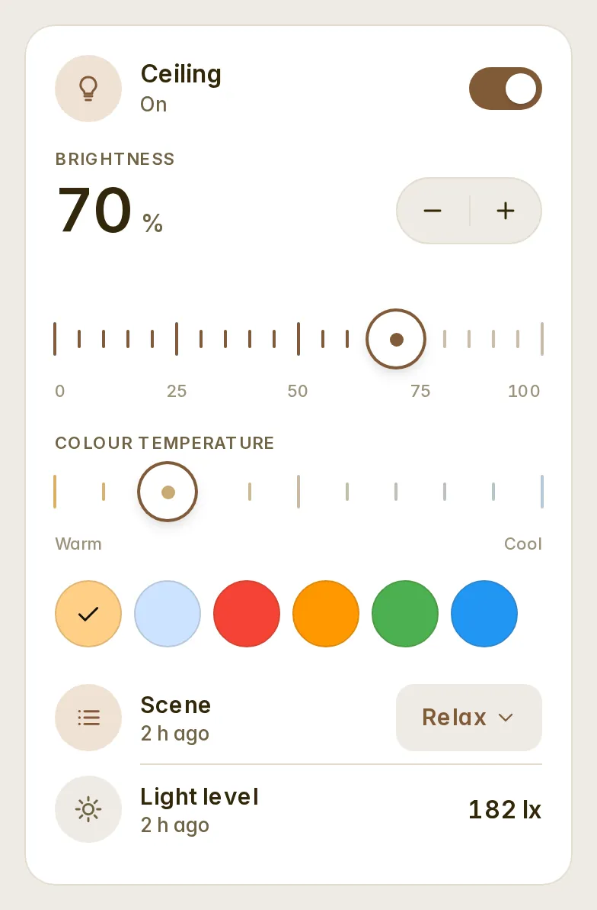</picture></a> | [**Light**](cards/light.md)<br>`custom:fluvy-light-card`<br>[Try it live](https://acosta290.github.io/fluvy/?card=light) | The precision dimmer: relative drag, slide away to slow down, hold for the 1 % scale, colour temperature. |
| <a href="cards/slider.md"><picture><source media="(prefers-color-scheme: dark)" srcset="images/cards/slider-dark.webp"></picture></a> | [**Slider**](cards/slider.md)<br>`custom:fluvy-slider-card`<br>[Try it live](https://acosta290.github.io/fluvy/?card=slider) | Any value on the precision ruler: a player’s volume with its mute, a number or a helper, a fan’s speed, another entity’s switch in its head. |
| <a href="cards/lights.md"><picture><source media="(prefers-color-scheme: dark)" srcset="images/cards/lights-dark.webp"></picture></a> | [**Room lights**](cards/lights.md)<br>`custom:fluvy-lights-card`<br>[Try it live](https://acosta290.github.io/fluvy/?card=lights) | A room’s lights on one card: one tap for the whole room, a round, chip or tile for each light, in its colour. |
| <a href="cards/thermostat.md"><picture><source media="(prefers-color-scheme: dark)" srcset="images/cards/thermostat-dark.webp"></picture></a> | [**Thermostat**](cards/thermostat.md)<br>`custom:fluvy-thermostat-card`<br>[Try it live](https://acosta290.github.io/fluvy/?card=thermostat) | Climate, water heater or humidifier on a dial, with modes, presets and fan speeds. |
| <a href="cards/entities.md"><picture><source media="(prefers-color-scheme: dark)" srcset="images/cards/entities-dark.webp"></picture></a> | [**Entities**](cards/entities.md)<br>`custom:fluvy-entities-card`<br>[Try it live](https://acosta290.github.io/fluvy/?card=entities) | Rows of entities: a switch for what toggles, the value for what is measured. |
| <a href="cards/items.md"><picture><source media="(prefers-color-scheme: dark)" srcset="images/cards/items-dark.webp"></picture></a> | [**Items**](cards/items.md)<br>`custom:fluvy-items-card`<br>[Try it live](https://acosta290.github.io/fluvy/?card=items) | The items of a sensor’s list attribute, a row each — flights overhead, departures, deliveries — with a flights preset for FlightRadar24. |
| <a href="cards/media.md"><picture><source media="(prefers-color-scheme: dark)" srcset="images/cards/media-dark.webp"></picture></a> | [**Media**](cards/media.md)<br>`custom:fluvy-media-card`<br>[Try it live](https://acosta290.github.io/fluvy/?card=media) | A media player: artwork, seek bar, transport and volume — full, compact row or hero. |
| <a href="cards/now-playing.md"><picture><source media="(prefers-color-scheme: dark)" srcset="images/cards/now-playing-dark.webp"></picture></a> | [**Now playing**](cards/now-playing.md)<br>`custom:fluvy-now-playing-card`<br>[Try it live](https://acosta290.github.io/fluvy/?card=now-playing) | The compact player of the home screen: artwork, thin progress, transport and volume. |
| <a href="cards/remote.md"><picture><source media="(prefers-color-scheme: dark)" srcset="images/cards/remote-dark.webp"></picture></a> | [**Remote**](cards/remote.md)<br>`custom:fluvy-remote-card`<br>[Try it live](https://acosta290.github.io/fluvy/?card=remote) | A TV remote in Fluvy’s hand: power, sources, a D-pad with OK, playback, volume routed where you like, channels, the apps with their logos, keys of your own. |
| <a href="cards/cover.md"><picture><source media="(prefers-color-scheme: dark)" srcset="images/cards/cover-dark.webp"></picture></a> | [**Cover**](cards/cover.md)<br>`custom:fluvy-cover-card`<br>[Try it live](https://acosta290.github.io/fluvy/?card=cover) | Blinds, shutters, garage doors and valves: vertical position ruler, tilt, open · stop · close, favourites. |
| <a href="cards/fan.md"><picture><source media="(prefers-color-scheme: dark)" srcset="images/cards/fan-dark.webp"></picture></a> | [**Fan**](cards/fan.md)<br>`custom:fluvy-fan-card`<br>[Try it live](https://acosta290.github.io/fluvy/?card=fan) | Speed ruler with steps, oscillation, direction and presets. |
| <a href="cards/vacuum.md"><picture><source media="(prefers-color-scheme: dark)" srcset="images/cards/vacuum-dark.webp">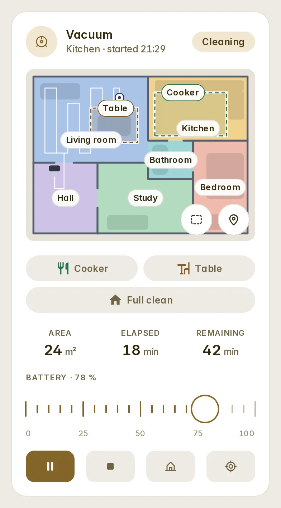</picture></a> | [**Vacuum**](cards/vacuum.md)<br>`custom:fluvy-vacuum-card`<br>[Try it live](https://acosta290.github.io/fluvy/?card=vacuum) | Robot vacuum or mower: battery, start · stop · dock · locate, suction, a drive pad. |
| <a href="cards/lock.md"><picture><source media="(prefers-color-scheme: dark)" srcset="images/cards/lock-dark.webp"></picture></a> | [**Lock**](cards/lock.md)<br>`custom:fluvy-lock-card`<br>[Try it live](https://acosta290.github.io/fluvy/?card=lock) | Slide to unlock, never one accidental tap; codes, jammed state, related rows. |
| <a href="cards/alarm.md"><picture><source media="(prefers-color-scheme: dark)" srcset="images/cards/alarm-dark.webp"></picture></a> | [**Alarm**](cards/alarm.md)<br>`custom:fluvy-alarm-card`<br>[Try it live](https://acosta290.github.io/fluvy/?card=alarm) | Arm modes as tiles and the keypad sheet for codes. |
| <a href="cards/camera.md"><picture><source media="(prefers-color-scheme: dark)" srcset="images/cards/camera-dark.webp"></picture></a> | [**Camera**](cards/camera.md)<br>`custom:fluvy-camera-card`<br>[Try it live](https://acosta290.github.io/fluvy/?card=camera) | A still that refreshes itself, or Home Assistant’s live stream, in the shape you choose; tap for the stream. |
| <a href="cards/cameras.md"><picture><source media="(prefers-color-scheme: dark)" srcset="images/cards/cameras-dark.webp"></picture></a> | [**Cameras**](cards/cameras.md)<br>`custom:fluvy-cameras-card`<br>[Try it live](https://acosta290.github.io/fluvy/?card=cameras) | Several cameras at a glance, each picture live or refreshing itself with its name and what it sees; a sheet of them all. |
| <a href="cards/printer.md"><picture><source media="(prefers-color-scheme: dark)" srcset="images/cards/printer-dark.webp"></picture></a> | [**3D printer**](cards/printer.md)<br>`custom:fluvy-printer-card`<br>[Try it live](https://acosta290.github.io/fluvy/?card=printer) | A 3D printer’s job: progress, time left, heaters, layers, filament and the camera; pause, resume and stop. OctoPrint, PrusaLink, Bambu Lab, Moonraker, Creality, Elegoo, Anycubic, Snapmaker and FlashForge. |
| <a href="cards/appliance.md"><picture><source media="(prefers-color-scheme: dark)" srcset="images/cards/appliance-dark.webp"></picture></a> | [**Appliance**](cards/appliance.md)<br>`custom:fluvy-appliance-card`<br>[Try it live](https://acosta290.github.io/fluvy/?card=appliance) | A washer, dryer, dishwasher, oven, hob, fridge, coffee machine, pet feeder, fountain, litter box or small appliance on a plug, pictured: what it does, when it is ready, what it uses, its reminders. |
| <a href="cards/appliances.md"><picture><source media="(prefers-color-scheme: dark)" srcset="images/cards/appliances-dark.webp"></picture></a> | [**Appliances**](cards/appliances.md)<br>`custom:fluvy-appliances-card`<br>[Try it live](https://acosta290.github.io/fluvy/?card=appliances) | The house’s appliances as live rows, or their whole cards side by side: what runs, what is done, what waits. |
| <a href="cards/vehicle.md"><picture><source media="(prefers-color-scheme: dark)" srcset="images/cards/vehicle-dark.webp">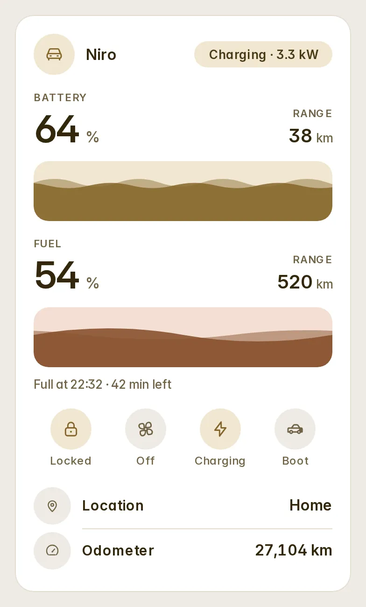</picture></a> | [**Vehicle**](cards/vehicle.md)<br>`custom:fluvy-vehicle-card`<br>[Try it live](https://acosta290.github.io/fluvy/?card=vehicle) | A car, electric, petrol, diesel or plug-in hybrid: its battery or tank, range and charge limit, when it is full, where it is, and its lock, climate, charging, boot and windows in one row. Tesla, BMW, Renault, Volvo, Kia, Hyundai, Volkswagen, Škoda, Polestar, MG, Toyota, Ford, Mercedes-Benz, Peugeot and more. |
| <a href="cards/weather.md"><picture><source media="(prefers-color-scheme: dark)" srcset="images/cards/weather-dark.webp"></picture></a> | [**Weather**](cards/weather.md)<br>`custom:fluvy-weather-card`<br>[Try it live](https://acosta290.github.io/fluvy/?card=weather) | Condition, temperature, feels-like, wind and the daily or hourly forecast. |
| <a href="cards/compass.md"><picture><source media="(prefers-color-scheme: dark)" srcset="images/cards/compass-dark.webp">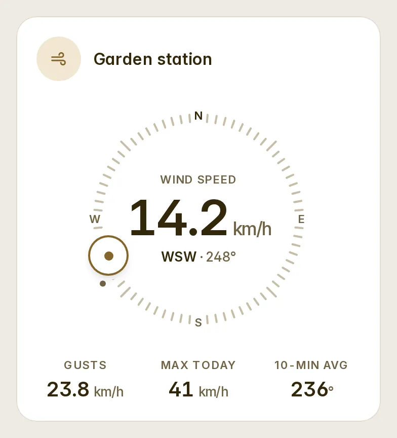</picture></a> | [**Compass**](cards/compass.md)<br>`custom:fluvy-compass-card`<br>[Try it live](https://acosta290.github.io/fluvy/?card=compass) | Wind speed and direction, a vehicle’s heading or any bearing on a 360° compass ring, with a secondary marker and up to three readouts underneath. |
| <a href="cards/sensor.md"><picture><source media="(prefers-color-scheme: dark)" srcset="images/cards/sensor-dark.webp"></picture></a> | [**Sensor**](cards/sensor.md)<br>`custom:fluvy-sensor-card`<br>[Try it live](https://acosta290.github.io/fluvy/?card=sensor) | A sensor with its curve, trend, min, max and average, or up to three sensors on one chart. |
| <a href="cards/readouts.md"><picture><source media="(prefers-color-scheme: dark)" srcset="images/cards/readouts-dark.webp"></picture></a> | [**Readouts**](cards/readouts.md)<br>`custom:fluvy-readouts-card`<br>[Try it live](https://acosta290.github.io/fluvy/?card=readouts) | Up to four values side by side with their trends. |
| <a href="cards/people.md"><picture><source media="(prefers-color-scheme: dark)" srcset="images/cards/people-dark.webp"></picture></a> | [**People**](cards/people.md)<br>`custom:fluvy-people-card`<br>[Try it live](https://acosta290.github.io/fluvy/?card=people) | Who is home: avatars, zones, times and phone batteries, each person with a tap of their own. |
| <a href="cards/openings.md"><picture><source media="(prefers-color-scheme: dark)" srcset="images/cards/openings-dark.webp"></picture></a> | [**Openings**](cards/openings.md)<br>`custom:fluvy-openings-card`<br>[Try it live](https://acosta290.github.io/fluvy/?card=openings) | Doors, windows and motion at a glance, with what is open counted. |
| <a href="cards/alerts.md"><picture><source media="(prefers-color-scheme: dark)" srcset="images/cards/alerts-dark.webp">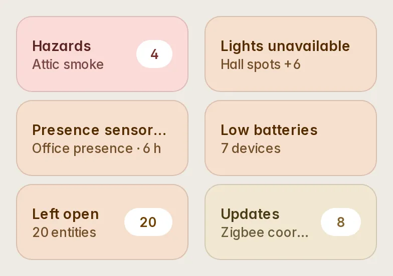</picture></a> | [**Alerts**](cards/alerts.md)<br>`custom:fluvy-alerts-card`<br>[Try it live](https://acosta290.github.io/fluvy/?card=alerts) | What needs a look — low batteries, devices gone, doors left open, leaks, updates, repairs — each from one line, as tiles, chips, rows or a banner, hidden while all is clear. |

## Rooms and the map

| | Card | What it is |
| --- | --- | --- |
| <a href="cards/room.md"><picture><source media="(prefers-color-scheme: dark)" srcset="images/cards/room-dark.webp"></picture></a> | [**Room**](cards/room.md)<br>`custom:fluvy-room-card`<br>[Try it live](https://acosta290.github.io/fluvy/?card=room) | A room of the house from its area: its picture, its climate, what is on, and its controls. |
| <a href="cards/map.md"><picture><source media="(prefers-color-scheme: dark)" srcset="images/cards/map-dark.webp"></picture></a> | [**Map**](cards/map.md)<br>`custom:fluvy-map-card`<br>[Try it live](https://acosta290.github.io/fluvy/?card=map) | Where everyone is: the house’s zones as columns of faces, a row a person, or Home Assistant’s map on a plate. |

## Structure and navigation

| | Card | What it is |
| --- | --- | --- |
| <a href="cards/hello.md"><picture><source media="(prefers-color-scheme: dark)" srcset="images/cards/hello-dark.webp">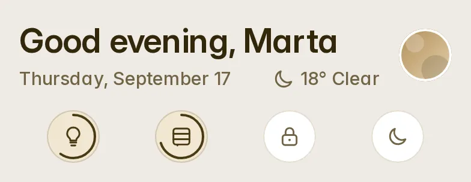</picture></a> | [**Hello**](cards/hello.md)<br>`custom:fluvy-hello-card`<br>[Try it live](https://acosta290.github.io/fluvy/?card=hello) | The greeting: name, date, weather and avatar. |
| <a href="cards/chips.md"><picture><source media="(prefers-color-scheme: dark)" srcset="images/cards/chips-dark.webp">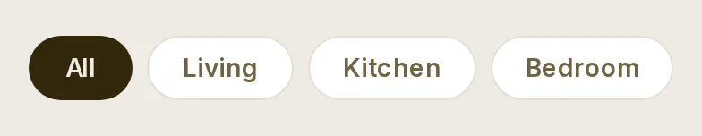</picture></a> | [**Chips**](cards/chips.md)<br>`custom:fluvy-chips-card`<br>[Try it live](https://acosta290.github.io/fluvy/?card=chips) | A row of chips that navigate between views or open entities. |
| <a href="cards/heading.md"><picture><source media="(prefers-color-scheme: dark)" srcset="images/cards/heading-dark.webp"></picture></a> | [**Heading**](cards/heading.md)<br>`custom:fluvy-heading-card`<br>[Try it live](https://acosta290.github.io/fluvy/?card=heading) | A section title with its count and a link. |
| <a href="cards/expander.md"><picture><source media="(prefers-color-scheme: dark)" srcset="images/cards/expander-dark.webp"></picture></a> | [**Expander**](cards/expander.md)<br>`custom:fluvy-expander-card`<br>[Try it live](https://acosta290.github.io/fluvy/?card=expander) | Any cards folded away under a head: a tap opens them, on one surface or each on its own. |
| <a href="cards/swipe.md"><picture><source media="(prefers-color-scheme: dark)" srcset="images/cards/swipe-dark.webp"></picture></a> | [**Swipe**](cards/swipe.md)<br>`custom:fluvy-swipe-card`<br>[Try it live](https://acosta290.github.io/fluvy/?card=swipe) | Any cards, one a page, turned by a swipe or the page marks under them: side by side on a wide screen, round from the last to the first. |
| <a href="cards/web.md"><picture><source media="(prefers-color-scheme: dark)" srcset="images/cards/web-dark.webp"></picture></a> | [**Web page**](cards/web.md)<br>`custom:fluvy-web-card`<br>[Try it live](https://acosta290.github.io/fluvy/?card=web) | A web page on a plate — a map, a chart, a site of your own — under a head, in a frame or bare; sandboxed as Home Assistant’s iframe card is. |

## Scenes, actions and helpers

| | Card | What it is |
| --- | --- | --- |
| <a href="cards/scene.md"><picture><source media="(prefers-color-scheme: dark)" srcset="images/cards/scene-dark.webp"></picture></a> | [**Scene**](cards/scene.md)<br>`custom:fluvy-scene-card`<br>[Try it live](https://acosta290.github.io/fluvy/?card=scene) | One scene, script or button as a tile with a done state. |
| <a href="cards/scenes.md"><picture><source media="(prefers-color-scheme: dark)" srcset="images/cards/scenes-dark.webp"></picture></a> | [**Scenes**](cards/scenes.md)<br>`custom:fluvy-scenes-card`<br>[Try it live](https://acosta290.github.io/fluvy/?card=scenes) | A grid of scenes and scripts. |
| <a href="cards/actions.md"><picture><source media="(prefers-color-scheme: dark)" srcset="images/cards/actions-dark.webp"></picture></a> | [**Actions**](cards/actions.md)<br>`custom:fluvy-actions-card`<br>[Try it live](https://acosta290.github.io/fluvy/?card=actions) | Buttons and scripts as a list with run buttons. |
| <a href="cards/helpers.md"><picture><source media="(prefers-color-scheme: dark)" srcset="images/cards/helpers-dark.webp"></picture></a> | [**Helpers**](cards/helpers.md)<br>`custom:fluvy-helpers-card`<br>[Try it live](https://acosta290.github.io/fluvy/?card=helpers) | Numbers, selects, texts, booleans and dates as their own controls. |
| <a href="cards/todo.md"><picture><source media="(prefers-color-scheme: dark)" srcset="images/cards/todo-dark.webp"></picture></a> | [**To-do**](cards/todo.md)<br>`custom:fluvy-todo-card`<br>[Try it live](https://acosta290.github.io/fluvy/?card=todo) | A to-do list: check, add, hide the done. |
| <a href="cards/timer.md"><picture><source media="(prefers-color-scheme: dark)" srcset="images/cards/timer-dark.webp">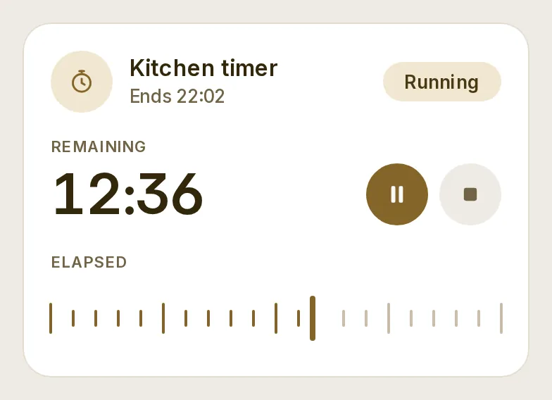</picture></a> | [**Timer**](cards/timer.md)<br>`custom:fluvy-timer-card`<br>[Try it live](https://acosta290.github.io/fluvy/?card=timer) | A timer counting down live, with pause and cancel. |
| <a href="cards/updates.md"><picture><source media="(prefers-color-scheme: dark)" srcset="images/cards/updates-dark.webp"></picture></a> | [**Updates**](cards/updates.md)<br>`custom:fluvy-updates-card`<br>[Try it live](https://acosta290.github.io/fluvy/?card=updates) | Pending updates with install buttons and progress. |
| <a href="cards/automations.md"><picture><source media="(prefers-color-scheme: dark)" srcset="images/cards/automations-dark.webp"></picture></a> | [**Automations**](cards/automations.md)<br>`custom:fluvy-automations-card`<br>[Try it live](https://acosta290.github.io/fluvy/?card=automations) | Every automation of the house: on or off, run, last and next run; schedules written as native automations, created and edited in a sheet. |

## Energy

| | Card | What it is |
| --- | --- | --- |
| <a href="cards/energy-period.md"><picture><source media="(prefers-color-scheme: dark)" srcset="images/cards/energy-period-dark.webp"></picture></a> | [**Energy period**](cards/energy-period.md)<br>`custom:fluvy-energy-period-card`<br>[Try it live](https://acosta290.github.io/fluvy/?card=energy-period) | The view’s date picker as a strip: ‹ the day, week, month or year › and back to today, Home Assistant’s own, so its energy cards follow it as Fluvy’s do. |
| <a href="cards/energy-usage.md"><picture><source media="(prefers-color-scheme: dark)" srcset="images/cards/energy-usage-dark.webp"></picture></a> | [**Energy usage**](cards/energy-usage.md)<br>`custom:fluvy-energy-usage-card`<br>[Try it live](https://acosta290.github.io/fluvy/?card=energy-usage) | Electricity, water or gas used by the hour, the day or the month, stacked by source or meter. |
| <a href="cards/energy.md"><picture><source media="(prefers-color-scheme: dark)" srcset="images/cards/energy-dark.webp"></picture></a> | [**Energy**](cards/energy.md)<br>`custom:fluvy-energy-card`<br>[Try it live](https://acosta290.github.io/fluvy/?card=energy) | Power right now, the day curve and the energy legend. |
| <a href="cards/energy-flow.md"><picture><source media="(prefers-color-scheme: dark)" srcset="images/cards/energy-flow-dark.webp"></picture></a> | [**Energy flow**](cards/energy-flow.md)<br>`custom:fluvy-energy-flow-card`<br>[Try it live](https://acosta290.github.io/fluvy/?card=energy-flow) | Where the house’s energy comes from and where it goes, live or over a period: import and export at once, every source, lanes in their origin’s colour. |
| <a href="cards/energy-balance.md"><picture><source media="(prefers-color-scheme: dark)" srcset="images/cards/energy-balance-dark.webp"></picture></a> | [**Energy balance**](cards/energy-balance.md)<br>`custom:fluvy-energy-balance-card`<br>[Try it live](https://acosta290.github.io/fluvy/?card=energy-balance) | What comes in against what goes out, live or over a period: the house is the remainder, so the totals agree; each phase of the grid, and the money. |
| <a href="cards/grid.md"><picture><source media="(prefers-color-scheme: dark)" srcset="images/cards/grid-dark.webp"></picture></a> | [**Grid**](cards/grid.md)<br>`custom:fluvy-grid-card`<br>[Try it live](https://acosta290.github.io/fluvy/?card=grid) | The grid right now: the net import or export, in and out at once, each phase with its voltage, the price and today’s totals. |
| <a href="cards/batteries.md"><picture><source media="(prefers-color-scheme: dark)" srcset="images/cards/batteries-dark.webp">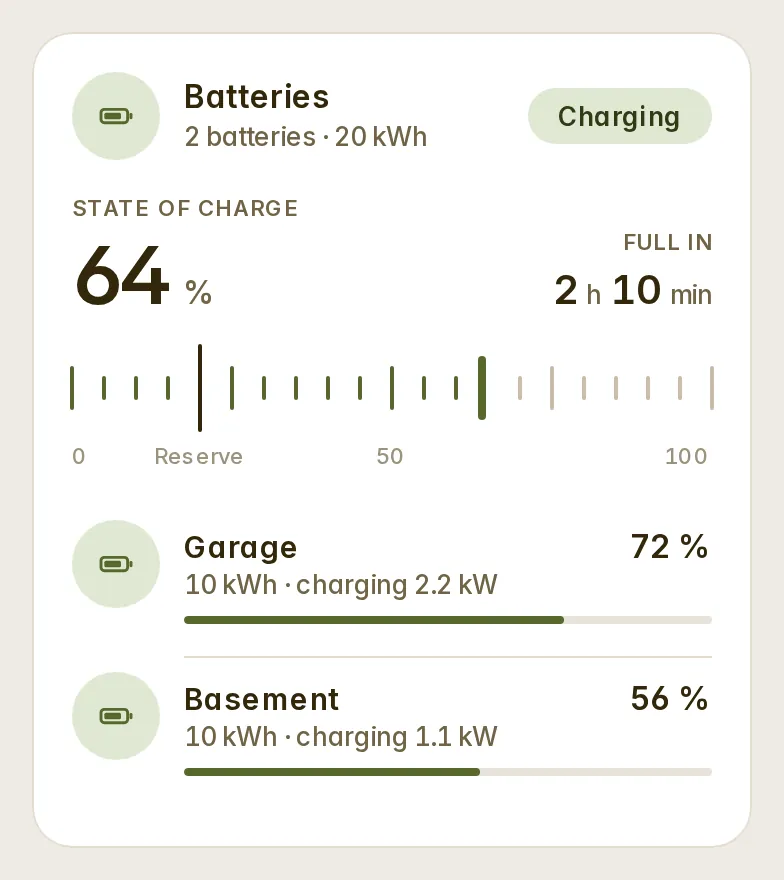</picture></a> | [**Batteries**](cards/batteries.md)<br>`custom:fluvy-batteries-card`<br>[Try it live](https://acosta290.github.io/fluvy/?card=batteries) | The house’s batteries as one: their state of charge, full or empty in, the reserve on the ruler, a row per battery and their mode. |
| <a href="cards/ev-charger.md"><picture><source media="(prefers-color-scheme: dark)" srcset="images/cards/ev-charger-dark.webp">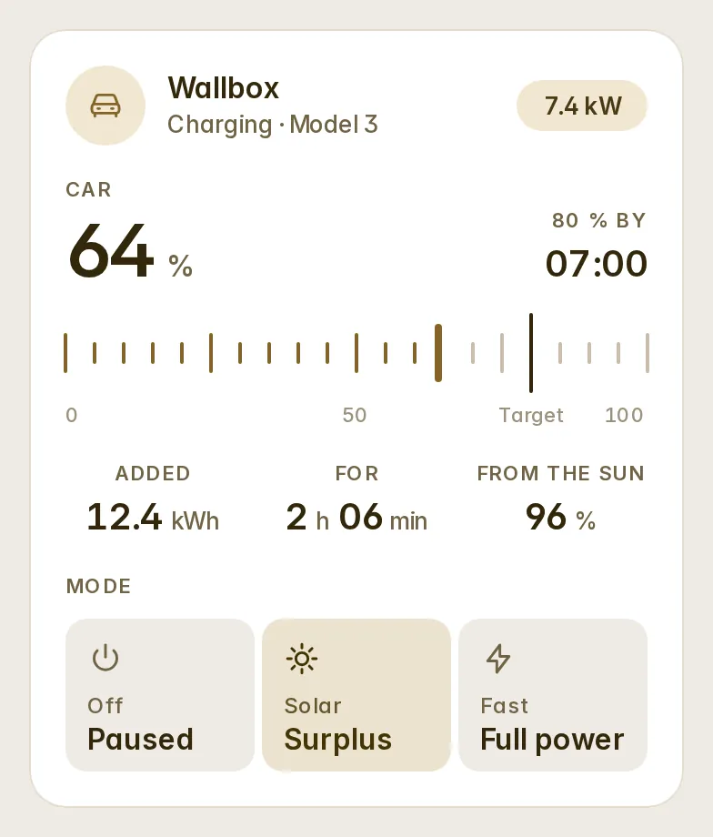</picture></a> | [**Car charger**](cards/ev-charger.md)<br>`custom:fluvy-ev-charger-card`<br>[Try it live](https://acosta290.github.io/fluvy/?card=ev-charger) | The car on its charger: its charge against the target, ready by when, what the session added and how much of it came from the sun, the charging mode. |
| <a href="cards/energy-sankey.md"><picture><source media="(prefers-color-scheme: dark)" srcset="images/cards/energy-sankey-dark.webp">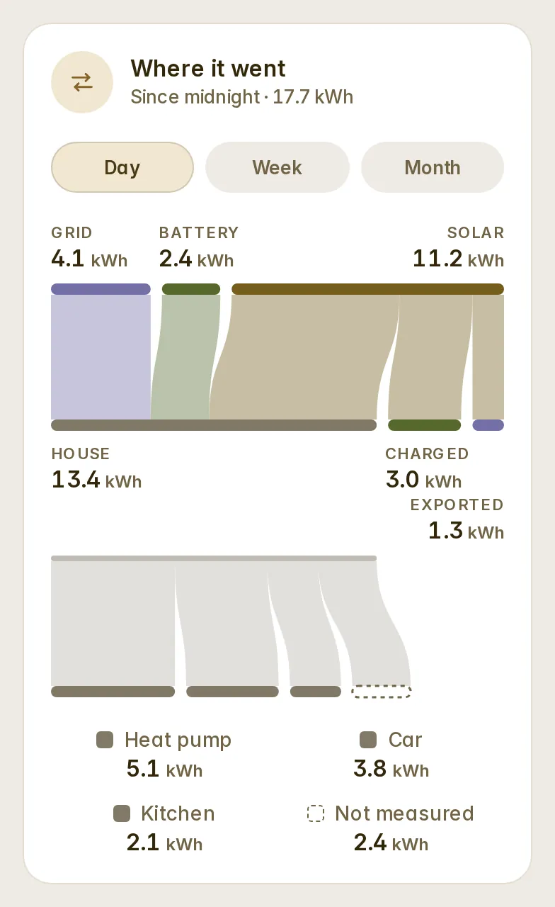</picture></a> | [**Where it went**](cards/energy-sankey.md)<br>`custom:fluvy-energy-sankey-card`<br>[Try it live](https://acosta290.github.io/fluvy/?card=energy-sankey) | A day, week or month of energy from where to where, in true proportions: the grid, the battery and the sun into the house, the charge and the export, and the house into its devices. |
| <a href="cards/energy-score.md"><picture><source media="(prefers-color-scheme: dark)" srcset="images/cards/energy-score-dark.webp"></picture></a> | [**Energy score**](cards/energy-score.md)<br>`custom:fluvy-energy-score-card`<br>[Try it live](https://acosta290.github.io/fluvy/?card=energy-score) | Self-powered, sun used and low-carbon as rings, the Energy dashboard’s own gauges, over imported, exported and net. |
| <a href="cards/energy-devices.md"><picture><source media="(prefers-color-scheme: dark)" srcset="images/cards/energy-devices-dark.webp"></picture></a> | [**Energy devices**](cards/energy-devices.md)<br>`custom:fluvy-energy-devices-card`<br>[Try it live](https://acosta290.github.io/fluvy/?card=energy-devices) | Where the energy goes, device by device on one scale: nested circuits, and what no meter measures. |
| <a href="cards/meters.md"><picture><source media="(prefers-color-scheme: dark)" srcset="images/cards/meters-dark.webp"></picture></a> | [**Water & gas**](cards/meters.md)<br>`custom:fluvy-meters-card`<br>[Try it live](https://acosta290.github.io/fluvy/?card=meters) | Today’s water and gas against a typical day, what flows right now, and a leak sensor or a valve beside them. |
| <a href="cards/gauge.md"><picture><source media="(prefers-color-scheme: dark)" srcset="images/cards/gauge-dark.webp"></picture></a> | [**Gauge**](cards/gauge.md)<br>`custom:fluvy-gauge-card`<br>[Try it live](https://acosta290.github.io/fluvy/?card=gauge) | A ring gauge for any numeric sensor with min, max and average, or centred on zero for a meter that runs both ways. |
| <a href="cards/stat-tiles.md"><picture><source media="(prefers-color-scheme: dark)" srcset="images/cards/stat-tiles-dark.webp"></picture></a> | [**Stat tiles**](cards/stat-tiles.md)<br>`custom:fluvy-stat-tiles-card`<br>[Try it live](https://acosta290.github.io/fluvy/?card=stat-tiles) | A headline value and a grid of stat tiles. |
| <a href="cards/production.md"><picture><source media="(prefers-color-scheme: dark)" srcset="images/cards/production-dark.webp"></picture></a> | [**Production**](cards/production.md)<br>`custom:fluvy-production-card`<br>[Try it live](https://acosta290.github.io/fluvy/?card=production) | Hourly production bars with the forecast behind, stacked per array when there are several. |
| <a href="cards/history-bars.md"><picture><source media="(prefers-color-scheme: dark)" srcset="images/cards/history-bars-dark.webp"></picture></a> | [**History bars**](cards/history-bars.md)<br>`custom:fluvy-history-bars-card`<br>[Try it live](https://acosta290.github.io/fluvy/?card=history-bars) | A sensor’s last days, weeks or months as bars from its long-term statistics: the total and the average in the head, the value over each bar, and a strip of facts under them — the highest and lowest, or what it comes to in CO₂, trees, kilometres or money. |
| <a href="cards/chart.md"><picture><source media="(prefers-color-scheme: dark)" srcset="images/cards/chart-dark.webp"></picture></a> | [**Chart**](cards/chart.md)<br>`custom:fluvy-chart-card`<br>[Try it live](https://acosta290.github.io/fluvy/?card=chart) | Any time series on one chart — history, statistics, a list in an attribute (Nordpool’s prices, a solar forecast) or a weather’s forecast — past to future with now marked, thresholds in their colours and the cheapest hours found. |
| <a href="cards/bars.md"><picture><source media="(prefers-color-scheme: dark)" srcset="images/cards/bars-dark.webp"></picture></a> | [**Bars**](cards/bars.md)<br>`custom:fluvy-bars-card`<br>[Try it live](https://acosta290.github.io/fluvy/?card=bars) | Rows with a bar each: plants, batteries, strings, levels. |
| <a href="cards/distribution.md"><picture><source media="(prefers-color-scheme: dark)" srcset="images/cards/distribution-dark.webp"></picture></a> | [**Distribution**](cards/distribution.md)<br>`custom:fluvy-distribution-card`<br>[Try it live](https://acosta290.github.io/fluvy/?card=distribution) | One stacked bar and a legend: who draws what. |
| <a href="cards/humidity.md"><picture><source media="(prefers-color-scheme: dark)" srcset="images/cards/humidity-dark.webp">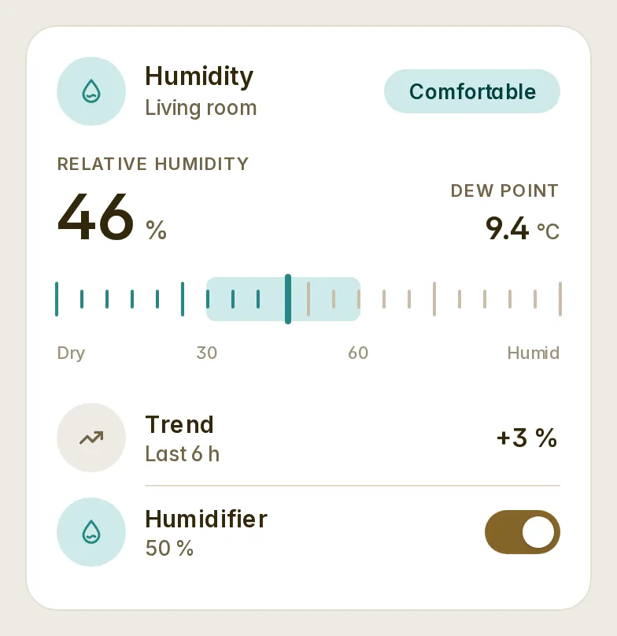</picture></a> | [**Humidity**](cards/humidity.md)<br>`custom:fluvy-humidity-card`<br>[Try it live](https://acosta290.github.io/fluvy/?card=humidity) | Humidity on a comfort band, with dew point and trend. |

## Time

| | Card | What it is |
| --- | --- | --- |
| <a href="cards/clock.md"><picture><source media="(prefers-color-scheme: dark)" srcset="images/cards/clock-dark.webp"></picture></a> | [**Clock**](cards/clock.md)<br>`custom:fluvy-clock-card`<br>[Try it live](https://acosta290.github.io/fluvy/?card=clock) | Analog or digital, hero, side or tile, with or without weather. |
| <a href="cards/calendar.md"><picture><source media="(prefers-color-scheme: dark)" srcset="images/cards/calendar-dark.webp"></picture></a> | [**Calendar**](cards/calendar.md)<br>`custom:fluvy-calendar-card`<br>[Try it live](https://acosta290.github.io/fluvy/?card=calendar) | Agenda, month, week, month + day, timeline, upcoming or tile. |

<!-- /generated:cards -->

## A minimal card

```yaml
type: custom:fluvy-tile-card
entity: light.living_room_lamp
```

Open the editor on it to see every option the tile offers — size, readouts, the tap action — with its default.

## Where they are used

The [automatic dashboard](automatic-dashboard.md) puts every one of these cards to use in a house that has one of
everything; its tests hold that promise. The [design language](../design/language.md) is what each card is built and
reviewed against.
