<!-- Generated by `pnpm docs:cards` from the catalogue and the gallery (tools/docs/src/pages.ts): change those, not this page. -->

# The cards

Sixty-seven cards, each in the card picker as **Fluvy · …** with a live preview and an editor. Every card has a page of its own: its picture, an example in YAML, a picture of each of its layouts, a YAML with every option, and what each option does. [The live demo](https://acosta290.github.io/fluvy/) has each one to try.

In YAML a card is `type: custom:fluvy-<name>-card` plus the entity or entities it draws and any of its options; an option left at its default is left out.

- [Options every card takes](customising.md#options-every-card-takes): names, icons, colours, actions, how an unavailable entity looks
- [Customising the cards](customising.md): details sheets, templates, conditions, groups by room, pictures of your own, a state’s colour, thresholds
- [Energy](energy.md), [the automatic dashboards](automatic-dashboard.md) and [the theme](theme.md): the cards at work together

[Everyday](#everyday) · [Rooms and the map](#rooms-and-the-map) · [Structure and navigation](#structure-and-navigation) · [Scenes, actions and helpers](#scenes-actions-and-helpers) · [Energy](#energy) · [Time](#time)

## Everyday

<table>
<tbody><tr>
<td align="center" valign="top" width="33%"><a href="cards/tile.md"><picture><source media="(prefers-color-scheme: dark)" srcset="images/cards/thumbs/tile-dark.webp">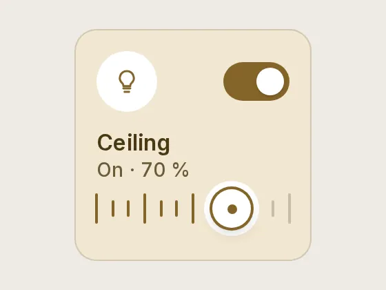</picture> <b>Tile</b></a> A light, switch, cover, fan, player, number or sensor as a tile: large with a precision ruler or two readouts, compact row, or mini.</td>
<td align="center" valign="top" width="33%"><a href="cards/tiles.md"><picture><source media="(prefers-color-scheme: dark)" srcset="images/cards/thumbs/tiles-dark.webp">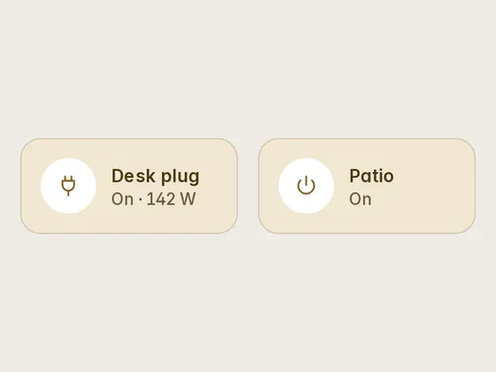</picture> <b>Tiles</b></a> A group of compact or mini tiles, two to four per row, 8 px apart.</td>
<td align="center" valign="top" width="33%"><a href="cards/template.md"><picture><source media="(prefers-color-scheme: dark)" srcset="images/cards/thumbs/template-dark.webp">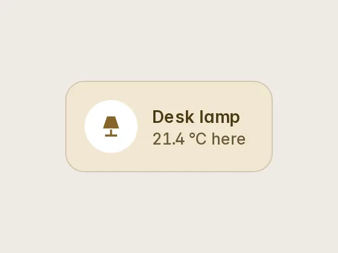</picture> <b>Template</b></a> A tile whose name, line, icon, colour and fill are templates, with or without an entity; a Mushroom template card pastes in.</td>
</tr></tbody>
<tbody><tr>
<td align="center" valign="top" width="33%"><a href="cards/light.md"><picture><source media="(prefers-color-scheme: dark)" srcset="images/cards/thumbs/light-dark.webp">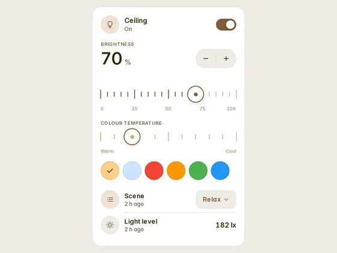</picture> <b>Light</b></a> The precision dimmer: relative drag, slide away to slow down, hold for the 1 % scale, colour temperature.</td>
<td align="center" valign="top" width="33%"><a href="cards/slider.md"><picture><source media="(prefers-color-scheme: dark)" srcset="images/cards/thumbs/slider-dark.webp">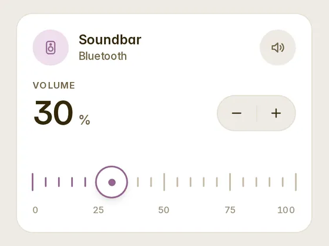</picture> <b>Slider</b></a> Any value on the precision ruler: a player’s volume with its mute, a number or a helper, a fan’s speed, another entity’s switch in its head.</td>
<td align="center" valign="top" width="33%"><a href="cards/lights.md"><picture><source media="(prefers-color-scheme: dark)" srcset="images/cards/thumbs/lights-dark.webp">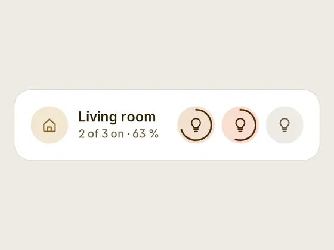</picture> <b>Room lights</b></a> A room’s lights on one card: one tap for the whole room, a round, chip or tile for each light, in its colour.</td>
</tr></tbody>
<tbody><tr>
<td align="center" valign="top" width="33%"><a href="cards/thermostat.md"><picture><source media="(prefers-color-scheme: dark)" srcset="images/cards/thumbs/thermostat-dark.webp">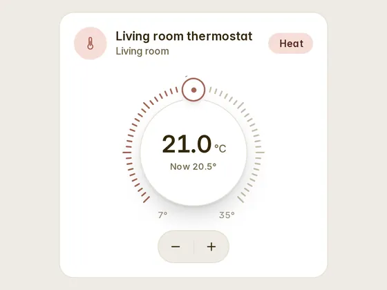</picture> <b>Thermostat</b></a> Climate, water heater or humidifier on a dial, with modes, presets and fan speeds.</td>
<td align="center" valign="top" width="33%"><a href="cards/entities.md"><picture><source media="(prefers-color-scheme: dark)" srcset="images/cards/thumbs/entities-dark.webp">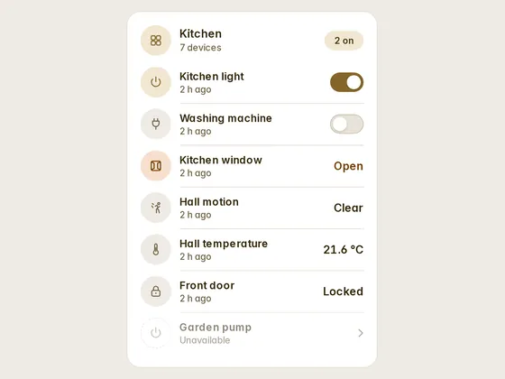</picture> <b>Entities</b></a> Rows of entities: a switch for what toggles, the value for what is measured.</td>
<td align="center" valign="top" width="33%"><a href="cards/items.md"><picture><source media="(prefers-color-scheme: dark)" srcset="images/cards/thumbs/items-dark.webp">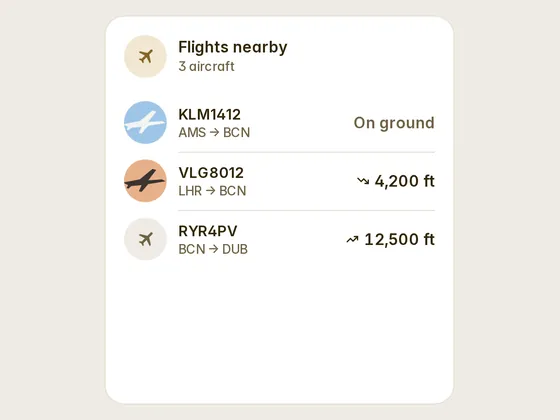</picture> <b>Items</b></a> The items of a sensor’s list attribute, a row each — flights overhead, departures, deliveries — with a flights preset for FlightRadar24.</td>
</tr></tbody>
<tbody><tr>
<td align="center" valign="top" width="33%"><a href="cards/media.md"><picture><source media="(prefers-color-scheme: dark)" srcset="images/cards/thumbs/media-dark.webp">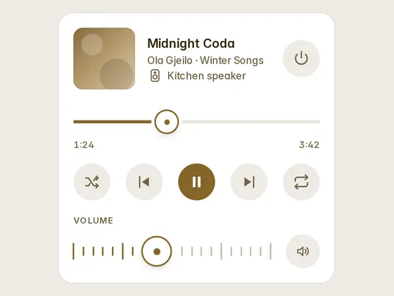</picture> <b>Media</b></a> A media player: artwork, seek bar, transport and volume — full, compact row or hero.</td>
<td align="center" valign="top" width="33%"><a href="cards/now-playing.md"><picture><source media="(prefers-color-scheme: dark)" srcset="images/cards/thumbs/now-playing-dark.webp">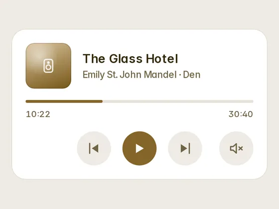</picture> <b>Now playing</b></a> The compact player of the home screen: artwork, thin progress, transport and volume.</td>
<td align="center" valign="top" width="33%"><a href="cards/remote.md"><picture><source media="(prefers-color-scheme: dark)" srcset="images/cards/thumbs/remote-dark.webp">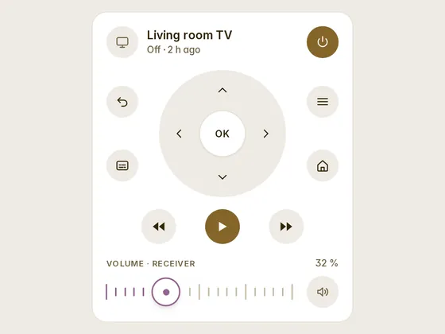</picture> <b>Remote</b></a> A TV remote in Fluvy’s hand: power, sources, a D-pad with OK, playback, volume routed where you like, channels, the apps with their logos, keys of your own.</td>
</tr></tbody>
<tbody><tr>
<td align="center" valign="top" width="33%"><a href="cards/cover.md"><picture><source media="(prefers-color-scheme: dark)" srcset="images/cards/thumbs/cover-dark.webp">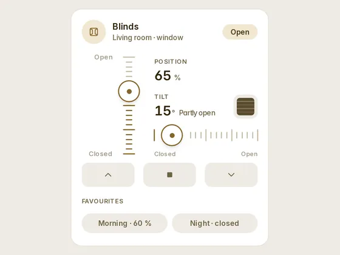</picture> <b>Cover</b></a> Blinds, shutters, garage doors and valves: vertical position ruler, tilt, open · stop · close, favourites.</td>
<td align="center" valign="top" width="33%"><a href="cards/fan.md"><picture><source media="(prefers-color-scheme: dark)" srcset="images/cards/thumbs/fan-dark.webp">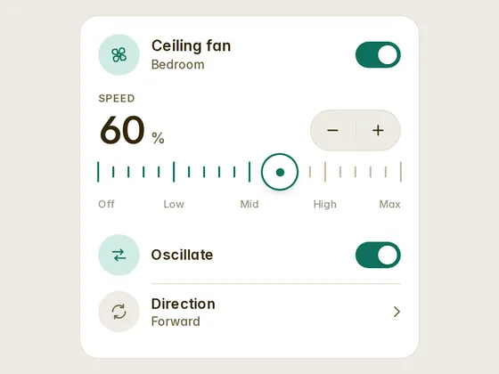</picture> <b>Fan</b></a> Speed ruler with steps, oscillation, direction and presets.</td>
<td align="center" valign="top" width="33%"><a href="cards/vacuum.md"><picture><source media="(prefers-color-scheme: dark)" srcset="images/cards/thumbs/vacuum-dark.webp">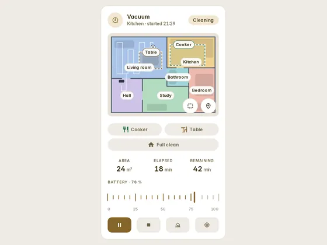</picture> <b>Vacuum</b></a> Robot vacuum or mower: battery, start · stop · dock · locate, suction, a drive pad.</td>
</tr></tbody>
<tbody><tr>
<td align="center" valign="top" width="33%"><a href="cards/lock.md"><picture><source media="(prefers-color-scheme: dark)" srcset="images/cards/thumbs/lock-dark.webp">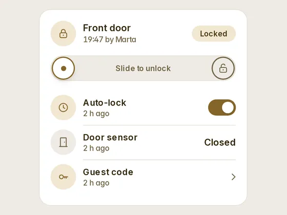</picture> <b>Lock</b></a> Slide to unlock, never one accidental tap; codes, jammed state, related rows.</td>
<td align="center" valign="top" width="33%"><a href="cards/alarm.md"><picture><source media="(prefers-color-scheme: dark)" srcset="images/cards/thumbs/alarm-dark.webp">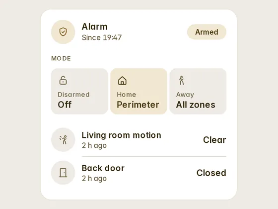</picture> <b>Alarm</b></a> Arm modes as tiles and the keypad sheet for codes.</td>
<td align="center" valign="top" width="33%"><a href="cards/camera.md"><picture><source media="(prefers-color-scheme: dark)" srcset="images/cards/thumbs/camera-dark.webp">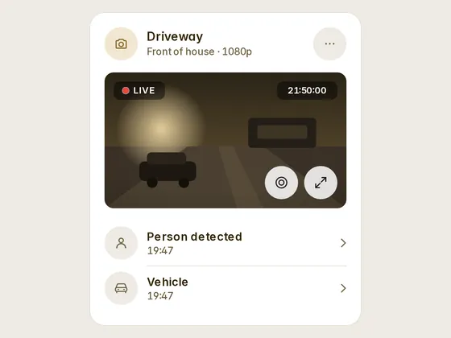</picture> <b>Camera</b></a> A still that refreshes itself, or Home Assistant’s live stream, in the shape you choose; tap for the stream.</td>
</tr></tbody>
<tbody><tr>
<td align="center" valign="top" width="33%"><a href="cards/cameras.md"><picture><source media="(prefers-color-scheme: dark)" srcset="images/cards/thumbs/cameras-dark.webp">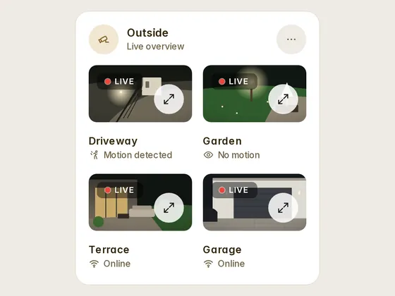</picture> <b>Cameras</b></a> Several cameras at a glance, each picture live or refreshing itself with its name and what it sees; a sheet of them all.</td>
<td align="center" valign="top" width="33%"><a href="cards/printer.md"><picture><source media="(prefers-color-scheme: dark)" srcset="images/cards/thumbs/printer-dark.webp">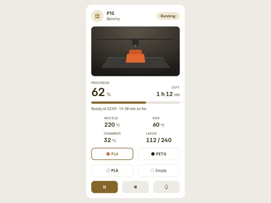</picture> <b>3D printer</b></a> A 3D printer’s job: progress, time left, heaters, layers, filament and the camera; pause, resume and stop. OctoPrint, PrusaLink, Bambu Lab, Moonraker, Creality, Elegoo, Anycubic, Snapmaker and FlashForge.</td>
<td align="center" valign="top" width="33%"><a href="cards/appliance.md"><picture><source media="(prefers-color-scheme: dark)" srcset="images/cards/thumbs/appliance-dark.webp">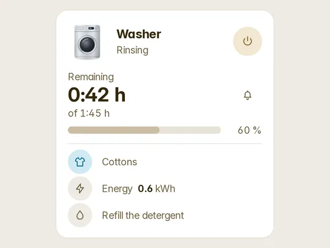</picture> <b>Appliance</b></a> A washer, dryer, dishwasher, oven, hob, fridge, coffee machine, pet feeder, fountain, litter box or small appliance on a plug, pictured: what it does, when it is ready, what it uses, its reminders.</td>
</tr></tbody>
<tbody><tr>
<td align="center" valign="top" width="33%"><a href="cards/appliances.md"><picture><source media="(prefers-color-scheme: dark)" srcset="images/cards/thumbs/appliances-dark.webp">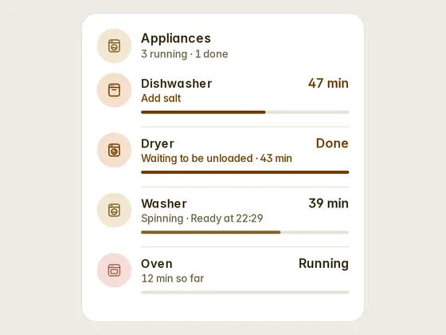</picture> <b>Appliances</b></a> The house’s appliances as live rows, or their whole cards side by side: what runs, what is done, what waits.</td>
<td align="center" valign="top" width="33%"><a href="cards/vehicle.md"><picture><source media="(prefers-color-scheme: dark)" srcset="images/cards/thumbs/vehicle-dark.webp">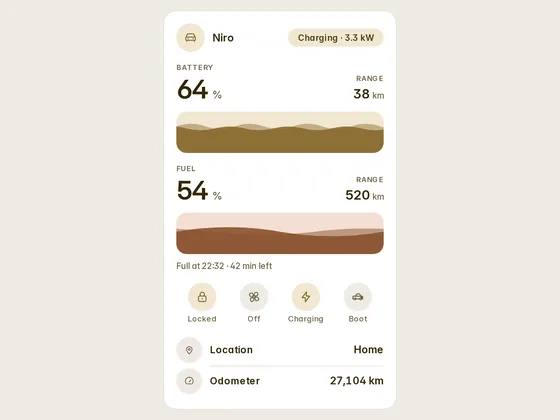</picture> <b>Vehicle</b></a> A car, electric, petrol, diesel or plug-in hybrid: its battery or tank, range and charge limit, when it is full, where it is, and its lock, climate, charging, boot and windows in one row. Tesla, BMW, Renault, Volvo, Kia, Hyundai, Volkswagen, Škoda, Polestar, MG, Toyota, Ford, Mercedes-Benz, Peugeot and more.</td>
<td align="center" valign="top" width="33%"><a href="cards/weather.md"><picture><source media="(prefers-color-scheme: dark)" srcset="images/cards/thumbs/weather-dark.webp">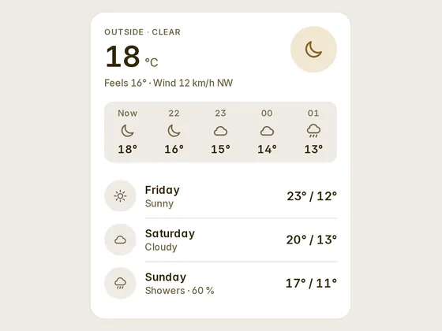</picture> <b>Weather</b></a> Condition, temperature, feels-like, wind and the daily or hourly forecast.</td>
</tr></tbody>
<tbody><tr>
<td align="center" valign="top" width="33%"><a href="cards/sensor.md"><picture><source media="(prefers-color-scheme: dark)" srcset="images/cards/thumbs/sensor-dark.webp">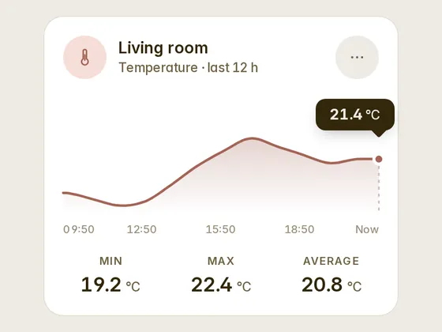</picture> <b>Sensor</b></a> A sensor with its curve, trend, min, max and average, or up to three sensors on one chart.</td>
<td align="center" valign="top" width="33%"><a href="cards/readouts.md"><picture><source media="(prefers-color-scheme: dark)" srcset="images/cards/thumbs/readouts-dark.webp">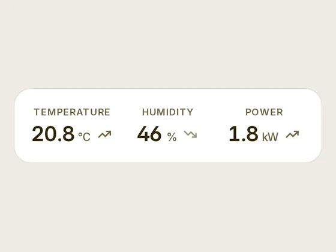</picture> <b>Readouts</b></a> Up to four values side by side with their trends.</td>
<td align="center" valign="top" width="33%"><a href="cards/people.md"><picture><source media="(prefers-color-scheme: dark)" srcset="images/cards/thumbs/people-dark.webp">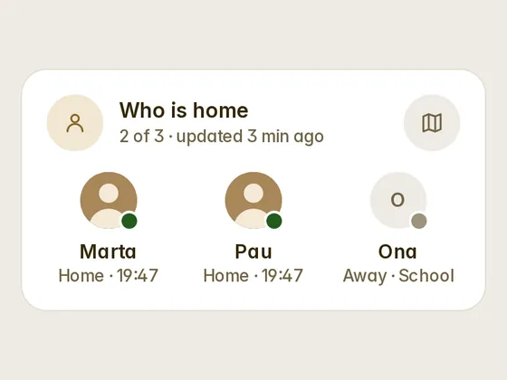</picture> <b>People</b></a> Who is home: avatars, zones, times and phone batteries, each person with a tap of their own.</td>
</tr></tbody>
<tbody><tr>
<td align="center" valign="top" width="33%"><a href="cards/openings.md"><picture><source media="(prefers-color-scheme: dark)" srcset="images/cards/thumbs/openings-dark.webp">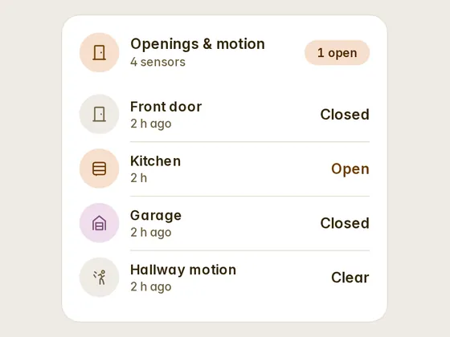</picture> <b>Openings</b></a> Doors, windows and motion at a glance, with what is open counted.</td>
<td align="center" valign="top" width="33%"><a href="cards/alerts.md"><picture><source media="(prefers-color-scheme: dark)" srcset="images/cards/thumbs/alerts-dark.webp">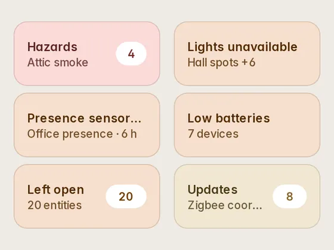</picture> <b>Alerts</b></a> What needs a look — low batteries, devices gone, doors left open, leaks, updates, repairs — each from one line, as tiles, chips, rows or a banner, hidden while all is clear.</td>
<td align="center" valign="top" width="33%"></td>
</tr></tbody>
</table>

## Rooms and the map

<table>
<tbody><tr>
<td align="center" valign="top" width="33%"><a href="cards/room.md"><picture><source media="(prefers-color-scheme: dark)" srcset="images/cards/thumbs/room-dark.webp"></picture> <b>Room</b></a> A room of the house from its area: its picture, its climate, what is on, and its controls.</td>
<td align="center" valign="top" width="33%"><a href="cards/map.md"><picture><source media="(prefers-color-scheme: dark)" srcset="images/cards/thumbs/map-dark.webp">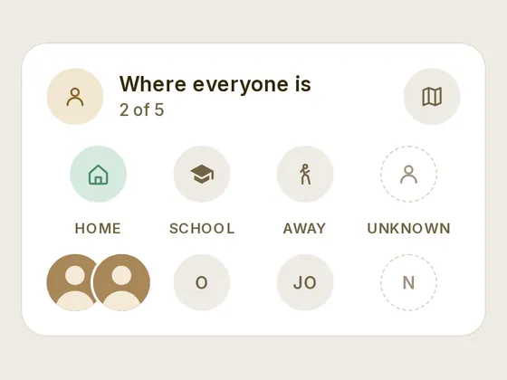</picture> <b>Map</b></a> Where everyone is: the house’s zones as columns of faces, a row a person, or Home Assistant’s map on a plate.</td>
<td align="center" valign="top" width="33%"></td>
</tr></tbody>
</table>

## Structure and navigation

<table>
<tbody><tr>
<td align="center" valign="top" width="33%"><a href="cards/hello.md"><picture><source media="(prefers-color-scheme: dark)" srcset="images/cards/thumbs/hello-dark.webp"></picture> <b>Hello</b></a> The greeting: name, date, weather and avatar.</td>
<td align="center" valign="top" width="33%"><a href="cards/chips.md"><picture><source media="(prefers-color-scheme: dark)" srcset="images/cards/thumbs/chips-dark.webp">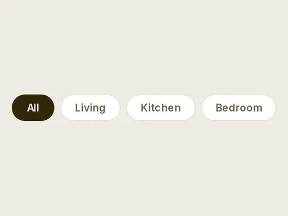</picture> <b>Chips</b></a> A row of chips that navigate between views or open entities.</td>
<td align="center" valign="top" width="33%"><a href="cards/heading.md"><picture><source media="(prefers-color-scheme: dark)" srcset="images/cards/thumbs/heading-dark.webp">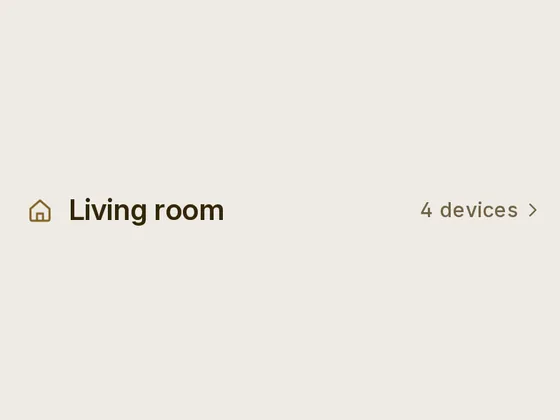</picture> <b>Heading</b></a> A section title with its count and a link.</td>
</tr></tbody>
<tbody><tr>
<td align="center" valign="top" width="33%"><a href="cards/expander.md"><picture><source media="(prefers-color-scheme: dark)" srcset="images/cards/thumbs/expander-dark.webp">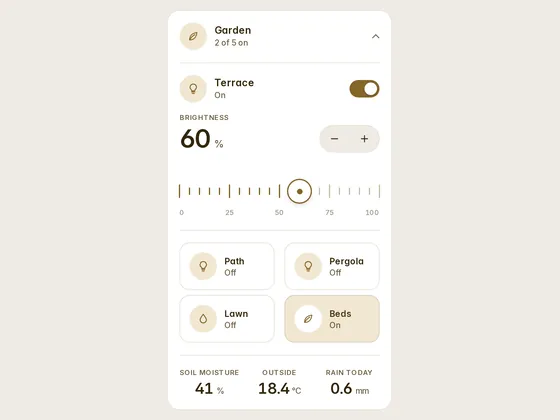</picture> <b>Expander</b></a> Any cards folded away under a head: a tap opens them, on one surface or each on its own.</td>
<td align="center" valign="top" width="33%"><a href="cards/swipe.md"><picture><source media="(prefers-color-scheme: dark)" srcset="images/cards/thumbs/swipe-dark.webp">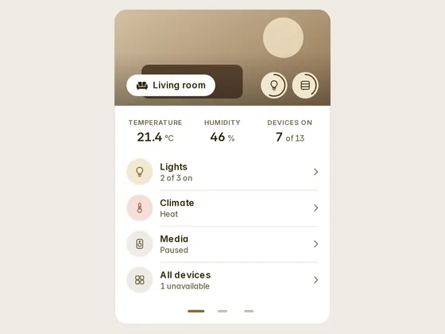</picture> <b>Swipe</b></a> Any cards, one a page, turned by a swipe or the page marks under them: side by side on a wide screen, round from the last to the first.</td>
<td align="center" valign="top" width="33%"><a href="cards/web.md"><picture><source media="(prefers-color-scheme: dark)" srcset="images/cards/thumbs/web-dark.webp">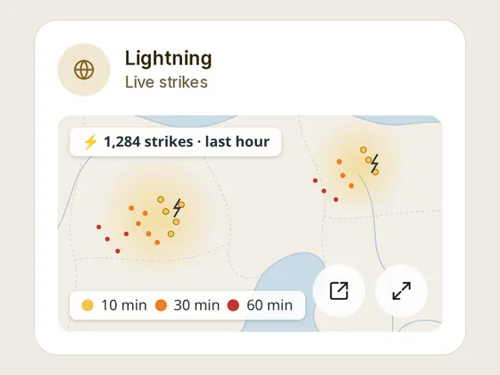</picture> <b>Web page</b></a> A web page on a plate — a map, a chart, a site of your own — under a head, in a frame or bare; sandboxed as Home Assistant’s iframe card is.</td>
</tr></tbody>
</table>

## Scenes, actions and helpers

<table>
<tbody><tr>
<td align="center" valign="top" width="33%"><a href="cards/scene.md"><picture><source media="(prefers-color-scheme: dark)" srcset="images/cards/thumbs/scene-dark.webp">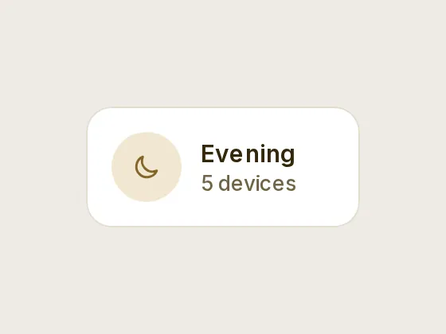</picture> <b>Scene</b></a> One scene, script or button as a tile with a done state.</td>
<td align="center" valign="top" width="33%"><a href="cards/scenes.md"><picture><source media="(prefers-color-scheme: dark)" srcset="images/cards/thumbs/scenes-dark.webp">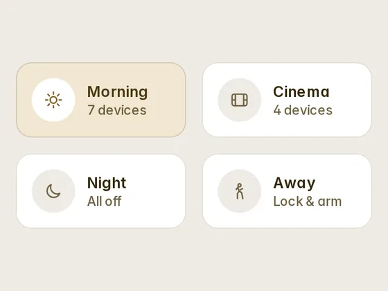</picture> <b>Scenes</b></a> A grid of scenes and scripts.</td>
<td align="center" valign="top" width="33%"><a href="cards/actions.md"><picture><source media="(prefers-color-scheme: dark)" srcset="images/cards/thumbs/actions-dark.webp">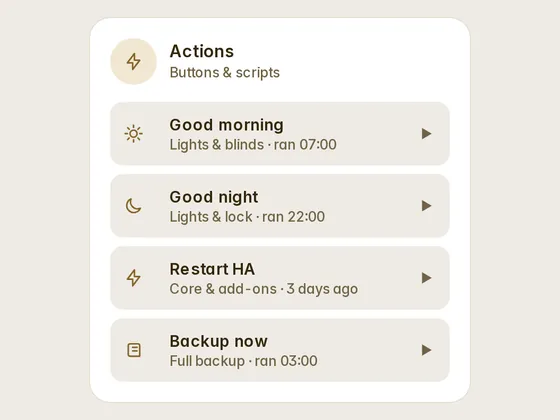</picture> <b>Actions</b></a> Buttons and scripts as a list with run buttons.</td>
</tr></tbody>
<tbody><tr>
<td align="center" valign="top" width="33%"><a href="cards/helpers.md"><picture><source media="(prefers-color-scheme: dark)" srcset="images/cards/thumbs/helpers-dark.webp">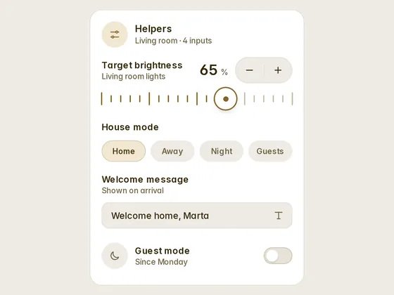</picture> <b>Helpers</b></a> Numbers, selects, texts, booleans and dates as their own controls.</td>
<td align="center" valign="top" width="33%"><a href="cards/todo.md"><picture><source media="(prefers-color-scheme: dark)" srcset="images/cards/thumbs/todo-dark.webp">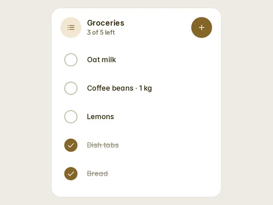</picture> <b>To-do</b></a> A to-do list: check, add, hide the done.</td>
<td align="center" valign="top" width="33%"><a href="cards/timer.md"><picture><source media="(prefers-color-scheme: dark)" srcset="images/cards/thumbs/timer-dark.webp">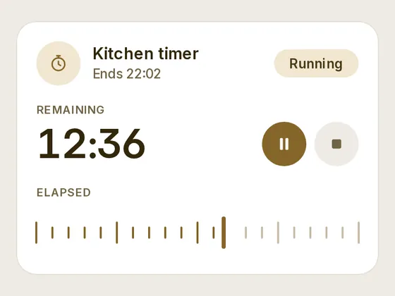</picture> <b>Timer</b></a> A timer counting down live, with pause and cancel.</td>
</tr></tbody>
<tbody><tr>
<td align="center" valign="top" width="33%"><a href="cards/updates.md"><picture><source media="(prefers-color-scheme: dark)" srcset="images/cards/thumbs/updates-dark.webp">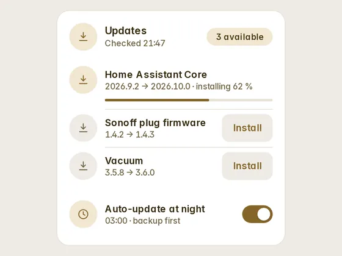</picture> <b>Updates</b></a> Pending updates with install buttons and progress.</td>
<td align="center" valign="top" width="33%"><a href="cards/automations.md"><picture><source media="(prefers-color-scheme: dark)" srcset="images/cards/thumbs/automations-dark.webp">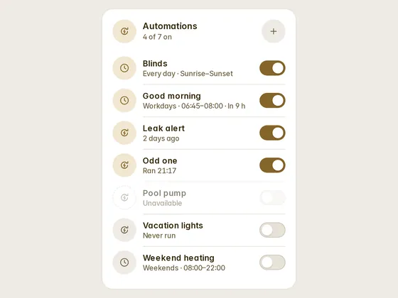</picture> <b>Automations</b></a> Every automation of the house: on or off, run, last and next run; schedules written as native automations, created and edited in a sheet.</td>
<td align="center" valign="top" width="33%"></td>
</tr></tbody>
</table>

## Energy

<table>
<tbody><tr>
<td align="center" valign="top" width="33%"><a href="cards/energy-period.md"><picture><source media="(prefers-color-scheme: dark)" srcset="images/cards/thumbs/energy-period-dark.webp">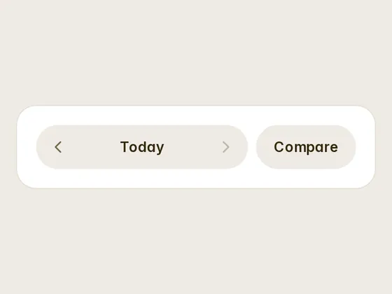</picture> <b>Energy period</b></a> The view’s date picker as a strip: ‹ the day, week, month or year › and back to today, Home Assistant’s own, so its energy cards follow it as Fluvy’s do.</td>
<td align="center" valign="top" width="33%"><a href="cards/energy-usage.md"><picture><source media="(prefers-color-scheme: dark)" srcset="images/cards/thumbs/energy-usage-dark.webp">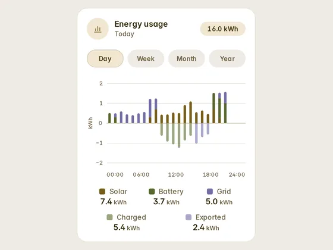</picture> <b>Energy usage</b></a> Electricity, water or gas used by the hour, the day or the month, stacked by source or meter.</td>
<td align="center" valign="top" width="33%"><a href="cards/energy.md"><picture><source media="(prefers-color-scheme: dark)" srcset="images/cards/thumbs/energy-dark.webp">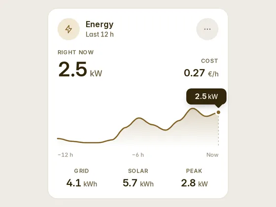</picture> <b>Energy</b></a> Power right now, the day curve and the energy legend.</td>
</tr></tbody>
<tbody><tr>
<td align="center" valign="top" width="33%"><a href="cards/energy-flow.md"><picture><source media="(prefers-color-scheme: dark)" srcset="images/cards/thumbs/energy-flow-dark.webp">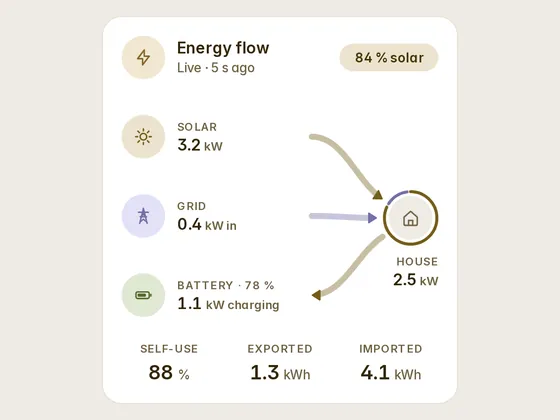</picture> <b>Energy flow</b></a> Where the house’s energy comes from and where it goes, live or over a period: import and export at once, every source, lanes in their origin’s colour.</td>
<td align="center" valign="top" width="33%"><a href="cards/energy-balance.md"><picture><source media="(prefers-color-scheme: dark)" srcset="images/cards/thumbs/energy-balance-dark.webp">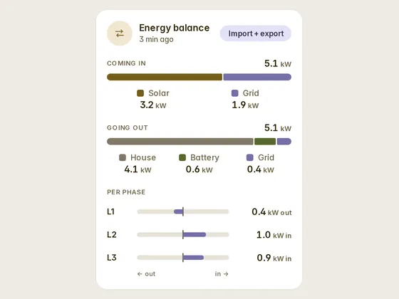</picture> <b>Energy balance</b></a> What comes in against what goes out, live or over a period: the house is the remainder, so the totals agree; each phase of the grid, and the money.</td>
<td align="center" valign="top" width="33%"><a href="cards/grid.md"><picture><source media="(prefers-color-scheme: dark)" srcset="images/cards/thumbs/grid-dark.webp">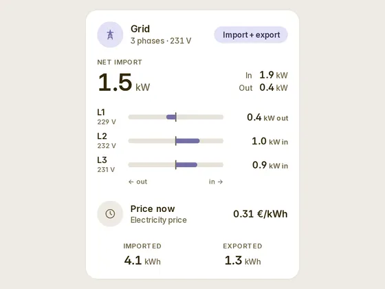</picture> <b>Grid</b></a> The grid right now: the net import or export, in and out at once, each phase with its voltage, the price and today’s totals.</td>
</tr></tbody>
<tbody><tr>
<td align="center" valign="top" width="33%"><a href="cards/batteries.md"><picture><source media="(prefers-color-scheme: dark)" srcset="images/cards/thumbs/batteries-dark.webp">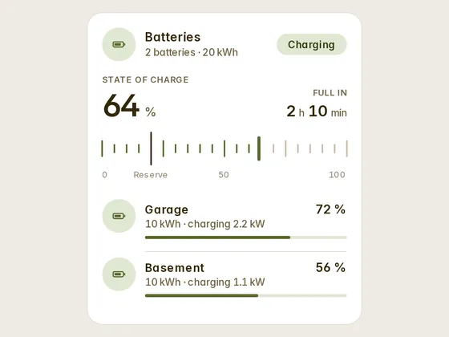</picture> <b>Batteries</b></a> The house’s batteries as one: their state of charge, full or empty in, the reserve on the ruler, a row per battery and their mode.</td>
<td align="center" valign="top" width="33%"><a href="cards/ev-charger.md"><picture><source media="(prefers-color-scheme: dark)" srcset="images/cards/thumbs/ev-charger-dark.webp"></picture> <b>Car charger</b></a> The car on its charger: its charge against the target, ready by when, what the session added and how much of it came from the sun, the charging mode.</td>
<td align="center" valign="top" width="33%"><a href="cards/energy-sankey.md"><picture><source media="(prefers-color-scheme: dark)" srcset="images/cards/thumbs/energy-sankey-dark.webp"></picture> <b>Where it went</b></a> A day, week or month of energy from where to where, in true proportions: the grid, the battery and the sun into the house, the charge and the export, and the house into its devices.</td>
</tr></tbody>
<tbody><tr>
<td align="center" valign="top" width="33%"><a href="cards/energy-score.md"><picture><source media="(prefers-color-scheme: dark)" srcset="images/cards/thumbs/energy-score-dark.webp"></picture> <b>Energy score</b></a> Self-powered, sun used and low-carbon as rings, the Energy dashboard’s own gauges, over imported, exported and net.</td>
<td align="center" valign="top" width="33%"><a href="cards/energy-devices.md"><picture><source media="(prefers-color-scheme: dark)" srcset="images/cards/thumbs/energy-devices-dark.webp"></picture> <b>Energy devices</b></a> Where the energy goes, device by device on one scale: nested circuits, and what no meter measures.</td>
<td align="center" valign="top" width="33%"><a href="cards/meters.md"><picture><source media="(prefers-color-scheme: dark)" srcset="images/cards/thumbs/meters-dark.webp"></picture> <b>Water &amp; gas</b></a> Today’s water and gas against a typical day, what flows right now, and a leak sensor or a valve beside them.</td>
</tr></tbody>
<tbody><tr>
<td align="center" valign="top" width="33%"><a href="cards/gauge.md"><picture><source media="(prefers-color-scheme: dark)" srcset="images/cards/thumbs/gauge-dark.webp"></picture> <b>Gauge</b></a> A ring gauge for any numeric sensor with min, max and average, or centred on zero for a meter that runs both ways.</td>
<td align="center" valign="top" width="33%"><a href="cards/stat-tiles.md"><picture><source media="(prefers-color-scheme: dark)" srcset="images/cards/thumbs/stat-tiles-dark.webp"></picture> <b>Stat tiles</b></a> A headline value and a grid of stat tiles.</td>
<td align="center" valign="top" width="33%"><a href="cards/production.md"><picture><source media="(prefers-color-scheme: dark)" srcset="images/cards/thumbs/production-dark.webp"></picture> <b>Production</b></a> Hourly production bars with the forecast behind, stacked per array when there are several.</td>
</tr></tbody>
<tbody><tr>
<td align="center" valign="top" width="33%"><a href="cards/history-bars.md"><picture><source media="(prefers-color-scheme: dark)" srcset="images/cards/thumbs/history-bars-dark.webp"></picture> <b>History bars</b></a> A sensor’s last days, weeks or months as bars from its long-term statistics: the total and the average in the head, the value over each bar, and a strip of facts under them — the highest and lowest, or what it comes to in CO₂, trees, kilometres or money.</td>
<td align="center" valign="top" width="33%"><a href="cards/chart.md"><picture><source media="(prefers-color-scheme: dark)" srcset="images/cards/thumbs/chart-dark.webp"></picture> <b>Chart</b></a> Any time series on one chart — history, statistics, a list in an attribute (Nordpool’s prices, a solar forecast) or a weather’s forecast — past to future with now marked, thresholds in their colours and the cheapest hours found.</td>
<td align="center" valign="top" width="33%"><a href="cards/bars.md"><picture><source media="(prefers-color-scheme: dark)" srcset="images/cards/thumbs/bars-dark.webp"></picture> <b>Bars</b></a> Rows with a bar each: plants, batteries, strings, levels.</td>
</tr></tbody>
<tbody><tr>
<td align="center" valign="top" width="33%"><a href="cards/distribution.md"><picture><source media="(prefers-color-scheme: dark)" srcset="images/cards/thumbs/distribution-dark.webp"></picture> <b>Distribution</b></a> One stacked bar and a legend: who draws what.</td>
<td align="center" valign="top" width="33%"><a href="cards/humidity.md"><picture><source media="(prefers-color-scheme: dark)" srcset="images/cards/thumbs/humidity-dark.webp"></picture> <b>Humidity</b></a> Humidity on a comfort band, with dew point and trend.</td>
<td align="center" valign="top" width="33%"></td>
</tr></tbody>
</table>

## Time

<table>
<tbody><tr>
<td align="center" valign="top" width="33%"><a href="cards/clock.md"><picture><source media="(prefers-color-scheme: dark)" srcset="images/cards/thumbs/clock-dark.webp"></picture> <b>Clock</b></a> Analog or digital, hero, side or tile, with or without weather.</td>
<td align="center" valign="top" width="33%"><a href="cards/calendar.md"><picture><source media="(prefers-color-scheme: dark)" srcset="images/cards/thumbs/calendar-dark.webp"></picture> <b>Calendar</b></a> Agenda, month, week, month + day, timeline, upcoming or tile.</td>
<td align="center" valign="top" width="33%"></td>
</tr></tbody>
</table>
