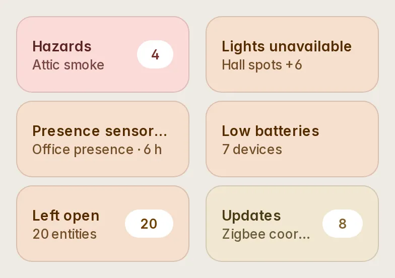
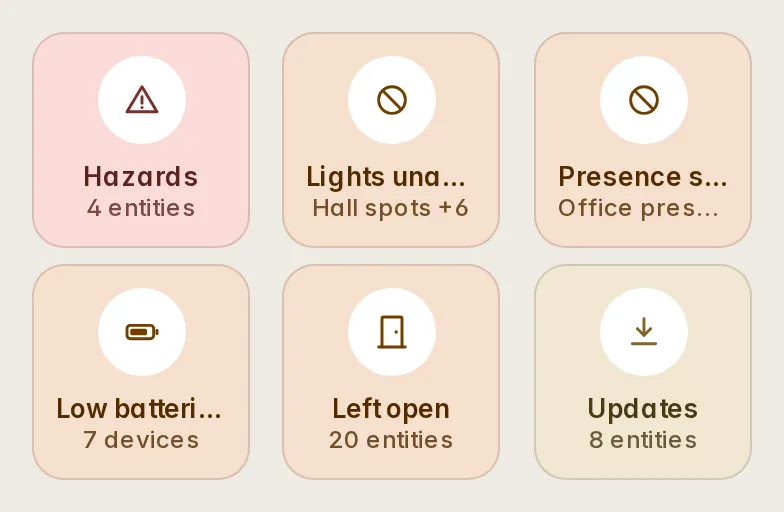
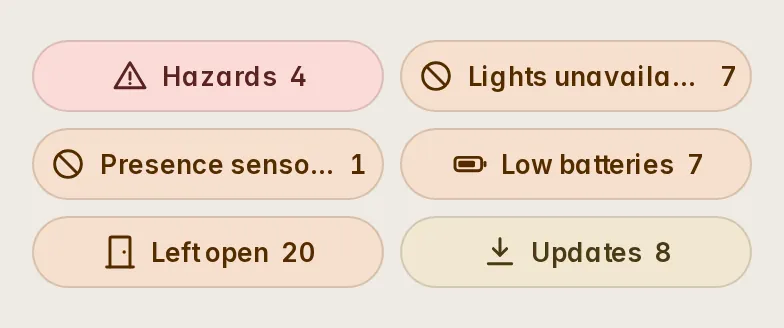
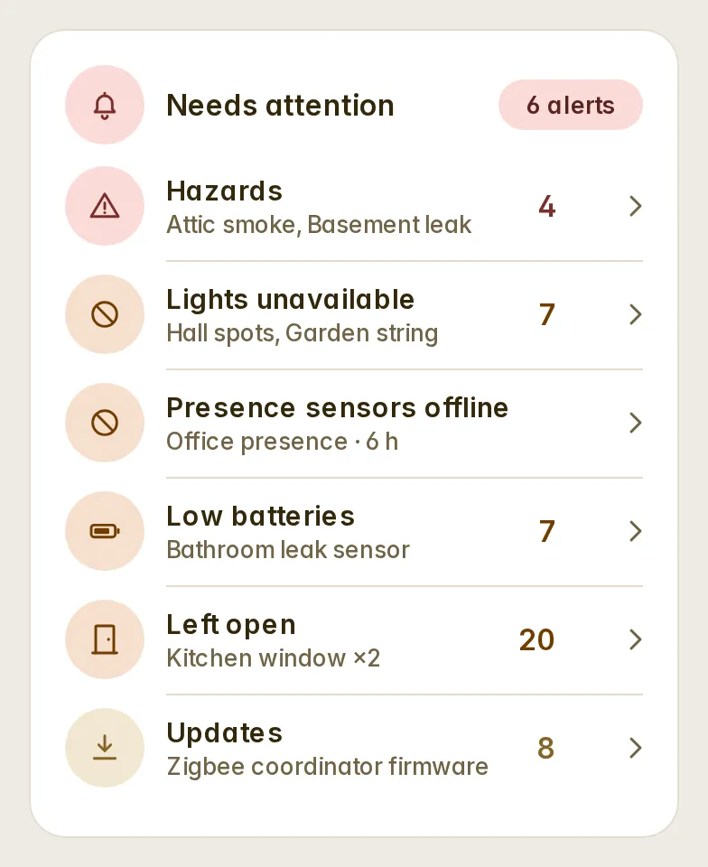
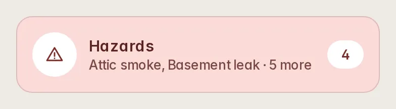

<!-- Generated by `pnpm docs:cards` from the card’s editor, its example in tools/docs/src/gallery.ts and its guide in tools/docs/guides/: change those, not this page. -->

# Alerts

What needs a look — low batteries, devices gone, doors left open, leaks, updates, repairs — each from one line, as tiles, chips, rows or a banner, hidden while all is clear.

`custom:fluvy-alerts-card` · [Try it live](https://acosta290.github.io/fluvy/?card=alerts) · [All cards](../cards.md#everyday)

<picture><source media="(prefers-color-scheme: dark)" srcset="../images/cards/alerts-dark.webp"></picture>

## Example

```yaml
type: custom:fluvy-alerts-card
alerts:
  - preset: hazards
    id: hazards
  - preset: unavailable
    domain: light
    name: Lights unavailable
    id: lights
  - preset: unavailable
    device_class:
      - occupancy
      - presence
      - motion
    name: Presence sensors offline
    id: presence
  - preset: low_battery
    id: batteries
  - preset: open
    for:
      minutes: 5
    id: open
  - preset: updates
    id: updates
```

The picture above, on the demo house: put your own entities in place of its.

## Layouts

`variant` chooses the layout. The picture above is `tiles`, the default; each of the others is the example plus the line over it, and opens in the live demo.

<table>
<tbody><tr>
<td align="center" valign="top" width="50%"><code>variant: mini</code><br><a href="https://acosta290.github.io/fluvy/?card=alerts&amp;layout=mini"><picture><source media="(prefers-color-scheme: dark)" srcset="../images/cards/alerts.mini-dark.webp"></picture></a></td>
<td align="center" valign="top" width="50%"><code>variant: chips</code><br><a href="https://acosta290.github.io/fluvy/?card=alerts&amp;layout=chips"><picture><source media="(prefers-color-scheme: dark)" srcset="../images/cards/alerts.chips-dark.webp"></picture></a></td>
</tr></tbody>
<tbody><tr>
<td align="center" valign="top" width="50%"><code>variant: rows</code><br><a href="https://acosta290.github.io/fluvy/?card=alerts&amp;layout=rows"><picture><source media="(prefers-color-scheme: dark)" srcset="../images/cards/alerts.rows-dark.webp"></picture></a></td>
<td align="center" valign="top" width="50%"><code>variant: banner</code><br><a href="https://acosta290.github.io/fluvy/?card=alerts&amp;layout=banner"><picture><source media="(prefers-color-scheme: dark)" srcset="../images/cards/alerts.banner-dark.webp"></picture></a></td>
</tr></tbody>
</table>

## All options

```yaml
type: custom:fluvy-alerts-card
# title:
# subtitle:
variant: tiles
columns: 2
# icon:
show_icon: auto
show_count: true
show_culprit: true
show_duration: true
compact: false
order: severity
rotate: 6
snooze: user
# max_alerts:
# empty_text:
hide_empty: true
# tone:
# color:
# card_color:
# card_opacity: 100
# card_border: true
# unavailable: dashed
# tap_action:
# hold_action:
# double_tap_action:
#   action: none
alerts:
  - preset: hazards
    id: hazards
  - preset: unavailable
    domain: light
    name: Lights unavailable
    id: lights
  - preset: unavailable
    device_class:
      - occupancy
      - presence
      - motion
    name: Presence sensors offline
    id: presence
  - preset: low_battery
    id: batteries
  - preset: open
    for:
      minutes: 5
    id: open
  - preset: updates
    id: updates
```

## Options

| Option | Default | What it does |
| --- | --- | --- |
| `title` |  | The title at the top of the card. |
| `subtitle` |  | The line under the title: your own words, an entity’s state or a template. |
| `variant` | `tiles` | The card’s layout. `tiles` · `mini` · `chips` · `rows` · `banner`. |
| `columns` | `2` | How many tiles stand in a row. `1` · `2` · `3` · `4` · `auto`. |
| `icon` |  | The card’s icon, in place of the entity’s own. |
| `show_count` | `true` | Shows how many each alert matches. |
| `show_culprit` | `true` | Names what each alert is about ("Hall sensor, Porch +1"). |
| `show_duration` | `true` | Says how long each alert has held ("Front door · 6 min"). |
| `compact` | `false` | Draws shorter rows that leave out who is at fault. |
| `order` | `severity` | Orders the alerts by severity, or as they are listed. `severity` (By severity) · `config` (As listed). |
| `rotate` | `6` | How many seconds the banner shows an alert before it turns to the next. 0 to 60. |
| `snooze` | `user` | Where snoozed alerts are remembered: each person’s, this device’s, the house’s, or nowhere. `user` (Each person) · `device` (This device) · `house` (The whole house) · `off`. |
| `max_alerts` |  | The most alerts shown at once; the rest fold into a "+N". 1 to 30. |
| `empty_text` |  | What the card says while it has nothing to show. |
| `hide_empty` | `true` | Hides the whole card while it has nothing to show. |
| [`alerts`](#alerts) |  | The alerts, each a ready-made one or your own, by what it matches. A list: [its items](#alerts). |

<details>
<summary>Its look and its actions, as on every card</summary>

| Option | Default | What it does |
| --- | --- | --- |
| `show_icon` | `auto` | Shows the icon, hides it, or lets the card decide. `auto` · `always` · `never`. |
| `name_lines` | `1` | Lets the name in the card’s head take two balanced lines where one would cut it; the head is a line taller whatever the name. `1` · `2`. |
| `tone` | the card’s own | The card’s colour from the palette’s tones; left out, the tone of what it shows. `accent` · `light` · `heat` · `cool` · `dry` · `fan` · `water` · `solar` · `grid` · `media` · `presence` · `armed` · `battery` · `house` · `gas` · `vehicle` (Car) · `neutral` · `ok` (Good) · `warning` · `danger`. |
| `color` |  | The card’s colour: its circle, its accents and its tints wear it. Left out, the colour of what it shows. |
| `card_color` |  | Paints the card’s surface in a colour of your own. |
| `card_opacity` | `100` | How solid the card’s surface is, in percent: under 100 the view’s background shows through. Left out, the house’s. 0 % to 100 %, in steps of 5. |
| `card_border` | `true` | Whether the card draws its hairline border. Left out, the house’s. |
| `unavailable` | `dashed` | How the card looks while its entity is unavailable: dashed, or quiet as when it is off. Left out, the house’s. `dashed` · `quiet` (As when off). |
| **Interactions** |  |  |
| `tap_action` | the card’s own | What a tap on the card does. |
| `hold_action` | the card’s own | What a long press on the card does. |
| `double_tap_action` | `none` | What two taps on the card do. |

More about them in [Options every card takes](../customising.md#options-every-card-takes).

</details>

## Lists

### `alerts`

An item is a map with `preset` and any of these fields.

| Field | What it does |
| --- | --- |
| `preset` | A ready-made alert, or one of your own. `low_battery` (Low batteries) · `unavailable` · `open` (Left open) · `unlocked` · `hazards` · `errors` · `updates` · `lights_on` · `ha_alerts` (Home Assistant alerts) · `repairs` · `custom`. |
| `name` | The alert’s name. |
| `icon` | The item’s own icon, in place of the one the card would give it. |
| `secondary` | The message under the alert’s name. |
| `severity` | How grave the alert is: critical, a warning, or information. `critical` · `warning` · `info`, or your own. |
| `tone` | The item’s colour from the palette’s tones. `accent` · `light` · `heat` · `cool` · `dry` · `fan` · `water` · `solar` · `grid` · `media` · `presence` · `armed` · `battery` · `house` · `gas` · `vehicle` (Car) · `neutral` · `ok` (Good) · `warning` · `danger`. |
| `color` | The item’s colour, in place of the one the card gives it. |
| `entity` | Counts only these entities. A list of entities. |
| `domain` | Counts only the entities of these domains. A list. |
| `device_class` | Counts only the entities of these device classes. A list. |
| `entity_id` | Counts the entities whose ids match these patterns. |
| `integration` | Counts only the entities of these integrations. A list. |
| `state` | Counts an entity whose state is one of these. A list. |
| `not_state` | Counts an entity whose state is none of these. A list. |
| `above` | Counts an entity whose state, or the attribute named, is above this number. |
| `below` | Counts an entity whose state, or the attribute named, is below this number. |
| `attribute` | The attribute that is compared, in place of the state. |
| `attributes` | Attributes each entity must have, with the values they may hold. |
| `phones` | Counts phones’ batteries too. `true` or `false`. |
| `acknowledged` | Counts Home Assistant’s alerts that were acknowledged too. `true` or `false`. |
| `area` | Counts only the entities of this area. |
| `floor` | Counts only the entities of these floors. |
| `label` | Counts only the entities with this label. |
| `device` | Counts only the entities of these devices. |
| `exclude` | Never counts these entities. A list of entities. |
| `for` | Counts an entity only once it has matched for this long. |
| `unchanged_for` | Counts an entity whose state has not changed for this long. |
| `since` | Where the time the alert began is read from. |
| `include_unavailable` | Counts unavailable and unknown entities too. `true` or `false`. |
| `hidden` | Counts hidden entities too. `true` or `false`. |
| `diagnostic` | Counts diagnostic entities too. `true` or `false`. |
| `count_by` | Counts the entities, or the devices they belong to. `entity` · `device`. |
| `min_count` | Shows the alert from this many matches up. 1 to 100. |
| `name_by` | What each row is named by: the entity, its device, its area, or an attribute. `entity` · `device` · `area`, or your own. |
| `sort_rows` | The order of the alert’s rows. `duration` (Longest first) · `value` (Lowest first) · `name` · `area`. |
| `split` | Makes an alert of each entity it matches. `true` or `false`. |
| `snooze` | Lets the alert be snoozed. `true` or `false`. |
| `admin_only` | Shows the alert to administrators only. `true` or `false`. |
| `row_action` | What a tap on one of the alert’s rows does. |
| `row_hold_action` | What a long press on one of the alert’s rows does. |
| `row_double_tap_action` | What two taps on one of the alert’s rows do. |
| `row_button` | A button on each of the alert’s rows. |
| `actions` | Buttons the alert’s sheet offers, each with its words, its icon and the action it runs. |
| `conditions` | Conditions under which the alert counts at all. |
| `escalate` | Raises the alert to a graver severity once it has held for a while, or matched enough. |
| `match` | Further groups of conditions, any of which may match. |
| `id` | The name the alert’s snoozes are remembered by. |
| **Interactions** |  |
| `tap_action` | What a tap on the item does. |
| `hold_action` | What a long press on the item does. |
| `double_tap_action` | What two taps on the item do. |

## Guide


Each alert is one line: a ready-made `preset`, or a matcher of your own. That one line drives its count, its list in the
sheet and its buttons.

```yaml
type: custom:fluvy-alerts-card
alerts:
  - preset: unavailable
    domain: light          # a preset narrowed to the lights
    name: Lights unavailable
  - preset: low_battery
  - preset: open
    for: { minutes: 15 }   # only once open for 15 minutes
  - preset: errors
  - preset: updates
```

- **Presets**: `low_battery`, `unavailable`, `open`, `unlocked`, `hazards`, `errors`, `updates`, `lights_on`,
  `ha_alerts` (Home Assistant's `alert` entities), `repairs` (for administrators).
- **Waiting**: `unavailable` and `open` show after five minutes, `unlocked` after ten. `for` sets your own; `for: 0`
  shows at once.
- **Your own matcher**: ids, `entity_id` patterns, `domain`, `device_class`, `integration`, `area`, `floor`, `label`,
  `device`, `state`, `above`, `below`, `attribute`, `for` …; `conditions` take Home Assistant's visibility shapes.
- **Severity**: `critical`, `warning`, `info`. `escalate` raises an alert after a while or past a count.
- **Layout**: `variant` is `tiles` (the default), `mini`, `chips`, `rows` under a head, or a `banner` that turns
  through them.
- **All clear**: the card hides itself; `hide_empty: false` keeps an "All clear" tile.
- **A tap** opens the alert's sheet, with a button for each entity (Lock, Close, Install) and one for all. A long press
  opens every alert.
- **Snooze** for an hour, eight hours, until tomorrow morning or until it changes. It follows you to every device;
  `snooze: device` keeps it on this one.

<details>
<summary>Older names the card still reads</summary>

| Older name | Read as |
| --- | --- |
| `sub` | `subtitle` |
| `meta` | `subtitle` |
| `layout` | `variant` |
| `view` | `variant` |
| `accent` | `color` |

</details>
