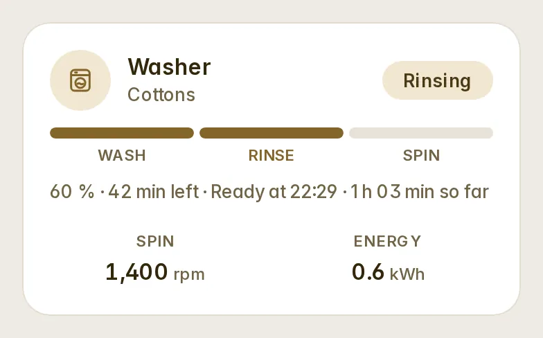
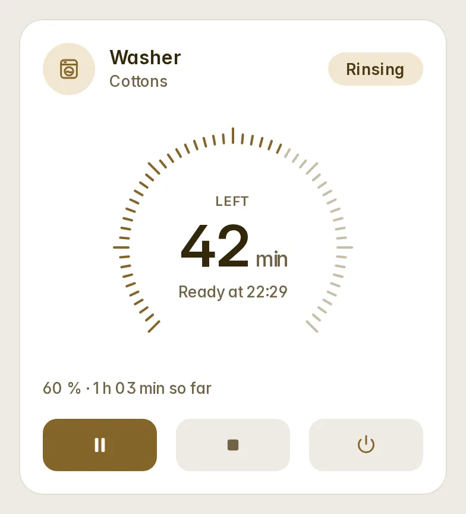
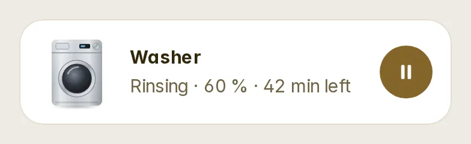

<!-- Generated by `pnpm docs:cards` from the card’s editor, its example in tools/docs/src/gallery.ts and its guide in tools/docs/guides/: change those, not this page. -->

# Appliance

A washer, dryer, dishwasher, oven, hob, fridge, coffee machine, pet feeder, fountain, litter box or small appliance on a plug, pictured: what it does, when it is ready, what it uses, its reminders.

`custom:fluvy-appliance-card` · [Try it live](https://acosta290.github.io/fluvy/?card=appliance) · [All cards](../cards.md#everyday)

<picture><source media="(prefers-color-scheme: dark)" srcset="../images/cards/appliance-dark.webp"></picture>

## Example

```yaml
type: custom:fluvy-appliance-card
device: miele-washer
name: Washer
```

The picture above, on the demo house: put your own entities in place of its.

## Layouts

`variant` chooses the layout. The picture above is `full`, the default; each of the others is the example plus the line over it, and opens in the live demo.

<table>
<tbody><tr>
<td align="center" valign="top" width="50%"><code>variant: compact</code><br><a href="https://acosta290.github.io/fluvy/?card=appliance&amp;layout=compact"><picture><source media="(prefers-color-scheme: dark)" srcset="../images/cards/appliance.compact-dark.webp"></picture></a></td>
<td align="center" valign="top" width="50%"><code>variant: ring</code><br><a href="https://acosta290.github.io/fluvy/?card=appliance&amp;layout=ring"><picture><source media="(prefers-color-scheme: dark)" srcset="../images/cards/appliance.ring-dark.webp"></picture></a></td>
</tr></tbody>
<tbody><tr>
<td align="center" valign="top" width="50%"><code>variant: row</code><br><a href="https://acosta290.github.io/fluvy/?card=appliance&amp;layout=row"><picture><source media="(prefers-color-scheme: dark)" srcset="../images/cards/appliance.row-dark.webp"></picture></a></td>
<td align="center" valign="top" width="50%"></td>
</tr></tbody>
</table>

## All options

```yaml
type: custom:fluvy-appliance-card
device: miele-washer
# entity:
kind: auto
variant: full
name: Washer
# icon:
show_icon: auto
show_badge: true
name_lines: 1
unit: both
picture: art
# image:
picture_min: auto
show_power: true
# power_action:
show_notify: true
show_hero: true
show_progress: true
progress_style: auto
time: both
show_zones: true
setpoint_style: readout
show_drinks: true
show_rows: true
# drinks:
row_values: inline
readouts:
  - temperature
  - spin
  - energy
show_maintenance: true
show_modes: false
modes_style: chips
# modes:
show_controls: false
show_programs: false
controls:
  - start
  - pause
  - stop
  - power
confirm:
  - stop
  - 'off'
  - feed
  - clean
  - level
unload_reminder: true
unload_after: 30
done_for: 120
door_alert: 0
low_level: 20
running_power: 5
finished_after: 3
# tone:
# color:
# card_color:
# card_opacity: 100
# card_border: true
# unavailable: dashed
# tap_action:
#   action: more-info
# hold_action:
#   action: more-info
# double_tap_action:
#   action: none
# icon_tap_action:
#   action: none
# icon_hold_action:
#   action: none
# icon_double_tap_action:
#   action: none
scan: true
# rows:
# sensors:
# maintenance:
# zones:
# roles:
```

## Options

| Option | Default | What it does |
| --- | --- | --- |
| `device` |  | The device the card reads: every entity it has is found on it. |
| `entity` |  | An entity in place of the device, such as a plug’s switch: the card reads the appliance from it. |
| `kind` | `auto` | What the appliance is, where the card should not find it by itself. `auto` · `washer` (Washing machine) · `dryer` (Tumble dryer) · `washer_dryer` · `dishwasher` · `oven` · `microwave` · `hob` · `hood` (Cooker hood) · `fridge` · `freezer` · `wine` · `coffee` · `kettle` · `air_fryer` · `toaster` · `blender` · `sandwich_maker` · `feeder` (Pet feeder) · `fountain` (Pet fountain) · `litter_box` · `appliance`. |
| `variant` | `full` | The card’s layout. `full` · `compact` · `ring` · `row`. |
| `name` |  | The name the card shows, in place of the entity’s own. |
| `icon` |  | The card’s icon, in place of the entity’s own. |
| `unit` | `both` | Which drum or cavity the card shows, where it has two. `both` · `main` (The first) · `sub` (The second). |
| `picture` | `art` | The card’s picture: the kind’s drawing, its icon, or none. `art` (Picture) · `icon` · `none`. |
| `image` |  | A picture of your own in place of the card’s drawing: an address, or an entity whose picture it is. |
| `picture_min` | `auto` | The smallest the picture becomes before a long name is shortened. `auto` · `32` (Small) · `44` (Medium) · `64` (Large). |
| `show_power` | `true` | Shows the round that switches it on and off. |
| `power_action` | the card’s own | What the power round does. |
| `show_notify` | `true` | Shows "Tell me when it’s done", which sets up a phone notification. |
| `scan` | `true` | Searches the device for the rest of its entities; off, the card reads only those named. |
| [`rows`](#rows) |  | The rows the card shows, each a reading of the appliance chosen by its key. A list: [its items](#rows). |
| [`tiles`](#tiles) |  | The tiles the card shows, each a reading of the appliance chosen by its key. A list: [its items](#tiles). |
| [`sensors`](#sensors) |  | More readouts from any of the device’s entities, after the card’s own. A list: [its items](#sensors). |
| [`maintenance`](#maintenance) |  | The reminders the card says, such as salt, a filter or descaling. A list: [its items](#maintenance). |
| [`zones`](#zones) |  | The compartments the card shows, such as a fridge’s and its freezer’s. A list: [its items](#zones). |
| [`roles`](#roles) |  | Entities named by hand for a part the card does not find on the device, or should read otherwise. A list: [its items](#roles). |
| **What it shows** |  |  |
| `show_hero` | `true` | Shows the large figures: the time left, the temperature, the compartments. |
| `show_progress` | `true` | Shows the cycle’s progress. |
| `progress_style` | `auto` | Draws the cycle’s progress as a bar, or in steps. `auto` · `bar` · `steps`. |
| `time` | `both` | Which times the card says: the time left, the time it ends, or both. `both` (Time left and when it ends) · `left` (Time left) · `end` (When it ends). |
| `show_zones` | `true` | Shows the compartments or the zones. |
| `setpoint_style` | `readout` | Shows each compartment’s temperature as a readout, or with − and + to set it. `readout` (Values only) · `stepper` (With steppers). |
| `show_drinks` | `true` | Shows the drinks to choose from. |
| `show_rows` | `true` | Shows the rows under the main control. |
| `drinks` | what the device offers | The drinks the card offers, in this order. A list. |
| `row_values` | `inline` | Where a row’s value stands: beside its words, at the end, or in one phrase with them. `inline` (Beside the words) · `end` (At the end) · `plain`. |
| `readouts` | `temperature`, `spin`, `energy` | The readouts the card shows, in this order; left out, the kind’s. Any of `program` · `temperature` · `spin` · `dryness` · `energy` · `water` · `cycles` · `detergent` · `elapsed` · `total` (In all) · `this_cycle` · `probe` (Core) · `power`. |
| `show_maintenance` | `true` | Shows the reminders, such as salt or a filter. |
| `show_modes` | `false` | Shows the fridge’s quick modes as chips. |
| `modes_style` | `chips` | How the modes are drawn. `chips` · `tiles`. |
| `modes` | what the device offers | The fridge’s quick modes the card offers, in this order. Any of `super_cool` · `super_freeze` · `eco` · `holiday` · `ice_maker` · `sabbath` · `child_lock`. |
| `show_controls` | `false` | Shows the buttons. |
| `show_programs` | `false` | Shows the programmes to choose from while it is at rest. |
| `controls` | `start`, `pause`, `stop`, `power` | The buttons the card shows, in this order; left out, the kind’s. Any of `start` · `pause` · `stop` · `power` · `light` · `feed` · `clean` · `deodorize` · `level`. |
| `confirm` | `stop`, `off`, `feed`, `clean`, `level` | The actions the card asks about before it runs them. Any of `start` · `resume` · `pause` · `stop` · `off` (Switch off) · `feed` · `clean` · `level`. |
| `feed_amount` |  | The amount of a meal the feeder gives from the card. 1 to 400. |
| **Reminders** |  |  |
| `unload_reminder` | `true` | Says when a finished cycle waits to be unloaded. |
| `unload_after` | `30` | How many minutes after a finish the card says it waits to be unloaded. 0 to 720. |
| `done_for` | `120` | How many minutes a finished cycle keeps saying it is done. 0 to 1440. |
| `door_alert` | `0` | How many seconds a door may stand open before the card warns of it. 0 to 3600. |
| `low_level` | `20` | The level, in percent, below which a tank or a filter reads low. 0 to 100. |
| `low_days` |  | Says a part is soon due within this many days. 0 to 90. |
| **On a smart plug** |  |  |
| `running_power` | `5` | The power in watts from which a plug’s appliance counts as running. 1 to 3000. |
| `finished_after` | `3` | How many minutes under its running power a plug’s appliance waits before its cycle is done. 1 to 120. |

<details>
<summary>Its look and its actions, as on every card</summary>

| Option | Default | What it does |
| --- | --- | --- |
| `show_icon` | `auto` | Shows the icon, hides it, or lets the card decide. `auto` · `always` · `never`. |
| `show_badge` | `true` | Shows the badge at the end of the head, such as the card’s state or a count. |
| `name_lines` | `1` | Lets the name in the card’s head take two balanced lines where one would cut it; the head is a line taller whatever the name. `1` · `2`. |
| `tone` | the card’s own | The card’s colour from the palette’s tones; left out, the tone of what it shows. `accent` · `light` · `heat` · `cool` · `dry` · `fan` · `water` · `solar` · `grid` · `media` · `presence` · `armed` · `battery` · `house` · `gas` · `vehicle` (Car) · `neutral` · `ok` (Good) · `warning` · `danger`. |
| `color` |  | The card’s colour: its circle, its accents and its tints wear it. Left out, the colour of what it shows. |
| `card_color` |  | Paints the card’s surface in a colour of your own. |
| `card_opacity` | `100` | How solid the card’s surface is, in percent: under 100 the view’s background shows through. Left out, the house’s. 0 % to 100 %, in steps of 5. |
| `card_border` | `true` | Whether the card draws its hairline border. Left out, the house’s. |
| `unavailable` | `dashed` | How the card looks while its entity is unavailable: dashed, or quiet as when it is off. Left out, the house’s. `dashed` · `quiet` (As when off). |
| **Interactions** |  |  |
| `tap_action` | `more-info` | What a tap on the card does. |
| `hold_action` | `more-info` | What a long press on the card does. |
| `double_tap_action` | `none` | What two taps on the card do. |
| `icon_tap_action` | `none` | What a tap on the icon does. |
| `icon_hold_action` | `none` | What a long press on the icon does. |
| `icon_double_tap_action` | `none` | What two taps on the icon do. |

More about them in [Options every card takes](../customising.md#options-every-card-takes).

</details>

## Lists

### `rows`

An item is a map with `key` and any of these fields.

| Field | What it does |
| --- | --- |
| `key` | Which key it is. `program` · `temperature` · `target` · `spin` · `dryness` · `water` · `energy` · `power` · `remaining` (Time remaining) · `end` (When it ends) · `elapsed` (Time so far) · `mode` · `alarm` · `last_brew` · `zones` · `last_meal` · `next_meal` · `fed_today` · `drank_today` · `purified` · `pump` · `last_use` · `uses_today` (Used today) · `entity` (Another entity) · `salt` · `rinse_aid` · `detergent` · `softener` · `filter` · `machine_care` · `descale` (Descaling) · `clean` · `water_tank` (Water) · `beans` · `drip_tray` · `milk` · `water_filter` · `air_filter` · `grease_filter` · `leak` · `service` · `food` · `desiccant` · `litter` · `waste` · `deodorant`. |
| `entity` | The entity the item shows. |
| `name` | The item’s own name, in place of the one the card would give it. |
| `icon` | The item’s own icon, in place of the one the card would give it. |
| `color` | The item’s colour, in place of the one the card gives it. |
| **Interactions** |  |
| `tap_action` | What a tap on the item does. |
| `hold_action` | What a long press on the item does. |
| `double_tap_action` | What two taps on the item do. |

### `tiles`

An item is a map with `key` and any of these fields.

| Field | What it does |
| --- | --- |
| `key` | Which key it is. `program` · `temperature` · `target` · `spin` · `dryness` · `water` · `energy` · `power` · `remaining` (Time remaining) · `end` (When it ends) · `elapsed` (Time so far) · `mode` · `alarm` · `last_brew` · `zones` · `last_meal` · `next_meal` · `fed_today` · `drank_today` · `purified` · `pump` · `last_use` · `uses_today` (Used today) · `entity` (Another entity) · `salt` · `rinse_aid` · `detergent` · `softener` · `filter` · `machine_care` · `descale` (Descaling) · `clean` · `water_tank` (Water) · `beans` · `drip_tray` · `milk` · `water_filter` · `air_filter` · `grease_filter` · `leak` · `service` · `food` · `desiccant` · `litter` · `waste` · `deodorant`. |
| `entity` | The entity the item shows. |
| `name` | The item’s own name, in place of the one the card would give it. |
| `icon` | The item’s own icon, in place of the one the card would give it. |
| `color` | The item’s colour, in place of the one the card gives it. |
| **Interactions** |  |
| `tap_action` | What a tap on the item does. |
| `hold_action` | What a long press on the item does. |
| `double_tap_action` | What two taps on the item do. |

### `sensors`

An item is an entity id, or a map with `entity` and any of these fields.

| Field | What it does |
| --- | --- |
| `entity` | The entity the item shows. |
| `name` | The item’s own name, in place of the one the card would give it. |

### `maintenance`

An item is a map with `key` and any of these fields.

| Field | What it does |
| --- | --- |
| `key` | Which reminder it is. `salt` (Add salt) · `rinse_aid` (Add rinse aid) · `detergent` (Refill the detergent) · `softener` (Refill the softener) · `filter` (Clean the filter) · `machine_care` (Run machine care) · `descale` · `clean` · `water_tank` (Refill the water tank) · `beans` (Add beans) · `drip_tray` (Empty the drip tray) · `milk` (Keep the milk cool) · `water_filter` (Replace the water filter) · `air_filter` (Replace the air filter) · `grease_filter` (Clean the grease filter) · `leak` (Water leak) · `service` (Needs a service) · `food` (Refill the food) · `desiccant` (Replace the desiccant) · `litter` (Add litter) · `waste` (Empty the waste bin) · `deodorant` (Replace the deodorant). |
| `name` | The item’s own name, in place of the one the card would give it. |
| `icon` | The item’s own icon, in place of the one the card would give it. |
| `color` | The item’s colour, in place of the one the card gives it. |
| **Interactions** |  |
| `tap_action` | What a tap on the item does. |
| `hold_action` | What a long press on the item does. |
| `double_tap_action` | What two taps on the item do. |

### `zones`

An item is an entity id, or a map with `entity` and any of these fields.

| Field | What it does |
| --- | --- |
| `entity` | The entity the item shows. |
| `name` | The item’s own name, in place of the one the card would give it. |
| `icon` | The item’s own icon, in place of the one the card would give it. |
| `color` | The item’s colour, in place of the one the card gives it. |
| **Interactions** |  |
| `tap_action` | What a tap on the item does. |
| `hold_action` | What a long press on the item does. |
| `double_tap_action` | What two taps on the item do. |

### `roles`

An item is a map with `role` and any of these fields.

| Field | What it does |
| --- | --- |
| `role` | What the entity stands for on the card. `state` · `power` · `program` · `phase` · `remaining` (Time left) · `finish` (End time) · `elapsed` (Time so far) · `total` · `progress` · `start_at` (Delayed start) · `temperature` · `target` · `probe` (Core probe) · `door` · `remote` · `start` · `pause` · `resume` · `stop` · `light` · `error` · `energy` · `water` · `watts` (Power reading) · `running` · `online` (Connection) · `feed` · `schedule` (Feeding plan) · `next_feed` (Next meal) · `last_feed` (Last meal) · `fed_today` · `clean` · `last_pet`. |
| `entity` | The entity the item shows. |

## Guide

Give the card the appliance's `device`, or one `entity` of it. It finds the rest by its integration (LG ThinQ, Home
Connect, Miele, SmartThings, LocalThings, Matter, Whirlpool, Tuya, hOn, Electrolux, PetKit, PETLIBRO) or by the
entities' names.

```yaml
type: custom:fluvy-appliance-card
device: 1f2c… # or entity: one of its entities
kind: washer  # auto by default
rows: [program, water, energy]
```

- Buttons appear only where the integration says exactly how: start, pause, stop, power, the light.
- `picture_min: 44` keeps the picture at 44 px or more in a narrow column; a long name ends in "…" instead.
- An administrator gets a bell by the time left: "Tell me when it's done" writes an automation that notifies them.

### When the card guesses wrong

`kind` says what it is. `roles` names an entity for a role, or `none` to drop one it found. `scan: false` reads only
what you name. A helper on the device plays a role only where the integration has nothing for it.

```yaml
# a dishwasher that starts even with its remote start off
type: custom:fluvy-appliance-card
device: 3c5d…
roles:
  - role: remote
    entity: none # the rest as found
```

```yaml
# buttons of your own: a device's buttons, a helper's or a script
type: custom:fluvy-appliance-card
device: 9a7e…
scan: false
show_controls: true
roles:
  - { role: state, entity: sensor.dishwasher_machine_state }
  - { role: start, entity: button.dishwasher_start }
  - { role: pause, entity: button.dishwasher_pause }
  - { role: stop, entity: script.dishwasher_stop }
```

### Asking first

`confirm` lists the commands that ask in Home Assistant's dialog first: `start`, `resume`, `pause`, `stop`, `off`,
`feed`, `clean`, `level`.

- Left out: a stop asks, and so do switching off while it runs (a fridge at any time), a meal, a clean, a levelling
  and a litter box's resume. An oven, a microwave and an air fryer also ask before they start.
- A list replaces that set, so include `off`. `confirm: []` asks for nothing.

```yaml
type: custom:fluvy-appliance-card
entity: switch.washer_power
variant: row
confirm: [start, stop, off]
```

### Any device


The picker lists every device with a sensor or a switch, whatever its integration. Set `kind`, and name in `roles`
what the card did not find. More readings go in `rows` as `entity` rows.

```yaml
type: custom:fluvy-appliance-card
device: 4b9e… # Decent Espresso DE1PRO over MQTT
kind: coffee
drinks: [Default, Londinium, Blooming espresso]
rows:
  - last_brew
  - entity: sensor.decent_espresso_de1pro_de1_steam_temperature
    name: Steam
roles:
  - { role: state, entity: sensor.decent_espresso_de1pro_de1_state }
  - { role: power, entity: switch.decent_espresso_de1pro_de1_on }
  - { role: program, entity: select.decent_espresso_de1pro_de1_profile }
```

### Feeders, fountains and litter boxes


`kind: feeder`, `fountain` or `litter_box`, found on PetKit and PETLIBRO. Two `tiles` show what is left; the round is a
meal, a clean or a resume, each asked first.

```yaml
type: custom:fluvy-appliance-card
device: 9a41… # a PetKit or PETLIBRO feeder
tiles: [food, next_meal]
rows: [last_meal, fed_today, desiccant]
feed_amount: 20 # a PetKit meal; PETLIBRO uses the device's amount
low_days: 5     # a part is "soon" within 5 days (7 by default)
```

Readings: `last_meal`, `next_meal`, `fed_today`, `drank_today`, `purified`, `pump`, `last_use`, `uses_today`. Parts:
`food`, `desiccant`, `water_tank`, `water_filter`, `litter`, `waste`, `deodorant`, `clean`, `filter`.

### The appliances card

Lists the house's appliances (or those in `appliances`), what needs a hand first.

```yaml
type: custom:fluvy-appliances-card
variant: cards # each appliance as its whole card, side by side
show: active   # only the busy ones
```

<details>
<summary>Older names the card still reads</summary>

| Older name | Read as |
| --- | --- |
| `layout` | `variant` |
| `view` | `variant` |
| `accent` | `color` |

</details>
