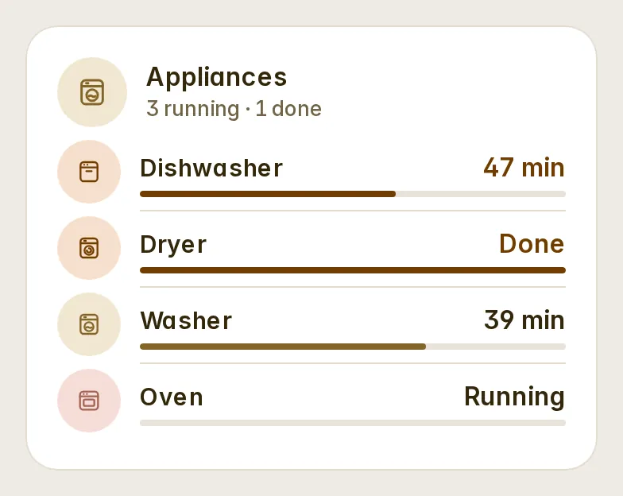
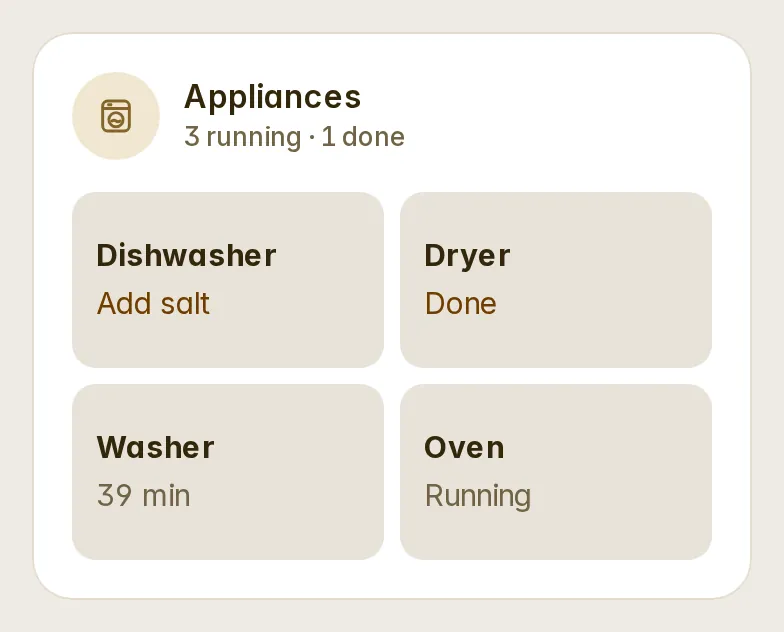
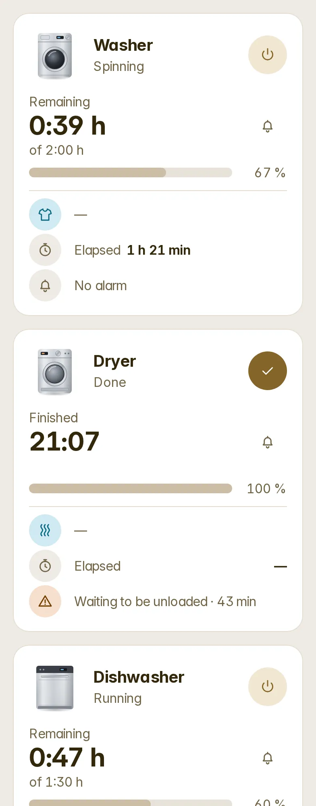

<!-- Generated by `pnpm docs:cards` from the card’s editor, its example in tools/docs/src/gallery.ts and its guide in tools/docs/guides/: change those, not this page. -->

# Appliances

The house’s appliances as live rows, or their whole cards side by side: what runs, what is done, what waits.

`custom:fluvy-appliances-card` · [Try it live](https://acosta290.github.io/fluvy/?card=appliances) · [All cards](../cards.md#everyday)

<picture><source media="(prefers-color-scheme: dark)" srcset="../images/cards/appliances-dark.webp"></picture>

## Example

```yaml
type: custom:fluvy-appliances-card
appliances:
  - device: lg-washer
    name: Washer
  - device: lg-dryer
    name: Dryer
  - device: hc-dish
    name: Dishwasher
  - device: hc-oven
    name: Oven
```

The picture above, on the demo house: put your own entities in place of its.

## Layouts

`variant` chooses the layout. The picture above is `rows`, the default; each of the others is the example plus the line over it, and opens in the live demo.

<table>
<tbody><tr>
<td align="center" valign="top" width="50%"><code>variant: compact</code><br><a href="https://acosta290.github.io/fluvy/?card=appliances&amp;layout=compact"><picture><source media="(prefers-color-scheme: dark)" srcset="../images/cards/appliances.compact-dark.webp"></picture></a></td>
<td align="center" valign="top" width="50%"><code>variant: tiles</code><br><a href="https://acosta290.github.io/fluvy/?card=appliances&amp;layout=tiles"><picture><source media="(prefers-color-scheme: dark)" srcset="../images/cards/appliances.tiles-dark.webp"></picture></a></td>
</tr></tbody>
<tbody><tr>
<td align="center" valign="top" width="50%"><code>variant: cards</code><br><a href="https://acosta290.github.io/fluvy/?card=appliances&amp;layout=cards"><picture><source media="(prefers-color-scheme: dark)" srcset="../images/cards/appliances.cards-dark.webp"></picture></a></td>
<td align="center" valign="top" width="50%"></td>
</tr></tbody>
</table>

## All options

```yaml
type: custom:fluvy-appliances-card
# title:
# subtitle:
# icon:
show_icon: auto
name_lines: 1
variant: rows
max_rows: 6
show: all
sort: state
show_count: true
hide_empty: false
# empty_text:
# tone:
# color:
# card_color:
# card_opacity: 100
# card_border: true
# unavailable: dashed
# tap_action:
#   action: none
# hold_action:
#   action: none
# double_tap_action:
#   action: none
# icon_tap_action:
#   action: none
# icon_hold_action:
#   action: none
# icon_double_tap_action:
#   action: none
appliances:
  - device: lg-washer
    name: Washer
  - device: lg-dryer
    name: Dryer
  - device: hc-dish
    name: Dishwasher
  - device: hc-oven
    name: Oven
```

## Options

| Option | Default | What it does |
| --- | --- | --- |
| `title` |  | The title at the top of the card. |
| `subtitle` |  | The line under the title: your own words, an entity’s state or a template. |
| `icon` |  | The card’s icon, in place of the entity’s own. |
| `variant` | `rows` | The card’s layout. `rows` · `compact` · `tiles` · `cards` (Whole cards). |
| `max_rows` | `6` | How many rows the card shows before a "more" row takes the rest. 1 to 30. |
| `picture` | `art` | The picture each appliance shows: its drawing, its icon, or none. `art` (Picture) · `icon` · `none`. |
| `picture_min` | `auto` | The smallest the picture becomes before a long name is shortened. `auto` · `32` (Small) · `44` (Medium) · `64` (Large). |
| `confirm` | each appliance’s own | The actions every appliance asks about before it runs them. Any of `start` · `resume` · `pause` · `stop` · `off` (Switch off) · `feed` · `clean` · `level`. |
| `show` | `all` | Shows every appliance, or only those running, waiting or done. `all` · `active` (Only the busy ones). |
| `sort` | `state` | Orders them by what they are doing, by name, or as listed. `state` (By what it does) · `name` · `none` (As listed). |
| `show_count` | `true` | Says on the head’s line how many run, are done and rest. |
| `hide_empty` | `false` | Hides the whole card while it has nothing to show. |
| `empty_text` |  | What the card says while it has nothing to show. |
| [`appliances`](#appliances) |  | The appliances the card lists; left out, every one of the house. A list: [its items](#appliances). |

<details>
<summary>Its look and its actions, as on every card</summary>

| Option | Default | What it does |
| --- | --- | --- |
| `show_icon` | `auto` | Shows the icon, hides it, or lets the card decide. `auto` · `always` · `never`. |
| `name_lines` | `1` | Lets the name in the card’s head take two balanced lines where one would cut it; the head is a line taller whatever the name. `1` · `2`. |
| `tone` | the card’s own | The card’s colour from the palette’s tones; left out, the tone of what it shows. `accent` · `light` · `heat` · `cool` · `dry` · `fan` · `water` · `solar` · `grid` · `media` · `presence` · `armed` · `battery` · `house` · `gas` · `vehicle` (Car) · `neutral` · `ok` (Good) · `warning` · `danger`. |
| `color` |  | The card’s colour: its circle, its accents and its tints wear it. Left out, the colour of what it shows. |
| `card_color` |  | Paints the card’s surface in a colour of your own. |
| `card_opacity` | `100` | How solid the card’s surface is, in percent: under 100 the view’s background shows through. Left out, the house’s. 0 % to 100 %, in steps of 5. |
| `card_border` | `true` | Whether the card draws its hairline border. Left out, the house’s. |
| `unavailable` | `dashed` | How the card looks while its entity is unavailable: dashed, or quiet as when it is off. Left out, the house’s. `dashed` · `quiet` (As when off). |
| **Interactions** |  |  |
| `tap_action` | `none` | What a tap on the card does. |
| `hold_action` | `none` | What a long press on the card does. |
| `double_tap_action` | `none` | What two taps on the card do. |
| `icon_tap_action` | `none` | What a tap on the icon does. |
| `icon_hold_action` | `none` | What a long press on the icon does. |
| `icon_double_tap_action` | `none` | What two taps on the icon do. |

More about them in [Options every card takes](../customising.md#options-every-card-takes).

</details>

## Lists

### `appliances`

An item is a map with `device` and any of these fields.

| Field | What it does |
| --- | --- |
| `device` | The appliance’s device. |
| `entity` | An entity in place of the device, such as a plug’s switch. |
| `name` | The item’s own name, in place of the one the card would give it. |
| `icon` | The item’s own icon, in place of the one the card would give it. |
| `color` | The item’s colour, in place of the one the card gives it. |
| `kind` | What the item is. `auto` · `washer` (Washing machine) · `dryer` (Tumble dryer) · `washer_dryer` · `dishwasher` · `oven` · `microwave` · `hob` · `hood` (Cooker hood) · `fridge` · `freezer` · `wine` · `coffee` · `kettle` · `air_fryer` · `toaster` · `blender` · `sandwich_maker` · `feeder` (Pet feeder) · `fountain` (Pet fountain) · `litter_box` · `appliance`. |
| **Interactions** |  |
| `tap_action` | What a tap on the item does. |
| `hold_action` | What a long press on the item does. |
| `double_tap_action` | What two taps on the item do. |

## Guide

This card is in [the Appliance card’s guide](appliance.md#guide).

<details>
<summary>Older names the card still reads</summary>

| Older name | Read as |
| --- | --- |
| `sub` | `subtitle` |
| `meta` | `subtitle` |
| `layout` | `variant` |
| `view` | `variant` |
| `accent` | `color` |

</details>
