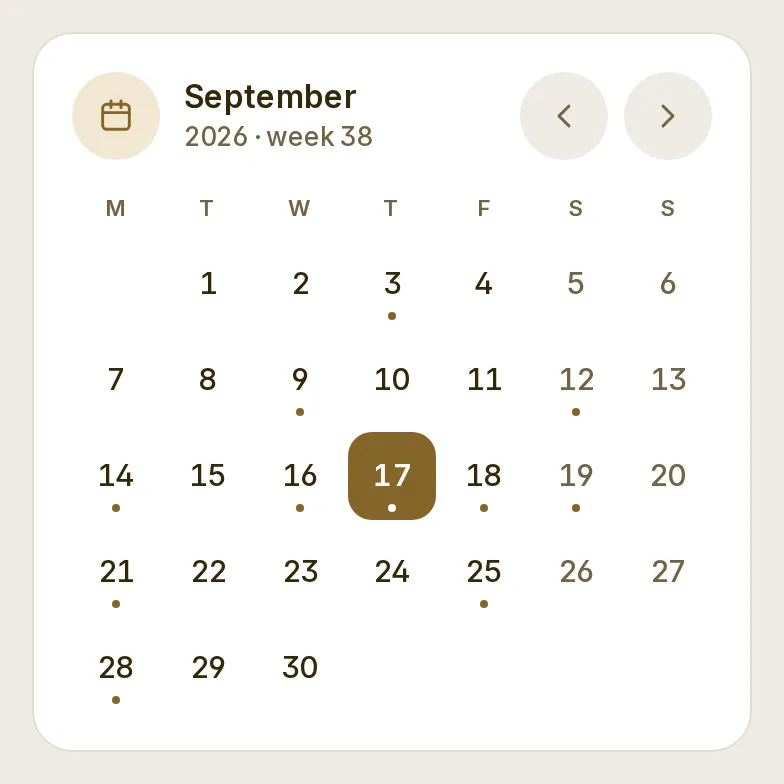
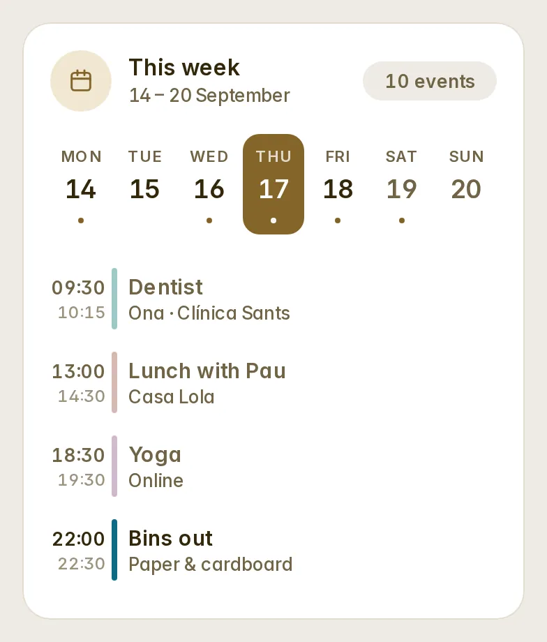
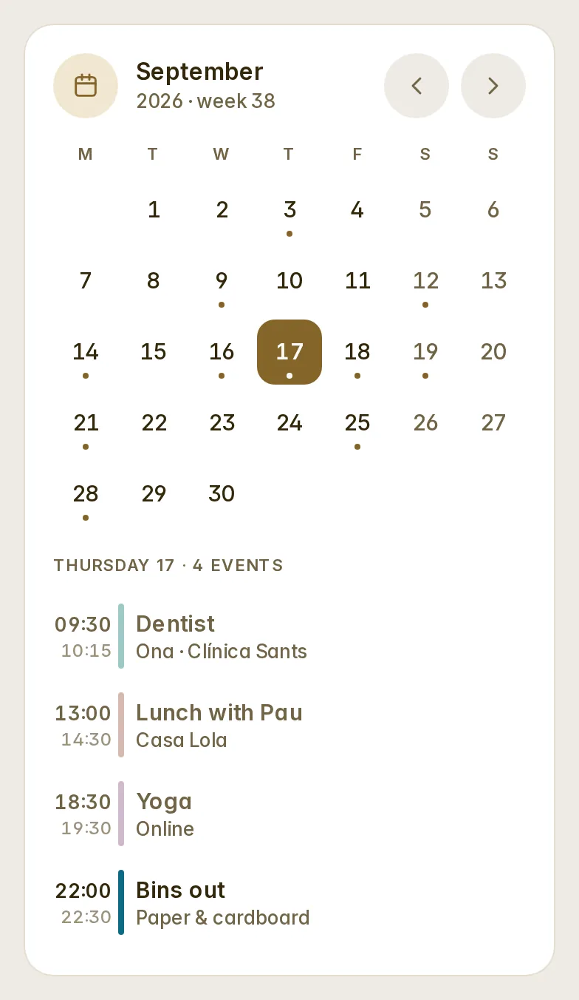
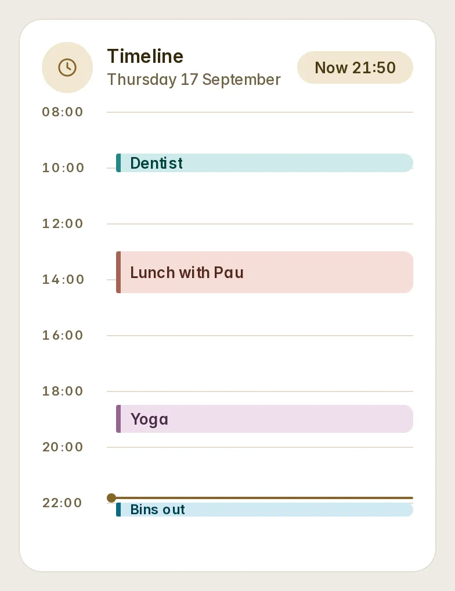
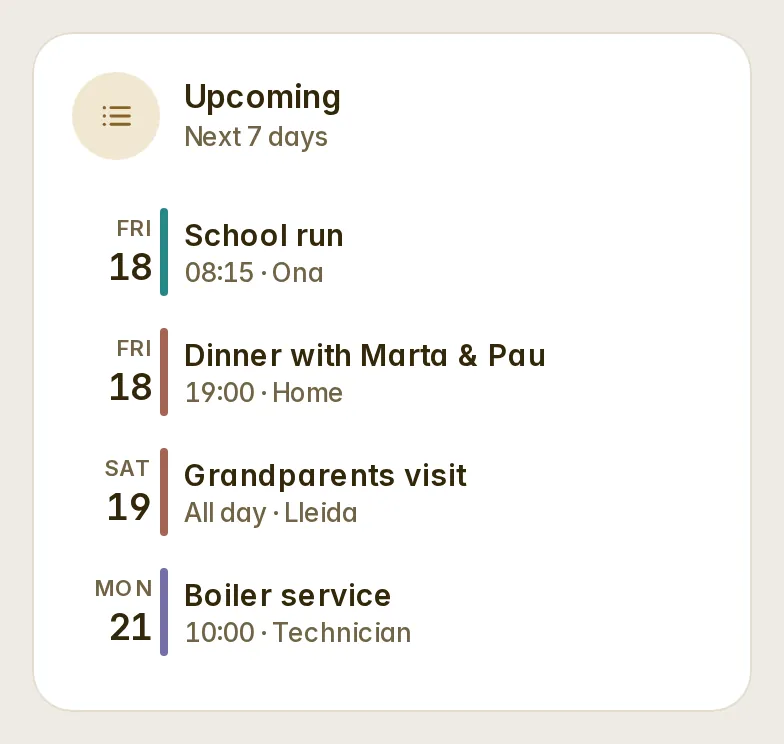
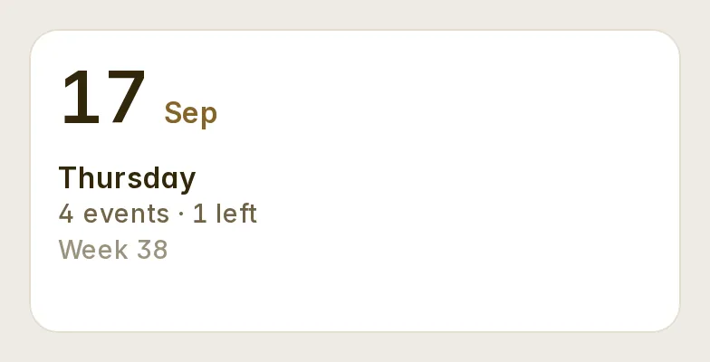

<!-- Generated by `pnpm docs:cards` from the card’s editor, its example in tools/docs/src/gallery.ts and its guide in tools/docs/guides/: change those, not this page. -->

# Calendar

Agenda, month, week, month + day, timeline, upcoming or tile.

`custom:fluvy-calendar-card` · [Try it live](https://acosta290.github.io/fluvy/?card=calendar) · [All cards](../cards.md#time)

<picture><source media="(prefers-color-scheme: dark)" srcset="../images/cards/calendar-dark.webp"></picture>

## Example

```yaml
type: custom:fluvy-calendar-card
calendars:
  - calendar.chores
  - calendar.family
  - calendar.ona
  - calendar.personal
  - calendar.services
first_weekday: monday
```

The picture above, on the demo house: put your own entities in place of its.

## Layouts

`variant` chooses the layout. The picture above is `agenda`, the default; each of the others is the example plus the line over it, and opens in the live demo.

<table>
<tbody><tr>
<td align="center" valign="top" width="50%"><code>variant: month</code><br><a href="https://acosta290.github.io/fluvy/?card=calendar&amp;layout=month"><picture><source media="(prefers-color-scheme: dark)" srcset="../images/cards/calendar.month-dark.webp"></picture></a></td>
<td align="center" valign="top" width="50%"><code>variant: week</code><br><a href="https://acosta290.github.io/fluvy/?card=calendar&amp;layout=week"><picture><source media="(prefers-color-scheme: dark)" srcset="../images/cards/calendar.week-dark.webp"></picture></a></td>
</tr></tbody>
<tbody><tr>
<td align="center" valign="top" width="50%"><code>variant: month-day</code><br><a href="https://acosta290.github.io/fluvy/?card=calendar&amp;layout=month-day"><picture><source media="(prefers-color-scheme: dark)" srcset="../images/cards/calendar.month-day-dark.webp"></picture></a></td>
<td align="center" valign="top" width="50%"><code>variant: timeline</code><br><a href="https://acosta290.github.io/fluvy/?card=calendar&amp;layout=timeline"><picture><source media="(prefers-color-scheme: dark)" srcset="../images/cards/calendar.timeline-dark.webp"></picture></a></td>
</tr></tbody>
<tbody><tr>
<td align="center" valign="top" width="50%"><code>variant: upcoming</code><br><a href="https://acosta290.github.io/fluvy/?card=calendar&amp;layout=upcoming"><picture><source media="(prefers-color-scheme: dark)" srcset="../images/cards/calendar.upcoming-dark.webp"></picture></a></td>
<td align="center" valign="top" width="50%"><code>variant: tile</code><br><a href="https://acosta290.github.io/fluvy/?card=calendar&amp;layout=tile"><picture><source media="(prefers-color-scheme: dark)" srcset="../images/cards/calendar.tile-dark.webp"></picture></a></td>
</tr></tbody>
</table>

## All options

```yaml
type: custom:fluvy-calendar-card
calendars:
  - calendar.chores
  - calendar.family
  - calendar.ona
  - calendar.personal
  - calendar.services
variant: agenda
# title:
show_icon: auto
name_lines: 1
# color:
# card_color:
# card_opacity: 100
# card_border: true
# unavailable: dashed
first_weekday: monday
```

## Options

| Option | Default | What it does |
| --- | --- | --- |
| `variant` | `agenda` | The card’s layout. `agenda` · `month` · `week` · `month-day` (Month and day) · `timeline` · `upcoming` · `tile`. |
| `title` |  | The title at the top of the card. |
| `tile` | `date` | What the tile shows: the date, or the next event. `date` (The date) · `next` (The next event). |
| `first_weekday` | `language` | The day the weeks and the months start on. `language` (As the language does) · `today` · `sunday` · `monday` · `tuesday` · `wednesday` · `thursday` · `friday` · `saturday`. |
| `days` |  | How many days ahead the agenda shows. 1 to 31. |
| `start_hour` |  | The hour the timeline starts at. 0 to 23. |
| `end_hour` |  | The hour the timeline ends at. 1 to 24. |
| [`calendars`](#calendars) |  | The calendars whose events the card shows. A list: [its items](#calendars). |

<details>
<summary>Its look and its actions, as on every card</summary>

| Option | Default | What it does |
| --- | --- | --- |
| `show_icon` | `auto` | Shows the icon, hides it, or lets the card decide. `auto` · `always` · `never`. |
| `name_lines` | `1` | Lets the name in the card’s head take two balanced lines where one would cut it; the head is a line taller whatever the name. `1` · `2`. |
| `color` |  | The card’s colour: its circle, its accents and its tints wear it. Left out, the colour of what it shows. |
| `card_color` |  | Paints the card’s surface in a colour of your own. |
| `card_opacity` | `100` | How solid the card’s surface is, in percent: under 100 the view’s background shows through. Left out, the house’s. 0 % to 100 %, in steps of 5. |
| `card_border` | `true` | Whether the card draws its hairline border. Left out, the house’s. |
| `unavailable` | `dashed` | How the card looks while its entity is unavailable: dashed, or quiet as when it is off. Left out, the house’s. `dashed` · `quiet` (As when off). |

More about them in [Options every card takes](../customising.md#options-every-card-takes).

</details>

## Lists

### `calendars`

An item is an entity id, or a map with `entity` and any of these fields.

| Field | What it does |
| --- | --- |
| `entity` | The entity the item shows. A `calendar`. |
| `name` | The item’s own name, in place of the one the card would give it. |
| `tone` | The item’s colour from the palette’s tones. `accent` · `light` · `heat` · `cool` · `dry` · `fan` · `water` · `solar` · `grid` · `media` · `presence` · `armed` · `battery` · `house` · `gas` · `vehicle` (Car) · `neutral` · `ok` (Good) · `warning` · `danger`. |
| `color` | The item’s colour, in place of the one the card gives it. |

## Guide

The week and the month start on the day `first_weekday` says: a weekday, or `language` (the default: your profile's,
else your language's).

```yaml
# the week view as the next seven days
type: custom:fluvy-calendar-card
variant: week
first_weekday: today
calendars:
  - calendar.family
  - calendar.work
```

`first_weekday: today` makes the week strip today and the six days after it ("Next 7 days"). It rolls over at midnight
by itself, for a wall dashboard that is never reloaded. A month keeps your week's first day.

<details>
<summary>Older names the card still reads</summary>

| Older name | Read as |
| --- | --- |
| `entities` | `calendars` |
| `layout` | `variant` |
| `view` | `variant` |
| `accent` | `color` |

</details>
