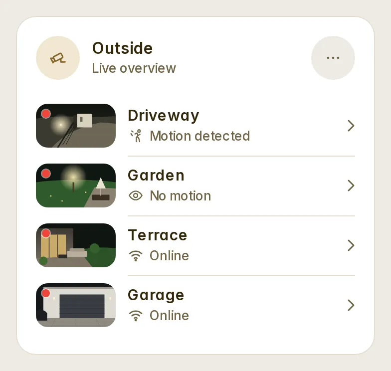
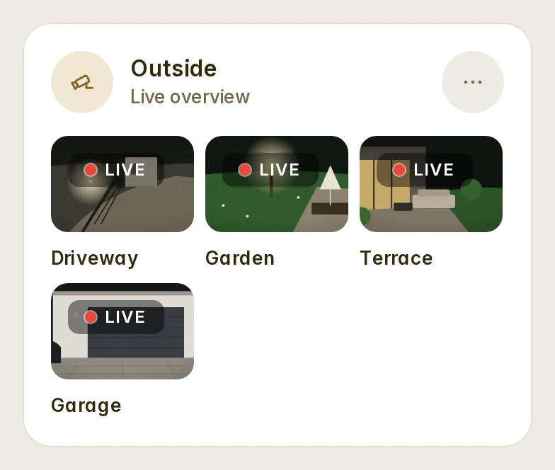

<!-- Generated by `pnpm docs:cards` from the card’s editor, its example in tools/docs/src/gallery.ts and its guide in tools/docs/guides/: change those, not this page. -->

# Cameras

Several cameras at a glance, each picture live or refreshing itself with its name and what it sees; a sheet of them all.

`custom:fluvy-cameras-card` · [Try it live](https://acosta290.github.io/fluvy/?card=cameras) · [All cards](../cards.md#everyday)

<picture><source media="(prefers-color-scheme: dark)" srcset="../images/cards/cameras-dark.webp"></picture>

## Example

```yaml
type: custom:fluvy-cameras-card
cameras:
  - camera.cm_driveway
  - camera.cm_garden
  - camera.cm_terrace
  - camera.cm_garage
title: Outside
```

The picture above, on the demo house: put your own entities in place of its.

## Layouts

`variant` chooses the layout. The picture above is `grid`, the default; each of the others is the example plus the line over it, and opens in the live demo.

<table>
<tbody><tr>
<td align="center" valign="top" width="50%"><code>variant: list</code><br><a href="https://acosta290.github.io/fluvy/?card=cameras&amp;layout=list"><picture><source media="(prefers-color-scheme: dark)" srcset="../images/cards/cameras.list-dark.webp"></picture></a></td>
<td align="center" valign="top" width="50%"><code>variant: compact</code><br><a href="https://acosta290.github.io/fluvy/?card=cameras&amp;layout=compact"><picture><source media="(prefers-color-scheme: dark)" srcset="../images/cards/cameras.compact-dark.webp"></picture></a></td>
</tr></tbody>
</table>

## All options

```yaml
type: custom:fluvy-cameras-card
title: Outside
# subtitle:
# icon:
show_icon: auto
name_lines: 1
# area:
cameras:
  - camera.cm_driveway
  - camera.cm_garden
  - camera.cm_terrace
  - camera.cm_garage
names: full
variant: grid
columns: auto
camera_view: auto
refresh: 10
aspect_ratio: '16:9'
fit_mode: cover
show_status: true
status: auto
show_live: true
show_fullscreen: true
# tone:
# color:
# card_color:
# card_opacity: 100
# card_border: true
# unavailable: dashed
# empty_text:
hide_empty: false
# tap_action:
#   action: none
# hold_action:
#   action: none
# double_tap_action:
#   action: none
# icon_tap_action:
#   action: none
# icon_hold_action:
#   action: none
# icon_double_tap_action:
#   action: none
```

## Options

| Option | Default | What it does |
| --- | --- | --- |
| `title` |  | The title at the top of the card. |
| `subtitle` |  | The line under the title: your own words, an entity’s state or a template. |
| `icon` |  | The card’s icon, in place of the entity’s own. |
| `area` |  | Limits the card to the entities of this area. |
| `names` | `full` | How a row is named where it has no name of its own: the entity’s full name, its own, or its device’s. `full` · `entity` · `device`. |
| `variant` | `grid` | The card’s layout. `grid` · `list` · `compact`. |
| `columns` | `auto` | How many pictures stand in a row. `auto` · `1` · `2` · `3` · `4`. |
| `camera_view` | `auto` | Shows still pictures that refresh by themselves, or Home Assistant’s live stream. `auto` · `live`. |
| `max_live` | `4` | How many cameras stream at once; the rest show stills. 0 to 12. |
| `refresh` | `10` | How often a still picture is taken again, in seconds. 0.5 to 300, in steps of 0.5. |
| `aspect_ratio` | `16:9` | Every picture’s shape, so that a row of pictures is level. `16:9` · `4:3` · `3:2` · `1:1` · `2:1` · `21:9` · `native` (The camera’s own), or your own. |
| `fit_mode` | `cover` | Fills the shape and crops the picture, or shows the whole picture inside it. `cover` (Fill (crop)) · `contain` (Whole picture). |
| `show_status` | `true` | Shows the line under each camera. |
| `status` | `auto` | What each camera’s line says. `auto` · `motion` · `state` · `none`. |
| `show_live` | `true` | Marks a streaming picture "Live". |
| `show_fullscreen` | `true` | Shows the button that opens it full screen. |
| `empty_text` |  | What the card says while it has nothing to show. |
| `hide_empty` | `false` | Hides the whole card while it has nothing to show. |
| [`cameras`](#cameras) |  | The cameras, in the order they are drawn. A list: [its items](#cameras). |

<details>
<summary>Its look and its actions, as on every card</summary>

| Option | Default | What it does |
| --- | --- | --- |
| `show_icon` | `auto` | Shows the icon, hides it, or lets the card decide. `auto` · `always` · `never`. |
| `name_lines` | `1` | Lets the name in the card’s head take two balanced lines where one would cut it; the head is a line taller whatever the name. `1` · `2`. |
| `tone` | the card’s own | The card’s colour from the palette’s tones; left out, the tone of what it shows. `accent` · `light` · `heat` · `cool` · `dry` · `fan` · `water` · `solar` · `grid` · `media` · `presence` · `armed` · `battery` · `house` · `gas` · `vehicle` (Car) · `neutral` · `ok` (Good) · `warning` · `danger`. |
| `color` |  | The card’s colour: its circle, its accents and its tints wear it. Left out, the colour of what it shows. |
| `card_color` |  | Paints the card’s surface in a colour of your own. |
| `card_opacity` | `100` | How solid the card’s surface is, in percent: under 100 the view’s background shows through. Left out, the house’s. 0 % to 100 %, in steps of 5. |
| `card_border` | `true` | Whether the card draws its hairline border. Left out, the house’s. |
| `unavailable` | `dashed` | How the card looks while its entity is unavailable: dashed, or quiet as when it is off. Left out, the house’s. `dashed` · `quiet` (As when off). |
| **Interactions** |  |  |
| `tap_action` | `none` | What a tap on the card does. |
| `hold_action` | `none` | What a long press on the card does. |
| `double_tap_action` | `none` | What two taps on the card do. |
| `icon_tap_action` | `none` | What a tap on the icon does. |
| `icon_hold_action` | `none` | What a long press on the icon does. |
| `icon_double_tap_action` | `none` | What two taps on the icon do. |

More about them in [Options every card takes](../customising.md#options-every-card-takes).

</details>

## Lists

### `cameras`

An item is an entity id, or a map with `entity` and any of these fields.

| Field | What it does |
| --- | --- |
| `entity` | The entity the item shows. A `camera`. |
| `name` | The item’s own name, in place of the one the card would give it. |
| `icon` | The item’s own icon, in place of the one the card would give it. |
| `motion` | The motion sensor the camera’s line reads. A `binary_sensor`. |
| `status` | What the camera’s line says. `auto` · `motion` · `state` · `none`. |
| `camera_view` | Shows this camera’s stills, or its live stream. `auto` · `live`. |
| `refresh` | How often this camera’s still picture is taken again, in seconds. 0.5 to 300, in steps of 0.5. |
| `fit_mode` | Fills the shape and crops the picture, or shows the whole picture. `cover` (Fill (crop)) · `contain` (Whole picture). |
| `tone` | The item’s colour from the palette’s tones. `accent` · `light` · `heat` · `cool` · `dry` · `fan` · `water` · `solar` · `grid` · `media` · `presence` · `armed` · `battery` · `house` · `gas` · `vehicle` (Car) · `neutral` · `ok` (Good) · `warning` · `danger`. |
| `color` | The item’s colour, in place of the one the card gives it. |
| **Interactions** |  |
| `tap_action` | What a tap on the item does. |
| `hold_action` | What a long press on the item does. |
| `double_tap_action` | What two taps on the item do. |

## Guide

The cameras are those in `cameras`, else every camera of its `area`. Each tile is the camera's picture over its name
and a line that says what it sees.

```yaml
type: custom:fluvy-cameras-card
title: Outside
cameras:
  - entity: camera.driveway
    icon: mdi:fence
  - entity: camera.garden
    motion: binary_sensor.garden_person # the sensor its line reads
  - camera.terrace
  - camera.garage
columns: 2
camera_view: live # streams, not stills
max_live: 2       # the first two stream, the others keep to stills
```

- **The line**: "Motion detected" or "No motion", read from `motion`, else a motion, occupancy or presence sensor of
  the camera's device; else the camera's state ("Recording", "Offline"). `status` chooses `motion`, `state` or `none`.
- **Pictures**: a still refreshes every `refresh` seconds while it is on screen. `camera_view: live` streams the first
  `max_live` (four by default). A stream that cannot play falls back to stills and says "Stream unavailable".
- **Layout**: `columns: auto` is one in a narrow column, two from 320 px, up to four across a wide band. `variant: list`
  is a row per camera with its thumbnail; `compact` the pictures alone with their names.
- **The head's round** opens a sheet of every camera, with a switch to show them all live while the dashboard stays
  open (not with `max_live: 0`). Give the card a `hold_action` and the round runs that instead of the sheet.

<details>
<summary>Older names the card still reads</summary>

| Older name | Read as |
| --- | --- |
| `entities` | `cameras` |
| `cameras[].label` | `cameras[].name` |
| `cameras[].sub` | `cameras[].secondary` |
| `cameras[].meta` | `cameras[].subtitle` |
| `sub` | `subtitle` |
| `meta` | `subtitle` |
| `layout` | `variant` |
| `view` | `variant` |
| `accent` | `color` |

</details>
