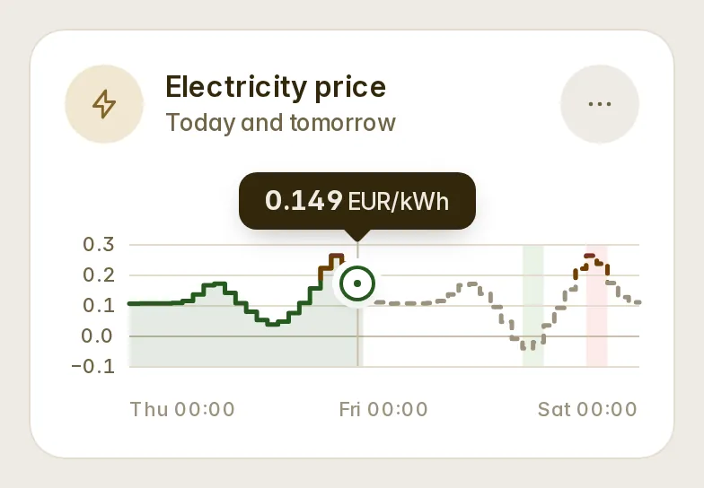
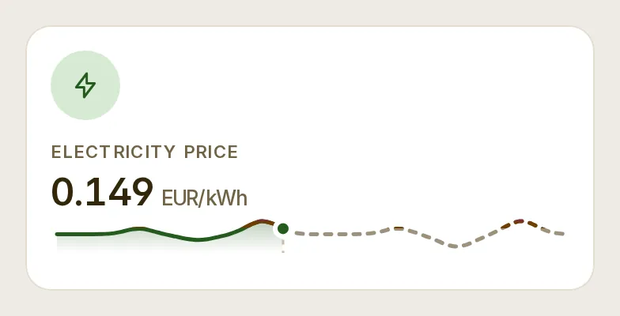
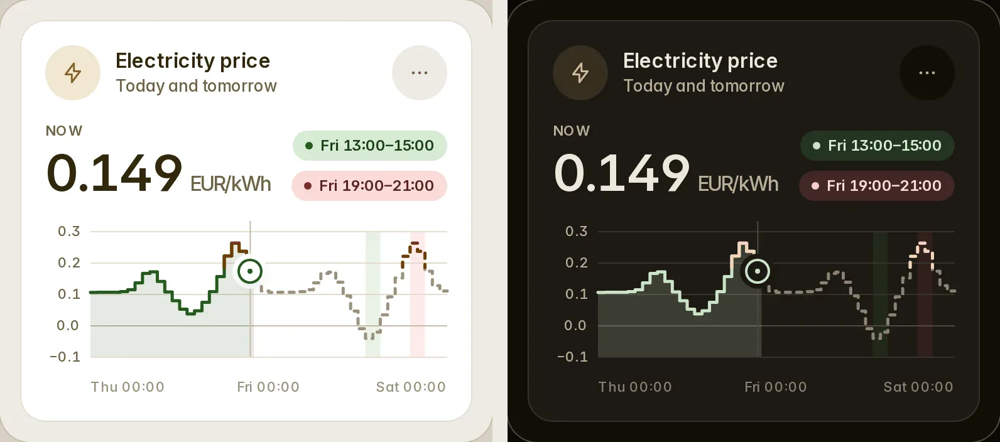

<!-- Generated by `pnpm docs:cards` from the card’s editor, its example in tools/docs/src/gallery.ts and its guide in tools/docs/guides/: change those, not this page. -->

# Chart

Any time series on one chart — history, statistics, a list in an attribute (Nordpool’s prices, a solar forecast) or a weather’s forecast — past to future with now marked, thresholds in their colours and the cheapest hours found.

`custom:fluvy-chart-card` · [Try it live](https://acosta290.github.io/fluvy/?card=chart) · [All cards](../cards.md#energy)

<picture><source media="(prefers-color-scheme: dark)" srcset="../images/cards/chart-dark.webp"></picture>

## Example

```yaml
type: custom:fluvy-chart-card
title: Electricity price
icon: bolt
series:
  - entity: sensor.ch_nordpool
    tone: ok
span: today+tomorrow
chart: step
thresholds:
  - tone: warning
    value: 0.18
  - tone: danger
    value: 0.26
highlight: both
highlight_hours: 2
```

The picture above, on the demo house: put your own entities in place of its.

## Layouts

`variant` chooses the layout. The picture above is `full`, the default; each of the others is the example plus the line over it, and opens in the live demo.

<table>
<tbody><tr>
<td align="center" valign="top" width="50%"><code>variant: compact</code><br><a href="https://acosta290.github.io/fluvy/?card=chart&amp;layout=compact"><picture><source media="(prefers-color-scheme: dark)" srcset="../images/cards/chart.compact-dark.webp"></picture></a></td>
<td align="center" valign="top" width="50%"><code>variant: tile</code><br><a href="https://acosta290.github.io/fluvy/?card=chart&amp;layout=tile"><picture><source media="(prefers-color-scheme: dark)" srcset="../images/cards/chart.tile-dark.webp"></picture></a></td>
</tr></tbody>
</table>

## All options

```yaml
type: custom:fluvy-chart-card
title: Electricity price
# subtitle:
icon: bolt
show_icon: auto
name_lines: 1
# tone:
# color:
# card_color:
# card_opacity: 100
# card_border: true
# unavailable: dashed
series:
  - entity: sensor.ch_nordpool
    tone: ok
# collection_key:
span: today+tomorrow
variant: full
show_head: true
highlight: both
highlight_hours: 2
thresholds:
  - tone: warning
    value: 0.18
  - tone: danger
    value: 0.26
chart: step
# points: auto
# fill: flat
# line_width: regular
# show_points: none
show_grid: auto
show_axis: true
# show_now: true
# animate: true
# tap_action:
#   action: more-info
# hold_action:
#   action: more-info
# double_tap_action:
#   action: none
# icon_tap_action:
#   action: none
# icon_hold_action:
#   action: none
# icon_double_tap_action:
#   action: none
```

## Options

| Option | Default | What it does |
| --- | --- | --- |
| `title` |  | The title at the top of the card. |
| `subtitle` |  | The line under the title: your own words, an entity’s state or a template. |
| `icon` |  | The card’s icon, in place of the entity’s own. |
| `collection_key` | none | Makes the card follow an Energy date picker on the same dashboard. |
| `span` | `12h` | The window of time the chart shows. `4h` (Last 4 h) · `12h` (Last 12 h) · `24h` (Last 24 h) · `today` · `today+tomorrow` (Today and tomorrow) · `48h` (Last 48 h) · `7d` (Last 7 days) · `30d` (Last 30 days), or your own. |
| `variant` | `full` | The card’s layout. `full` · `compact` · `tile`. |
| `show_head` | `true` | Shows the value now, large, over the chart. |
| `show_legend` | `true` | Shows the legend under the chart. |
| `highlight` | `none` | Marks the windows to come: the cheapest, the dearest, or both. `none` · `min` (The lowest reading) · `max` (The highest reading) · `both` (Lowest and highest). |
| `highlight_hours` | `1` | How many hours each marked window lasts. 1 to 12. |
| [`series`](#series) |  | The series the chart draws, an entity each. A list: [its items](#series). |
| [`thresholds`](#thresholds) |  | Values from which the line takes another tone. A list: [its items](#thresholds). |
| **Chart** |  |  |
| `chart` | `classic` | The chart’s style; left out, the style set for the whole house. `classic` · `soft` · `glow` · `minimal` · `step` · `bars` · `columns` · `band`. |
| `points` | `auto` | How far apart the line’s points are drawn. `auto` · `5m` · `15m` · `30m` · `1h`. |
| `curve` | `smooth` | How the line joins its readings: smooth, straight, or in steps. `smooth` · `straight` · `step`. |
| `fill` | `gradient` | What lies under the line: a gradient, a flat fill, or nothing. `gradient` · `flat` · `none`. |
| `line_width` | `regular` | How thick the line is. `thin` · `regular` · `bold`. |
| `glow` | `false` | Draws a soft shadow under the line. |
| `show_points` | `end` | Draws points on the line: none, the last one, or every reading. `none` · `end` (At the end) · `all`. |
| `show_grid` | `auto` | Draws gridlines across the chart. `auto` · `none` · `x` (Vertical lines) · `y` (Horizontal lines) · `both`. |
| `show_axis` | `true` | Shows the scale’s labels beside the chart. |
| `show_now` | `false` | Marks the present moment on the chart. |
| `animate` | `true` | Lets the chart or the gauge move as it draws; off, it shows its resting frame at once. |

<details>
<summary>Its look and its actions, as on every card</summary>

| Option | Default | What it does |
| --- | --- | --- |
| `show_icon` | `auto` | Shows the icon, hides it, or lets the card decide. `auto` · `always` · `never`. |
| `name_lines` | `1` | Lets the name in the card’s head take two balanced lines where one would cut it; the head is a line taller whatever the name. `1` · `2`. |
| `tone` | the card’s own | The card’s colour from the palette’s tones; left out, the tone of what it shows. `accent` · `light` · `heat` · `cool` · `dry` · `fan` · `water` · `solar` · `grid` · `media` · `presence` · `armed` · `battery` · `house` · `gas` · `vehicle` (Car) · `neutral` · `ok` (Good) · `warning` · `danger`. |
| `color` |  | The card’s colour: its circle, its accents and its tints wear it. Left out, the colour of what it shows. |
| `card_color` |  | Paints the card’s surface in a colour of your own. |
| `card_opacity` | `100` | How solid the card’s surface is, in percent: under 100 the view’s background shows through. Left out, the house’s. 0 % to 100 %, in steps of 5. |
| `card_border` | `true` | Whether the card draws its hairline border. Left out, the house’s. |
| `unavailable` | `dashed` | How the card looks while its entity is unavailable: dashed, or quiet as when it is off. Left out, the house’s. `dashed` · `quiet` (As when off). |
| **Interactions** |  |  |
| `tap_action` | `more-info` | What a tap on the card does. |
| `hold_action` | `more-info` | What a long press on the card does. |
| `double_tap_action` | `none` | What two taps on the card do. |
| `icon_tap_action` | `none` | What a tap on the icon does. |
| `icon_hold_action` | `none` | What a long press on the icon does. |
| `icon_double_tap_action` | `none` | What two taps on the icon do. |

More about them in [Options every card takes](../customising.md#options-every-card-takes).

</details>

## Lists

### `series`

An item is an entity id, or a map with `entity` and any of these fields.

| Field | What it does |
| --- | --- |
| `entity` | The entity the item shows. A `sensor`, `weather`, `number`, `input_number` or `counter`. |
| `name` | The item’s own name, in place of the one the card would give it. |
| `source` | Where the readings come from. `auto` · `history` · `statistics` · `attribute` (A list in its attributes) · `forecast`. |
| `attribute` | The attribute that holds the list of readings. `auto`, or your own. |
| `time_key` | The key of each entry that holds its time. |
| `value_key` | The key of each entry that holds its value. |
| `stat` | What each reading of the statistics is. `mean` (The mean) · `min` (The lowest reading) · `max` (The highest reading) · `sum` · `change` (What it gained). |
| `period` | How long each statistic’s reading lasts. `hour` (An hour) · `day` (A day) · `week` (A week) · `month` (A month). |
| `kind` | How the series is drawn: a line, an area, columns, or a band. `line` · `area` · `columns` · `band`. |
| `curve` | How this series’ line joins its readings. `smooth` · `straight` · `step`. |
| `fill` | What lies under this series’ line. `gradient` · `flat` · `none`. |
| `tone` | The item’s colour from the palette’s tones. `accent` · `light` · `heat` · `cool` · `dry` · `fan` · `water` · `solar` · `grid` · `media` · `presence` · `armed` · `battery` · `house` · `gas` · `vehicle` (Car) · `neutral` · `ok` (Good) · `warning` · `danger`. |
| `color` | The item’s colour, in place of the one the card gives it. `graph-1` (Series 1) · `graph-2` (Series 2) · `graph-3` (Series 3) · `graph-4` (Series 4) · `graph-5` (Series 5) · `graph-6` (Series 6) · `graph-7` (Series 7) · `graph-8` (Series 8) · `graph-9` (Series 9) · `graph-10` (Series 10) · `graph-11` (Series 11) · `graph-12` (Series 12) · `accent` · `ok` (Good) · `warning` · `danger` · `notice` · `light` · `solar` · `grid` · `battery` · `water` · `gas` · `home` (House), or your own. |
| `unit` | The unit this series is written in. `auto` · `W` · `kW` · `MW` · `Wh` · `kWh` · `MWh` · `L` · `m³` · `gal` · `ft³`, or your own. |
| `decimals` | How many decimals the figure has. `auto` · `0` · `1` · `2` · `3`. |

### `thresholds`

An item is a map with `tone` and any of these fields.

| Field | What it does |
| --- | --- |
| `tone` | The item’s colour from the palette’s tones. `none` · `accent` · `light` · `heat` · `cool` · `dry` · `fan` · `water` · `solar` · `grid` · `media` · `presence` · `armed` · `battery` · `house` · `gas` · `vehicle` (Car) · `neutral` · `ok` (Good) · `warning` · `danger`. |
| `value` | Where the threshold starts: a figure, an entity’s reading or a template’s answer, in the reading’s unit. |
| `below` | The threshold claims what is under its value. `true` or `false`. |
| `color` | The item’s colour, in place of the one the card gives it. |
| `label` | What the band is called, said beside the reading so that colour is never all that says it. |
| `icon` | The item’s own icon, in place of the one the card would give it. |

## Guide



Up to six `series` on one chart: a sensor's history, its statistics, a list in its attributes, or a weather's
forecast. The past is solid, the future dashed.

```yaml
# Nordpool prices: raw_today and raw_tomorrow are read by themselves
type: custom:fluvy-chart-card
title: Electricity price
series:
  - entity: sensor.nordpool_kwh_nl_eur_3_10_021
    tone: ok # the line's colour where it is cheap
span: today+tomorrow
chart: step
thresholds:
  - { value: 0.18, tone: warning }
  - { value: 0.26, tone: danger }
highlight: both # the cheapest and the dearest window ahead
highlight_hours: 2
```

```yaml
# the measured temperature, then the forecast after it
type: custom:fluvy-chart-card
title: Temperature
series:
  - entity: sensor.living_room_temperature
    name: Living room
  - entity: weather.home # its hourly forecast
    name: Outside
    color: graph-4 # the palette's fourth series colour
span: today+tomorrow
```

### Series

- `source`: `history`, `statistics`, `attribute` or `forecast`. Left out: a weather's forecast, else a known list in
  its attributes, else its history.
- Lists read by themselves: Nordpool, Tibber, ENTSO-E, Frank Energie, Solcast (its 10 % and 90 % as a band), and any
  list of times and values. `time_key` and `value_key` name other keys.
- `kind`: `line`, `area`, `columns` or `band` (lows and highs).
- `unit`: one the sensor's converts to, or the unit its list is written in (Solcast's kW under a kWh sensor).
- `color` takes a colour or a palette name that follows the palette: `graph-1` to `graph-12`, `accent`, `ok`,
  `warning`, `danger`, `solar`, `grid`, `battery`, `water`, `gas`, `home`.

### Window

`span`: the house's window (12 hours), `<N>h` or `<N>d` rolling to now, `today`, or `today+tomorrow` (today alone until
tomorrow's prices are out). With `collection_key` it follows a
[date picker](../energy.md#following-home-assistants-date-picker).

`thresholds` are written in the first series' unit ([thresholds](../customising.md#thresholds)); the chart style and
its fine keys are the sensor card's ([charts](../customising.md#charts)).

<details>
<summary>Older names the card still reads</summary>

| Older name | Read as |
| --- | --- |
| `sub` | `subtitle` |
| `meta` | `subtitle` |
| `layout` | `variant` |
| `view` | `variant` |
| `accent` | `color` |

</details>
