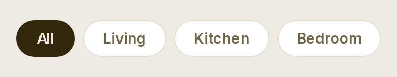

<!-- Generated by `pnpm docs:cards` from the card’s editor, its example in tools/docs/src/gallery.ts and its guide in tools/docs/guides/: change those, not this page. -->

# Chips

A row of chips that navigate between views or open entities.

`custom:fluvy-chips-card` · [Try it live](https://acosta290.github.io/fluvy/?card=chips) · [All cards](../cards.md#structure-and-navigation)

<picture><source media="(prefers-color-scheme: dark)" srcset="../images/cards/chips-dark.webp"></picture>

## Example

```yaml
type: custom:fluvy-chips-card
chips:
  - name: All
    path: /
  - name: Living
    path: /fluvy-home/living
  - name: Kitchen
    path: /fluvy-home/kitchen
  - name: Bedroom
    path: /fluvy-home/bedroom
```

The picture above, on the demo house: put your own entities in place of its.

## All options

```yaml
type: custom:fluvy-chips-card
# name:
chips:
  - name: All
    path: /
  - name: Living
    path: /fluvy-home/living
  - name: Kitchen
    path: /fluvy-home/kitchen
  - name: Bedroom
    path: /fluvy-home/bedroom
# tint: 'on'
# empty_text:
hide_empty: false
```

## Options

| Option | Default | What it does |
| --- | --- | --- |
| `name` |  | The name the card shows, in place of the entity’s own. |
| `tint` | `on` | When each chip shows its colour. `on` (When on) · `always`. |
| `empty_text` |  | What the card says while it has nothing to show. |
| `hide_empty` | `false` | Hides the whole card while it has nothing to show. |
| [`chips`](#chips) |  | The chips, each a tab that opens a path or runs an action. A list: [its items](#chips). |

## Lists

### `chips`

An item is a map with `name` and any of these fields.

| Field | What it does |
| --- | --- |
| `name` | The item’s own name, in place of the one the card would give it. |
| `icon` | The item’s own icon, in place of the one the card would give it. |
| `path` | Where a tap on the chip goes. |
| `entity` | The entity the item shows. |
| `color` | The item’s colour, in place of the one the card gives it. |
| **Interactions** |  |
| `tap_action` | What a tap on the item does. |
| `hold_action` | What a long press on the item does. |
| `double_tap_action` | What two taps on the item do. |

## Guide

A chip's `name`, `icon` and `color` may each be a Home Assistant template, rendered live. The chip's `entity` is
`entity` in them.

```yaml
type: custom:fluvy-chips-card
chips:
  # a count that stays current
  - name: "{{ states.person | selectattr('state', 'eq', 'home') | list | count }} home"
    icon: mdi:home-account
    path: /dashboard-home/people
  # a colour that follows a state
  - name: "{{ states.light | selectattr('state', 'eq', 'on') | list | count }} lights on"
    icon: mdi:lightbulb-group
    color: "{{ 'amber' if is_state('light.kitchen', 'on') else 'grey' }}"
  # a chip that shows only while there is something to say
  - name: "{{ 'Washer done' if is_state('sensor.washer_state', 'finished') else '' }}"
    entity: sensor.washer_state
```

- A template that renders nothing leaves the chip its icon; a chip with no icon is then left out.
- A template that fails shows nothing of itself.
- `icon` takes an `mdi:` icon or a Fluvy glyph's name; `color` a colour name or `#rrggbb`.
- The row stays one line, whatever the words.
- Fluvy runs no JavaScript: a button-card label between `[[[ ]]]` shows as written. Write it as a template.

<details>
<summary>Older names the card still reads</summary>

| Older name | Read as |
| --- | --- |
| `label` | `name` |
| `chips[].label` | `chips[].name` |
| `chips[].sub` | `chips[].secondary` |
| `chips[].meta` | `chips[].subtitle` |
| `chips[].action` | `chips[].tap_action` |

</details>
