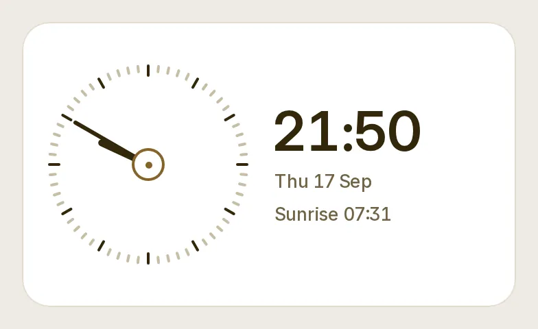
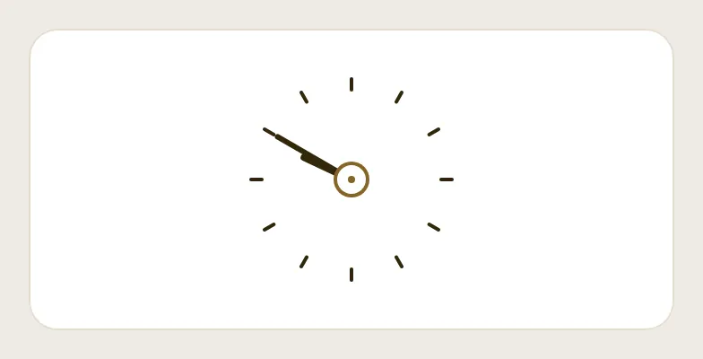

<!-- Generated by `pnpm docs:cards` from the card’s editor, its example in tools/docs/src/gallery.ts and its guide in tools/docs/guides/: change those, not this page. -->

# Clock

Analog or digital, hero, side or tile, with or without weather.

`custom:fluvy-clock-card` · [Try it live](https://acosta290.github.io/fluvy/?card=clock) · [All cards](../cards.md#time)

<picture><source media="(prefers-color-scheme: dark)" srcset="../images/cards/clock-dark.webp"></picture>

## Example

```yaml
type: custom:fluvy-clock-card
```

The picture above, on the demo house: put your own entities in place of its.

## Layouts

`variant` chooses the layout. The picture above is `hero`, the default; each of the others is the example plus the line over it, and opens in the live demo.

<table>
<tbody><tr>
<td align="center" valign="top" width="50%"><code>variant: side</code><br><a href="https://acosta290.github.io/fluvy/?card=clock&amp;layout=side"><picture><source media="(prefers-color-scheme: dark)" srcset="../images/cards/clock.side-dark.webp"></picture></a></td>
<td align="center" valign="top" width="50%"><code>variant: tile</code><br><a href="https://acosta290.github.io/fluvy/?card=clock&amp;layout=tile"><picture><source media="(prefers-color-scheme: dark)" srcset="../images/cards/clock.tile-dark.webp"></picture></a></td>
</tr></tbody>
</table>

## All options

```yaml
type: custom:fluvy-clock-card
face: analog
variant: hero
numerals: none
# title:
show_seconds: true
hour12: true
show_date: true
show_week: false
# weather:
show_forecast: false
# time_zone:
# color:
# card_color:
# card_opacity: 100
# card_border: true
# tap_action:
# hold_action:
#   action: none
# double_tap_action:
#   action: none
```

## Options

| Option | Default | What it does |
| --- | --- | --- |
| `face` | `analog` | Draws the time on a dial, or in large digits. `analog` · `digital`. |
| `variant` | `hero` | The card’s layout. `hero` · `side` · `tile`. |
| `numerals` | `none` | The numbers drawn round the dial. `none` · `quarters` · `all`. |
| `title` |  | A title over the clock, such as the city it shows. |
| `show_seconds` | `true` | Shows the seconds: the second hand on a dial, the seconds after the digits. |
| `hour12` | `true` | Writes the time on a 12-hour clock; left out, as Home Assistant’s profile says. |
| `show_date` | `true` | Shows the date. |
| `show_week` | `false` | Shows the week’s number after the date. |
| `weather` |  | A weather entity: its condition and temperature, and the sky’s tone on the face. A `weather`. |
| `show_forecast` | `false` | Shows the forecast; hidden, the card is the weather now alone. |
| `time_zone` |  | The time zone the clock shows, as an IANA name. |

<details>
<summary>Its look and its actions, as on every card</summary>

| Option | Default | What it does |
| --- | --- | --- |
| `color` |  | The card’s colour: its circle, its accents and its tints wear it. Left out, the colour of what it shows. |
| `card_color` |  | Paints the card’s surface in a colour of your own. |
| `card_opacity` | `100` | How solid the card’s surface is, in percent: under 100 the view’s background shows through. Left out, the house’s. 0 % to 100 %, in steps of 5. |
| `card_border` | `true` | Whether the card draws its hairline border. Left out, the house’s. |
| `unavailable` | `dashed` | How the card looks while its entity is unavailable: dashed, or quiet as when it is off. Left out, the house’s. `dashed` · `quiet` (As when off). |
| **Interactions** |  |  |
| `tap_action` | the card’s own | What a tap on the card does. |
| `hold_action` | `none` | What a long press on the card does. |
| `double_tap_action` | `none` | What two taps on the card do. |

More about them in [Options every card takes](../customising.md#options-every-card-takes).

</details>

<details>
<summary>Older names the card still reads</summary>

| Older name | Read as |
| --- | --- |
| `variant` | `face` (some of its values) |
| `seconds` | `show_seconds` |
| `date` | `show_date` |
| `week` | `show_week` |
| `forecast` | `show_forecast` |
| `layout` | `variant` |
| `view` | `variant` |
| `accent` | `color` |

</details>
