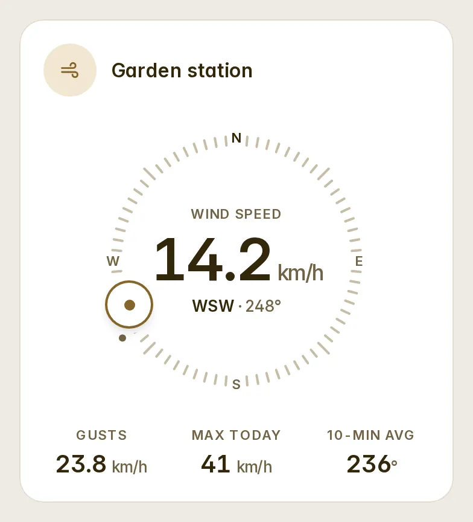

<!-- Generated by `pnpm docs:cards` from the card’s editor, its example in tools/docs/src/gallery.ts and its guide in tools/docs/guides/: change those, not this page. -->

# Compass

Wind speed and direction, a vehicle’s heading or any bearing on a 360° compass ring, with a secondary marker and up to three readouts underneath.

`custom:fluvy-compass-card` · [Try it live](https://acosta290.github.io/fluvy/?card=compass) · [All cards](../cards.md#everyday)

<picture><source media="(prefers-color-scheme: dark)" srcset="../images/cards/compass-dark.webp"></picture>

## Example

```yaml
type: custom:fluvy-compass-card
entity: sensor.am_wind_speed
direction_entity: sensor.am_wind_bearing
stats:
  - entity: sensor.am_wind_gust
    name: Gusts
  - entity: sensor.am_wind_max_today
    name: Max today
  - entity: sensor.am_wind_bearing_avg
    name: '10m avg'
```

The picture above, on the demo house: put your own entities in place of its.

## All options

```yaml
type: custom:fluvy-compass-card
entity: sensor.am_wind_speed
# name:
# subtitle:
# icon:
show_icon: auto
show_badge: true
name_lines: 1
# tone:
# color:
# card_color:
# card_opacity: 100
# card_border: true
# unavailable: dashed
# warn_above:
# danger_above:
direction_entity: sensor.am_wind_bearing
indicator: pointer
indicator_opacity: 1
# secondary_direction_entity:
secondary_indicator: knob
secondary_opacity: 0.55
north_offset: 0
# label:
# badge:
show_stats: true
show_ticks: true
show_cardinals: true
stats:
  - entity: sensor.am_wind_gust
    name: Gusts
  - entity: sensor.am_wind_max_today
    name: Max today
  - entity: sensor.am_wind_bearing_avg
    name: '10m avg'
# unit: auto
# decimals: auto
# tap_action:
#   action: more-info
# hold_action:
#   action: more-info
# double_tap_action:
#   action: none
# icon_tap_action:
#   action: none
# icon_hold_action:
#   action: none
# icon_double_tap_action:
#   action: none
```

## Options

| Option | Default | What it does |
| --- | --- | --- |
| `entity` |  | The numeric sensor shown in the centre of the compass ring, such as wind speed. A `sensor`, `number` or `input_number`. |
| `name` |  | The name the card shows, in place of the entity’s own. |
| `subtitle` |  | The line under the title: your own words, an entity’s state or a template. |
| `icon` |  | The card’s icon, in place of the entity’s own. |
| `warn_above` |  | Above this value the card turns to a warning. 0 to 500. |
| `danger_above` |  | Above this value the card turns to danger. 0 to 500. |
| `direction_entity` |  | The bearing sensor (0–360° or a cardinal point) that drives the primary pointer on the ring. A `sensor`, `number`, `input_number` or `sun`. |
| `indicator` | `pointer` | The shape of the primary pointer on the compass ring. `pointer` · `knob` · `arrow_inward` · `arrow_outward` · `circle`. |
| `indicator_opacity` | `1` | The opacity of the primary pointer on the ring. 0.1 to 1, in steps of 0.05. |
| `secondary_direction_entity` |  | A second bearing sensor drawn on the same ring, such as a 10-minute average wind direction or the sun’s azimuth. A `sensor`, `number`, `input_number` or `sun`. |
| `secondary_indicator` | `knob` | The shape of the secondary pointer on the compass ring. `pointer` · `knob` · `arrow_inward` · `arrow_outward` · `circle`. |
| `secondary_opacity` | `0.55` | The opacity of the secondary pointer on the ring. 0.1 to 1, in steps of 0.05. |
| `north_offset` | `0` | Rotates the compass dial by this many degrees when the view is not aligned with true north. -180 to 360. |
| `label` |  | The word in the open centre of the ring, above the figure. |
| `badge` |  | The words in the head’s pill, in place of the cardinal direction. |
| `show_stats` | `true` | Shows the row of readouts under the compass. |
| `show_ticks` | `true` | Draws the 48 degree ticks around the compass ring. |
| `show_cardinals` | `true` | Shows N, E, S and W on the compass ring. |
| `unit` | `auto` | The unit the figures are written in; automatic keeps the sensor’s. `auto` · `W` · `kW` · `MW` · `Wh` · `kWh` · `MWh` · `L` · `m³` · `gal` · `ft³`, or your own. |
| `decimals` | `auto` | How many decimals the figures have; automatic decides by their size. `auto` · `0` · `1` · `2` · `3`. |
| [`stats`](#stats) |  | Up to three sensors read out under the compass, in this order. A list: [its items](#stats). |

<details>
<summary>Its look and its actions, as on every card</summary>

| Option | Default | What it does |
| --- | --- | --- |
| `show_icon` | `auto` | Shows the icon, hides it, or lets the card decide. `auto` · `always` · `never`. |
| `show_badge` | `true` | Shows the badge at the end of the head, such as the card’s state or a count. |
| `name_lines` | `1` | Lets the name in the card’s head take two balanced lines where one would cut it; the head is a line taller whatever the name. `1` · `2`. |
| `tone` | the card’s own | The card’s colour from the palette’s tones; left out, the tone of what it shows. `accent` · `light` · `heat` · `cool` · `dry` · `fan` · `water` · `solar` · `grid` · `media` · `presence` · `armed` · `battery` · `house` · `gas` · `vehicle` (Car) · `neutral` · `ok` (Good) · `warning` · `danger`. |
| `color` |  | The card’s colour: its circle, its accents and its tints wear it. Left out, the colour of what it shows. |
| `card_color` |  | Paints the card’s surface in a colour of your own. |
| `card_opacity` | `100` | How solid the card’s surface is, in percent: under 100 the view’s background shows through. Left out, the house’s. 0 % to 100 %, in steps of 5. |
| `card_border` | `true` | Whether the card draws its hairline border. Left out, the house’s. |
| `unavailable` | `dashed` | How the card looks while its entity is unavailable: dashed, or quiet as when it is off. Left out, the house’s. `dashed` · `quiet` (As when off). |
| **Interactions** |  |  |
| `tap_action` | `more-info` | What a tap on the card does. |
| `hold_action` | `more-info` | What a long press on the card does. |
| `double_tap_action` | `none` | What two taps on the card do. |
| `icon_tap_action` | `none` | What a tap on the icon does. |
| `icon_hold_action` | `none` | What a long press on the icon does. |
| `icon_double_tap_action` | `none` | What two taps on the icon do. |

More about them in [Options every card takes](../customising.md#options-every-card-takes).

</details>

## Lists

### `stats`

An item is an entity id, or a map with `entity` and any of these fields.

| Field | What it does |
| --- | --- |
| `entity` | The entity the item shows. A `sensor`, `number` or `input_number`. |
| `name` | The item’s own name, in place of the one the card would give it. |
| `unit` | The unit the figure is written in. `auto` · `W` · `kW` · `MW` · `Wh` · `kWh` · `MWh` · `L` · `m³` · `gal` · `ft³`, or your own. |
| `decimals` | How many decimals the figure has. `auto` · `0` · `1` · `2` · `3`. |

<details>
<summary>Older names the card still reads</summary>

| Older name | Read as |
| --- | --- |
| `sub` | `subtitle` |
| `meta` | `subtitle` |
| `accent` | `color` |

</details>
