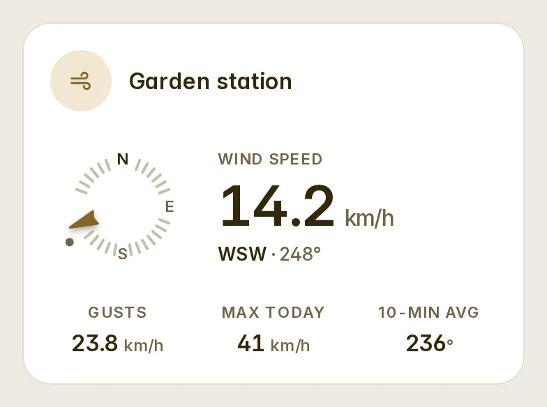
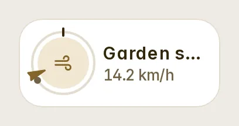

<!-- Generated by `pnpm docs:cards` from the card’s editor, its example in tools/docs/src/gallery.ts and its guide in tools/docs/guides/: change those, not this page. -->

# Compass

Wind speed and direction, a vehicle’s heading or any bearing on a 360° compass ring, with a secondary marker and up to three readouts underneath.

`custom:fluvy-compass-card` · [Try it live](https://acosta290.github.io/fluvy/?card=compass) · [All cards](../cards.md#everyday)

<picture><source media="(prefers-color-scheme: dark)" srcset="../images/cards/compass-dark.webp"></picture>

## Example

```yaml
type: custom:fluvy-compass-card
name: Garden station
entity: sensor.am_wind_speed
direction_entity: sensor.am_wind_bearing
secondary_direction_entity: sensor.am_wind_bearing_avg
stats:
  - entity: sensor.am_wind_gust
    name: Gusts
  - entity: sensor.am_wind_max_today
    name: Max today
  - entity: sensor.am_wind_bearing_avg
    name: '10-min avg'
```

The picture above, on the demo house: put your own entities in place of its.

## Layouts

`variant` chooses the layout. The picture above is `full`, the default; each of the others is the example plus the line over it, and opens in the live demo.

<table>
<tbody><tr>
<td align="center" valign="top" width="50%"><code>variant: compact</code><br><a href="https://acosta290.github.io/fluvy/?card=compass&amp;layout=compact"><picture><source media="(prefers-color-scheme: dark)" srcset="../images/cards/compass.compact-dark.webp"></picture></a></td>
<td align="center" valign="top" width="50%"><code>variant: row</code><br><a href="https://acosta290.github.io/fluvy/?card=compass&amp;layout=row"><picture><source media="(prefers-color-scheme: dark)" srcset="../images/cards/compass.row-dark.webp"></picture></a></td>
</tr></tbody>
</table>

## All options

```yaml
type: custom:fluvy-compass-card
entity: sensor.am_wind_speed
name: Garden station
# subtitle:
# icon:
variant: full
show_icon: auto
show_badge: true
name_lines: 1
# tone:
# color:
# card_color:
# card_opacity: 100
# card_border: true
# exact_colors: false
# unavailable: dashed
direction_entity: sensor.am_wind_bearing
# direction_attribute:
indicator: arrow
secondary_direction_entity: sensor.am_wind_bearing_avg
# secondary_direction_attribute:
secondary_indicator: dot
arrow_points: outward
north_offset: 0
face: classic
show_ticks: true
show_cardinals: true
# label:
# badge:
stats:
  - entity: sensor.am_wind_gust
    name: Gusts
  - entity: sensor.am_wind_max_today
    name: Max today
  - entity: sensor.am_wind_bearing_avg
    name: '10-min avg'
show_stats: true
# thresholds:
# unit: auto
# decimals: auto
# tap_action:
#   action: more-info
# hold_action:
#   action: more-info
# double_tap_action:
#   action: none
# icon_tap_action:
#   action: none
# icon_hold_action:
#   action: none
# icon_double_tap_action:
#   action: none
```

## Options

| Option | Default | What it does |
| --- | --- | --- |
| `entity` |  | The figure in the ring beside `direction_entity`, such as the wind’s speed; alone, it is read as the bearing. A `sensor`, `number` or `input_number`. |
| `name` |  | The name the card shows, in place of the entity’s own. |
| `subtitle` |  | The line under the title: your own words, an entity’s state or a template. |
| `icon` |  | The card’s icon, in place of the entity’s own. |
| `variant` | `full` | The card’s layout. `full` · `compact` · `row`. |
| `direction_entity` |  | The bearing: a state in degrees or in English letters (N, NNE … NNW), the sun’s azimuth, a weather entity’s wind. |
| `direction_attribute` |  | The attribute the bearing is read from, on any entity (a car tracker’s `heading`). |
| `indicator` | `arrow` | How the bearing is marked: an arrow across the ring, a chevron in a ringed circle on it, the knob on the ring, the ticks lit across it, or a dot. `arrow` · `chevron` · `knob` · `ticks` (Lit ticks) · `dot`. |
| `secondary_direction_entity` |  | A second bearing on the same ring, in the secondary ink: a 10-minute average, the sun. |
| `secondary_direction_attribute` |  | The attribute the second bearing is read from. |
| `secondary_indicator` | `dot` | How the second bearing is marked. `arrow` · `chevron` · `knob` · `ticks` (Lit ticks) · `dot`. |
| `arrow_points` | `outward` | Which way an arrow or a chevron points, the bearing’s and the second’s: out from the centre to the bearing, as a compass needle’s head, or in at the figure, as the wind blows from it. `outward` · `inward`. |
| `north_offset` | `0` | Where north is drawn, in degrees clockwise from the top, for a window that does not face north. -180 ° to 180 °. |
| `face` | `classic` | The ring’s look: a classic compass’s, a band with the ticks across it and the letters large outside it; or the ring of ticks alone, the letters small in their place. `classic` · `ring`. |
| `show_ticks` | `true` | Draws the ring’s ticks, the cardinal points’ bars with them. |
| `show_cardinals` | `true` | Writes N, E, S and W in the ring, in the page’s language. |
| `label` |  | The words inside the ring, over the figure. |
| `badge` |  | The words in the head’s badge: your own, an entity’s state or a template; none by default. |
| `show_stats` | `true` | Shows the row of readouts under the ring. |
| `tint` | `off` | Whether the card itself takes the colour of the threshold its figure is past: never, or while it is past one. `off` (Never) · `on` (Past a threshold). |
| `tint_style` | `wash` | How that colour is shown: a wash over the card, or the card’s edge. `wash` · `edge`. |
| `unit` | `auto` | The unit the figures are written in; automatic keeps the sensor’s. `auto` · `W` · `kW` · `MW` · `Wh` · `kWh` · `MWh` · `L` · `m³` · `gal` · `ft³`, or your own. |
| `decimals` | `auto` | How many decimals the figures have; automatic decides by their size. `auto` · `0` · `1` · `2` · `3`. |
| [`stats`](#stats) |  | Up to three sensors read out under the compass, in this order. A list: [its items](#stats). |
| [`thresholds`](#thresholds) |  | Values past which the reading takes a colour, each with its tone, and a label and an icon of its own. A list: [its items](#thresholds). |

<details>
<summary>Its look and its actions, as on every card</summary>

| Option | Default | What it does |
| --- | --- | --- |
| `show_icon` | `auto` | Shows the icon, hides it, or lets the card decide. `auto` · `always` · `never`. |
| `show_badge` | `true` | Shows the badge at the end of the head, such as the card’s state or a count. |
| `name_lines` | `1` | Lets the name in the card’s head take two balanced lines where one would cut it; the head is a line taller whatever the name. 0 hides the name: the head keeps its circle and its line. `0` · `1` · `2`. |
| `tone` | the card’s own | The card’s colour from the palette’s tones; left out, the tone of what it shows. `accent` · `light` · `heat` · `cool` · `dry` · `fan` · `water` · `solar` · `grid` · `media` · `presence` · `armed` · `battery` · `house` · `gas` · `vehicle` (Car) · `neutral` · `ok` (Good) · `warning` · `danger`. |
| `color` |  | The card’s colour: its circle, its accents and its tints wear it. Left out, the colour of what it shows. |
| `card_color` |  | Paints the card’s surface in a colour of your own. |
| `card_opacity` | `100` | How solid the card’s surface is, in percent: under 100 the view’s background shows through. Left out, the house’s. 0 % to 100 %, in steps of 5. |
| `card_border` | `true` | Whether the card draws its hairline border. Left out, the house’s. |
| `card_blur` | `true` | Whether what shows through a see-through card is blurred. Left out, the house’s, and none at 0 %. |
| `exact_colors` | `false` | Wears the colours the card names as Home Assistant draws them and a hex as typed, not the palette’s tones. Left out, the house’s. |
| `unavailable` | `dashed` | How the card looks while its entity is unavailable: dashed, or quiet as when it is off. Left out, the house’s. `dashed` · `quiet` (As when off). |
| **Interactions** |  |  |
| `tap_action` | `more-info` | What a tap on the card does. |
| `hold_action` | `more-info` | What a long press on the card does. |
| `double_tap_action` | `none` | What two taps on the card do. |
| `icon_tap_action` | `none` | What a tap on the icon does. |
| `icon_hold_action` | `none` | What a long press on the icon does. |
| `icon_double_tap_action` | `none` | What two taps on the icon do. |

More about them in [Options every card takes](../customising.md#options-every-card-takes).

</details>

## Lists

### `stats`

An item is an entity id, or a map with `entity` and any of these fields.

| Field | What it does |
| --- | --- |
| `entity` | The entity the item shows. A `sensor`, `number` or `input_number`. |
| `name` | The item’s own name, in place of the one the card would give it. |
| `unit` | The unit the figure is written in. `auto` · `W` · `kW` · `MW` · `Wh` · `kWh` · `MWh` · `L` · `m³` · `gal` · `ft³`, or your own. |
| `decimals` | How many decimals the figure has. `auto` · `0` · `1` · `2` · `3`. |

### `thresholds`

An item is a map with `tone` and any of these fields.

| Field | What it does |
| --- | --- |
| `tone` | The item’s colour from the palette’s tones. `none` · `accent` · `light` · `heat` · `cool` · `dry` · `fan` · `water` · `solar` · `grid` · `media` · `presence` · `armed` · `battery` · `house` · `gas` · `vehicle` (Car) · `neutral` · `ok` (Good) · `warning` · `danger`. |
| `value` | Where the threshold starts: a figure, an entity’s reading or a template’s answer, in the reading’s unit. |
| `below` | The threshold claims what is under its value. `true` or `false`. |
| `color` | The item’s colour, in place of the one the card gives it. |
| `label` | What the band is called, said beside the reading so that colour is never all that says it. |
| `icon` | The item’s own icon, in place of the one the card would give it. |

## Guide

The Compass card draws a bearing on a 360° ring: the wind from a weather station, a car's heading, a dish's or the
sun's azimuth. A figure stands in the ring (the wind's speed), the point and the degrees under it.

```yaml
# a weather station: the wind, its 10-minute average beside it, three readouts under the ring
type: custom:fluvy-compass-card
name: Garden station
entity: sensor.wind_speed
direction_entity: sensor.wind_direction
secondary_direction_entity: sensor.wind_direction_10_min
stats:
  - entity: sensor.wind_gust
    name: Gusts
  - entity: sensor.wind_max_today
    name: Max today
```

```yaml
# a car's heading from its tracker, the ticks lit across it
type: custom:fluvy-compass-card
entity: sensor.model_y_speed
direction_entity: device_tracker.model_y
direction_attribute: heading
indicator: ticks
```

- `direction_entity` is read in degrees, or in English's letters for the sixteen points (`N`, `NNE` … `NNW`, in any
  case): an integration's `O` or `NO` is East in German and West in Spanish, so other letters are not guessed at. The
  sun's azimuth and a weather entity's `wind_bearing` are read on their own, and so is a weather entity's wind speed
  where the card has no `entity`; any other attribute is named with `direction_attribute`.
- Without `entity` or a weather entity, the ring reads the bearing itself ("291°" over "WNW").
- `face`: `classic` (the default) draws a compass's bezel, a band with the ticks across it and the four letters large
  outside it; `ring` draws the ticks alone with small letters in their place, as before 1.25. Where a language's
  letters are too wide for a narrow column (Polish "Wsch"), they step down together, or stand in the band's place.
- `indicator`: `arrow` (the default, laid across the ring at the bearing), `chevron` (a chevron in a ringed circle
  riding the ring), `knob`, `ticks` (the ticks lit across the bearing's sixteenth) or `dot`; the second bearing's
  `secondary_indicator` is a `dot` by default, in the secondary ink, and its `arrow` the arrow's outline.
- `arrow_points`: an arrow or a chevron points `outward` from the centre to the bearing, as a compass needle's head
  (the default), or `inward` at the figure, as the wind blows from its bearing; it turns the second's too.
- `north_offset` turns the ring for a window that does not face north: `-90` puts east at the top. The letters stay
  upright.
- In half a section the figure, the point and the degrees stand under the ring.
- `variant: compact` puts a small ring beside the figure under the head (the figure under it in a phone's narrowest
  column and in half a section), its readouts smaller; `variant: row` is one row for half a section, its circle ringed
  by the bearing, its name over the figure and the point.

<details>
<summary>Older names the card still reads</summary>

| Older name | Read as |
| --- | --- |
| `sub` | `subtitle` |
| `meta` | `subtitle` |
| `layout` | `variant` |
| `view` | `variant` |
| `accent` | `color` |

</details>
