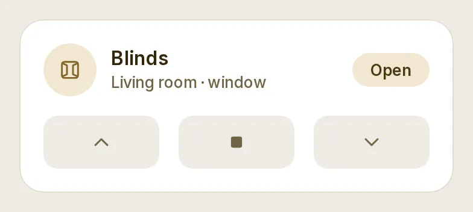

<!-- Generated by `pnpm docs:cards` from the card’s editor, its example in tools/docs/src/gallery.ts and its guide in tools/docs/guides/: change those, not this page. -->

# Cover

Blinds, shutters, garage doors and valves: vertical position ruler, tilt, open · stop · close, favourites.

`custom:fluvy-cover-card` · [Try it live](https://acosta290.github.io/fluvy/?card=cover) · [All cards](../cards.md#everyday)

<picture><source media="(prefers-color-scheme: dark)" srcset="../images/cards/cover-dark.webp"></picture>

## Example

```yaml
type: custom:fluvy-cover-card
entity: cover.blinds
subtitle: Living room · window
tilt_angle: 90
tilt_style: slats
favorites:
  - name: Morning
    position: 60
  - name: Night
    position: 0
    tilt: 0
```

The picture above, on the demo house: put your own entities in place of its.

## Layouts

`variant` chooses the layout. The picture above is `full`, the default; each of the others is the example plus the line over it, and opens in the live demo.

<table>
<tbody><tr>
<td align="center" valign="top" width="50%"><code>variant: compact</code><br><a href="https://acosta290.github.io/fluvy/?card=cover&amp;layout=compact"><picture><source media="(prefers-color-scheme: dark)" srcset="../images/cards/cover.compact-dark.webp"></picture></a></td>
<td align="center" valign="top" width="50%"></td>
</tr></tbody>
</table>

## All options

```yaml
type: custom:fluvy-cover-card
entity: cover.blinds
# name:
# icon:
show_icon: auto
show_badge: true
name_lines: 1
subtitle: Living room · window
tilt_angle: 90
variant: full
favorites_style: full
show_tilt: true
show_favorites: true
favorites:
  - name: Morning
    position: 60
  - name: Night
    position: 0
    tilt: 0
direction: up
invert_position: false
# position_presets:
# open_label:
# closed_label:
tilt_style: slats
invert_tilt: false
# tilt_presets:
slider_style: house
# tone:
# color:
# card_color:
# card_opacity: 100
# card_border: true
# unavailable: dashed
# tint: 'off'
# state_colors:
# tap_action:
#   action: more-info
# hold_action:
#   action: more-info
# double_tap_action:
#   action: none
# icon_tap_action:
#   action: none
# icon_hold_action:
#   action: none
# icon_double_tap_action:
#   action: none
```

## Options

| Option | Default | What it does |
| --- | --- | --- |
| `entity` | **required** | The entity the card is about: what it shows, and what its controls act on. A `cover` or `valve`. |
| `name` |  | The name the card shows, in place of the entity’s own. |
| `icon` |  | The card’s icon, in place of the entity’s own. |
| `subtitle` |  | The line under the title: your own words, an entity’s state or a template. |
| `tilt_angle` |  | The slats’ angle at 100 % tilt: the tilt then reads in degrees. 0 to 360. |
| `variant` | `full` | The card’s layout. `full` · `compact`. |
| `favorites_style` | `full` | Draws the favourites as chips that fill the row, or as content-sized chips. `full` · `chips`. |
| `show_tilt` | `true` | Shows the tilt control. |
| `show_favorites` | `true` | Shows the favourite positions. |
| `slider_style` | `house` | The slider’s style; left out, the style set for every slider. `house` · `ruler` · `bar` · `liquid`. |
| `slider_words` | `ends` | Writes the words at the slider’s ends, or none. `ends` · `none`. |
| `tint` | `off` | When the card shows its colour beyond its circle: never, while it is on or active, or at rest too. `off` (Never) · `on` (When active) · `always`. |
| `tint_style` | `wash` | How the colour is shown: a wash over the card, the card’s edge, or the control alone. `wash` · `edge` · `control`. |
| `state_colors` |  | A colour for each of the device’s states, held under this key: a tone, none, or a colour of your own. Its keys: `open` · `closed` · `opening` · `closing`. |
| [`favorites`](#favorites) |  | Favourite positions, each a chip that moves the cover there. A list: [its items](#favorites). |
| **Position and tilt** |  |  |
| `direction` | `up` | What the position counts: how far the cover is open, or how far it has come down. `up` (How far it is open) · `down` (How far it is down). |
| `invert_position` | `false` | Reads the position the other way round, for a cover that reports 100 % when it is closed. |
| `position_presets` | none | Positions offered as chips under the ruler, each a tap away. Any of `0` · `25` · `50` · `75` · `100`, or your own. |
| `open_label` |  | The word at the open end of the position ruler and of its presets; left out, "Open". |
| `closed_label` |  | The word at the closed end of the position ruler and of its presets; left out, "Closed". |
| `tilt_style` | `steps` | How the tilt is set: its figure with − and +, or its slats on a ruler. `steps` · `slats`. |
| `invert_tilt` | `false` | Reads the tilt the other way round: its figure, its slats, its presets and what it sends. |
| `tilt_presets` | none | Tilts offered as chips under the tilt control, each a tap away. Any of `0` · `25` · `50` · `75` · `100`, or your own. |

<details>
<summary>Its look and its actions, as on every card</summary>

| Option | Default | What it does |
| --- | --- | --- |
| `show_icon` | `auto` | Shows the icon, hides it, or lets the card decide. `auto` · `always` · `never`. |
| `show_badge` | `true` | Shows the badge at the end of the head, such as the card’s state or a count. |
| `name_lines` | `1` | Lets the name in the card’s head take two balanced lines where one would cut it; the head is a line taller whatever the name. `1` · `2`. |
| `tone` | the card’s own | The card’s colour from the palette’s tones; left out, the tone of what it shows. `accent` · `light` · `heat` · `cool` · `dry` · `fan` · `water` · `solar` · `grid` · `media` · `presence` · `armed` · `battery` · `house` · `gas` · `vehicle` (Car) · `neutral` · `ok` (Good) · `warning` · `danger`. |
| `color` |  | The card’s colour: its circle, its accents and its tints wear it. Left out, the colour of what it shows. |
| `card_color` |  | Paints the card’s surface in a colour of your own. |
| `card_opacity` | `100` | How solid the card’s surface is, in percent: under 100 the view’s background shows through. Left out, the house’s. 0 % to 100 %, in steps of 5. |
| `card_border` | `true` | Whether the card draws its hairline border. Left out, the house’s. |
| `unavailable` | `dashed` | How the card looks while its entity is unavailable: dashed, or quiet as when it is off. Left out, the house’s. `dashed` · `quiet` (As when off). |
| **Interactions** |  |  |
| `tap_action` | `more-info` | What a tap on the card does. |
| `hold_action` | `more-info` | What a long press on the card does. |
| `double_tap_action` | `none` | What two taps on the card do. |
| `icon_tap_action` | `none` | What a tap on the icon does. |
| `icon_hold_action` | `none` | What a long press on the icon does. |
| `icon_double_tap_action` | `none` | What two taps on the icon do. |

More about them in [Options every card takes](../customising.md#options-every-card-takes).

</details>

## Lists

### `favorites`

An item is a map with `name` and any of these fields.

| Field | What it does |
| --- | --- |
| `name` | The item’s own name, in place of the one the card would give it. |
| `position` | The cover’s position the favourite moves it to, in percent. 0 to 100. |
| `tilt` | The tilt the favourite moves the slats to. 0 to 100. |

## Guide


### Tilt and presets

```yaml
type: custom:fluvy-cover-card
entity: cover.office_blind
tilt_style: slats              # the tilt drawn as the blind's slats
position_presets: [0, 50, 100] # chips under the commands
tilt_presets: [0, 50, 100]
```

The slats stand beside the position where the card is wide enough, else under the commands. `favorites` is for
places with a name of their own.


### A cover counted its own way

Home Assistant counts 0 as closed and 100 as open. These keys turn the card's numbers round; the open and close
commands stay as they are.

| Key | When |
| --- | --- |
| `invert_position: true` | Your cover says 100 % when it is closed |
| `invert_tilt: true` | Its tilt says 100 % when the slats are closed |
| `direction: down` | You count how far it has come down ("35 % down") |

```yaml
type: custom:fluvy-cover-card
entity: cover.bedroom_blind
invert_position: true
direction: down
open_label: Up   # the words at the ruler's ends
closed_label: Down
```

Tiles, voice assistants and automations still read Home Assistant's numbers. Better fix the cover at its source where
you can: KNX (`invert_position`, `invert_angle`), MQTT (`position_open`, `position_closed`, `tilt_min`, `tilt_max`),
Zigbee2MQTT (`invert_cover`) or a
[template cover](https://www.home-assistant.io/integrations/cover.template/).

<details>
<summary>Older names the card still reads</summary>

| Older name | Read as |
| --- | --- |
| `favorites[].label` | `favorites[].name` |
| `favorites[].sub` | `favorites[].secondary` |
| `favorites[].meta` | `favorites[].subtitle` |
| `sub` | `subtitle` |
| `meta` | `subtitle` |
| `layout` | `variant` |
| `view` | `variant` |
| `accent` | `color` |

</details>
