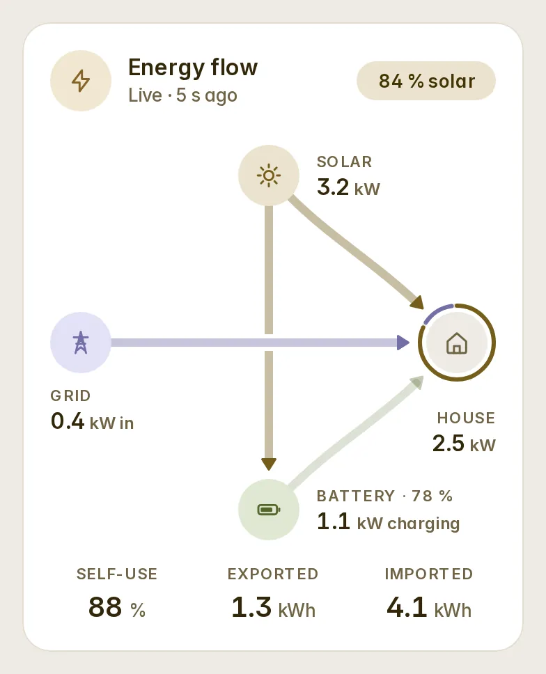
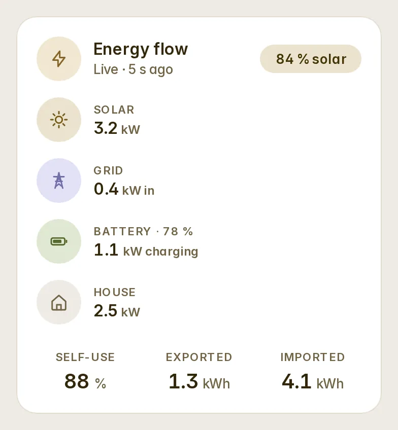

<!-- Generated by `pnpm docs:cards` from the card’s editor, its example in tools/docs/src/gallery.ts and its guide in tools/docs/guides/: change those, not this page. -->

# Energy flow

Where the house’s energy comes from and where it goes, live or over a period: import and export at once, every source, lanes in their origin’s colour.

`custom:fluvy-energy-flow-card` · [Try it live](https://acosta290.github.io/fluvy/?card=energy-flow) · [All cards](../cards.md#energy)

<picture><source media="(prefers-color-scheme: dark)" srcset="../images/cards/energy-flow-dark.webp"></picture>

## Example

```yaml
type: custom:fluvy-energy-flow-card
subtitle: Live · 5 s ago
home: sensor.ef_house_power
sources:
  - type: solar
    power: sensor.ef_solar_power
  - type: grid
    power: sensor.ef_grid_power
  - type: battery
    power: sensor.ef_battery_power
    level: sensor.ef_battery_level
readouts:
  - entity: sensor.ef_self_use
    name: Self-use
  - entity: sensor.ef_exported_today
    name: Exported
  - entity: sensor.ef_imported_today
    name: Imported
```

The picture above, on the demo house: put your own entities in place of its.

## Layouts

`variant` chooses the layout. The picture above is `rows`, the default; each of the others is the example plus the line over it, and opens in the live demo.

<table>
<tbody><tr>
<td align="center" valign="top" width="50%"><code>variant: cross</code><br><a href="https://acosta290.github.io/fluvy/?card=energy-flow&amp;layout=cross"><picture><source media="(prefers-color-scheme: dark)" srcset="../images/cards/energy-flow.cross-dark.webp"></picture></a></td>
<td align="center" valign="top" width="50%"><code>variant: list</code><br><a href="https://acosta290.github.io/fluvy/?card=energy-flow&amp;layout=list"><picture><source media="(prefers-color-scheme: dark)" srcset="../images/cards/energy-flow.list-dark.webp"></picture></a></td>
</tr></tbody>
</table>

## All options

```yaml
type: custom:fluvy-energy-flow-card
# title:
subtitle: Live · 5 s ago
# icon:
home: sensor.ef_house_power
show_icon: auto
name_lines: 1
variant: rows
flow_style: stream
motion: full
# max_power:
badge: solar
period: live
show_period: true
readouts:
  - entity: sensor.ef_self_use
    name: Self-use
  - entity: sensor.ef_exported_today
    name: Exported
  - entity: sensor.ef_imported_today
    name: Imported
# tone:
# color:
# card_color:
# card_opacity: 100
# card_border: true
# unavailable: dashed
# unit: auto
# decimals: auto
# tap_action:
#   action: none
# hold_action:
#   action: none
# double_tap_action:
#   action: none
# icon_tap_action:
#   action: none
# icon_hold_action:
#   action: none
# icon_double_tap_action:
#   action: none
sources:
  - type: solar
    power: sensor.ef_solar_power
  - type: grid
    power: sensor.ef_grid_power
  - type: battery
    power: sensor.ef_battery_power
    level: sensor.ef_battery_level
# consumers:
```

## Options

| Option | Default | What it does |
| --- | --- | --- |
| `title` |  | The title at the top of the card. |
| `subtitle` |  | The line under the title: your own words, an entity’s state or a template. |
| `icon` |  | The card’s icon, in place of the entity’s own. |
| `home` |  | The house’s own power meter; left out, the card adds up the sources. A `sensor`. |
| `variant` | `rows` | The card’s layout. `rows` · `cross` · `list`. |
| `flow_style` | `stream` | How the lanes between the sources and the house are drawn. `stream` · `legs` (Lines) · `rail`. |
| `motion` | `full` | How the flows move: fully, calmly, or not at all. `full` · `calm` · `off`. |
| `max_power` |  | The house’s peak power in watts: each flow moves at its share of it. 100 or more, in steps of 100. |
| `badge` | `solar` | What the head’s badge says: the solar share, how self-powered the house is, the grid, or nothing. `solar` (Share of solar) · `self_powered` · `grid` (The grid’s direction) · `none`. |
| `period` | `live` | Shows the power now, or a period’s totals. `live` · `day` · `week` · `month`. |
| `collection_key` | none | Makes the card follow an Energy date picker on the same dashboard. |
| `show_period` | `true` | Shows the chips that choose the period. |
| `unit` | `auto` | The unit the figures are written in; automatic keeps the sensor’s. `auto` · `W` · `kW` · `MW` · `Wh` · `kWh` · `MWh`, or your own. |
| `decimals` | `auto` | How many decimals the figures have; automatic decides by their size. `auto` · `0` · `1` · `2` · `3`. |
| [`sources`](#sources) |  | The sources of energy, each with its sensors; left out, the Energy dashboard’s. A list: [its items](#sources). |
| [`consumers`](#consumers) |  | Where the house’s power goes: devices drawn under the house. A list: [its items](#consumers). |
| [`readouts`](#readouts) |  | The readouts under the card, in this order. A list: [its items](#readouts). |

<details>
<summary>Its look and its actions, as on every card</summary>

| Option | Default | What it does |
| --- | --- | --- |
| `show_icon` | `auto` | Shows the icon, hides it, or lets the card decide. `auto` · `always` · `never`. |
| `name_lines` | `1` | Lets the name in the card’s head take two balanced lines where one would cut it; the head is a line taller whatever the name. `1` · `2`. |
| `tone` | the card’s own | The card’s colour from the palette’s tones; left out, the tone of what it shows. `accent` · `light` · `heat` · `cool` · `dry` · `fan` · `water` · `solar` · `grid` · `media` · `presence` · `armed` · `battery` · `house` · `gas` · `vehicle` (Car) · `neutral` · `ok` (Good) · `warning` · `danger`. |
| `color` |  | The card’s colour: its circle, its accents and its tints wear it. Left out, the colour of what it shows. |
| `card_color` |  | Paints the card’s surface in a colour of your own. |
| `card_opacity` | `100` | How solid the card’s surface is, in percent: under 100 the view’s background shows through. Left out, the house’s. 0 % to 100 %, in steps of 5. |
| `card_border` | `true` | Whether the card draws its hairline border. Left out, the house’s. |
| `unavailable` | `dashed` | How the card looks while its entity is unavailable: dashed, or quiet as when it is off. Left out, the house’s. `dashed` · `quiet` (As when off). |
| **Interactions** |  |  |
| `tap_action` | `none` | What a tap on the card does. |
| `hold_action` | `none` | What a long press on the card does. |
| `double_tap_action` | `none` | What two taps on the card do. |
| `icon_tap_action` | `none` | What a tap on the icon does. |
| `icon_hold_action` | `none` | What a long press on the icon does. |
| `icon_double_tap_action` | `none` | What two taps on the icon do. |

More about them in [Options every card takes](../customising.md#options-every-card-takes).

</details>

## Lists

### `sources`

An item is a map with `type` and any of these fields.

| Field | What it does |
| --- | --- |
| `type` | What kind of source it is. `solar` · `grid` · `battery` · `generator` · `vehicle` (Car). |
| `power` | One signed sensor of its power: positive while it comes in. A `sensor`. |
| `phases` | One sensor per phase, each signed and summed. A list of `sensor` entities. |
| `import` | A sensor of the power coming in from it, positive. A `sensor`. |
| `export` | A sensor of the power going out of it, positive. A `sensor`. |
| `invert` | Reads the sensor the other way round. `true` or `false`. |
| `level` | A sensor of its state of charge. A `sensor`. |
| `capacity` | The battery’s usable capacity in kWh. 0 to 1000, in steps of 0.1. |
| `name` | The item’s own name, in place of the one the card would give it. |
| `icon` | The item’s own icon, in place of the one the card would give it. |
| `color` | The item’s colour, in place of the one the card gives it. |
| `threshold` | Below this many watts the source’s lane rests. 0 to 10000. |
| `arrows` | Draws arrows along the source’s lane as power arrives, or none. `arrival` (At arrival) · `none`. |
| `show` | When the item is drawn. `always` · `active` (When active) · `never`. |

### `consumers`

An item is an entity id, or a map with `entity` and any of these fields.

| Field | What it does |
| --- | --- |
| `entity` | The entity the item shows. A `sensor`. |
| `name` | The item’s own name, in place of the one the card would give it. |
| `icon` | The item’s own icon, in place of the one the card would give it. |
| `color` | The item’s colour, in place of the one the card gives it. |

### `readouts`

An item is an entity id, or a map with `entity` and any of these fields.

| Field | What it does |
| --- | --- |
| `entity` | The entity the item shows. A `sensor`. |
| `name` | The item’s own name, in place of the one the card would give it. |
| `unit` | The unit the figure is written in. `auto` · `W` · `kW` · `MW` · `Wh` · `kWh` · `MWh`, or your own. |
| `decimals` | How many decimals the figure has. `auto` · `0` · `1` · `2` · `3`. |

<details>
<summary>Older names the card still reads</summary>

| Older name | Read as |
| --- | --- |
| `home_power` | `home` |
| `readouts[].label` | `readouts[].name` |
| `readouts[].sub` | `readouts[].secondary` |
| `readouts[].meta` | `readouts[].subtitle` |
| `consumers[].label` | `consumers[].name` |
| `consumers[].sub` | `consumers[].secondary` |
| `consumers[].meta` | `consumers[].subtitle` |
| `sources[].power` | `sources[].phases` (some of its values) |
| `solar_power` | folded into the keys above |
| `grid_power` | folded into the keys above |
| `grid_invert` | folded into the keys above |
| `battery_power` | folded into the keys above |
| `battery_invert` | folded into the keys above |
| `battery_level` | folded into the keys above |
| `sub` | `subtitle` |
| `meta` | `subtitle` |
| `layout` | `variant` |
| `view` | `variant` |
| `accent` | `color` |

</details>
