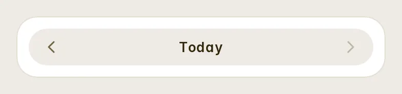
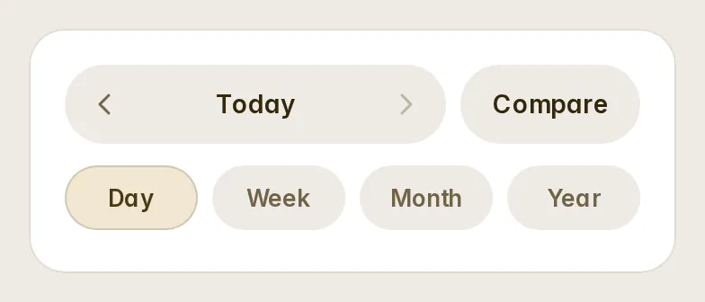
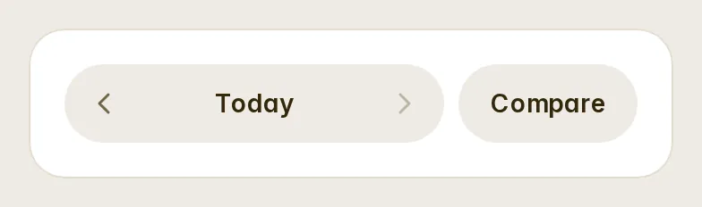

<!-- Generated by `pnpm docs:cards` from the card’s editor, its example in tools/docs/src/gallery.ts and its guide in tools/docs/guides/: change those, not this page. -->

# Energy period

The view’s date picker as a strip: ‹ the day, week, month or year › and back to today, Home Assistant’s own, so its energy cards follow it as Fluvy’s do.

`custom:fluvy-energy-period-card` · [Try it live](https://acosta290.github.io/fluvy/?card=energy-period) · [All cards](../cards.md#energy)

<picture><source media="(prefers-color-scheme: dark)" srcset="../images/cards/energy-period-dark.webp"></picture>

## Example

```yaml
type: custom:fluvy-energy-period-card
collection_key: energy_pg
show_compare: true
```

The picture above, on the demo house: put your own entities in place of its.

## Layouts

`variant` chooses the layout. The picture above is `row`, the default; each of the others is the example plus the line over it, and opens in the live demo.

<table>
<tbody><tr>
<td align="center" valign="top" width="50%"><code>variant: compact</code><br><a href="https://acosta290.github.io/fluvy/?card=energy-period&amp;layout=compact"><picture><source media="(prefers-color-scheme: dark)" srcset="../images/cards/energy-period.compact-dark.webp"></picture></a></td>
<td align="center" valign="top" width="50%"><code>variant: stacked</code><br><a href="https://acosta290.github.io/fluvy/?card=energy-period&amp;layout=stacked"><picture><source media="(prefers-color-scheme: dark)" srcset="../images/cards/energy-period.stacked-dark.webp"></picture></a></td>
</tr></tbody>
<tbody><tr>
<td align="center" valign="top" width="50%"><code>variant: bar</code><br><a href="https://acosta290.github.io/fluvy/?card=energy-period&amp;layout=bar"><picture><source media="(prefers-color-scheme: dark)" srcset="../images/cards/energy-period.bar-dark.webp"></picture></a></td>
<td align="center" valign="top" width="50%"></td>
</tr></tbody>
</table>

## All options

```yaml
type: custom:fluvy-energy-period-card
variant: row
collection_key: energy_pg
periods:
  - day
  - week
  - month
  - year
  - custom
show_today: true
show_compare: true
# tone:
# color:
# card_color:
# card_opacity: 100
# card_border: true
# unavailable: dashed
```

## Options

| Option | Default | What it does |
| --- | --- | --- |
| `variant` | `row` | The card’s layout. `row` · `compact` · `stacked` (With the periods) · `bar` (Across the section). |
| `collection_key` | none | Makes the card follow an Energy date picker on the same dashboard. |
| `periods` | `day`, `week`, `month`, `year`, `custom` | The periods the card offers to choose from, in this order. Any of `day` · `week` · `month` · `year` · `custom`. |
| `show_today` | `true` | Shows the Today button, which comes back to the present period. |
| `show_compare` | `false` | Shows the Compare button, which adds the period before. |

<details>
<summary>Its look and its actions, as on every card</summary>

| Option | Default | What it does |
| --- | --- | --- |
| `tone` | the card’s own | The card’s colour from the palette’s tones; left out, the tone of what it shows. `accent` · `light` · `heat` · `cool` · `dry` · `fan` · `water` · `solar` · `grid` · `media` · `presence` · `armed` · `battery` · `house` · `gas` · `vehicle` (Car) · `neutral` · `ok` (Good) · `warning` · `danger`. |
| `color` |  | The card’s colour: its circle, its accents and its tints wear it. Left out, the colour of what it shows. |
| `card_color` |  | Paints the card’s surface in a colour of your own. |
| `card_opacity` | `100` | How solid the card’s surface is, in percent: under 100 the view’s background shows through. Left out, the house’s. 0 % to 100 %, in steps of 5. |
| `card_border` | `true` | Whether the card draws its hairline border. Left out, the house’s. |
| `unavailable` | `dashed` | How the card looks while its entity is unavailable: dashed, or quiet as when it is off. Left out, the house’s. `dashed` · `quiet` (As when off). |

More about them in [Options every card takes](../customising.md#options-every-card-takes).

</details>

<details>
<summary>Older names the card still reads</summary>

| Older name | Read as |
| --- | --- |
| `layout` | `variant` |
| `view` | `variant` |
| `accent` | `color` |

</details>
