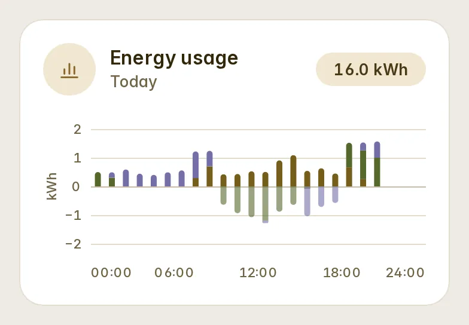
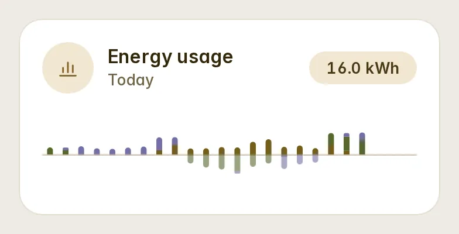

<!-- Generated by `pnpm docs:cards` from the card’s editor, its example in tools/docs/src/gallery.ts and its guide in tools/docs/guides/: change those, not this page. -->

# Energy usage

Electricity, water or gas used by the hour, the day or the month, stacked by source or meter.

`custom:fluvy-energy-usage-card` · [Try it live](https://acosta290.github.io/fluvy/?card=energy-usage) · [All cards](../cards.md#energy)

<picture><source media="(prefers-color-scheme: dark)" srcset="../images/cards/energy-usage-dark.webp"></picture>

## Example

```yaml
type: custom:fluvy-energy-usage-card
```

The picture above, on the demo house: put your own entities in place of its.

## Layouts

`variant` chooses the layout. The picture above is `full`, the default; each of the others is the example plus the line over it, and opens in the live demo.

<table>
<tbody><tr>
<td align="center" valign="top" width="50%"><code>variant: compact</code><br><a href="https://acosta290.github.io/fluvy/?card=energy-usage&amp;layout=compact"><picture><source media="(prefers-color-scheme: dark)" srcset="../images/cards/energy-usage.compact-dark.webp"></picture></a></td>
<td align="center" valign="top" width="50%"><code>variant: mini</code><br><a href="https://acosta290.github.io/fluvy/?card=energy-usage&amp;layout=mini"><picture><source media="(prefers-color-scheme: dark)" srcset="../images/cards/energy-usage.mini-dark.webp"></picture></a></td>
</tr></tbody>
</table>

## All options

```yaml
type: custom:fluvy-energy-usage-card
kind: energy
# title:
# subtitle:
# icon:
variant: full
show_icon: auto
show_badge: true
name_lines: 1
mode: usage
plot_height: 160
period: day
# collection_key:
show_period: true
show_returns: true
show_legend: true
compare: false
max_sources: 6
# chart: classic
show_grid: auto
show_axis: true
# animate: true
# tone:
# color:
# card_color:
# card_opacity: 100
# card_border: true
# unavailable: dashed
# unit: auto
# decimals: auto
# tap_action:
#   action: none
# hold_action:
#   action: none
# double_tap_action:
#   action: none
# icon_tap_action:
#   action: none
# icon_hold_action:
#   action: none
# icon_double_tap_action:
#   action: none
# sources:
```

## Options

| Option | Default | What it does |
| --- | --- | --- |
| `kind` | `energy` | What the card charts: energy, water, or gas. `energy` (Electricity) · `water` · `gas`. |
| `title` |  | The title at the top of the card. |
| `subtitle` |  | The line under the title: your own words, an entity’s state or a template. |
| `icon` |  | The card’s icon, in place of the entity’s own. |
| `variant` | `full` | The card’s layout. `full` · `compact` · `mini`. |
| `mode` | `usage` | Shows what the house used from each source, or every flow between them. `usage` (Used by the house) · `flows` (Metered flows). |
| `plot_height` | `160` | The chart’s height in pixels. 48 to 480, in steps of 4. |
| `period` | `day` | The span the columns show. `day` · `week` · `month` · `year`. |
| `collection_key` | none | Makes the card follow an Energy date picker on the same dashboard. |
| `show_period` | `true` | Shows the chips that choose the period. |
| `show_returns` | `true` | Shows what went into the battery and out to the grid, under the line. |
| `show_legend` | `true` | Shows the legend under the chart. |
| `compare` | `false` | Draws the period before as faint columns behind the bars. |
| `max_sources` | `6` | How many sources keep their own name before the rest fold into "Other". 2 to 6. |
| `unit` | `auto` | The unit the figures are written in; automatic keeps the sensor’s. `auto` · `Wh` · `kWh` · `MWh`, or your own. |
| `decimals` | `auto` | How many decimals the figures have; automatic decides by their size. `auto` · `0` · `1` · `2` · `3`. |
| [`sources`](#sources) |  | The sources of energy, each with its sensors; left out, the Energy dashboard’s. A list: [its items](#sources). |
| [`meters`](#meters) |  | The water or gas meters charted; left out, the Energy dashboard’s. A list: [its items](#meters). |
| **Chart** |  |  |
| `chart` | `classic` | The chart’s style; left out, the style set for the whole house. `classic` · `soft`. |
| `show_grid` | `auto` | Draws gridlines across the chart. `auto` · `none` · `x` (Vertical lines) · `y` (Horizontal lines) · `both`. |
| `show_axis` | `true` | Shows the scale’s labels beside the chart. |
| `animate` | `true` | Lets the chart or the gauge move as it draws; off, it shows its resting frame at once. |

<details>
<summary>Its look and its actions, as on every card</summary>

| Option | Default | What it does |
| --- | --- | --- |
| `show_icon` | `auto` | Shows the icon, hides it, or lets the card decide. `auto` · `always` · `never`. |
| `show_badge` | `true` | Shows the badge at the end of the head, such as the card’s state or a count. |
| `name_lines` | `1` | Lets the name in the card’s head take two balanced lines where one would cut it; the head is a line taller whatever the name. `1` · `2`. |
| `tone` | the card’s own | The card’s colour from the palette’s tones; left out, the tone of what it shows. `accent` · `light` · `heat` · `cool` · `dry` · `fan` · `water` · `solar` · `grid` · `media` · `presence` · `armed` · `battery` · `house` · `gas` · `vehicle` (Car) · `neutral` · `ok` (Good) · `warning` · `danger`. |
| `color` |  | The card’s colour: its circle, its accents and its tints wear it. Left out, the colour of what it shows. |
| `card_color` |  | Paints the card’s surface in a colour of your own. |
| `card_opacity` | `100` | How solid the card’s surface is, in percent: under 100 the view’s background shows through. Left out, the house’s. 0 % to 100 %, in steps of 5. |
| `card_border` | `true` | Whether the card draws its hairline border. Left out, the house’s. |
| `unavailable` | `dashed` | How the card looks while its entity is unavailable: dashed, or quiet as when it is off. Left out, the house’s. `dashed` · `quiet` (As when off). |
| **Interactions** |  |  |
| `tap_action` | `none` | What a tap on the card does. |
| `hold_action` | `none` | What a long press on the card does. |
| `double_tap_action` | `none` | What two taps on the card do. |
| `icon_tap_action` | `none` | What a tap on the icon does. |
| `icon_hold_action` | `none` | What a long press on the icon does. |
| `icon_double_tap_action` | `none` | What two taps on the icon do. |

More about them in [Options every card takes](../customising.md#options-every-card-takes).

</details>

## Lists

### `sources`

An item is a map with `type` and any of these fields.

| Field | What it does |
| --- | --- |
| `type` | What kind of source it is. `solar` · `battery` · `grid`. |
| `name` | The item’s own name, in place of the one the card would give it. |
| `color` | The item’s colour, in place of the one the card gives it. `graph-1` (Series 1) · `graph-2` (Series 2) · `graph-3` (Series 3) · `graph-4` (Series 4) · `graph-5` (Series 5) · `graph-6` (Series 6) · `graph-7` (Series 7) · `graph-8` (Series 8) · `graph-9` (Series 9) · `graph-10` (Series 10) · `graph-11` (Series 11) · `graph-12` (Series 12) · `accent` · `ok` (Good) · `warning` · `danger` · `notice` · `light` · `solar` · `grid` · `battery` · `water` · `gas` · `home` (House), or your own. |
| `show` | Draws this source. `true` or `false`. |

### `meters`

An item is an entity id, or a map with `entity` and any of these fields.

| Field | What it does |
| --- | --- |
| `entity` | The meter’s statistic. |
| `name` | The item’s own name, in place of the one the card would give it. |
| `color` | The item’s colour, in place of the one the card gives it. `graph-1` (Series 1) · `graph-2` (Series 2) · `graph-3` (Series 3) · `graph-4` (Series 4) · `graph-5` (Series 5) · `graph-6` (Series 6) · `graph-7` (Series 7) · `graph-8` (Series 8) · `graph-9` (Series 9) · `graph-10` (Series 10) · `graph-11` (Series 11) · `graph-12` (Series 12) · `accent` · `ok` (Good) · `warning` · `danger` · `notice` · `light` · `solar` · `grid` · `battery` · `water` · `gas` · `home` (House), or your own. |

## Guide

The card draws the house's energy as Home Assistant's usage graph does: a column for each hour of a day, each day of a
week or a month, each month of a year. Above the line, where the house took it from (the sun, the battery, the grid on
top); below, what went into the battery and out to the grid. The figures are the Energy dashboard's, slot by slot.

```yaml
type: custom:fluvy-energy-usage-card
period: week   # day (the default), week, month, year
compare: true  # last week as ghost columns behind this one
sources:
  - { type: solar, name: Roof }
  - battery
  - { type: grid, color: '#7c5cff' }
```

```yaml
# following a date picker on the dashboard: its range, its Compare
type: custom:fluvy-energy-usage-card
collection_key: energy_casa
variant: compact
```

- `sources` lists the sources in the order they stack, each with its `name`, `color` (a palette name follows the
  palette) and `show`. Left out: every source of the Energy dashboard. Past `max_sources` the last fold into "Other".
- `show_returns: false` leaves out what went out; `show_legend: false` the legend.
- `variant: compact` is the chart and its axis; `mini` a strip under the head.
- `mode: flows`, `plot_height` and water or gas (`kind`) are in [the energy cards](../energy.md#the-cards); following
  a picker in [following Home Assistant's date picker](../energy.md#following-home-assistants-date-picker).

<details>
<summary>Older names the card still reads</summary>

| Older name | Read as |
| --- | --- |
| `sub` | `subtitle` |
| `meta` | `subtitle` |
| `layout` | `variant` |
| `view` | `variant` |
| `accent` | `color` |

</details>
