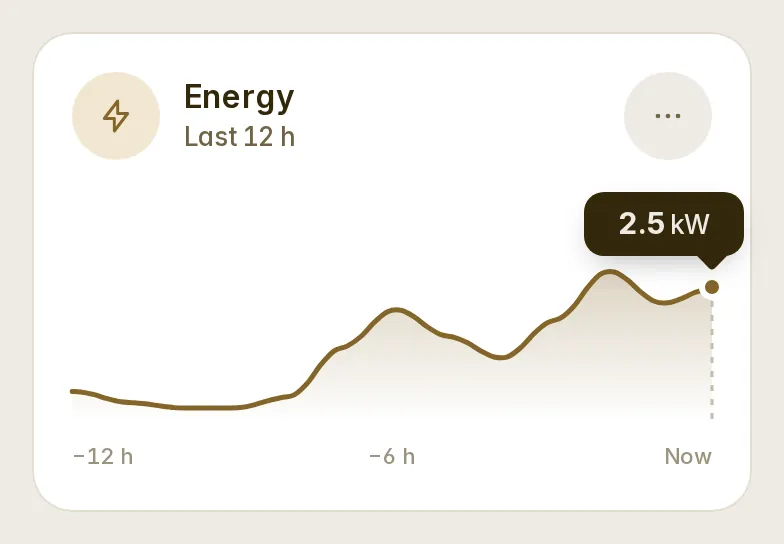
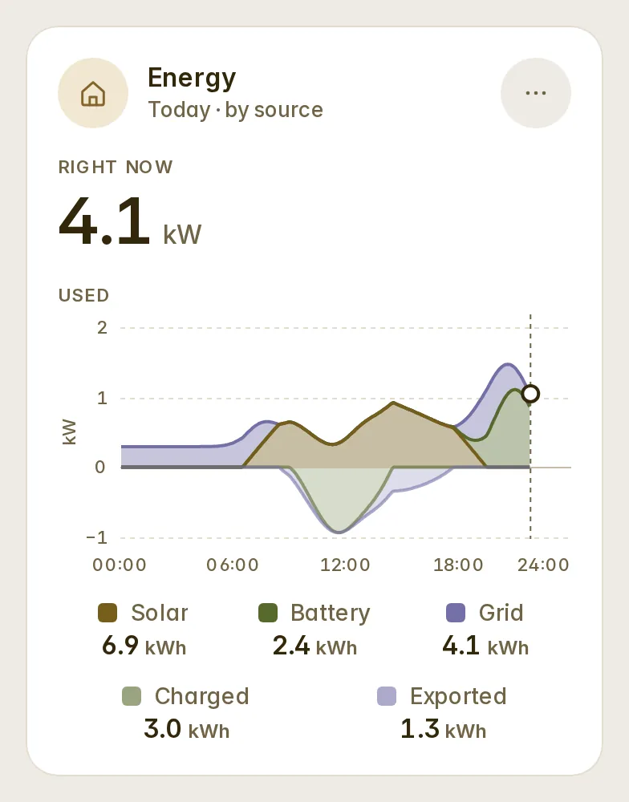
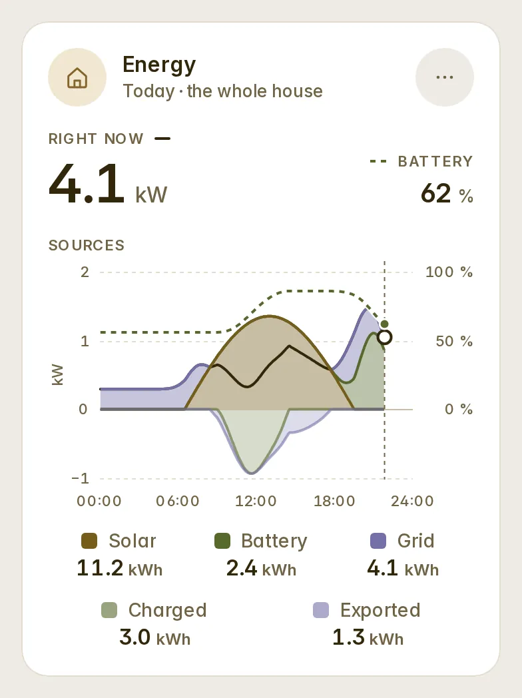

<!-- Generated by `pnpm docs:cards` from the card’s editor, its example in tools/docs/src/gallery.ts and its guide in tools/docs/guides/: change those, not this page. -->

# Energy

Power right now, the day curve and the energy legend.

`custom:fluvy-energy-card` · [Try it live](https://acosta290.github.io/fluvy/?card=energy) · [All cards](../cards.md#energy)

<picture><source media="(prefers-color-scheme: dark)" srcset="../images/cards/energy-dark.webp"></picture>

## Example

```yaml
type: custom:fluvy-energy-card
entity: sensor.ef_house_power
name: Energy
cost_entity: sensor.ef_cost_now
legend:
  - entity: sensor.ef_grid_today
    name: Grid
  - entity: sensor.ef_solar_today
    name: Solar
  - entity: sensor.ef_peak_today
    name: Peak
```

The picture above, on the demo house: put your own entities in place of its.

## Layouts

`variant` chooses the layout. The picture above is `full`, the default; each of the others is the example plus the line over it, and opens in the live demo.

<table>
<tbody><tr>
<td align="center" valign="top" width="50%"><code>variant: compact</code><br><a href="https://acosta290.github.io/fluvy/?card=energy&amp;layout=compact"><picture><source media="(prefers-color-scheme: dark)" srcset="../images/cards/energy.compact-dark.webp"></picture></a></td>
<td align="center" valign="top" width="50%"><code>variant: sources</code><br><a href="https://acosta290.github.io/fluvy/?card=energy&amp;layout=sources"><picture><source media="(prefers-color-scheme: dark)" srcset="../images/cards/energy.sources-dark.webp"></picture></a></td>
</tr></tbody>
<tbody><tr>
<td align="center" valign="top" width="50%"><code>variant: overview</code><br><a href="https://acosta290.github.io/fluvy/?card=energy&amp;layout=overview"><picture><source media="(prefers-color-scheme: dark)" srcset="../images/cards/energy.overview-dark.webp"></picture></a></td>
<td align="center" valign="top" width="50%"></td>
</tr></tbody>
</table>

## All options

```yaml
type: custom:fluvy-energy-card
entity: sensor.ef_house_power
invert: false
name: Energy
# subtitle:
# icon:
show_icon: auto
name_lines: 1
# tone:
# color:
# card_color:
# card_opacity: 100
# card_border: true
# unavailable: dashed
variant: full
# hours: 12
# collection_key:
show_soc: true
show_house: true
stack: true
cost_entity: sensor.ef_cost_now
show_cost: true
legend:
  - entity: sensor.ef_grid_today
    name: Grid
  - entity: sensor.ef_solar_today
    name: Solar
  - entity: sensor.ef_peak_today
    name: Peak
# chart: classic
# points: auto
# curve: smooth
# fill: gradient
# line_width: regular
# show_points: end
show_grid: auto
show_axis: true
# animate: true
# unit: auto
# decimals: auto
# tap_action:
#   action: more-info
# hold_action:
#   action: more-info
# double_tap_action:
#   action: none
# icon_tap_action:
#   action: none
# icon_hold_action:
#   action: none
# icon_double_tap_action:
#   action: none
```

## Options

| Option | Default | What it does |
| --- | --- | --- |
| `entity` | **required** | The power sensor the card shows and charts. A `sensor`. |
| `invert` | `false` | Reads the sensor the other way round, for a meter that counts going out as positive. |
| `name` |  | The name the card shows, in place of the entity’s own. |
| `subtitle` |  | The line under the title: your own words, an entity’s state or a template. |
| `icon` |  | The card’s icon, in place of the entity’s own. |
| `variant` | `full` | The card’s layout. `full` · `compact` · `sources` (By source) · `overview` (Whole house). |
| `hours` | `12` | How many hours of history the card draws, up to now. 1 to 168. |
| `collection_key` | none | Makes the card follow an Energy date picker on the same dashboard. |
| `show_soc` | `true` | Draws the batteries’ state of charge as a dashed line. |
| `show_house` | `true` | Draws the house’s use as a line over the sources. |
| `stack` | `true` | Stacks the sources on top of each other. |
| `cost_entity` |  | A price or cost sensor shown beside the main figure. A `sensor`. |
| `show_cost` | `true` | Shows the cost sensor beside the main figure. |
| `unit` | `auto` | The unit the figures are written in; automatic keeps the sensor’s. `auto` · `W` · `kW` · `MW` · `Wh` · `kWh` · `MWh` · `L` · `m³` · `gal` · `ft³`, or your own. |
| `decimals` | `auto` | How many decimals the figures have; automatic decides by their size. `auto` · `0` · `1` · `2` · `3`. |
| [`legend`](#legend) |  | The rows of figures under the chart. A list: [its items](#legend). |
| **Chart** |  |  |
| `chart` | `classic` | The chart’s style. `classic` · `soft` · `glow` · `minimal` · `step`. |
| `points` | `auto` | How far apart the line’s points are drawn. `auto` · `5m` · `15m` · `30m` · `1h`. |
| `curve` | `smooth` | How the line joins its readings: smooth, straight, or in steps. `smooth` · `straight` · `step`. |
| `fill` | `gradient` | What lies under the line: a gradient, a flat fill, or nothing. `gradient` · `flat` · `none`. |
| `line_width` | `regular` | How thick the line is. `thin` · `regular` · `bold`. |
| `glow` | `false` | Draws a soft shadow under the line. |
| `show_points` | `end` | Draws points on the line: none, the last one, or every reading. `none` · `end` (At the end) · `all`. |
| `show_grid` | `auto` | Draws gridlines across the chart. `auto` · `none` · `x` (Vertical lines) · `y` (Horizontal lines) · `both`. |
| `show_axis` | `true` | Shows the scale’s labels beside the chart. |
| `highlight` | `none` | Marks out readings on the chart: the lowest, the highest, both, or the current one. `none` · `min` (The lowest reading) · `max` (The highest reading) · `both` (Lowest and highest) · `current` (The current one). |
| `animate` | `true` | Lets the chart or the gauge move as it draws; off, it shows its resting frame at once. |

<details>
<summary>Its look and its actions, as on every card</summary>

| Option | Default | What it does |
| --- | --- | --- |
| `show_icon` | `auto` | Shows the icon, hides it, or lets the card decide. `auto` · `always` · `never`. |
| `name_lines` | `1` | Lets the name in the card’s head take two balanced lines where one would cut it; the head is a line taller whatever the name. `1` · `2`. |
| `tone` | the card’s own | The card’s colour from the palette’s tones; left out, the tone of what it shows. `accent` · `light` · `heat` · `cool` · `dry` · `fan` · `water` · `solar` · `grid` · `media` · `presence` · `armed` · `battery` · `house` · `gas` · `vehicle` (Car) · `neutral` · `ok` (Good) · `warning` · `danger`. |
| `color` |  | The card’s colour: its circle, its accents and its tints wear it. Left out, the colour of what it shows. |
| `card_color` |  | Paints the card’s surface in a colour of your own. |
| `card_opacity` | `100` | How solid the card’s surface is, in percent: under 100 the view’s background shows through. Left out, the house’s. 0 % to 100 %, in steps of 5. |
| `card_border` | `true` | Whether the card draws its hairline border. Left out, the house’s. |
| `unavailable` | `dashed` | How the card looks while its entity is unavailable: dashed, or quiet as when it is off. Left out, the house’s. `dashed` · `quiet` (As when off). |
| **Interactions** |  |  |
| `tap_action` | `more-info` | What a tap on the card does. |
| `hold_action` | `more-info` | What a long press on the card does. |
| `double_tap_action` | `none` | What two taps on the card do. |
| `icon_tap_action` | `none` | What a tap on the icon does. |
| `icon_hold_action` | `none` | What a long press on the icon does. |
| `icon_double_tap_action` | `none` | What two taps on the icon do. |

More about them in [Options every card takes](../customising.md#options-every-card-takes).

</details>

## Lists

### `legend`

An item is an entity id, or a map with `entity` and any of these fields.

| Field | What it does |
| --- | --- |
| `entity` | The entity the item shows. A `sensor`. |
| `name` | The item’s own name, in place of the one the card would give it. |
| `period` | What the legend’s figure shows. `today` (Since midnight). |
| `unit` | The unit the figure is written in. `auto` · `W` · `kW` · `MW` · `Wh` · `kWh` · `MWh`, or your own. |
| `decimals` | How many decimals the figure has. `auto` · `0` · `1` · `2` · `3`. |

<details>
<summary>Older names the card still reads</summary>

| Older name | Read as |
| --- | --- |
| `title` | `name` |
| `legend[].label` | `legend[].name` |
| `legend[].sub` | `legend[].secondary` |
| `legend[].meta` | `legend[].subtitle` |
| `sub` | `subtitle` |
| `meta` | `subtitle` |
| `layout` | `variant` |
| `view` | `variant` |
| `trend_hours` | `hours` |
| `accent` | `color` |

</details>
