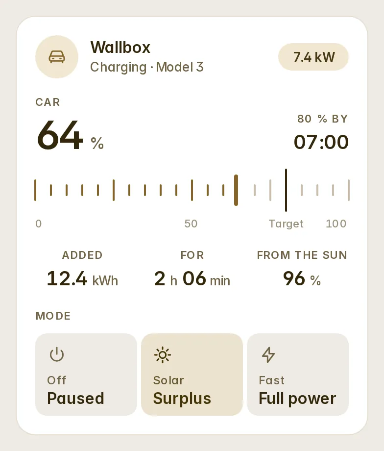

<!-- Generated by `pnpm docs:cards` from the card’s editor, its example in tools/docs/src/gallery.ts and its guide in tools/docs/guides/: change those, not this page. -->

# Car charger

The car on its charger: its charge against the target, ready by when, what the session added and how much of it came from the sun, the charging mode.

`custom:fluvy-ev-charger-card` · [Try it live](https://acosta290.github.io/fluvy/?card=ev-charger) · [All cards](../cards.md#energy)

<picture><source media="(prefers-color-scheme: dark)" srcset="../images/cards/ev-charger-dark.webp"></picture>

## Example

```yaml
type: custom:fluvy-ev-charger-card
entity: sensor.st_wallbox
level: sensor.st_car_level
target: 80
ready_by: '07:00'
session_energy: sensor.st_session
status: sensor.st_wallbox_status
vehicle: Model 3
solar_share: sensor.st_solar_share
mode: select.st_wallbox_mode
```

The picture above, on the demo house: put your own entities in place of its.

## All options

```yaml
type: custom:fluvy-ev-charger-card
entity: sensor.st_wallbox
# name:
# icon:
show_icon: auto
show_badge: true
name_lines: 1
invert: false
level: sensor.st_car_level
target: 80
ready_by: '07:00'
status: sensor.st_wallbox_status
session_energy: sensor.st_session
solar_share: sensor.st_solar_share
vehicle: Model 3
mode: select.st_wallbox_mode
# tone:
# color:
# card_color:
# card_opacity: 100
# card_border: true
# unavailable: dashed
# unit: auto
# decimals: auto
# tap_action:
#   action: more-info
# hold_action:
#   action: more-info
# double_tap_action:
#   action: none
# icon_tap_action:
#   action: none
# icon_hold_action:
#   action: none
# icon_double_tap_action:
#   action: none
```

## Options

| Option | Default | What it does |
| --- | --- | --- |
| `entity` | **required** | The charger’s power sensor, positive while it charges the car. A `sensor`. |
| `name` |  | The name the card shows, in place of the entity’s own. |
| `icon` |  | The card’s icon, in place of the entity’s own. |
| `invert` | `false` | Reads the charger’s sensor the other way round, for one that counts charging as negative. |
| `level` |  | A sensor of the car’s state of charge. A `sensor`. |
| `target` |  | Where the charge should stop: a percentage, or an entity that holds one. |
| `ready_by` |  | When the car should be charged: a time, or an entity that holds one. |
| `status` |  | A sensor that says whether the car is charging or connected. A `sensor` or `binary_sensor`. |
| `session_energy` |  | A sensor of the energy this charging session has added. A `sensor`. |
| `solar_share` |  | A sensor of how much of the charge comes from the sun, in percent. A `sensor`. |
| `vehicle` |  | The car’s name, said after the status. |
| `mode` |  | A select entity of the charging mode, shown as tiles to choose from. A `select` or `input_select`. |
| `unit` | `auto` | The unit the figures are written in; automatic keeps the sensor’s. `auto` · `W` · `kW` · `MW` · `Wh` · `kWh` · `MWh` · `L` · `m³` · `gal` · `ft³`, or your own. |
| `decimals` | `auto` | How many decimals the figures have; automatic decides by their size. `auto` · `0` · `1` · `2` · `3`. |

<details>
<summary>Its look and its actions, as on every card</summary>

| Option | Default | What it does |
| --- | --- | --- |
| `show_icon` | `auto` | Shows the icon, hides it, or lets the card decide. `auto` · `always` · `never`. |
| `show_badge` | `true` | Shows the badge at the end of the head, such as the card’s state or a count. |
| `name_lines` | `1` | Lets the name in the card’s head take two balanced lines where one would cut it; the head is a line taller whatever the name. `1` · `2`. |
| `tone` | the card’s own | The card’s colour from the palette’s tones; left out, the tone of what it shows. `accent` · `light` · `heat` · `cool` · `dry` · `fan` · `water` · `solar` · `grid` · `media` · `presence` · `armed` · `battery` · `house` · `gas` · `vehicle` (Car) · `neutral` · `ok` (Good) · `warning` · `danger`. |
| `color` |  | The card’s colour: its circle, its accents and its tints wear it. Left out, the colour of what it shows. |
| `card_color` |  | Paints the card’s surface in a colour of your own. |
| `card_opacity` | `100` | How solid the card’s surface is, in percent: under 100 the view’s background shows through. Left out, the house’s. 0 % to 100 %, in steps of 5. |
| `card_border` | `true` | Whether the card draws its hairline border. Left out, the house’s. |
| `unavailable` | `dashed` | How the card looks while its entity is unavailable: dashed, or quiet as when it is off. Left out, the house’s. `dashed` · `quiet` (As when off). |
| **Interactions** |  |  |
| `tap_action` | `more-info` | What a tap on the card does. |
| `hold_action` | `more-info` | What a long press on the card does. |
| `double_tap_action` | `none` | What two taps on the card do. |
| `icon_tap_action` | `none` | What a tap on the icon does. |
| `icon_hold_action` | `none` | What a long press on the icon does. |
| `icon_double_tap_action` | `none` | What two taps on the icon do. |

More about them in [Options every card takes](../customising.md#options-every-card-takes).

</details>

<details>
<summary>Older names the card still reads</summary>

| Older name | Read as |
| --- | --- |
| `accent` | `color` |

</details>
