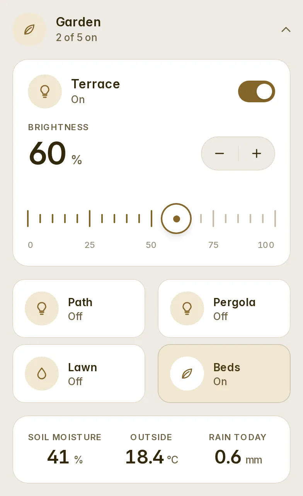
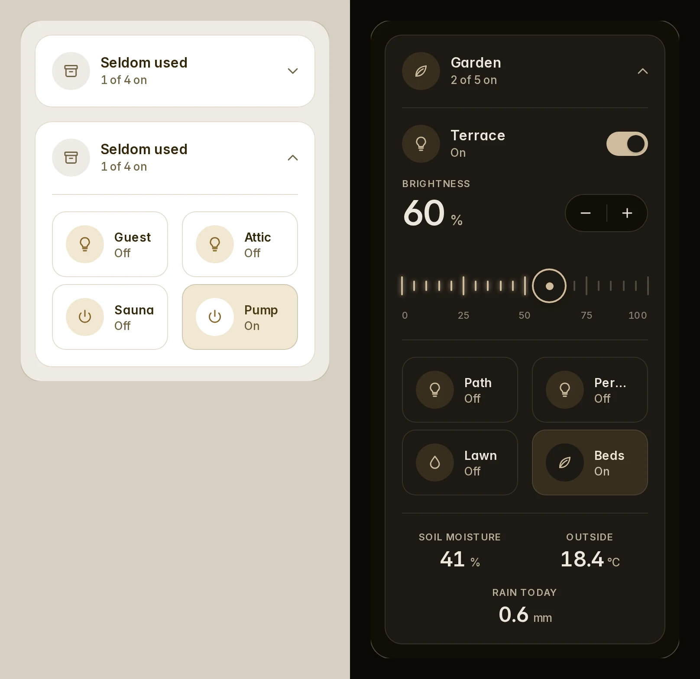
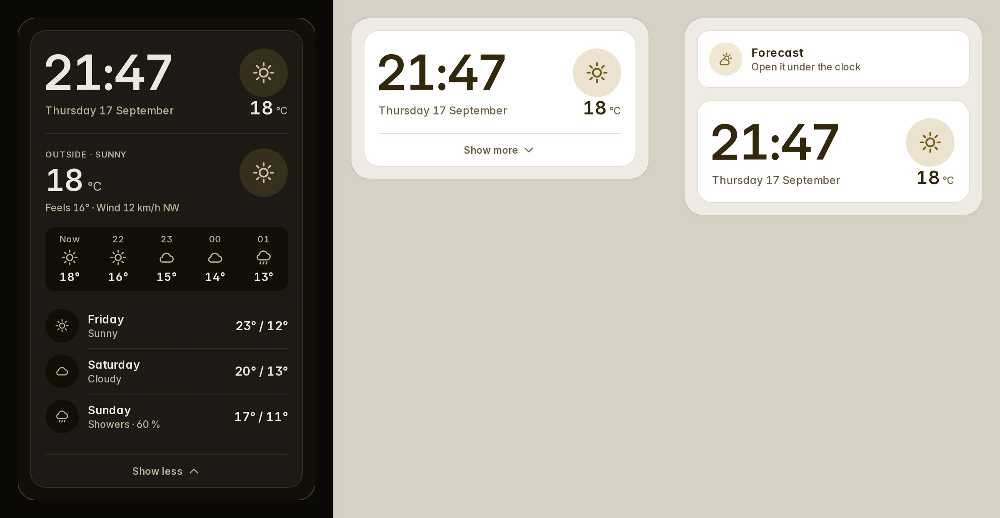

<!-- Generated by `pnpm docs:cards` from the card’s editor, its example in tools/docs/src/gallery.ts and its guide in tools/docs/guides/: change those, not this page. -->

# Expander

Any cards folded away under a head: a tap opens them, on one surface or each on its own.

`custom:fluvy-expander-card` · [Try it live](https://acosta290.github.io/fluvy/?card=expander) · [All cards](../cards.md#structure-and-navigation)

<picture><source media="(prefers-color-scheme: dark)" srcset="../images/cards/expander-dark.webp"></picture>

## Example

```yaml
type: custom:fluvy-expander-card
title: Garden
icon: leaf
entities:
  - light.ex_terrace
  - light.ex_path
  - light.ex_pergola
  - switch.ex_lawn
  - switch.ex_beds
remember: 'off'
cards:
  - type: custom:fluvy-light-card
    entity: light.ex_terrace
  - type: custom:fluvy-tiles-card
    size: compact
    columns: 2
    tiles:
      - entity: light.ex_path
      - entity: light.ex_pergola
      - entity: switch.ex_lawn
        icon: drop
      - entity: switch.ex_beds
        icon: leaf
  - type: custom:fluvy-readouts-card
    entities:
      - sensor.ex_soil
      - sensor.ex_garden_temperature
      - sensor.ex_rain
expanded: true
```

The picture above, on the demo house: put your own entities in place of its.

## Layouts

`style` chooses the layout. The picture above is `card`, the default; each of the others is the example plus the line over it, and opens in the live demo.

<table>
<tbody><tr>
<td align="center" valign="top" width="50%"><code>style: plain</code><br><a href="https://acosta290.github.io/fluvy/?card=expander&amp;layout=plain"><picture><source media="(prefers-color-scheme: dark)" srcset="../images/cards/expander.plain-dark.webp"></picture></a></td>
<td align="center" valign="top" width="50%"></td>
</tr></tbody>
</table>

## All options

```yaml
type: custom:fluvy-expander-card
title: Garden
icon: leaf
# subtitle:
entities:
  - light.ex_terrace
  - light.ex_path
  - light.ex_pergola
  - switch.ex_lawn
  - switch.ex_beds
show_summary: true
style: card
columns: 1
gap: 40
show_icon: auto
name_lines: 1
show_chevron: true
chevron_position: end
chevron_size: regular
expanded: true
remember: 'off'
# open_when:
close_after: 0
# id:
# tone:
# color:
# icon_color:
# card_color:
# card_opacity: 100
# card_border: true
# tap_action:
#   action: more-info
# hold_action:
#   action: more-info
# double_tap_action:
#   action: none
# head_cards:
cards:
  - type: custom:fluvy-light-card
    entity: light.ex_terrace
  - type: custom:fluvy-tiles-card
    size: compact
    columns: 2
    tiles:
      - entity: light.ex_path
      - entity: light.ex_pergola
      - entity: switch.ex_lawn
        icon: drop
      - entity: switch.ex_beds
        icon: leaf
  - type: custom:fluvy-readouts-card
    entities:
      - sensor.ex_soil
      - sensor.ex_garden_temperature
      - sensor.ex_rain
```

## Options

| Option | Default | What it does |
| --- | --- | --- |
| `title` |  | The title in the head. |
| `icon` |  | The card’s icon, in place of the entity’s own. |
| `subtitle` |  | The line under the title: your own words, an entity’s state or a template. |
| `entities` |  | The entities the head’s line counts ("2 of 5 on"). A list of entities. |
| `show_summary` | `true` | Counts the entities on the line under the title ("2 of 5 on"). |
| `style` | `card` | Draws the card on its own surface, or plain on the page. `card` (One card) · `plain`. |
| `columns` | `1` | How many of its cards stand side by side. `1` · `2` · `3` · `4`. |
| `gap` | `40` | The room between the cards it holds, in pixels. 0 to 64, in steps of 4. |
| `show_chevron` | `true` | Shows the chevron that opens and folds the card. |
| `chevron_position` | `end` | Where the chevron that opens and folds it stands. `end` (At the end) · `start` (At the start) · `bottom` (At the foot). |
| `chevron_size` | `regular` | How large the chevron is. `regular` · `large`. |
| `expanded` | `false` | Opens the card as the page loads; off, it starts folded. |
| `remember` | `device` | Where the way it was left open or folded is kept: this device, the person, or nowhere. `device` (On this device) · `user` (For each person) · `off`. |
| `open_when` |  | A condition that opens the card by itself while it holds. |
| `close_after` | `0` | Folds the card again by itself this many minutes after it was opened; 0 never does. 0 to 1440. |
| `id` |  | A name other cards use to open, fold or toggle this one. |
| `icon_color` |  | Paints the icon’s circle in a colour of its own. |
| `head_cards` |  | Cards that stand in the head in place of its icon and title, and stay while it is folded. |
| `cards` |  | The cards the Expander holds and shows while it is open: any card, Fluvy’s or not. |

<details>
<summary>Its look and its actions, as on every card</summary>

| Option | Default | What it does |
| --- | --- | --- |
| `show_icon` | `auto` | Shows the icon, hides it, or lets the card decide. `auto` · `always` · `never`. |
| `name_lines` | `1` | Lets the name in the card’s head take two balanced lines where one would cut it; the head is a line taller whatever the name. `1` · `2`. |
| `tone` | the card’s own | The card’s colour from the palette’s tones; left out, the tone of what it shows. `accent` · `light` · `heat` · `cool` · `dry` · `fan` · `water` · `solar` · `grid` · `media` · `presence` · `armed` · `battery` · `house` · `gas` · `vehicle` (Car) · `neutral` · `ok` (Good) · `warning` · `danger`. |
| `color` |  | The card’s colour: its circle, its accents and its tints wear it. Left out, the colour of what it shows. |
| `card_color` |  | Paints the card’s surface in a colour of your own. |
| `card_opacity` | `100` | How solid the card’s surface is, in percent: under 100 the view’s background shows through. Left out, the house’s. 0 % to 100 %, in steps of 5. |
| `card_border` | `true` | Whether the card draws its hairline border. Left out, the house’s. |
| **Interactions** |  |  |
| `tap_action` | `more-info` | What a tap on the card does. |
| `hold_action` | `more-info` | What a long press on the card does. |
| `double_tap_action` | `none` | What two taps on the card do. |

More about them in [Options every card takes](../customising.md#options-every-card-takes).

</details>

## Guide



The Expander folds any cards away under a head; a tap opens them. Folded, its cards are not built, so it costs
nothing.

```yaml
type: custom:fluvy-expander-card
title: Seldom used
icon: mdi:archive
entities: # counted on the head's line: "1 of 3 on"
  - light.guest_room
  - light.attic
  - switch.towel_heater
cards:
  - type: custom:fluvy-tiles-card
    entities: [light.guest_room, light.attic, switch.towel_heater]
  - type: entities
    entities: [sensor.attic_temperature]
```

- `style: card` (the default) holds every card on one surface; `plain` leaves each its own.
- `columns` (up to 4) and `gap` (px) lay the cards side by side.
- `color` colours the circle and the Fluvy cards inside that name no colour; `icon_color` the circle alone.
- A `tap_action` of its own leaves folding to the chevron.

### Folded or open

```yaml
# opens with the garage door, folds 10 minutes after you open it
type: custom:fluvy-expander-card
title: Garage
subtitle: "{{ states('cover.garage_door') }}"
remember: user # device (the default): per browser; user: per person; off
open_when:     # an entity with state, state_not, above or below
  entity: binary_sensor.garage_door
  state: "on"
close_after: 10 # minutes
cards:
  - type: custom:fluvy-camera-card
    entity: camera.garage
```

`expanded: true` starts it open. `open_when` folds it again when the condition ends, unless you touched it.

### Cards in the head



`head_cards` puts cards in the head's place: a clock, a weather tile. They stay on the page while folded, and the
chevron folds.

```yaml
type: custom:fluvy-expander-card
title: Today              # names the chevron's button
chevron_position: bottom  # a "Show more" row at the foot
chevron_size: large       # 56 px, for a wall tablet
head_cards:
  - type: custom:fluvy-clock-card
    face: digital
cards:
  - type: custom:fluvy-weather-card
    entity: weather.home
```

### Open it from another card

Give the expander an `id`; any card's `fire-dom-event` opens, folds or toggles it.

```yaml
type: custom:fluvy-template-card
name: Forecast
tap_action:
  action: fire-dom-event
  fluvy_expander:
    id: forecast     # the expander's id
    action: toggle   # or open, close
```

- A card inside the expander needs no id: `fluvy_expander: toggle`.
- Several expanders with one `id` move together.
- Home Assistant's action picker lacks `fire-dom-event`: write it in YAML (the expander's editor shows the line).
- `show_chevron: false` with `tap_action: { action: none }` leaves it to another card or `open_when`.

### From expander-card

Buttons that open an expander-card keep working; only the cards change.

| expander-card | Fluvy's Expander |
| --- | --- |
| `type: custom:expander-card` | `type: custom:fluvy-expander-card` |
| `title-card` | `head_cards` (one card or several) |
| `title`, `cards`, `expanded` | The same |
| `title-card-button-overlay`, `overlay-margin` | `chevron_position` |
| `title-card-clickable` | `tap_action: {action: fire-dom-event, fluvy_expander: toggle}` on the head's card |
| `expander-card-id` | `id` |
| `storage-id` | `remember` |
| `clear`, `clear-children` | `style`: `card` (one surface) or `plain` (each its own) |
| `expanded-gap` | `gap` |
| `show-button-users` | `show_chevron: false` |

<details>
<summary>Older names the card still reads</summary>

| Older name | Read as |
| --- | --- |
| `sub` | `subtitle` |
| `meta` | `subtitle` |
| `accent` | `color` |

</details>
