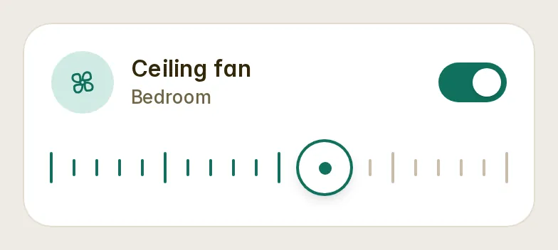

<!-- Generated by `pnpm docs:cards` from the card’s editor, its example in tools/docs/src/gallery.ts and its guide in tools/docs/guides/: change those, not this page. -->

# Fan

Speed ruler with steps, oscillation, direction and presets.

`custom:fluvy-fan-card` · [Try it live](https://acosta290.github.io/fluvy/?card=fan) · [All cards](../cards.md#everyday)

<picture><source media="(prefers-color-scheme: dark)" srcset="../images/cards/fan-dark.webp"></picture>

## Example

```yaml
type: custom:fluvy-fan-card
entity: fan.ceiling
subtitle: Bedroom
```

The picture above, on the demo house: put your own entities in place of its.

## Layouts

`variant` chooses the layout. The picture above is `full`, the default; each of the others is the example plus the line over it, and opens in the live demo.

<table>
<tbody><tr>
<td align="center" valign="top" width="50%"><code>variant: compact</code><br><a href="https://acosta290.github.io/fluvy/?card=fan&amp;layout=compact"><picture><source media="(prefers-color-scheme: dark)" srcset="../images/cards/fan.compact-dark.webp"></picture></a></td>
<td align="center" valign="top" width="50%"></td>
</tr></tbody>
</table>

## All options

```yaml
type: custom:fluvy-fan-card
entity: fan.ceiling
# name:
# icon:
show_icon: auto
name_lines: 1
subtitle: Bedroom
variant: full
show_stepper: true
show_presets: true
preset_style: full
show_oscillation: true
show_direction: true
when_off: all
slider_style: house
# tone:
# color:
# card_color:
# card_opacity: 100
# card_border: true
# unavailable: dashed
# tint: 'off'
# state_colors:
# tap_action:
#   action: more-info
# hold_action:
#   action: more-info
# double_tap_action:
#   action: none
# icon_tap_action:
#   action: none
# icon_hold_action:
#   action: none
# icon_double_tap_action:
#   action: none
```

## Options

| Option | Default | What it does |
| --- | --- | --- |
| `entity` | **required** | The entity the card is about: what it shows, and what its controls act on. A `fan`. |
| `name` |  | The name the card shows, in place of the entity’s own. |
| `icon` |  | The card’s icon, in place of the entity’s own. |
| `subtitle` |  | The line under the title: your own words, an entity’s state or a template. |
| `variant` | `full` | The card’s layout. `full` · `compact`. |
| `show_stepper` | `true` | Shows the − and + buttons. |
| `show_presets` | `true` | Shows the presets. |
| `preset_style` | `full` | Draws the presets as chips that fill the row, or as content-sized chips. `full` · `chips`. |
| `show_oscillation` | `true` | Shows the oscillation switch. |
| `show_direction` | `true` | Shows the fan’s direction. |
| `when_off` | `all` | What the card shows while the device is off: everything, or only what turns it on. `all` · `essentials` (The essentials). |
| `slider_style` | `house` | The slider’s style; left out, the style set for every slider. `house` · `ruler` · `bar` · `liquid`. |
| `slider_words` | `ends` | Writes the words at the slider’s ends, or none. `ends` · `none`. |
| `tint` | `off` | When the card shows its colour beyond its circle: never, while it is on or active, or at rest too. `off` (Never) · `on` (When active) · `always`. |
| `tint_style` | `wash` | How the colour is shown: a wash over the card, the card’s edge, or the control alone. `wash` · `edge` · `control`. |
| `state_colors` |  | A colour for each of the device’s states, held under this key: a tone, none, or a colour of your own. Its keys: `on` · `off`. |

<details>
<summary>Its look and its actions, as on every card</summary>

| Option | Default | What it does |
| --- | --- | --- |
| `show_icon` | `auto` | Shows the icon, hides it, or lets the card decide. `auto` · `always` · `never`. |
| `name_lines` | `1` | Lets the name in the card’s head take two balanced lines where one would cut it; the head is a line taller whatever the name. `1` · `2`. |
| `tone` | the card’s own | The card’s colour from the palette’s tones; left out, the tone of what it shows. `accent` · `light` · `heat` · `cool` · `dry` · `fan` · `water` · `solar` · `grid` · `media` · `presence` · `armed` · `battery` · `house` · `gas` · `vehicle` (Car) · `neutral` · `ok` (Good) · `warning` · `danger`. |
| `color` |  | The card’s colour: its circle, its accents and its tints wear it. Left out, the colour of what it shows. |
| `card_color` |  | Paints the card’s surface in a colour of your own. |
| `card_opacity` | `100` | How solid the card’s surface is, in percent: under 100 the view’s background shows through. Left out, the house’s. 0 % to 100 %, in steps of 5. |
| `card_border` | `true` | Whether the card draws its hairline border. Left out, the house’s. |
| `unavailable` | `dashed` | How the card looks while its entity is unavailable: dashed, or quiet as when it is off. Left out, the house’s. `dashed` · `quiet` (As when off). |
| **Interactions** |  |  |
| `tap_action` | `more-info` | What a tap on the card does. |
| `hold_action` | `more-info` | What a long press on the card does. |
| `double_tap_action` | `none` | What two taps on the card do. |
| `icon_tap_action` | `none` | What a tap on the icon does. |
| `icon_hold_action` | `none` | What a long press on the icon does. |
| `icon_double_tap_action` | `none` | What two taps on the icon do. |

More about them in [Options every card takes](../customising.md#options-every-card-takes).

</details>

<details>
<summary>Older names the card still reads</summary>

| Older name | Read as |
| --- | --- |
| `sub` | `subtitle` |
| `meta` | `subtitle` |
| `layout` | `variant` |
| `view` | `variant` |
| `accent` | `color` |

</details>
