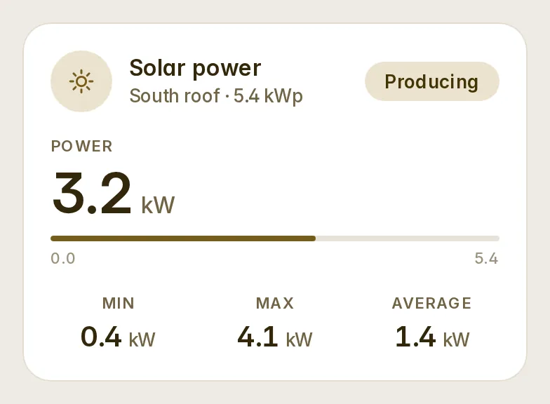
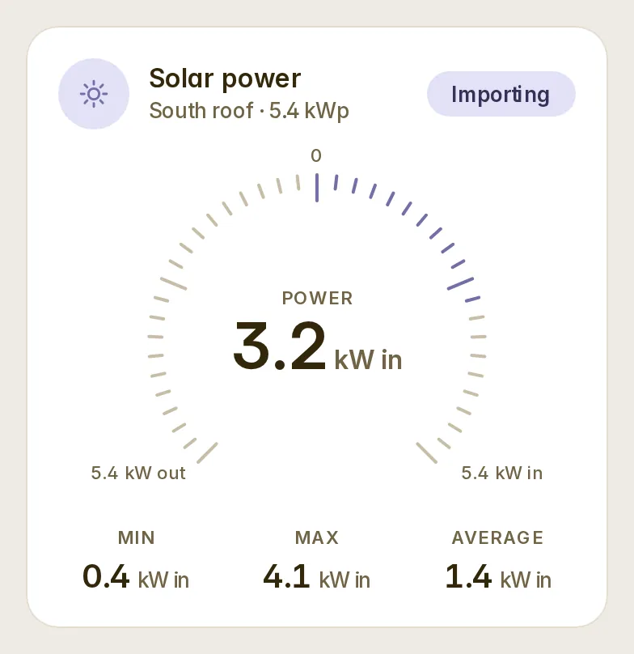

<!-- Generated by `pnpm docs:cards` from the card’s editor, its example in tools/docs/src/gallery.ts and its guide in tools/docs/guides/: change those, not this page. -->

# Gauge

A ring gauge for any numeric sensor with min, max and average, or centred on zero for a meter that runs both ways.

`custom:fluvy-gauge-card` · [Try it live](https://acosta290.github.io/fluvy/?card=gauge) · [All cards](../cards.md#energy)

<picture><source media="(prefers-color-scheme: dark)" srcset="../images/cards/gauge-dark.webp"></picture>

## Example

```yaml
type: custom:fluvy-gauge-card
entity: sensor.so_solar_power
icon: sun
subtitle: South roof · 5.4 kWp
max_entity: sensor.so_solar_capacity
```

The picture above, on the demo house: put your own entities in place of its.

## Layouts

`variant` chooses the layout. The picture above is `ring`, the default; each of the others is the example plus the line over it, and opens in the live demo.

<table>
<tbody><tr>
<td align="center" valign="top" width="50%"><code>variant: bar</code><br><a href="https://acosta290.github.io/fluvy/?card=gauge&amp;layout=bar"><picture><source media="(prefers-color-scheme: dark)" srcset="../images/cards/gauge.bar-dark.webp"></picture></a></td>
<td align="center" valign="top" width="50%"><code>variant: signed</code><br><a href="https://acosta290.github.io/fluvy/?card=gauge&amp;layout=signed"><picture><source media="(prefers-color-scheme: dark)" srcset="../images/cards/gauge.signed-dark.webp"></picture></a></td>
</tr></tbody>
</table>

## All options

```yaml
type: custom:fluvy-gauge-card
entity: sensor.so_solar_power
# name:
subtitle: South roof · 5.4 kWp
icon: sun
variant: ring
# gauge: ticks
show_icon: auto
show_badge: true
name_lines: 1
# tone:
# color:
# card_color:
# card_opacity: 100
# card_border: true
# unavailable: dashed
# min:
# max:
max_entity: sensor.so_solar_capacity
# label:
# badge:
show_stats: true
# hours:
stats:
  - min
  - max
  - average
# thresholds:
# unit: auto
# decimals: auto
# tap_action:
#   action: more-info
# hold_action:
#   action: more-info
# double_tap_action:
#   action: none
# icon_tap_action:
#   action: none
# icon_hold_action:
#   action: none
# icon_double_tap_action:
#   action: none
```

## Options

| Option | Default | What it does |
| --- | --- | --- |
| `entity` | **required** | The entity the card is about: what it shows, and what its controls act on. A `sensor`, `number`, `input_number` or `counter`. |
| `name` |  | The name the card shows, in place of the entity’s own. |
| `subtitle` |  | The line under the title: your own words, an entity’s state or a template. |
| `icon` |  | The card’s icon, in place of the entity’s own. |
| `variant` | `ring` | The card’s layout. `ring` · `bar` · `signed` (Centred on zero). |
| `gauge` | `ticks` | The gauge’s style. `ticks` · `dial` · `ring` · `liquid` · `thermo` (Sky) · `tank` · `battery` · `pulse` · `air` · `sun`. |
| `animate` | `true` | Lets the chart or the gauge move as it draws; off, it shows its resting frame at once. |
| `min` |  | The bottom of the ring, in the sensor’s unit. |
| `max` |  | The top of the ring, in the sensor’s unit. |
| `max_entity` |  | An entity that holds the top of the scale, such as an inverter’s rated power. A `sensor`, `number` or `input_number`. |
| `label` |  | The words inside the ring, over the figure. |
| `badge` |  | The words in the head’s badge: your own, an entity’s state or a template. |
| `show_stats` | `true` | Shows the row of figures under the gauge. |
| `hours` |  | How many hours of history the card draws, up to now. 1 to 168. |
| `stats` | `min`, `max`, `average` | The figures shown in the row under the gauge, in this order. Any of `min` · `max` · `average`. |
| `tint` | `off` | Whether the card itself takes the colour of the threshold its reading is past: never, or while it is past one. `off` (Never) · `on` (Past a threshold). |
| `tint_style` | `wash` | How that colour is shown: a wash over the card, or the card’s edge. `wash` · `edge`. |
| `unit` | `auto` | The unit the figures are written in; automatic keeps the sensor’s. `auto` · `W` · `kW` · `MW` · `Wh` · `kWh` · `MWh` · `L` · `m³` · `gal` · `ft³`, or your own. |
| `decimals` | `auto` | How many decimals the figures have; automatic decides by their size. `auto` · `0` · `1` · `2` · `3`. |
| [`thresholds`](#thresholds) |  | Values past which the reading takes a colour, each with its tone, and a label and an icon of its own. A list: [its items](#thresholds). |

<details>
<summary>Its look and its actions, as on every card</summary>

| Option | Default | What it does |
| --- | --- | --- |
| `show_icon` | `auto` | Shows the icon, hides it, or lets the card decide. `auto` · `always` · `never`. |
| `show_badge` | `true` | Shows the badge at the end of the head, such as the card’s state or a count. |
| `name_lines` | `1` | Lets the name in the card’s head take two balanced lines where one would cut it; the head is a line taller whatever the name. `1` · `2`. |
| `tone` | the card’s own | The card’s colour from the palette’s tones; left out, the tone of what it shows. `accent` · `light` · `heat` · `cool` · `dry` · `fan` · `water` · `solar` · `grid` · `media` · `presence` · `armed` · `battery` · `house` · `gas` · `vehicle` (Car) · `neutral` · `ok` (Good) · `warning` · `danger`. |
| `color` |  | The card’s colour: its circle, its accents and its tints wear it. Left out, the colour of what it shows. |
| `card_color` |  | Paints the card’s surface in a colour of your own. |
| `card_opacity` | `100` | How solid the card’s surface is, in percent: under 100 the view’s background shows through. Left out, the house’s. 0 % to 100 %, in steps of 5. |
| `card_border` | `true` | Whether the card draws its hairline border. Left out, the house’s. |
| `unavailable` | `dashed` | How the card looks while its entity is unavailable: dashed, or quiet as when it is off. Left out, the house’s. `dashed` · `quiet` (As when off). |
| **Interactions** |  |  |
| `tap_action` | `more-info` | What a tap on the card does. |
| `hold_action` | `more-info` | What a long press on the card does. |
| `double_tap_action` | `none` | What two taps on the card do. |
| `icon_tap_action` | `none` | What a tap on the icon does. |
| `icon_hold_action` | `none` | What a long press on the icon does. |
| `icon_double_tap_action` | `none` | What two taps on the icon do. |

More about them in [Options every card takes](../customising.md#options-every-card-takes).

</details>

## Lists

### `thresholds`

An item is a map with `tone` and any of these fields.

| Field | What it does |
| --- | --- |
| `tone` | The item’s colour from the palette’s tones. `none` · `accent` · `light` · `heat` · `cool` · `dry` · `fan` · `water` · `solar` · `grid` · `media` · `presence` · `armed` · `battery` · `house` · `gas` · `vehicle` (Car) · `neutral` · `ok` (Good) · `warning` · `danger`. |
| `value` | Where the threshold starts: a figure, an entity’s reading or a template’s answer, in the reading’s unit. |
| `below` | The threshold claims what is under its value. `true` or `false`. |
| `color` | The item’s colour, in place of the one the card gives it. |
| `label` | What the band is called, said beside the reading so that colour is never all that says it. |
| `icon` | The item’s own icon, in place of the one the card would give it. |

<details>
<summary>Older names the card still reads</summary>

| Older name | Read as |
| --- | --- |
| `sub` | `subtitle` |
| `meta` | `subtitle` |
| `layout` | `variant` |
| `view` | `variant` |
| `trend_hours` | `hours` |
| `accent` | `color` |

</details>
