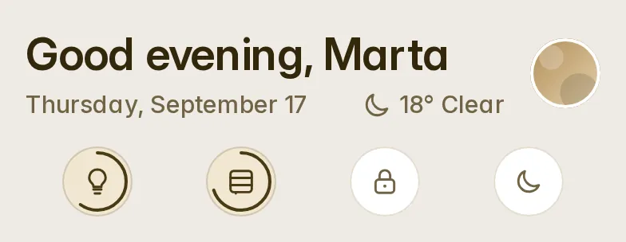

<!-- Generated by `pnpm docs:cards` from the card’s editor, its example in tools/docs/src/gallery.ts and its guide in tools/docs/guides/: change those, not this page. -->

# Hello

The greeting: name, date, weather and avatar.

`custom:fluvy-hello-card` · [Try it live](https://acosta290.github.io/fluvy/?card=hello) · [All cards](../cards.md#structure-and-navigation)

<picture><source media="(prefers-color-scheme: dark)" srcset="../images/cards/hello-dark.webp"></picture>

## Example

```yaml
type: custom:fluvy-hello-card
name: Marta
person: person.marta
weather: weather.flat
quick_actions:
  - light.gr_hall
  - cover.gr_blinds
  - lock.gr_front_door
  - entity: scene.gr_evening
    icon: fluvy:moon
```

The picture above, on the demo house: put your own entities in place of its.

## All options

```yaml
type: custom:fluvy-hello-card
name: Marta
person: person.marta
weather: weather.flat
show_weather: true
show_date: true
show_avatar: true
show_name: true
# color:
# exact_colors: false
quick_actions:
  - light.gr_hall
  - cover.gr_blinds
  - lock.gr_front_door
  - entity: scene.gr_evening
    icon: fluvy:moon
show_quick_states: false
# tap_action:
#   action: more-info
# hold_action:
#   action: more-info
# double_tap_action:
#   action: none
# weather_tap_action:
#   action: none
# weather_hold_action:
#   action: none
# weather_double_tap_action:
#   action: none
# date_tap_action:
#   action: none
# date_hold_action:
#   action: none
# date_double_tap_action:
#   action: none
```

## Options

| Option | Default | What it does |
| --- | --- | --- |
| `name` |  | The name the card shows, in place of the entity’s own. |
| `person` |  | The person the card greets; left out, whoever is signed in. A `person`. |
| `weather` |  | The weather entity whose condition and temperature the card shows. A `weather`. |
| `show_weather` | `true` | Shows the weather beside the date. |
| `show_date` | `true` | Shows the date. |
| `show_avatar` | `true` | Shows the person’s picture. |
| `show_name` | `true` | Shows the name after the greeting; hidden, the greeting alone. |
| `show_quick_states` | `false` | Shows every quick action’s state in its round, unless the action says otherwise. |
| `quick_state_position` | `under` | Where the quick actions’ states stand: under their icons, their line taller, or beside them, the rounds wider. `under` · `beside`. |
| [`quick_actions`](#quick_actions) |  | Small rounds under the greeting, across its width, each an entity with its own icon, colour and actions: a lamp, a door, a scene. A list: [its items](#quick_actions). |
| **Interactions** |  |  |
| `weather_tap_action` | `none` | What a tap on the weather does, for the weather entity; nothing until one is set. |
| `weather_hold_action` | `none` | What a long press on the weather does. |
| `weather_double_tap_action` | `none` | What two taps on the weather do. |
| `date_tap_action` | `none` | What a tap on the date does, such as opening a calendar’s view; nothing until one is set. |
| `date_hold_action` | `none` | What a long press on the date does. |
| `date_double_tap_action` | `none` | What two taps on the date do. |

<details>
<summary>Its look and its actions, as on every card</summary>

| Option | Default | What it does |
| --- | --- | --- |
| `color` |  | The card’s colour: its circle, its accents and its tints wear it. Left out, the colour of what it shows. |
| `exact_colors` | `false` | Wears the colours the card names as Home Assistant draws them and a hex as typed, not the palette’s tones. Left out, the house’s. |
| **Interactions** |  |  |
| `tap_action` | `more-info` | What a tap on the card does. |
| `hold_action` | `more-info` | What a long press on the card does. |
| `double_tap_action` | `none` | What two taps on the card do. |

More about them in [Options every card takes](../customising.md#options-every-card-takes).

</details>

## Lists

### `quick_actions`

An item is an entity id, or a map with `entity` and any of these fields.

| Field | What it does |
| --- | --- |
| `entity` | The entity the item shows. |
| `name` | The item’s own name, in place of the one the card would give it. |
| `icon` | The item’s own icon, in place of the one the card would give it. |
| `tone` | The item’s colour from the palette’s tones. `accent` · `light` · `heat` · `cool` · `dry` · `fan` · `water` · `solar` · `grid` · `media` · `presence` · `armed` · `battery` · `house` · `gas` · `vehicle` (Car) · `neutral` · `ok` (Good) · `warning` · `danger`. |
| `color` | The item’s colour, in place of the one the card gives it. |
| `show_state` | Shows this quick action’s state in its round, or hides it, whatever the card says. `true` (On) · `false` (Off). |
| `gauge` | Draws the round’s reading on it as a gauge: an arc round its edge, an arc from zero, a sector or a flood. `arc` · `zero` (From zero) · `sector` · `fill`. |
| `min` | The bottom of the row’s bar: a figure, an entity or a template. |
| `max` | The top of the row’s bar: a figure, an entity or a template. |
| `attribute` | The attribute that is compared, in place of the state. |
| `decimals` | How many decimals the figure has. 0 to 3. |
| `thresholds` | Thresholds of the item’s own: values past which its reading takes a colour. |
| **Interactions** |  |
| `tap_action` | What a tap on the item does. |
| `hold_action` | What a long press on the item does. |
| `double_tap_action` | What two taps on the item do. |

<details>
<summary>Older names the card still reads</summary>

| Older name | Read as |
| --- | --- |
| `accent` | `color` |

</details>
