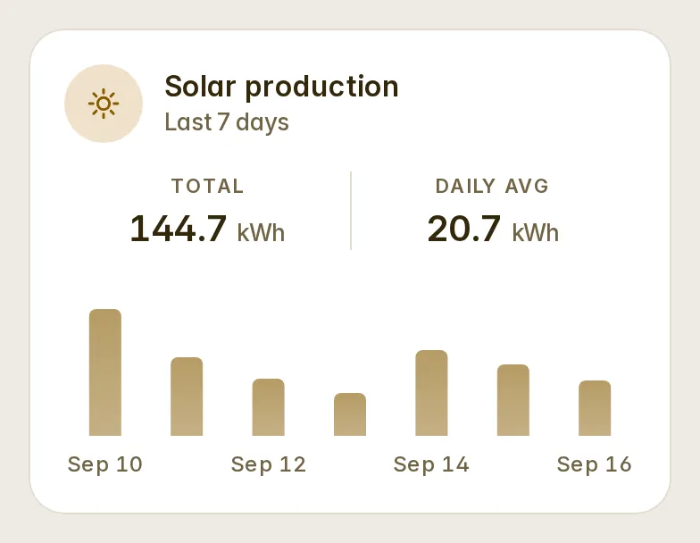
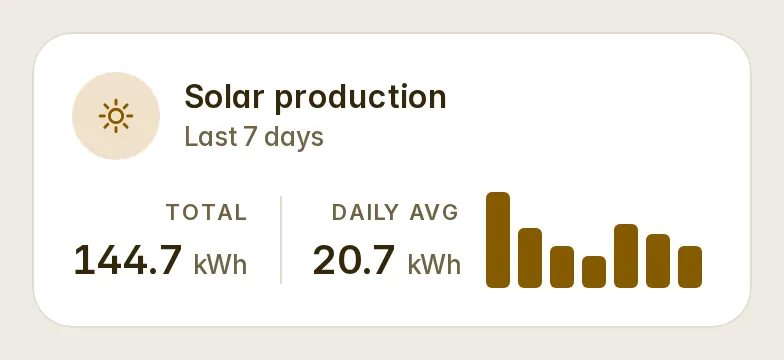

<!-- Generated by `pnpm docs:cards` from the card’s editor, its example in tools/docs/src/gallery.ts and its guide in tools/docs/guides/: change those, not this page. -->

# History bars

A sensor’s last days, weeks or months as bars from its long-term statistics: the total and the average in the head, the value over each bar, and a strip of facts under them — the highest and lowest, or what it comes to in CO₂, trees, kilometres or money.

`custom:fluvy-history-bars-card` · [Try it live](https://acosta290.github.io/fluvy/?card=history-bars) · [All cards](../cards.md#energy)

<picture><source media="(prefers-color-scheme: dark)" srcset="../images/cards/history-bars-dark.webp"></picture>

## Example

```yaml
type: custom:fluvy-history-bars-card
entity: sensor.hb_solar
icon: sun
color: '#C9A063'
```

The picture above, on the demo house: put your own entities in place of its.

## Layouts

`variant` chooses the layout. The picture above is `full`, the default; each of the others is the example plus the line over it, and opens in the live demo.

<table>
<tbody><tr>
<td align="center" valign="top" width="50%"><code>variant: compact</code><br><a href="https://acosta290.github.io/fluvy/?card=history-bars&amp;layout=compact"><picture><source media="(prefers-color-scheme: dark)" srcset="../images/cards/history-bars.compact-dark.webp"></picture></a></td>
<td align="center" valign="top" width="50%"><code>variant: mini</code><br><a href="https://acosta290.github.io/fluvy/?card=history-bars&amp;layout=mini"><picture><source media="(prefers-color-scheme: dark)" srcset="../images/cards/history-bars.mini-dark.webp"></picture></a></td>
</tr></tbody>
</table>

## All options

```yaml
type: custom:fluvy-history-bars-card
entity: sensor.hb_solar
# name:
# subtitle:
icon: sun
variant: full
show_icon: auto
name_lines: 1
# tone:
color: '#C9A063'
# card_color:
# card_opacity: 100
# card_border: true
# unavailable: dashed
days: 7
period: day
stat: state
reset: auto
source: auto
date_format: date
# negative_color:
# current_color:
include_today: false
show_head: true
show_values: true
show_axis: true
show_grid: true
show_dates: true
show_facts: true
head:
  - average
  - highest
facts:
  - highest
  - lowest
  - average
co2_factor: 0.4
# price:
# chart: classic
# animate: true
# unit: auto
decimals: 1
# tap_action:
#   action: more-info
# hold_action:
#   action: more-info
# double_tap_action:
#   action: none
# icon_tap_action:
#   action: none
# icon_hold_action:
#   action: none
# icon_double_tap_action:
#   action: none
# entities:
```

## Options

| Option | Default | What it does |
| --- | --- | --- |
| `entity` | **required** | The sensor whose history the bars show: a meter, or any reading. A `sensor`. |
| `name` |  | The name the card shows, in place of the entity’s own. |
| `subtitle` |  | The line under the title: your own words, an entity’s state or a template. |
| `icon` |  | The card’s icon, in place of the entity’s own. |
| `variant` | `full` | The card’s layout. `full` · `compact` · `mini`. |
| `days` | `7` | How many bars the card draws. 1 to 92. |
| `period` | `day` | What one bar stands for: a day, a week, or a month. `day` · `week` · `month`. |
| `stat` | `state` | What each bar shows: what the meter gained, its reading, the mean, the highest or the lowest. `change` (What it gained) · `state` (The reading at the end) · `mean` (The mean) · `max` (The highest reading) · `min` (The lowest reading). |
| `reset` | `auto` | When the meter starts again from zero, so the bars count each period once. `auto` (As Home Assistant counts it) · `never` · `day` (Every day) · `week` (Every week) · `month` (Every month) · `year` (Every year). |
| `source` | `auto` | Reads the bars from Home Assistant’s statistics, or from the sensor’s history. `auto` (Statistics, else the history) · `history` (The history (recent days)). |
| `date_format` | `date` | How each bar’s date is written under it. `date` (The date) · `weekday` (The weekday) · `short`. |
| `negative_color` |  | Paints the bars below zero in a colour of their own. |
| `current_color` |  | Paints the bar still in progress in a colour of its own. |
| `include_today` | `false` | Adds the period still in progress as the last bar. |
| `show_head` | `true` | Shows the head’s figures over the bars. |
| `show_values` | `true` | Writes each bar’s value over it. |
| `show_axis` | `true` | Shows the scale’s labels beside the chart. |
| `show_grid` | `true` | Draws gridlines behind the bars. |
| `show_dates` | `true` | Writes each bar’s date under it. |
| `show_facts` | `true` | Shows the strip of facts under the bars. |
| `co2_factor` | `0.4` | Kilograms of CO₂ a kWh of grid power costs, for the CO₂ and the trees. 0 to 2, in steps of 0.01. |
| `price` |  | The price per unit the money is worked out with. 0 to 100, in steps of 0.001. |
| `unit` | `auto` | The unit the figures are written in; automatic keeps the sensor’s. `auto` · `W` · `kW` · `MW` · `Wh` · `kWh` · `MWh` · `L` · `m³` · `gal` · `ft³`, or your own. |
| `decimals` | `1` | How many decimals the figures have; automatic decides by their size. `0` · `1` · `2` · `3`. |
| [`entities`](#entities) |  | Sensors added up bar by bar, such as several arrays. A list: [its items](#entities). |
| [`head`](#head) |  | The figures in the head, in this order. A list: [its items](#head). |
| [`facts`](#facts) |  | The facts under the chart, in this order. A list: [its items](#facts). |
| **Chart** |  |  |
| `chart` | `classic` | The bars’ style. `classic` · `bars` · `columns` · `minimal`. |
| `highlight` | `none` | Marks out a bar: the lowest, the highest, both, or the current one. `none` · `min` (The lowest reading) · `max` (The highest reading) · `both` (Lowest and highest) · `current` (The current one). |
| `animate` | `true` | Lets the chart or the gauge move as it draws; off, it shows its resting frame at once. |

<details>
<summary>Its look and its actions, as on every card</summary>

| Option | Default | What it does |
| --- | --- | --- |
| `show_icon` | `auto` | Shows the icon, hides it, or lets the card decide. `auto` · `always` · `never`. |
| `name_lines` | `1` | Lets the name in the card’s head take two balanced lines where one would cut it; the head is a line taller whatever the name. `1` · `2`. |
| `tone` | the card’s own | The card’s colour from the palette’s tones; left out, the tone of what it shows. `accent` · `light` · `heat` · `cool` · `dry` · `fan` · `water` · `solar` · `grid` · `media` · `presence` · `armed` · `battery` · `house` · `gas` · `vehicle` (Car) · `neutral` · `ok` (Good) · `warning` · `danger`. |
| `color` |  | The card’s colour: its circle, its accents and its tints wear it. Left out, the colour of what it shows. |
| `card_color` |  | Paints the card’s surface in a colour of your own. |
| `card_opacity` | `100` | How solid the card’s surface is, in percent: under 100 the view’s background shows through. Left out, the house’s. 0 % to 100 %, in steps of 5. |
| `card_border` | `true` | Whether the card draws its hairline border. Left out, the house’s. |
| `unavailable` | `dashed` | How the card looks while its entity is unavailable: dashed, or quiet as when it is off. Left out, the house’s. `dashed` · `quiet` (As when off). |
| **Interactions** |  |  |
| `tap_action` | `more-info` | What a tap on the card does. |
| `hold_action` | `more-info` | What a long press on the card does. |
| `double_tap_action` | `none` | What two taps on the card do. |
| `icon_tap_action` | `none` | What a tap on the icon does. |
| `icon_hold_action` | `none` | What a long press on the icon does. |
| `icon_double_tap_action` | `none` | What two taps on the icon do. |

More about them in [Options every card takes](../customising.md#options-every-card-takes).

</details>

## Lists

### `entities`

An item is an entity id, or a map with `entity` and any of these fields.

| Field | What it does |
| --- | --- |
| `entity` | The entity the item shows. A `sensor`. |

### `head`

An item is a map with `kind` and any of these fields.

| Field | What it does |
| --- | --- |
| `kind` | What the figure says. `total` · `average` · `highest` · `lowest` · `today` · `co2` (CO₂) · `trees` · `km` (Kilometres) · `share` · `money` · `template`. |
| `name` | The figure’s name. |
| `unit` | The unit the figure is written in. |
| `decimals` | How many decimals the figure has. 0 to 3. |
| `factor` | The factor the figure is worked out with. 0 or more, in steps of 0.001. |
| `of` | The sensor the share is of. A `sensor`. |
| `template` | A template of your own for the figure. |
| **Interactions** |  |
| `tap_action` | What a tap on the item does. |
| `hold_action` | What a long press on the item does. |
| `double_tap_action` | What two taps on the item do. |

### `facts`

An item is a map with `kind` and any of these fields.

| Field | What it does |
| --- | --- |
| `kind` | What the fact says. `total` · `average` · `highest` · `lowest` · `today` · `co2` (CO₂) · `trees` · `km` (Kilometres) · `share` · `money` · `template`. |
| `name` | The fact’s name. |
| `icon` | The item’s own icon, in place of the one the card would give it. |
| `color` | The item’s colour, in place of the one the card gives it. |
| `unit` | The unit the figure is written in. |
| `decimals` | How many decimals the figure has. 0 to 3. |
| `factor` | The factor the figure is worked out with. 0 or more, in steps of 0.001. |
| `of` | The sensor the share is of. A `sensor`. |
| `template` | A template of your own for the figure. |
| **Interactions** |  |
| `tap_action` | What a tap on the item does. |
| `hold_action` | What a long press on the item does. |
| `double_tap_action` | What two taps on the item do. |

<details>
<summary>Older names the card still reads</summary>

| Older name | Read as |
| --- | --- |
| `title` | `name` |
| `entities[].label` | `entities[].name` |
| `entities[].sub` | `entities[].secondary` |
| `entities[].meta` | `entities[].subtitle` |
| `sub` | `subtitle` |
| `meta` | `subtitle` |
| `layout` | `variant` |
| `view` | `variant` |
| `accent` | `color` |

</details>
