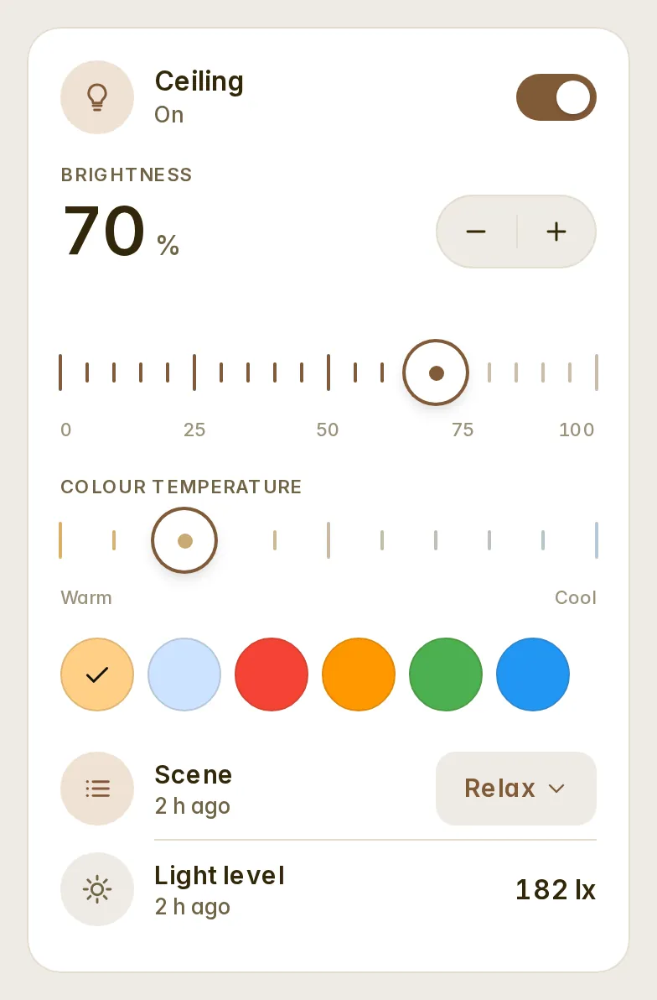
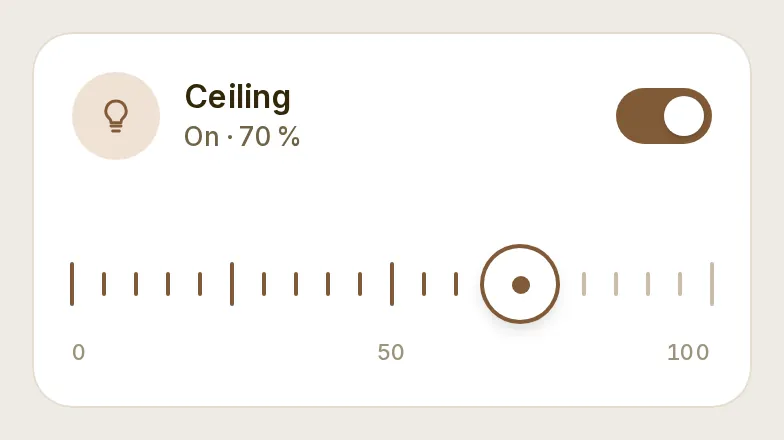

<!-- Generated by `pnpm docs:cards` from the card’s editor, its example in tools/docs/src/gallery.ts and its guide in tools/docs/guides/: change those, not this page. -->

# Light

The precision dimmer: relative drag, slide away to slow down, hold for the 1 % scale, colour temperature.

`custom:fluvy-light-card` · [Try it live](https://acosta290.github.io/fluvy/?card=light) · [All cards](../cards.md#everyday)

<picture><source media="(prefers-color-scheme: dark)" srcset="../images/cards/light-dark.webp"></picture>

## Example

```yaml
type: custom:fluvy-light-card
entity: light.ceiling
```

The picture above, on the demo house: put your own entities in place of its.

## Layouts

`variant` chooses the layout. The picture above is `auto`, the default; each of the others is the example plus the line over it, and opens in the live demo.

<table>
<tbody><tr>
<td align="center" valign="top" width="50%"><code>variant: full</code><br><a href="https://acosta290.github.io/fluvy/?card=light&amp;layout=full"><picture><source media="(prefers-color-scheme: dark)" srcset="../images/cards/light.full-dark.webp"></picture></a></td>
<td align="center" valign="top" width="50%"><code>variant: compact</code><br><a href="https://acosta290.github.io/fluvy/?card=light&amp;layout=compact"><picture><source media="(prefers-color-scheme: dark)" srcset="../images/cards/light.compact-dark.webp"></picture></a></td>
</tr></tbody>
</table>

## All options

```yaml
type: custom:fluvy-light-card
entity: light.ceiling
# name:
# icon:
show_icon: auto
name_lines: 1
show_brightness: true
variant: auto
show_stepper: true
live_update: false
slider_style: house
show_temperature: true
show_color: true
colors:
  - red
  - orange
  - green
  - blue
  - purple
  - pink
temperature_tint: true
# tone:
# color:
# card_color:
# card_opacity: 100
# card_border: true
# unavailable: dashed
# tint: 'off'
light_whites: temperature
# tap_action:
#   action: more-info
# hold_action:
#   action: more-info
# double_tap_action:
#   action: none
# icon_tap_action:
#   action: none
# icon_hold_action:
#   action: none
# icon_double_tap_action:
#   action: none
```

## Options

| Option | Default | What it does |
| --- | --- | --- |
| `entity` | **required** | The entity the card is about: what it shows, and what its controls act on. A `light`. |
| `name` |  | The name the card shows, in place of the entity’s own. |
| `icon` |  | The card’s icon, in place of the entity’s own. |
| `show_brightness` | `true` | Shows the brightness ruler. `true` (Always) · `when_on` · `false` (Never). |
| `variant` | `auto` | The card’s layout. `auto` · `full` · `compact`. |
| `show_stepper` | `true` | Shows the − and + buttons. |
| `live_update` | `false` | Sends the value while the slider is dragged, not only when it is let go. |
| `slider_style` | `house` | The slider’s style; left out, the style set for every slider. `house` · `ruler` · `bar` · `liquid`. |
| `slider_words` | `ends` | Writes the words at the slider’s ends, or none. `ends` · `none`. |
| `show_temperature` | `true` | Shows the colour temperature ruler. |
| `show_color` | `true` | Shows the colour controls. |
| `temperature_tint` | `true` | Tints the colour temperature ruler from warm to cool. |
| `tint` | `off` | When the card shows its colour beyond its circle: never, while it is on or active, or at rest too. `off` (Never) · `on` (When on) · `always`. |
| `tint_strength` | `full` | How much colour the card shows: a soft wash, the whole fill, or as much as the light is bright. `soft` · `brightness` (Soft, with the brightness) · `full` · `full_brightness` (Full colour, with the brightness). |
| `light_whites` | `temperature` | Draws a lit white by its colour temperature, or as the palette’s light. `palette` (The theme’s light) · `temperature` (The bulb’s white). |
| [`colors`](#colors) |  | Quick colours offered as rounds, in this order. A list: [its items](#colors). |

<details>
<summary>Its look and its actions, as on every card</summary>

| Option | Default | What it does |
| --- | --- | --- |
| `show_icon` | `auto` | Shows the icon, hides it, or lets the card decide. `auto` · `always` · `never`. |
| `name_lines` | `1` | Lets the name in the card’s head take two balanced lines where one would cut it; the head is a line taller whatever the name. `1` · `2`. |
| `tone` | the card’s own | The card’s colour from the palette’s tones; left out, the tone of what it shows. `accent` · `light` · `heat` · `cool` · `dry` · `fan` · `water` · `solar` · `grid` · `media` · `presence` · `armed` · `battery` · `house` · `gas` · `vehicle` (Car) · `neutral` · `ok` (Good) · `warning` · `danger`. |
| `color` |  | The card’s colour: its circle, its accents and its tints wear it. Left out, the colour of what it shows. |
| `card_color` |  | Paints the card’s surface in a colour of your own. |
| `card_opacity` | `100` | How solid the card’s surface is, in percent: under 100 the view’s background shows through. Left out, the house’s. 0 % to 100 %, in steps of 5. |
| `card_border` | `true` | Whether the card draws its hairline border. Left out, the house’s. |
| `unavailable` | `dashed` | How the card looks while its entity is unavailable: dashed, or quiet as when it is off. Left out, the house’s. `dashed` · `quiet` (As when off). |
| **Interactions** |  |  |
| `tap_action` | `more-info` | What a tap on the card does. |
| `hold_action` | `more-info` | What a long press on the card does. |
| `double_tap_action` | `none` | What two taps on the card do. |
| `icon_tap_action` | `none` | What a tap on the icon does. |
| `icon_hold_action` | `none` | What a long press on the icon does. |
| `icon_double_tap_action` | `none` | What two taps on the icon do. |

More about them in [Options every card takes](../customising.md#options-every-card-takes).

</details>

## Lists

### `colors`

An item is a map with `color` and any of these fields.

| Field | What it does |
| --- | --- |
| `color` | The quick colour: a named one, or any colour of your own. `warm` · `cool` · `red` · `orange` · `yellow` · `green` · `blue` · `purple` · `pink` · `picker` (Colour picker) · `custom`. |
| `name` | What the round says. |
| `rgb` | Any colour, picked in the colour well. |

<details>
<summary>Older names the card still reads</summary>

| Older name | Read as |
| --- | --- |
| `layout` | `variant` |
| `view` | `variant` |
| `accent` | `color` |

</details>
