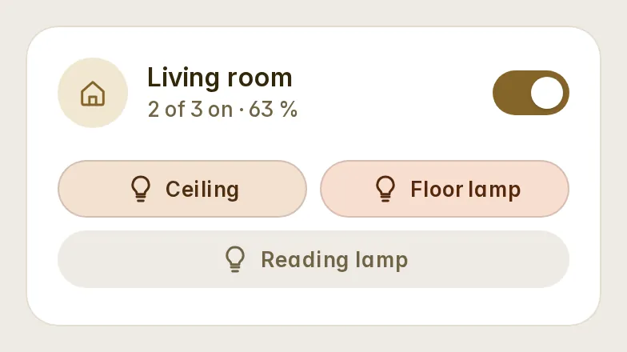
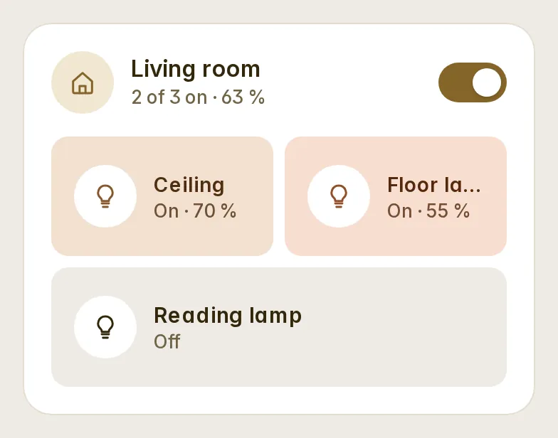

<!-- Generated by `pnpm docs:cards` from the card’s editor, its example in tools/docs/src/gallery.ts and its guide in tools/docs/guides/: change those, not this page. -->

# Room lights

A room’s lights on one card: one tap for the whole room, a round, chip or tile for each light, in its colour.

`custom:fluvy-lights-card` · [Try it live](https://acosta290.github.io/fluvy/?card=lights) · [All cards](../cards.md#everyday)

<picture><source media="(prefers-color-scheme: dark)" srcset="../images/cards/lights-dark.webp"></picture>

## Example

```yaml
type: custom:fluvy-lights-card
name: Living room
lights:
  - light.lt_ceiling
  - light.lt_floor
  - light.lt_reading
```

The picture above, on the demo house: put your own entities in place of its.

## Layouts

`variant` chooses the layout. The picture above is `row`, the default; each of the others is the example plus the line over it, and opens in the live demo.

<table>
<tbody><tr>
<td align="center" valign="top" width="50%"><code>variant: chips</code><br><a href="https://acosta290.github.io/fluvy/?card=lights&amp;layout=chips"><picture><source media="(prefers-color-scheme: dark)" srcset="../images/cards/lights.chips-dark.webp"></picture></a></td>
<td align="center" valign="top" width="50%"><code>variant: tiles</code><br><a href="https://acosta290.github.io/fluvy/?card=lights&amp;layout=tiles"><picture><source media="(prefers-color-scheme: dark)" srcset="../images/cards/lights.tiles-dark.webp"></picture></a></td>
</tr></tbody>
</table>

## All options

```yaml
type: custom:fluvy-lights-card
# area:
names: full
name: Living room
# icon:
show_icon: auto
variant: row
show_brightness: false
show_count: true
show_level: true
show_color: false
# light_colors: true
light_whites: temperature
# tone:
# color:
# card_color:
# card_opacity: 100
# card_border: true
# unavailable: dashed
# empty_text:
hide_empty: false
# tap_action:
# hold_action:
#   action: none
# double_tap_action:
#   action: none
# icon_tap_action:
#   action: none
# icon_hold_action:
#   action: none
# icon_double_tap_action:
#   action: none
lights:
  - light.lt_ceiling
  - light.lt_floor
  - light.lt_reading
```

## Options

| Option | Default | What it does |
| --- | --- | --- |
| `area` | **required** | Limits the card to the entities of this area. |
| `names` | `full` | How a row is named where it has no name of its own: the entity’s full name, its own, or its device’s. `full` · `entity` · `device`. |
| `name` |  | The name the card shows, in place of the entity’s own. |
| `icon` |  | The card’s icon, in place of the entity’s own. |
| `variant` | `row` | The card’s layout. `row` · `chips` · `tiles`. |
| `show_brightness` | `false` | Shows one brightness ruler for the whole room. |
| `show_count` | `true` | Says on the head’s line how many lights are on. |
| `show_level` | `true` | Shows the lights’ brightness: the average, and a ring round each round. |
| `show_color` | `false` | Shows a colour round in the head for the room’s colours. |
| `color_action` | `sheet` | What a tap on the colour round opens: Fluvy’s sheet for the room, or Home Assistant’s details. `sheet` (Fluvy’s colour sheet) · `more-info` (Home Assistant’s details). |
| `color_control` | `ruler` | How the colour sheet picks a hue: a ruler, or a wheel. `ruler` · `wheel`. |
| `light_colors` | `true` | Shows each light that is on in its bulb’s own colour. |
| `light_whites` | `temperature` | Draws a lit white by its colour temperature, or as the palette’s light. `palette` (The theme’s light) · `temperature` (The bulb’s white). |
| `slider_style` | `house` | The slider’s style; left out, the style set for every slider. `house` · `ruler` · `bar` · `liquid`. |
| `slider_words` | `ends` | Writes the words at the slider’s ends, or none. `ends` · `none`. |
| `tint` | `on` | When each light’s tile shows its colour. `on` (When on) · `always`. |
| `switch_style` | `toggle` | Draws the switch as a toggle, or as a wall rocker that only switches. `toggle` · `rocker` (Wall rocker). |
| `empty_text` |  | What the card says while it has nothing to show. |
| `hide_empty` | `false` | Hides the whole card while it has nothing to show. |
| [`lights`](#lights) |  | The lights, in the order they are drawn; left out, the area’s. A list: [its items](#lights). |
| [`colors`](#colors) |  | Quick colours offered as rounds, in this order. A list: [its items](#colors). |

<details>
<summary>Its look and its actions, as on every card</summary>

| Option | Default | What it does |
| --- | --- | --- |
| `show_icon` | `auto` | Shows the icon, hides it, or lets the card decide. `auto` · `always` · `never`. |
| `tone` | the card’s own | The card’s colour from the palette’s tones; left out, the tone of what it shows. `accent` · `light` · `heat` · `cool` · `dry` · `fan` · `water` · `solar` · `grid` · `media` · `presence` · `armed` · `battery` · `house` · `gas` · `vehicle` (Car) · `neutral` · `ok` (Good) · `warning` · `danger`. |
| `color` |  | The card’s colour: its circle, its accents and its tints wear it. Left out, the colour of what it shows. |
| `card_color` |  | Paints the card’s surface in a colour of your own. |
| `card_opacity` | `100` | How solid the card’s surface is, in percent: under 100 the view’s background shows through. Left out, the house’s. 0 % to 100 %, in steps of 5. |
| `card_border` | `true` | Whether the card draws its hairline border. Left out, the house’s. |
| `unavailable` | `dashed` | How the card looks while its entity is unavailable: dashed, or quiet as when it is off. Left out, the house’s. `dashed` · `quiet` (As when off). |
| `name_lines` | `1` | Lets each light tile’s name take two lines where one would cut it, every tile a line taller. `1` · `2`. |
| **Interactions** |  |  |
| `tap_action` | the card’s own | What a tap on the card does. |
| `hold_action` | `none` | What a long press on the card does. |
| `double_tap_action` | `none` | What two taps on the card do. |
| `icon_tap_action` | `none` | What a tap on the icon does. |
| `icon_hold_action` | `none` | What a long press on the icon does. |
| `icon_double_tap_action` | `none` | What two taps on the icon do. |

More about them in [Options every card takes](../customising.md#options-every-card-takes).

</details>

## Lists

### `lights`

An item is an entity id, or a map with `entity` and any of these fields.

| Field | What it does |
| --- | --- |
| `entity` | The entity the item shows. A `light`. |
| `name` | The item’s own name, in place of the one the card would give it. |
| `icon` | The item’s own icon, in place of the one the card would give it. |
| `color` | The item’s colour, in place of the one the card gives it. |

### `colors`

An item is a map with `color` and any of these fields.

| Field | What it does |
| --- | --- |
| `color` | The quick colour: a named one, or any colour of your own. `warm` · `cool` · `red` · `orange` · `yellow` · `green` · `blue` · `purple` · `pink` · `picker` (Colour picker) · `custom`. |
| `name` | What the round says. |
| `rgb` | Any colour, picked in the colour well. |

<details>
<summary>Older names the card still reads</summary>

| Older name | Read as |
| --- | --- |
| `entities` | `lights` |
| `lights[].label` | `lights[].name` |
| `lights[].sub` | `lights[].secondary` |
| `lights[].meta` | `lights[].subtitle` |
| `layout` | `variant` |
| `view` | `variant` |
| `accent` | `color` |

</details>
