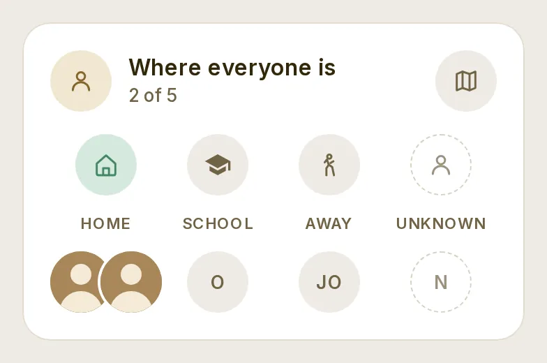
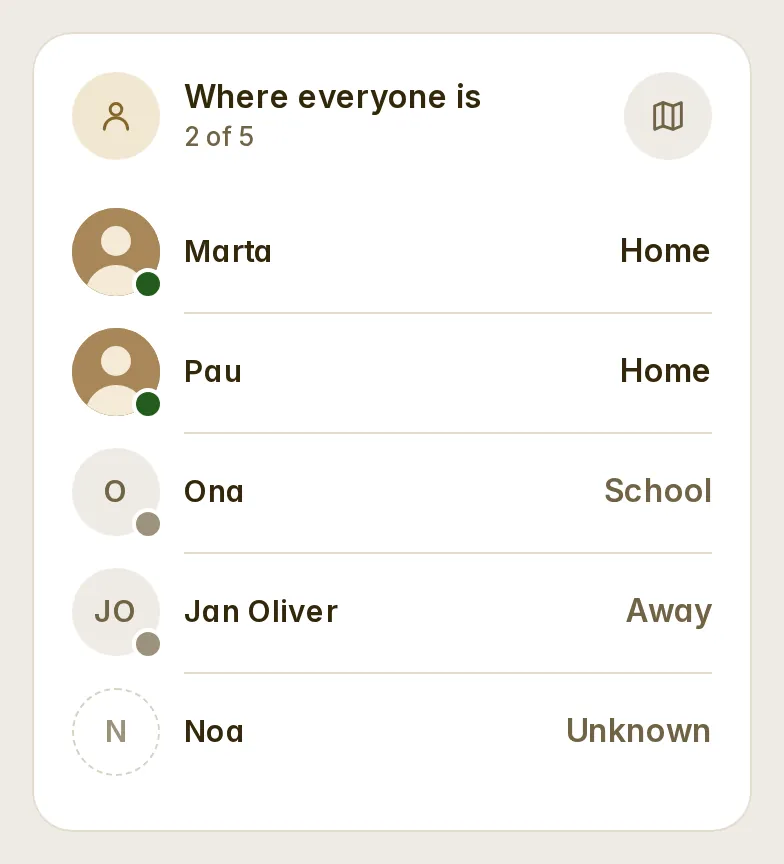

<!-- Generated by `pnpm docs:cards` from the card’s editor, its example in tools/docs/src/gallery.ts and its guide in tools/docs/guides/: change those, not this page. -->

# Map

Where everyone is: the house’s zones as columns of faces, a row a person, or Home Assistant’s map on a plate.

`custom:fluvy-map-card` · [Try it live](https://acosta290.github.io/fluvy/?card=map) · [All cards](../cards.md#rooms-and-the-map)

<picture><source media="(prefers-color-scheme: dark)" srcset="../images/cards/map-dark.webp"></picture>

## Example

```yaml
type: custom:fluvy-map-card
entities:
  - person.am_marta
  - person.am_pau
  - person.am_ona
  - person.am_jan
  - person.am_noa
```

The picture above, on the demo house: put your own entities in place of its.

## Layouts

`variant` chooses the layout. The picture above is `zones`, the default; each of the others is the example plus the line over it, and opens in the live demo.

<table>
<tbody><tr>
<td align="center" valign="top" width="50%"><code>variant: map</code><br><a href="https://acosta290.github.io/fluvy/?card=map&amp;layout=map"><picture><source media="(prefers-color-scheme: dark)" srcset="../images/cards/map.map-dark.webp"></picture></a></td>
<td align="center" valign="top" width="50%"><code>variant: rows</code><br><a href="https://acosta290.github.io/fluvy/?card=map&amp;layout=rows"><picture><source media="(prefers-color-scheme: dark)" srcset="../images/cards/map.rows-dark.webp"></picture></a></td>
</tr></tbody>
</table>

## All options

```yaml
type: custom:fluvy-map-card
entities:
  - person.am_marta
  - person.am_pau
  - person.am_ona
  - person.am_jan
  - person.am_noa
# zones:
# title:
# icon:
show_icon: auto
name_lines: 1
variant: zones
map_shape: wide
# hours_to_show:
# default_zoom:
fit_zones: false
show_empty: false
show_distance: false
# map_path:
# tone:
# color:
# card_color:
# card_opacity: 100
# card_border: true
# unavailable: dashed
# empty_text:
hide_empty: false
# tap_action:
#   action: none
# hold_action:
#   action: none
# double_tap_action:
#   action: none
# icon_tap_action:
#   action: none
# icon_hold_action:
#   action: none
# icon_double_tap_action:
#   action: none
```

## Options

| Option | Default | What it does |
| --- | --- | --- |
| `entities` | **required** | The people and trackers the map shows. A list of `person` or `device_tracker` entities. |
| `title` |  | The title at the top of the card. |
| `icon` |  | The card’s icon, in place of the entity’s own. |
| `variant` | `zones` | The card’s layout. `zones` · `map` · `rows`. |
| `map_shape` | `wide` | The map’s shape: wide, or square. `wide` · `square`. |
| `hours_to_show` |  | How many hours of each person’s path the map draws. 0 to 168. |
| `default_zoom` |  | How close the map is drawn while it fits nobody in particular. 1 to 20. |
| `fit_zones` | `false` | Fits the map round the zones as well as the people. |
| `show_empty` | `false` | Keeps a zone with nobody in it. |
| `show_distance` | `false` | Says how far from home each person who is away is. |
| `map_path` |  | Where the map button goes. |
| `empty_text` |  | What the card says while it has nothing to show. |
| `hide_empty` | `false` | Hides the whole card while it has nothing to show. |
| [`zones`](#zones) |  | The zones the card shows people in, in this order. A list: [its items](#zones). |

<details>
<summary>Its look and its actions, as on every card</summary>

| Option | Default | What it does |
| --- | --- | --- |
| `show_icon` | `auto` | Shows the icon, hides it, or lets the card decide. `auto` · `always` · `never`. |
| `name_lines` | `1` | Lets the name in the card’s head take two balanced lines where one would cut it; the head is a line taller whatever the name. `1` · `2`. |
| `tone` | the card’s own | The card’s colour from the palette’s tones; left out, the tone of what it shows. `accent` · `light` · `heat` · `cool` · `dry` · `fan` · `water` · `solar` · `grid` · `media` · `presence` · `armed` · `battery` · `house` · `gas` · `vehicle` (Car) · `neutral` · `ok` (Good) · `warning` · `danger`. |
| `color` |  | The card’s colour: its circle, its accents and its tints wear it. Left out, the colour of what it shows. |
| `card_color` |  | Paints the card’s surface in a colour of your own. |
| `card_opacity` | `100` | How solid the card’s surface is, in percent: under 100 the view’s background shows through. Left out, the house’s. 0 % to 100 %, in steps of 5. |
| `card_border` | `true` | Whether the card draws its hairline border. Left out, the house’s. |
| `unavailable` | `dashed` | How the card looks while its entity is unavailable: dashed, or quiet as when it is off. Left out, the house’s. `dashed` · `quiet` (As when off). |
| **Interactions** |  |  |
| `tap_action` | `none` | What a tap on the card does. |
| `hold_action` | `none` | What a long press on the card does. |
| `double_tap_action` | `none` | What two taps on the card do. |
| `icon_tap_action` | `none` | What a tap on the icon does. |
| `icon_hold_action` | `none` | What a long press on the icon does. |
| `icon_double_tap_action` | `none` | What two taps on the icon do. |

More about them in [Options every card takes](../customising.md#options-every-card-takes).

</details>

## Lists

### `zones`

An item is an entity id, or a map with `entity` and any of these fields.

| Field | What it does |
| --- | --- |
| `entity` | The entity the item shows. A `zone`. |
| `name` | The item’s own name, in place of the one the card would give it. |
| `icon` | The item’s own icon, in place of the one the card would give it. |

<details>
<summary>Older names the card still reads</summary>

| Older name | Read as |
| --- | --- |
| `layout` | `variant` |
| `view` | `variant` |
| `accent` | `color` |

</details>
