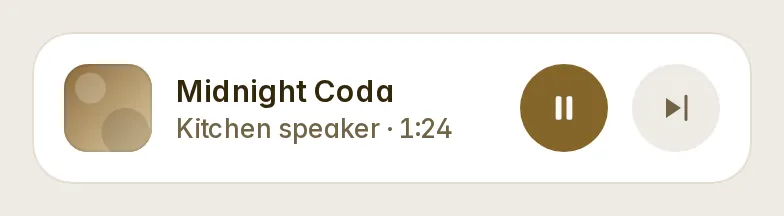
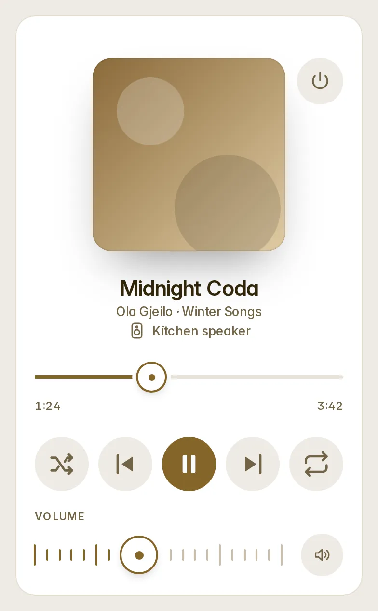

<!-- Generated by `pnpm docs:cards` from the card’s editor, its example in tools/docs/src/gallery.ts and its guide in tools/docs/guides/: change those, not this page. -->

# Media

A media player: artwork, seek bar, transport and volume — full, compact row or hero.

`custom:fluvy-media-card` · [Try it live](https://acosta290.github.io/fluvy/?card=media) · [All cards](../cards.md#everyday)

<picture><source media="(prefers-color-scheme: dark)" srcset="../images/cards/media-dark.webp"></picture>

## Example

```yaml
type: custom:fluvy-media-card
entity: media_player.kitchen
```

The picture above, on the demo house: put your own entities in place of its.

## Layouts

`variant` chooses the layout. The picture above is `full`, the default; each of the others is the example plus the line over it, and opens in the live demo.

<table>
<tbody><tr>
<td align="center" valign="top" width="50%"><code>variant: mini</code><br><a href="https://acosta290.github.io/fluvy/?card=media&amp;layout=mini"><picture><source media="(prefers-color-scheme: dark)" srcset="../images/cards/media.mini-dark.webp"></picture></a></td>
<td align="center" valign="top" width="50%"><code>variant: hero</code><br><a href="https://acosta290.github.io/fluvy/?card=media&amp;layout=hero"><picture><source media="(prefers-color-scheme: dark)" srcset="../images/cards/media.hero-dark.webp"></picture></a></td>
</tr></tbody>
</table>

## All options

```yaml
type: custom:fluvy-media-card
entity: media_player.kitchen
# name:
# icon:
# secondary:
# image:
variant: full
source_style: full
show_source: true
show_volume: true
show_power: true
controls:
  - play
  - next
slider_style: house
# tone:
# color:
# card_color:
# card_opacity: 100
# card_border: true
# unavailable: dashed
# tap_action:
#   action: more-info
# hold_action:
#   action: more-info
# double_tap_action:
#   action: none
```

## Options

| Option | Default | What it does |
| --- | --- | --- |
| `entity` | **required** | The entity the card is about: what it shows, and what its controls act on. A `media_player`. |
| `name` |  | The name the card shows, in place of the entity’s own. |
| `icon` |  | The card’s icon, in place of the entity’s own. |
| `secondary` |  | The line under the title, in place of what is playing: your own words, an entity’s state or a template. |
| `image` |  | A picture of your own in place of the card’s drawing: an address, or an entity whose picture it is. |
| `image_mode` | `fallback` | Shows your own picture only while the player has no artwork, or always. `fallback` (Without artwork) · `always`. |
| `variant` | `full` | The card’s layout. `full` · `mini` · `hero`. |
| `source_style` | `full` | Draws the sources as chips that fill the row, or as content-sized chips. `full` · `chips`. |
| `show_source` | `true` | Shows the player’s sources to choose from. |
| `show_volume` | `true` | Shows the volume control. |
| `show_power` | `true` | Shows the power button. |
| `controls` | `play`, `next` | The rounds of the mini layout’s row, in this order. Any of `power` · `previous` · `play` · `next` · `volume`. |
| `slider_style` | `house` | The slider’s style; left out, the style set for every slider. `house` · `ruler` · `bar` · `liquid`. |
| `slider_words` | `ends` | Writes the words at the slider’s ends, or none. `ends` · `none`. |

<details>
<summary>Its look and its actions, as on every card</summary>

| Option | Default | What it does |
| --- | --- | --- |
| `tone` | the card’s own | The card’s colour from the palette’s tones; left out, the tone of what it shows. `accent` · `light` · `heat` · `cool` · `dry` · `fan` · `water` · `solar` · `grid` · `media` · `presence` · `armed` · `battery` · `house` · `gas` · `vehicle` (Car) · `neutral` · `ok` (Good) · `warning` · `danger`. |
| `color` |  | The card’s colour: its circle, its accents and its tints wear it. Left out, the colour of what it shows. |
| `card_color` |  | Paints the card’s surface in a colour of your own. |
| `card_opacity` | `100` | How solid the card’s surface is, in percent: under 100 the view’s background shows through. Left out, the house’s. 0 % to 100 %, in steps of 5. |
| `card_border` | `true` | Whether the card draws its hairline border. Left out, the house’s. |
| `unavailable` | `dashed` | How the card looks while its entity is unavailable: dashed, or quiet as when it is off. Left out, the house’s. `dashed` · `quiet` (As when off). |
| **Interactions** |  |  |
| `tap_action` | `more-info` | What a tap on the card does. |
| `hold_action` | `more-info` | What a long press on the card does. |
| `double_tap_action` | `none` | What two taps on the card do. |

More about them in [Options every card takes](../customising.md#options-every-card-takes).

</details>

## Guide

The line under the title is the player's own: who made what plays, else its state. `secondary` puts your own line
there, in every layout: words, a template (the player is `entity` in it), or an entity, said as its state with its
unit.

```yaml
type: custom:fluvy-media-card
entity: media_player.lounge_tv
variant: mini
secondary: sensor.lounge_tv_status # or "{{ state_attr(entity, 'source') }} · {{ states('sensor.soundbar_volume') }}"
```

- Words that do not fit lose their last ` · ` parts, then end in "…".
- A television (`device_class: tv`) that is on but plays nothing Home Assistant can name is titled by its app or
  input, else its name.
- `image` shows a picture of your own where the player has no artwork
  ([pictures of your own](../customising.md#pictures-of-your-own)).

The Now playing card takes neither `secondary` nor `image`: use the Media card for those.

<details>
<summary>Older names the card still reads</summary>

| Older name | Read as |
| --- | --- |
| `layout` | `variant` |
| `view` | `variant` |
| `accent` | `color` |

</details>
