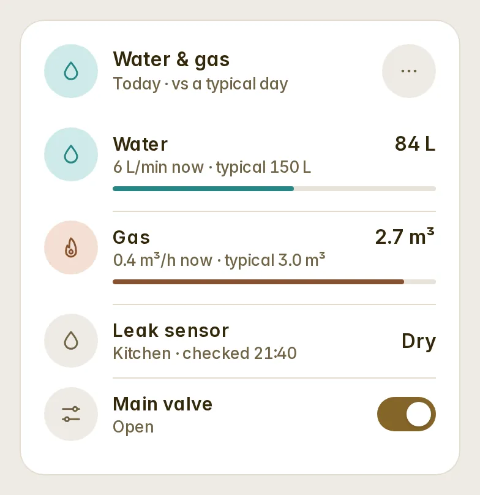

<!-- Generated by `pnpm docs:cards` from the card’s editor, its example in tools/docs/src/gallery.ts and its guide in tools/docs/guides/: change those, not this page. -->

# Water & gas

Today’s water and gas against a typical day, what flows right now, and a leak sensor or a valve beside them.

`custom:fluvy-meters-card` · [Try it live](https://acosta290.github.io/fluvy/?card=meters) · [All cards](../cards.md#energy)

<picture><source media="(prefers-color-scheme: dark)" srcset="../images/cards/meters-dark.webp"></picture>

## Example

```yaml
type: custom:fluvy-meters-card
meters:
  - entity: sensor.mt_water
    rate: sensor.mt_water_flow
  - entity: sensor.mt_gas
    rate: sensor.mt_gas_flow
    typical: 3
rows:
  - binary_sensor.mt_leak
  - entity: valve.mt_main
    icon: sliders
```

The picture above, on the demo house: put your own entities in place of its.

## Layouts

`variant` chooses the layout. The picture above is `full`, the default; each of the others is the example plus the line over it, and opens in the live demo.

<table>
<tbody><tr>
<td align="center" valign="top" width="50%"><code>variant: rows</code><br><a href="https://acosta290.github.io/fluvy/?card=meters&amp;layout=rows"><picture><source media="(prefers-color-scheme: dark)" srcset="../images/cards/meters.rows-dark.webp"></picture></a></td>
<td align="center" valign="top" width="50%"></td>
</tr></tbody>
</table>

## All options

```yaml
type: custom:fluvy-meters-card
# title:
# subtitle:
# icon:
variant: full
show_icon: auto
name_lines: 1
# collection_key:
# tone:
# color:
# card_color:
# card_opacity: 100
# card_border: true
# unavailable: dashed
# unit: auto
# decimals: auto
# tap_action:
#   action: more-info
# hold_action:
#   action: more-info
# double_tap_action:
#   action: none
# icon_tap_action:
#   action: none
# icon_hold_action:
#   action: none
# icon_double_tap_action:
#   action: none
meters:
  - entity: sensor.mt_water
    rate: sensor.mt_water_flow
  - entity: sensor.mt_gas
    rate: sensor.mt_gas_flow
    typical: 3
rows:
  - binary_sensor.mt_leak
  - entity: valve.mt_main
    icon: sliders
```

## Options

| Option | Default | What it does |
| --- | --- | --- |
| `title` |  | The title at the top of the card. |
| `subtitle` |  | The line under the title: your own words, an entity’s state or a template. |
| `icon` |  | The card’s icon, in place of the entity’s own. |
| `variant` | `full` | The card’s layout. `full` · `rows`. |
| `collection_key` | none | Makes the card follow an Energy date picker on the same dashboard. |
| `unit` | `auto` | The unit the figures are written in; automatic keeps the sensor’s. `auto` · `L` · `m³` · `gal` · `ft³`, or your own. |
| `decimals` | `auto` | How many decimals the figures have; automatic decides by their size. `auto` · `0` · `1` · `2` · `3`. |
| [`meters`](#meters) |  | The water and gas meters; left out, the Energy dashboard’s. A list: [its items](#meters). |
| [`rows`](#rows) |  | Rows under the meters, such as a leak sensor or a valve. A list: [its items](#rows). |

<details>
<summary>Its look and its actions, as on every card</summary>

| Option | Default | What it does |
| --- | --- | --- |
| `show_icon` | `auto` | Shows the icon, hides it, or lets the card decide. `auto` · `always` · `never`. |
| `name_lines` | `1` | Lets the name in the card’s head take two balanced lines where one would cut it; the head is a line taller whatever the name. `1` · `2`. |
| `tone` | the card’s own | The card’s colour from the palette’s tones; left out, the tone of what it shows. `accent` · `light` · `heat` · `cool` · `dry` · `fan` · `water` · `solar` · `grid` · `media` · `presence` · `armed` · `battery` · `house` · `gas` · `vehicle` (Car) · `neutral` · `ok` (Good) · `warning` · `danger`. |
| `color` |  | The card’s colour: its circle, its accents and its tints wear it. Left out, the colour of what it shows. |
| `card_color` |  | Paints the card’s surface in a colour of your own. |
| `card_opacity` | `100` | How solid the card’s surface is, in percent: under 100 the view’s background shows through. Left out, the house’s. 0 % to 100 %, in steps of 5. |
| `card_border` | `true` | Whether the card draws its hairline border. Left out, the house’s. |
| `unavailable` | `dashed` | How the card looks while its entity is unavailable: dashed, or quiet as when it is off. Left out, the house’s. `dashed` · `quiet` (As when off). |
| **Interactions** |  |  |
| `tap_action` | `more-info` | What a tap on the card does. |
| `hold_action` | `more-info` | What a long press on the card does. |
| `double_tap_action` | `none` | What two taps on the card do. |
| `icon_tap_action` | `none` | What a tap on the icon does. |
| `icon_hold_action` | `none` | What a long press on the icon does. |
| `icon_double_tap_action` | `none` | What two taps on the icon do. |

More about them in [Options every card takes](../customising.md#options-every-card-takes).

</details>

## Lists

### `meters`

An item is an entity id, or a map with `entity` and any of these fields.

| Field | What it does |
| --- | --- |
| `entity` | The entity the item shows. A `sensor`. |
| `rate` | A sensor of what flows right now. A `sensor`. |
| `typical` | A typical day’s use, in the meter’s unit; left out, the last 7 days’ mean. 0 or more, in steps of 0.1. |
| `name` | The item’s own name, in place of the one the card would give it. |
| `icon` | The item’s own icon, in place of the one the card would give it. |
| `kind` | What the meter measures: water, or gas. `water` · `gas`. |
| `unit` | The unit the figure is written in. `auto` · `L` · `m³` · `gal` · `ft³`, or your own. |
| `decimals` | How many decimals the figure has. `auto` · `0` · `1` · `2` · `3`. |

### `rows`

An item is an entity id, or a map with `entity` and any of these fields.

| Field | What it does |
| --- | --- |
| `entity` | The entity the item shows. A `binary_sensor`, `sensor`, `valve`, `switch` or `input_boolean`. |
| `name` | The item’s own name, in place of the one the card would give it. |
| `icon` | The item’s own icon, in place of the one the card would give it. |

<details>
<summary>Older names the card still reads</summary>

| Older name | Read as |
| --- | --- |
| `meters[].label` | `meters[].name` |
| `meters[].sub` | `meters[].secondary` |
| `meters[].meta` | `meters[].subtitle` |
| `rows[].label` | `rows[].name` |
| `rows[].sub` | `rows[].secondary` |
| `rows[].meta` | `rows[].subtitle` |
| `sub` | `subtitle` |
| `meta` | `subtitle` |
| `layout` | `variant` |
| `view` | `variant` |
| `accent` | `color` |

</details>
