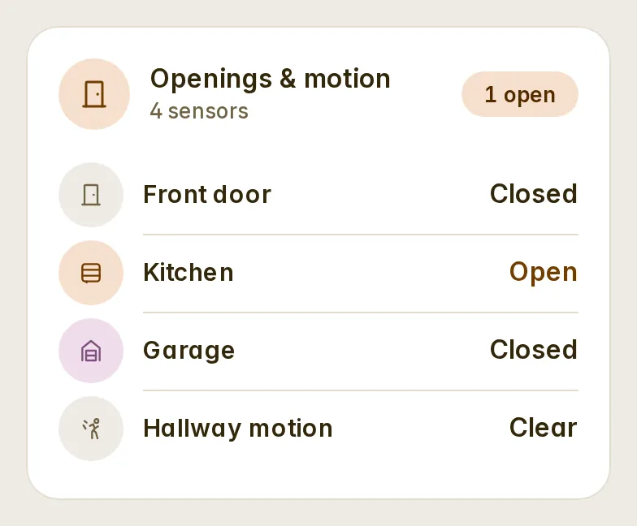
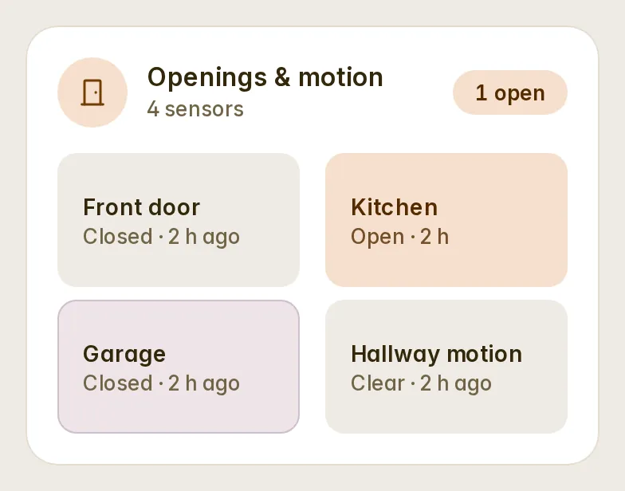

<!-- Generated by `pnpm docs:cards` from the card’s editor, its example in tools/docs/src/gallery.ts and its guide in tools/docs/guides/: change those, not this page. -->

# Openings

Doors, windows and motion at a glance, with what is open counted.

`custom:fluvy-openings-card` · [Try it live](https://acosta290.github.io/fluvy/?card=openings) · [All cards](../cards.md#everyday)

<picture><source media="(prefers-color-scheme: dark)" srcset="../images/cards/openings-dark.webp"></picture>

## Example

```yaml
type: custom:fluvy-openings-card
rows:
  - entity: binary_sensor.am_front_door
    name: Front door
  - entity: binary_sensor.am_kitchen_window
    name: Kitchen
    icon: blinds
  - entity: binary_sensor.am_garage_door
    name: Garage
    color: purple
  - binary_sensor.am_hallway_motion
```

The picture above, on the demo house: put your own entities in place of its.

## Layouts

`variant` chooses the layout. The picture above is `rows`, the default; each of the others is the example plus the line over it, and opens in the live demo.

<table>
<tbody><tr>
<td align="center" valign="top" width="50%"><code>variant: compact</code><br><a href="https://acosta290.github.io/fluvy/?card=openings&amp;layout=compact"><picture><source media="(prefers-color-scheme: dark)" srcset="../images/cards/openings.compact-dark.webp"></picture></a></td>
<td align="center" valign="top" width="50%"><code>variant: tiles</code><br><a href="https://acosta290.github.io/fluvy/?card=openings&amp;layout=tiles"><picture><source media="(prefers-color-scheme: dark)" srcset="../images/cards/openings.tiles-dark.webp"></picture></a></td>
</tr></tbody>
</table>

## All options

```yaml
type: custom:fluvy-openings-card
rows:
  - entity: binary_sensor.am_front_door
    name: Front door
  - entity: binary_sensor.am_kitchen_window
    name: Kitchen
    icon: blinds
  - entity: binary_sensor.am_garage_door
    name: Garage
    color: purple
  - binary_sensor.am_hallway_motion
names: full
# title:
# subtitle:
# icon:
show_icon: auto
name_lines: 1
# tone:
# color:
# card_color:
# card_opacity: 100
# card_border: true
# unavailable: dashed
variant: rows
max_rows: 4
show_count: true
show_time: true
# since_pattern:
# empty_text:
hide_empty: false
# tap_action:
#   action: none
# hold_action:
#   action: none
# double_tap_action:
#   action: none
# icon_tap_action:
#   action: none
# icon_hold_action:
#   action: none
# icon_double_tap_action:
#   action: none
```

## Options

| Option | Default | What it does |
| --- | --- | --- |
| `names` | `full` | How a row is named where it has no name of its own: the entity’s full name, its own, or its device’s. `full` · `entity` · `device`. |
| `title` |  | The title at the top of the card. |
| `subtitle` |  | The line under the title: your own words, an entity’s state or a template. |
| `icon` |  | The card’s icon, in place of the entity’s own. |
| `variant` | `rows` | The card’s layout. `rows` · `compact` · `tiles`. |
| `max_rows` | `4` | How many rows the card shows before "All sensors". 1 or more. |
| `show_count` | `true` | Says on the head’s line how many are open. |
| `show_time` | `true` | Says under each name how long it has been so. |
| `since_pattern` |  | Where every row’s last change is read from, as a pattern of sensor ids. |
| `empty_text` |  | What the card says while it has nothing to show. |
| `hide_empty` | `false` | Hides the whole card while it has nothing to show. |
| [`rows`](#rows) |  | The doors, windows and sensors the card lists, in this order. A list: [its items](#rows). |

<details>
<summary>Its look and its actions, as on every card</summary>

| Option | Default | What it does |
| --- | --- | --- |
| `show_icon` | `auto` | Shows the icon, hides it, or lets the card decide. `auto` · `always` · `never`. |
| `name_lines` | `1` | Lets the name in the card’s head take two balanced lines where one would cut it; the head is a line taller whatever the name. `1` · `2`. |
| `tone` | the card’s own | The card’s colour from the palette’s tones; left out, the tone of what it shows. `accent` · `light` · `heat` · `cool` · `dry` · `fan` · `water` · `solar` · `grid` · `media` · `presence` · `armed` · `battery` · `house` · `gas` · `vehicle` (Car) · `neutral` · `ok` (Good) · `warning` · `danger`. |
| `color` |  | The card’s colour: its circle, its accents and its tints wear it. Left out, the colour of what it shows. |
| `card_color` |  | Paints the card’s surface in a colour of your own. |
| `card_opacity` | `100` | How solid the card’s surface is, in percent: under 100 the view’s background shows through. Left out, the house’s. 0 % to 100 %, in steps of 5. |
| `card_border` | `true` | Whether the card draws its hairline border. Left out, the house’s. |
| `unavailable` | `dashed` | How the card looks while its entity is unavailable: dashed, or quiet as when it is off. Left out, the house’s. `dashed` · `quiet` (As when off). |
| **Interactions** |  |  |
| `tap_action` | `none` | What a tap on the card does. |
| `hold_action` | `none` | What a long press on the card does. |
| `double_tap_action` | `none` | What two taps on the card do. |
| `icon_tap_action` | `none` | What a tap on the icon does. |
| `icon_hold_action` | `none` | What a long press on the icon does. |
| `icon_double_tap_action` | `none` | What two taps on the icon do. |

More about them in [Options every card takes](../customising.md#options-every-card-takes).

</details>

## Lists

### `rows`

An item is an entity id, or a map with `entity` and any of these fields.

| Field | What it does |
| --- | --- |
| `entity` | The entity the item shows. A `binary_sensor`, `cover` or `lock`. |
| `name` | The item’s own name, in place of the one the card would give it. |
| `icon` | The item’s own icon, in place of the one the card would give it. |
| `color` | The item’s colour, in place of the one the card gives it. |
| `device_class` | Reads the entity as this kind of sensor: its words, its icon and when it counts as open. |
| `states` | Words of your own for the sensor’s states. |
| `since` | Where the time of the last change is read from. |
| **Interactions** |  |
| `tap_action` | What a tap on the item does. |
| `hold_action` | What a long press on the item does. |
| `double_tap_action` | What two taps on the item do. |

## Guide

Each sensor's state is said in its class's words (a door's Open and Closed, a motion's Detected and Clear, a leak's Wet
and Dry), and the head counts what needs acting on ("2 open"): an open door, window or cover, a leak, smoke, a
problem.

```yaml
type: custom:fluvy-openings-card
rows:
  - binary_sensor.bedroom_window # a window: counted when open
  - entity: binary_sensor.bedroom_window_tilt # no class: said, never counted
    name: Tilt
    icon: mdi:window-open-variant
    states:
      on: Tilted
      off: Closed
  - entity: binary_sensor.side_door_contact # no class: read as a door
    device_class: door
```

- `device_class` gives a sensor a class (`door`, `window`, `garage_door`, `opening`, `motion`, `moisture`, `smoke` …):
  its words, its icon and whether it counts.
- `states` gives words of your own, by state (`on`, `off`; a cover's `open`, `closed`). The class still decides what
  counts: with `device_class: window`, a tilted window counts as open.
- An unquoted `on:` or `off:` (read as true or false in YAML mode) works as written.
- The real time of the last change: `since` and `since_pattern`
  ([templates in row text](../customising.md#templates-in-row-text)).

<details>
<summary>Older names the card still reads</summary>

| Older name | Read as |
| --- | --- |
| `entities` | `rows` |
| `rows[].label` | `rows[].name` |
| `rows[].sub` | `rows[].secondary` |
| `rows[].meta` | `rows[].subtitle` |
| `sub` | `subtitle` |
| `meta` | `subtitle` |
| `layout` | `variant` |
| `view` | `variant` |
| `accent` | `color` |

</details>
