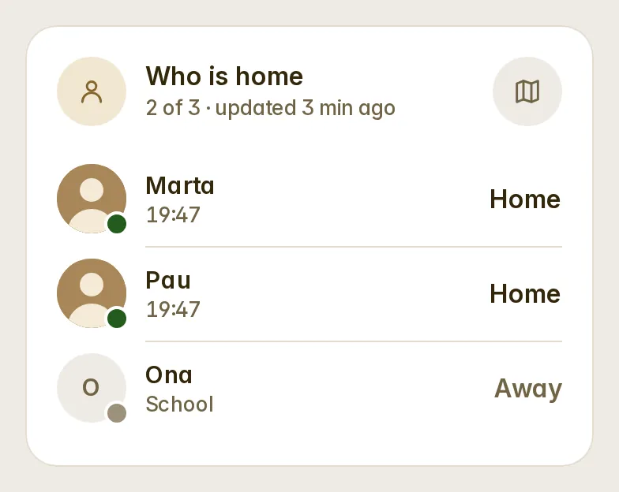

<!-- Generated by `pnpm docs:cards` from the card’s editor, its example in tools/docs/src/gallery.ts and its guide in tools/docs/guides/: change those, not this page. -->

# People

Who is home: avatars, zones, times and phone batteries, each person with a tap of their own.

`custom:fluvy-people-card` · [Try it live](https://acosta290.github.io/fluvy/?card=people) · [All cards](../cards.md#everyday)

<picture><source media="(prefers-color-scheme: dark)" srcset="../images/cards/people-dark.webp"></picture>

## Example

```yaml
type: custom:fluvy-people-card
people:
  - person.am_marta
  - person.am_pau
  - person.am_ona
```

The picture above, on the demo house: put your own entities in place of its.

## Layouts

`variant` chooses the layout. The picture above is `grid`, the default; each of the others is the example plus the line over it, and opens in the live demo.

<table>
<tbody><tr>
<td align="center" valign="top" width="50%"><code>variant: rows</code><br><a href="https://acosta290.github.io/fluvy/?card=people&amp;layout=rows"><picture><source media="(prefers-color-scheme: dark)" srcset="../images/cards/people.rows-dark.webp"></picture></a></td>
<td align="center" valign="top" width="50%"></td>
</tr></tbody>
</table>

## All options

```yaml
type: custom:fluvy-people-card
people:
  - person.am_marta
  - person.am_pau
  - person.am_ona
# title:
# icon:
show_icon: auto
name_lines: 1
variant: grid
# map_path:
show_zone: true
show_time: true
show_battery: false
# color:
# card_color:
# card_opacity: 100
# card_border: true
# unavailable: dashed
# empty_text:
hide_empty: false
# tap_action:
#   action: none
# hold_action:
#   action: none
# double_tap_action:
#   action: none
# icon_tap_action:
#   action: none
# icon_hold_action:
#   action: none
# icon_double_tap_action:
#   action: none
```

## Options

| Option | Default | What it does |
| --- | --- | --- |
| `title` |  | The title at the top of the card. |
| `icon` |  | The card’s icon, in place of the entity’s own. |
| `variant` | `grid` | The card’s layout. `grid` · `rows`. |
| `map_path` |  | Where the map button goes. |
| `show_zone` | `true` | Says under each name the zone they are in. |
| `show_time` | `true` | Says under each name how long it has been so. |
| `show_battery` | `false` | Shows each person’s phone battery. |
| `empty_text` |  | What the card says while it has nothing to show. |
| `hide_empty` | `false` | Hides the whole card while it has nothing to show. |
| [`people`](#people) |  | The people the card shows, in this order. A list: [its items](#people). |

<details>
<summary>Its look and its actions, as on every card</summary>

| Option | Default | What it does |
| --- | --- | --- |
| `show_icon` | `auto` | Shows the icon, hides it, or lets the card decide. `auto` · `always` · `never`. |
| `name_lines` | `1` | Lets the name in the card’s head take two balanced lines where one would cut it; the head is a line taller whatever the name. `1` · `2`. |
| `color` |  | The card’s colour: its circle, its accents and its tints wear it. Left out, the colour of what it shows. |
| `card_color` |  | Paints the card’s surface in a colour of your own. |
| `card_opacity` | `100` | How solid the card’s surface is, in percent: under 100 the view’s background shows through. Left out, the house’s. 0 % to 100 %, in steps of 5. |
| `card_border` | `true` | Whether the card draws its hairline border. Left out, the house’s. |
| `unavailable` | `dashed` | How the card looks while its entity is unavailable: dashed, or quiet as when it is off. Left out, the house’s. `dashed` · `quiet` (As when off). |
| **Interactions** |  |  |
| `tap_action` | `none` | What a tap on the card does. |
| `hold_action` | `none` | What a long press on the card does. |
| `double_tap_action` | `none` | What two taps on the card do. |
| `icon_tap_action` | `none` | What a tap on the icon does. |
| `icon_hold_action` | `none` | What a long press on the icon does. |
| `icon_double_tap_action` | `none` | What two taps on the icon do. |

More about them in [Options every card takes](../customising.md#options-every-card-takes).

</details>

## Lists

### `people`

An item is an entity id, or a map with `entity` and any of these fields.

| Field | What it does |
| --- | --- |
| `entity` | The entity the item shows. A `person` or `device_tracker`. |
| `name` | The item’s own name, in place of the one the card would give it. |
| `battery` | The person’s phone battery sensor. A `sensor`. |
| `color` | The item’s colour, in place of the one the card gives it. |
| `since` | Where the time of the last change is read from. |
| **Interactions** |  |
| `tap_action` | What a tap on the item does. |
| `hold_action` | What a long press on the item does. |
| `double_tap_action` | What two taps on the item do. |

<details>
<summary>Older names the card still reads</summary>

| Older name | Read as |
| --- | --- |
| `layout` | `variant` |
| `entities` | `people` |
| `people[].label` | `people[].name` |
| `people[].sub` | `people[].secondary` |
| `people[].meta` | `people[].subtitle` |
| `view` | `variant` |
| `accent` | `color` |

</details>
