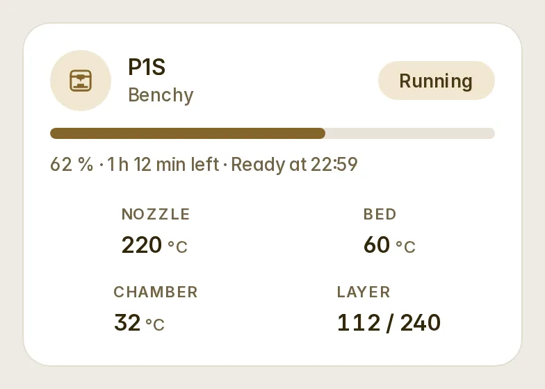
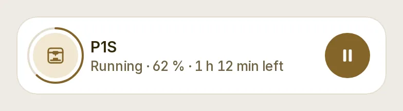

<!-- Generated by `pnpm docs:cards` from the card’s editor, its example in tools/docs/src/gallery.ts and its guide in tools/docs/guides/: change those, not this page. -->

# 3D printer

A 3D printer’s job: progress, time left, heaters, layers, filament and the camera; pause, resume and stop. OctoPrint, PrusaLink, Bambu Lab, Moonraker, Creality, Elegoo, Anycubic, Snapmaker and FlashForge.

`custom:fluvy-printer-card` · [Try it live](https://acosta290.github.io/fluvy/?card=printer) · [All cards](../cards.md#everyday)

<picture><source media="(prefers-color-scheme: dark)" srcset="../images/cards/printer-dark.webp"></picture>

## Example

```yaml
type: custom:fluvy-printer-card
device: d-p1s
```

The picture above, on the demo house: put your own entities in place of its.

## Layouts

`variant` chooses the layout. The picture above is `full`, the default; each of the others is the example plus the line over it, and opens in the live demo.

<table>
<tbody><tr>
<td align="center" valign="top" width="50%"><code>variant: compact</code><br><a href="https://acosta290.github.io/fluvy/?card=printer&amp;layout=compact"><picture><source media="(prefers-color-scheme: dark)" srcset="../images/cards/printer.compact-dark.webp"></picture></a></td>
<td align="center" valign="top" width="50%"><code>variant: row</code><br><a href="https://acosta290.github.io/fluvy/?card=printer&amp;layout=row"><picture><source media="(prefers-color-scheme: dark)" srcset="../images/cards/printer.row-dark.webp"></picture></a></td>
</tr></tbody>
</table>

## All options

```yaml
type: custom:fluvy-printer-card
device: d-p1s
# entity:
# name:
# icon:
show_icon: auto
show_badge: true
name_lines: 1
variant: full
readouts:
  - nozzle
  - bed
  - chamber
  - layer
show_image: true
image: auto
camera_view: auto
fit_mode: cover
aspect_ratio: '16:9'
show_filament: true
show_controls: true
# color:
# card_color:
# card_opacity: 100
# card_border: true
# unavailable: dashed
# tap_action:
#   action: more-info
# hold_action:
#   action: more-info
# double_tap_action:
#   action: none
# icon_tap_action:
#   action: none
# icon_hold_action:
#   action: none
# icon_double_tap_action:
#   action: none
# sensors:
# roles:
```

## Options

| Option | Default | What it does |
| --- | --- | --- |
| `device` |  | The device the card reads: every entity it has is found on it. |
| `entity` |  | An entity of the printer, where its device is not named: the device is found from it. |
| `name` |  | The name the card shows, in place of the entity’s own. |
| `icon` |  | The card’s icon, in place of the entity’s own. |
| `variant` | `full` | The card’s layout. `full` · `compact` · `row`. |
| `readouts` | `nozzle`, `bed`, `chamber`, `layer` | The readouts the card shows, up to six, in this order. Any of `nozzle` · `bed` · `chamber` · `layer` · `speed` · `filament` · `elapsed`. |
| `show_image` | `true` | Shows the camera or the print’s preview above the progress. |
| `image` | `auto` | What the picture shows: the camera, the print’s preview, or the card’s choice. `auto` · `camera` · `preview` (Job preview). |
| `camera_view` | `auto` | Shows still pictures that refresh by themselves, or Home Assistant’s live stream. `auto` · `live`. |
| `fit_mode` | `cover` | Fills the shape and crops the picture, or shows the whole picture inside it. `cover` (Fill (crop)) · `contain` (Whole picture). |
| `aspect_ratio` | `16:9` | The picture’s shape, so that the card keeps its height before the picture arrives. `16:9` · `4:3` · `3:2` · `1:1` · `2:1` · `21:9` · `native` (The camera’s own). |
| `show_filament` | `true` | Shows the filament unit’s trays, the one in use marked. |
| `show_controls` | `true` | Shows the pause, stop and light buttons. |
| [`sensors`](#sensors) |  | More readouts from any of the device’s entities, after the card’s own. A list: [its items](#sensors). |
| [`roles`](#roles) |  | Entities named by hand for a part the card does not find on the device, or should read otherwise. A list: [its items](#roles). |

<details>
<summary>Its look and its actions, as on every card</summary>

| Option | Default | What it does |
| --- | --- | --- |
| `show_icon` | `auto` | Shows the icon, hides it, or lets the card decide. `auto` · `always` · `never`. |
| `show_badge` | `true` | Shows the badge at the end of the head, such as the card’s state or a count. |
| `name_lines` | `1` | Lets the name in the card’s head take two balanced lines where one would cut it; the head is a line taller whatever the name. `1` · `2`. |
| `color` |  | The card’s colour: its circle, its accents and its tints wear it. Left out, the colour of what it shows. |
| `card_color` |  | Paints the card’s surface in a colour of your own. |
| `card_opacity` | `100` | How solid the card’s surface is, in percent: under 100 the view’s background shows through. Left out, the house’s. 0 % to 100 %, in steps of 5. |
| `card_border` | `true` | Whether the card draws its hairline border. Left out, the house’s. |
| `unavailable` | `dashed` | How the card looks while its entity is unavailable: dashed, or quiet as when it is off. Left out, the house’s. `dashed` · `quiet` (As when off). |
| **Interactions** |  |  |
| `tap_action` | `more-info` | What a tap on the card does. |
| `hold_action` | `more-info` | What a long press on the card does. |
| `double_tap_action` | `none` | What two taps on the card do. |
| `icon_tap_action` | `none` | What a tap on the icon does. |
| `icon_hold_action` | `none` | What a long press on the icon does. |
| `icon_double_tap_action` | `none` | What two taps on the icon do. |

More about them in [Options every card takes](../customising.md#options-every-card-takes).

</details>

## Lists

### `sensors`

An item is an entity id, or a map with `entity` and any of these fields.

| Field | What it does |
| --- | --- |
| `entity` | The entity the item shows. |
| `name` | The item’s own name, in place of the one the card would give it. |

### `roles`

An item is a map with `role` and any of these fields.

| Field | What it does |
| --- | --- |
| `role` | What the entity is to the printer. `status` · `printing` · `progress` · `remaining` (Time left) · `finish` · `start` · `file` · `stage` · `error` · `elapsed` (Time printed) · `filament` · `nozzle` · `nozzle_target` · `bed` · `bed_target` · `chamber` · `layer` · `layers` (Total layers) · `speed` · `camera` · `preview` · `pause` · `resume` · `stop` · `light`. |
| `entity` | The entity the item shows. |

<details>
<summary>Older names the card still reads</summary>

| Older name | Read as |
| --- | --- |
| `layout` | `variant` |
| `view` | `variant` |
| `accent` | `color` |

</details>
