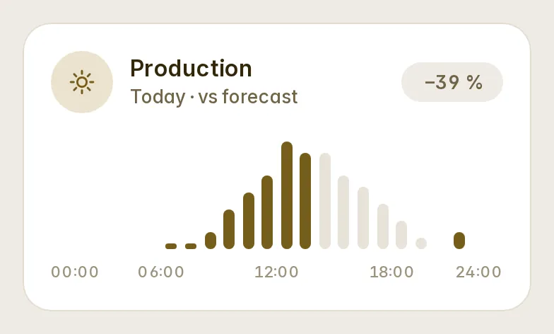

<!-- Generated by `pnpm docs:cards` from the card’s editor, its example in tools/docs/src/gallery.ts and its guide in tools/docs/guides/: change those, not this page. -->

# Production

Hourly production bars with the forecast behind, stacked per array when there are several.

`custom:fluvy-production-card` · [Try it live](https://acosta290.github.io/fluvy/?card=production) · [All cards](../cards.md#energy)

<picture><source media="(prefers-color-scheme: dark)" srcset="../images/cards/production-dark.webp"></picture>

## Example

```yaml
type: custom:fluvy-production-card
entity: sensor.so_energy_today
forecast_entity: sensor.so_forecast_today
peak_entity: sensor.so_peak_today
```

The picture above, on the demo house: put your own entities in place of its.

## Layouts

`variant` chooses the layout. The picture above is `full`, the default; each of the others is the example plus the line over it, and opens in the live demo.

<table>
<tbody><tr>
<td align="center" valign="top" width="50%"><code>variant: compact</code><br><a href="https://acosta290.github.io/fluvy/?card=production&amp;layout=compact"><picture><source media="(prefers-color-scheme: dark)" srcset="../images/cards/production.compact-dark.webp"></picture></a></td>
<td align="center" valign="top" width="50%"></td>
</tr></tbody>
</table>

## All options

```yaml
type: custom:fluvy-production-card
entity: sensor.so_energy_today
# name:
# subtitle:
# icon:
show_icon: auto
show_badge: true
name_lines: 1
# tone:
# color:
# card_color:
# card_opacity: 100
# card_border: true
# unavailable: dashed
day: today
forecast_entity: sensor.so_forecast_today
peak_entity: sensor.so_peak_today
show_forecast: true
show_peak: true
badge: day
variant: full
# collection_key:
# chart: classic
# animate: true
# unit: auto
# decimals: auto
# tap_action:
#   action: more-info
# hold_action:
#   action: more-info
# double_tap_action:
#   action: none
# icon_tap_action:
#   action: none
# icon_hold_action:
#   action: none
# icon_double_tap_action:
#   action: none
# arrays:
```

## Options

| Option | Default | What it does |
| --- | --- | --- |
| `entity` | **required** | A sensor of what the panels made today: its state is the day’s total so far. A `sensor`. |
| `name` |  | The name the card shows, in place of the entity’s own. |
| `subtitle` |  | The line under the title: your own words, an entity’s state or a template. |
| `icon` |  | The card’s icon, in place of the entity’s own. |
| `day` | `today` | The day the card shows: today’s production, tomorrow’s forecast, or the days ahead. `today` · `tomorrow` · `ahead` (Days ahead). |
| `days` |  | How many days ahead the forecast shows. 2 to 14. |
| `forecast_entity` |  | A sensor of today’s forecast: its state is the day’s total, its attributes may hold the hours. A `sensor`. |
| `peak_entity` |  | A sensor of today’s peak power; left out, the best hour stands in. A `sensor`. |
| `show_forecast` | `true` | Shows the forecast; hidden, the card is the weather now alone. |
| `show_peak` | `true` | Shows the day’s peak and its hour. |
| `badge` | `day` | What the head’s badge compares with the forecast: the day so far, or the hour under the pointer. `day` (The day so far) · `hour` (The hour under the pointer, else the day). |
| `variant` | `full` | The card’s layout. `full` · `compact`. |
| `collection_key` | none | Makes the card follow an Energy date picker on the same dashboard. |
| `unit` | `auto` | The unit the figures are written in; automatic keeps the sensor’s. `auto` · `W` · `kW` · `MW` · `Wh` · `kWh` · `MWh` · `L` · `m³` · `gal` · `ft³`, or your own. |
| `decimals` | `auto` | How many decimals the figures have; automatic decides by their size. `auto` · `0` · `1` · `2` · `3`. |
| [`arrays`](#arrays) |  | The arrays, each its own power or energy sensor, drawn on the same bars. A list: [its items](#arrays). |
| **Chart** |  |  |
| `chart` | `classic` | The bars’ style. `classic` · `soft` · `columns`. |
| `show_now` | `false` | Marks the present moment on the chart. |
| `highlight` | `none` | Marks out readings on the chart: the lowest, the highest, both, or the current one. `none` · `min` (The lowest reading) · `max` (The highest reading) · `both` (Lowest and highest) · `current` (The current one). |
| `animate` | `true` | Lets the chart or the gauge move as it draws; off, it shows its resting frame at once. |

<details>
<summary>Its look and its actions, as on every card</summary>

| Option | Default | What it does |
| --- | --- | --- |
| `show_icon` | `auto` | Shows the icon, hides it, or lets the card decide. `auto` · `always` · `never`. |
| `show_badge` | `true` | Shows the badge at the end of the head, such as the card’s state or a count. |
| `name_lines` | `1` | Lets the name in the card’s head take two balanced lines where one would cut it; the head is a line taller whatever the name. `1` · `2`. |
| `tone` | the card’s own | The card’s colour from the palette’s tones; left out, the tone of what it shows. `accent` · `light` · `heat` · `cool` · `dry` · `fan` · `water` · `solar` · `grid` · `media` · `presence` · `armed` · `battery` · `house` · `gas` · `vehicle` (Car) · `neutral` · `ok` (Good) · `warning` · `danger`. |
| `color` |  | The card’s colour: its circle, its accents and its tints wear it. Left out, the colour of what it shows. |
| `card_color` |  | Paints the card’s surface in a colour of your own. |
| `card_opacity` | `100` | How solid the card’s surface is, in percent: under 100 the view’s background shows through. Left out, the house’s. 0 % to 100 %, in steps of 5. |
| `card_border` | `true` | Whether the card draws its hairline border. Left out, the house’s. |
| `unavailable` | `dashed` | How the card looks while its entity is unavailable: dashed, or quiet as when it is off. Left out, the house’s. `dashed` · `quiet` (As when off). |
| **Interactions** |  |  |
| `tap_action` | `more-info` | What a tap on the card does. |
| `hold_action` | `more-info` | What a long press on the card does. |
| `double_tap_action` | `none` | What two taps on the card do. |
| `icon_tap_action` | `none` | What a tap on the icon does. |
| `icon_hold_action` | `none` | What a long press on the icon does. |
| `icon_double_tap_action` | `none` | What two taps on the icon do. |

More about them in [Options every card takes](../customising.md#options-every-card-takes).

</details>

## Lists

### `arrays`

An item is an entity id, or a map with `entity` and any of these fields.

| Field | What it does |
| --- | --- |
| `entity` | The entity the item shows. A `sensor`. |
| `name` | The item’s own name, in place of the one the card would give it. |

<details>
<summary>Older names the card still reads</summary>

| Older name | Read as |
| --- | --- |
| `title` | `name` |
| `arrays[].label` | `arrays[].name` |
| `arrays[].sub` | `arrays[].secondary` |
| `arrays[].meta` | `arrays[].subtitle` |
| `sub` | `subtitle` |
| `meta` | `subtitle` |
| `layout` | `variant` |
| `view` | `variant` |
| `accent` | `color` |

</details>
