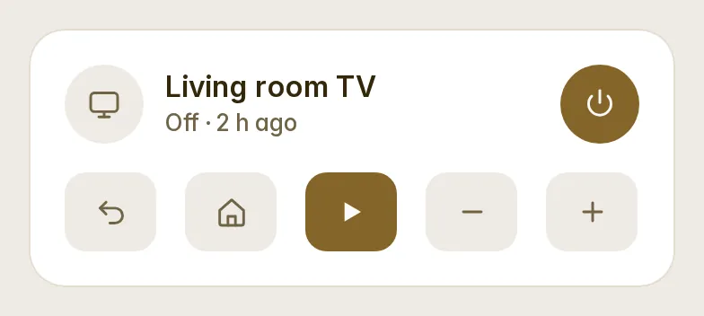
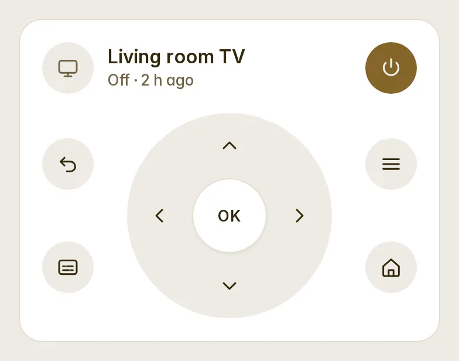
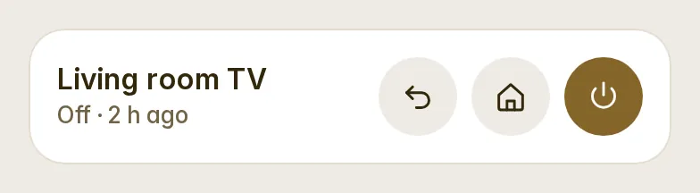
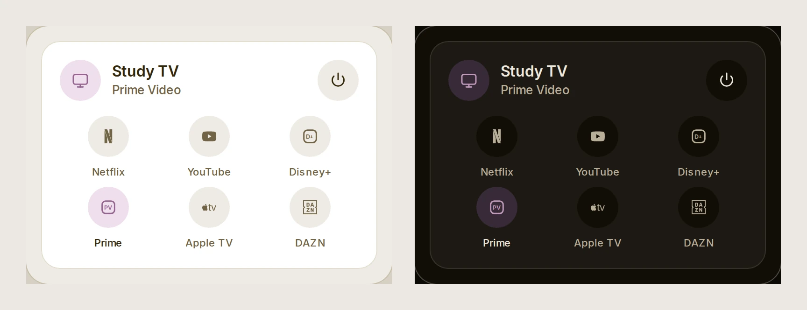

<!-- Generated by `pnpm docs:cards` from the card’s editor, its example in tools/docs/src/gallery.ts and its guide in tools/docs/guides/: change those, not this page. -->

# Remote

A TV remote in Fluvy’s hand: power, sources, a D-pad with OK, playback, volume routed where you like, channels, the apps with their logos, keys of your own.

`custom:fluvy-remote-card` · [Try it live](https://acosta290.github.io/fluvy/?card=remote) · [All cards](../cards.md#everyday)

<picture><source media="(prefers-color-scheme: dark)" srcset="../images/cards/remote-dark.webp"></picture>

## Example

```yaml
type: custom:fluvy-remote-card
entity: media_player.rm_tv
remote: remote.rm_tv
volume_entity: media_player.rm_receiver
```

The picture above, on the demo house: put your own entities in place of its.

## Layouts

`variant` chooses the layout. The picture above is `full`, the default; each of the others is the example plus the line over it, and opens in the live demo.

<table>
<tbody><tr>
<td align="center" valign="top" width="50%"><code>variant: compact</code><br><a href="https://acosta290.github.io/fluvy/?card=remote&amp;layout=compact"><picture><source media="(prefers-color-scheme: dark)" srcset="../images/cards/remote.compact-dark.webp"></picture></a></td>
<td align="center" valign="top" width="50%"><code>variant: pad</code><br><a href="https://acosta290.github.io/fluvy/?card=remote&amp;layout=pad"><picture><source media="(prefers-color-scheme: dark)" srcset="../images/cards/remote.pad-dark.webp"></picture></a></td>
</tr></tbody>
<tbody><tr>
<td align="center" valign="top" width="50%"><code>variant: row</code><br><a href="https://acosta290.github.io/fluvy/?card=remote&amp;layout=row"><picture><source media="(prefers-color-scheme: dark)" srcset="../images/cards/remote.row-dark.webp"></picture></a></td>
<td align="center" valign="top" width="50%"></td>
</tr></tbody>
</table>

## All options

```yaml
type: custom:fluvy-remote-card
entity: media_player.rm_tv
remote: remote.rm_tv
volume_entity: media_player.rm_receiver
# name:
# icon:
show_icon: auto
name_lines: 1
variant: full
off_keys: live
groups:
  - source
  - dpad
  - transport
  - volume
  - apps
dpad: ring
ok_label: word
side_keys: auto
nav:
  - back
  - menu
  - captions
  - home
transport:
  - rewind
  - play_pause
  - forward
volume: auto
apps_style: circles
apps_tint: open
# commands:
# tone:
# color:
# card_color:
# card_opacity: 100
# card_border: true
# unavailable: dashed
# tap_action:
#   action: more-info
# hold_action:
#   action: more-info
# double_tap_action:
#   action: none
# icon_tap_action:
#   action: none
# icon_hold_action:
#   action: none
# icon_double_tap_action:
#   action: none
# apps:
```

## Options

| Option | Default | What it does |
| --- | --- | --- |
| `entity` |  | The media player the remote controls. A `media_player`. |
| `remote` |  | Sends the keys through this remote entity. A `remote`. |
| `volume_entity` |  | Sends the volume to another device than the player. A `media_player`. |
| `name` |  | The name the card shows, in place of the entity’s own. |
| `icon` |  | The card’s icon, in place of the entity’s own. |
| `variant` | `full` | The card’s layout. `full` · `compact` · `pad` · `row`. |
| `off_keys` | `live` | Keeps every key alive while the device is off, or only the power key. `live` · `power` (Only power). |
| `groups` | `source`, `dpad`, `transport`, `volume`, `apps` | The groups of keys the remote shows, in this order. Any of `source` · `dpad` (Direction pad) · `transport` (Playback) · `volume` · `channel` · `apps` · `custom`. |
| `dpad` | `ring` | Draws the arrow keys round a ring, or in a grid. `ring` · `grid`. |
| `ok_label` | `word` | Writes "OK" on the middle key, or leaves it plain. `word` (With the word) · `plain`. |
| `side_keys` | `auto` | Where the keys round the pad stand. `auto` · `sides` (Beside the pad) · `row`. |
| `nav` | `back`, `menu`, `captions`, `home` | Which keys stand round the arrow pad, in this order. Any of `power` · `up` · `down` · `left` · `right` · `ok` · `back` · `home` · `menu` · `info` · `guide` · `captions` (Subtitles) · `settings` · `input` · `assistant` · `exit` · `play_pause` (Play or pause) · `play` · `pause` · `stop` · `rewind` · `forward` (Fast forward) · `previous` · `next` · `record` · `volume_up` · `volume_down` · `mute` · `channel_up` · `channel_down`. |
| `transport` | `rewind`, `play_pause`, `forward` | The playback keys, in this order. Any of `power` · `up` · `down` · `left` · `right` · `ok` · `back` · `home` · `menu` · `info` · `guide` · `captions` (Subtitles) · `settings` · `input` · `assistant` · `exit` · `play_pause` (Play or pause) · `play` · `pause` · `stop` · `rewind` · `forward` (Fast forward) · `previous` · `next` · `record` · `volume_up` · `volume_down` · `mute` · `channel_up` · `channel_down`. |
| `volume` | `auto` | How the volume is set: a ruler, keys, or − and +. `auto` · `ruler` · `keys` · `stepper`. |
| `apps_style` | `circles` | Draws the apps as rounds with their logos, or as chips. `circles` · `chips`. |
| `apps_tint` | `open` | Paints each app in its own colour while it is open, or always. `open` (The open app) · `always`. |
| `keys` | `back`, `home`, `play_pause`, `volume_down`, `volume_up` | The keys the compact remote shows in its row, in this order. Any of `power` · `up` · `down` · `left` · `right` · `ok` · `back` · `home` · `menu` · `info` · `guide` · `captions` (Subtitles) · `settings` · `input` · `assistant` · `exit` · `play_pause` (Play or pause) · `play` · `pause` · `stop` · `rewind` · `forward` (Fast forward) · `previous` · `next` · `record` · `volume_up` · `volume_down` · `mute` · `channel_up` · `channel_down`. |
| `controls` | `back`, `home`, `power` | The rounds of the row layout, in this order. Any of `power` · `up` · `down` · `left` · `right` · `ok` · `back` · `home` · `menu` · `info` · `guide` · `captions` (Subtitles) · `settings` · `input` · `assistant` · `exit` · `play_pause` (Play or pause) · `play` · `pause` · `stop` · `rewind` · `forward` (Fast forward) · `previous` · `next` · `record` · `volume_up` · `volume_down` · `mute` · `channel_up` · `channel_down`. |
| `commands` |  | The command this device takes for a key, where it is not the one Fluvy knows. |
| [`apps`](#apps) |  | The apps the remote opens, as rounds or chips. A list: [its items](#apps). |
| [`custom`](#custom) |  | Keys of your own, each a command the device takes or any action. A list: [its items](#custom). |

<details>
<summary>Its look and its actions, as on every card</summary>

| Option | Default | What it does |
| --- | --- | --- |
| `show_icon` | `auto` | Shows the icon, hides it, or lets the card decide. `auto` · `always` · `never`. |
| `name_lines` | `1` | Lets the name in the card’s head take two balanced lines where one would cut it; the head is a line taller whatever the name. `1` · `2`. |
| `tone` | the card’s own | The card’s colour from the palette’s tones; left out, the tone of what it shows. `accent` · `light` · `heat` · `cool` · `dry` · `fan` · `water` · `solar` · `grid` · `media` · `presence` · `armed` · `battery` · `house` · `gas` · `vehicle` (Car) · `neutral` · `ok` (Good) · `warning` · `danger`. |
| `color` |  | The card’s colour: its circle, its accents and its tints wear it. Left out, the colour of what it shows. |
| `card_color` |  | Paints the card’s surface in a colour of your own. |
| `card_opacity` | `100` | How solid the card’s surface is, in percent: under 100 the view’s background shows through. Left out, the house’s. 0 % to 100 %, in steps of 5. |
| `card_border` | `true` | Whether the card draws its hairline border. Left out, the house’s. |
| `unavailable` | `dashed` | How the card looks while its entity is unavailable: dashed, or quiet as when it is off. Left out, the house’s. `dashed` · `quiet` (As when off). |
| **Interactions** |  |  |
| `tap_action` | `more-info` | What a tap on the card does. |
| `hold_action` | `more-info` | What a long press on the card does. |
| `double_tap_action` | `none` | What two taps on the card do. |
| `icon_tap_action` | `none` | What a tap on the icon does. |
| `icon_hold_action` | `none` | What a long press on the icon does. |
| `icon_double_tap_action` | `none` | What two taps on the icon do. |

More about them in [Options every card takes](../customising.md#options-every-card-takes).

</details>

## Lists

### `apps`

An item is a map with `app` and any of these fields.

| Field | What it does |
| --- | --- |
| `app` | The streaming app it is: its logo, its colour and how the player opens it. `netflix` · `disneyplus` (Disney+) · `movistarplus` · `primevideo` · `appletv` · `rakutentv` · `youtube` · `youtubemusic` · `youtubetv` · `youtubekids` · `hbomax` · `max` · `hulu` · `paramountplus` (Paramount+) · `peacock` · `dazn` · `filmin` · `skyshowtime` · `crunchyroll` · `plutotv` · `tubi` · `twitch` · `plex` · `jellyfin` · `emby` · `kodi` · `spotify` · `applemusic` · `applepodcasts` · `amazonmusic` · `deezer` · `tidal` · `soundcloud` · `audible` · `pocketcasts` · `steam` · `xbox` · `playstation` · `nintendoswitch` · `atresplayer` · `rtveplay` · `mitele` · `mubi` · `vimeo` · `dailymotion` · `viaplay` · `googletv` · `googleplay` · `channel4` · `itvx` · `zdf` · `starz` · `showtime` · `now` · `nebula` · `fubo` · `tiktok` · `roku` · `bilibili`, or your own. |
| `name` | The item’s own name, in place of the one the card would give it. |
| `icon` | The item’s own icon, in place of the one the card would give it. |
| `image` | A picture of your own for the app. |
| `color` | The item’s colour, in place of the one the card gives it. |
| `source` | The player’s source the app is. |
| `key` | A key that opens the app. `power` · `up` · `down` · `left` · `right` · `ok` · `back` · `home` · `menu` · `info` · `guide` · `captions` (Subtitles) · `settings` · `input` · `assistant` · `exit` · `play_pause` (Play or pause) · `play` · `pause` · `stop` · `rewind` · `forward` (Fast forward) · `previous` · `next` · `record` · `volume_up` · `volume_down` · `mute` · `channel_up` · `channel_down`. |
| `activity` | How an Android TV opens the app. |
| **Interactions** |  |
| `tap_action` | What a tap on the item does. |
| `hold_action` | What a long press on the item does. |
| `double_tap_action` | What two taps on the item do. |

### `custom`

An item is a map with `name` and any of these fields.

| Field | What it does |
| --- | --- |
| `name` | The item’s own name, in place of the one the card would give it. |
| `icon` | The item’s own icon, in place of the one the card would give it. |
| `key` | The key it stands in for. `power` · `up` · `down` · `left` · `right` · `ok` · `back` · `home` · `menu` · `info` · `guide` · `captions` (Subtitles) · `settings` · `input` · `assistant` · `exit` · `play_pause` (Play or pause) · `play` · `pause` · `stop` · `rewind` · `forward` (Fast forward) · `previous` · `next` · `record` · `volume_up` · `volume_down` · `mute` · `channel_up` · `channel_down`. |
| **Interactions** |  |
| `tap_action` | What a tap on the item does. |
| `hold_action` | What a long press on the item does. |
| `double_tap_action` | What two taps on the item do. |

## Guide


`entity` is the player, `remote` the remote entity that takes the keys; either alone works.

```yaml
type: custom:fluvy-remote-card
entity: media_player.living_room_tv
remote: remote.living_room_tv
volume_entity: media_player.receiver # the volume goes to the receiver
apps:
  - app: netflix
  - name: Radio
    icon: mdi:radio
    source: Live TV
custom: # keys of your own
  - name: Guide
    key: guide
```

### Where a key goes

1. The player's own service (power, volume, play, a source).
2. Else the remote, as its integration takes it: Android TV Remote, Apple TV, Roku, LG webOS, Samsung, Fire TV.
3. Else your own `commands`.

A key nothing takes is drawn disabled. The D-pad and the channel need a `remote` (or an LG television).

```yaml
# a Samsung television whose back key has another name
type: custom:fluvy-remote-card
entity: media_player.bedroom_tv
remote: remote.bedroom_tv
variant: compact
keys: [back, home, play_pause, volume_down, volume_up]
commands:
  back: KEY_RETURN
```

### Layout

| `variant` | Draws | Height at 360 px |
| --- | --- | --- |
| `full` | Everything in `groups` | 572 |
| `compact` | The head and a row of `keys` | 144 |
| `pad` | The head and the D-pad | 276 |
| `row` | A mini row with its `controls` | 76 |

`groups` picks and orders the parts: `source`, `dpad`, `transport`, `volume`, `apps`, `channel`, `custom`.

### Apps



Left out, `apps` shows the player's sources that name a platform (Netflix, Disney+, YouTube and about fifty more), each
with its logo. Your own take `app`, or a `source`, `key` or `tap_action`, with any `name`, `icon`, `color` or `image`.

On Android TV Remote, an app opens best by a deep link: `activity: netflix://`. Opening by application ID goes through
the Play Store, which has not opened many apps since August 2026.

<details>
<summary>Older names the card still reads</summary>

| Older name | Read as |
| --- | --- |
| `layout` | `variant` |
| `view` | `variant` |
| `accent` | `color` |

</details>
