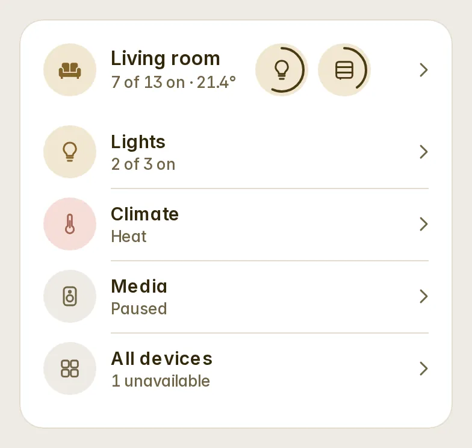
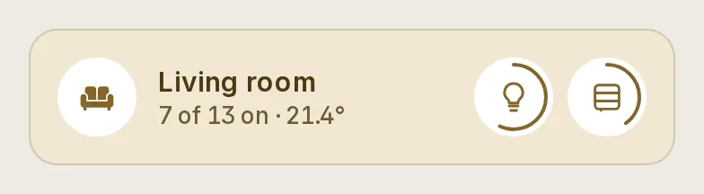

<!-- Generated by `pnpm docs:cards` from the card’s editor, its example in tools/docs/src/gallery.ts and its guide in tools/docs/guides/: change those, not this page. -->

# Room

A room of the house from its area: its picture, its climate, what is on, and its controls.

`custom:fluvy-room-card` · [Try it live](https://acosta290.github.io/fluvy/?card=room) · [All cards](../cards.md#rooms-and-the-map)

<picture><source media="(prefers-color-scheme: dark)" srcset="../images/cards/room-dark.webp"></picture>

## Example

```yaml
type: custom:fluvy-room-card
area: rm_living
path: /fluvy-auto/room-rm_living
```

The picture above, on the demo house: put your own entities in place of its.

## Layouts

`variant` chooses the layout. The picture above is `photo`, the one the card takes by itself here; each of the others is the example plus the line over it, and opens in the live demo.

<table>
<tbody><tr>
<td align="center" valign="top" width="50%"><code>variant: tile</code><br><a href="https://acosta290.github.io/fluvy/?card=room&amp;layout=tile"><picture><source media="(prefers-color-scheme: dark)" srcset="../images/cards/room.tile-dark.webp"></picture></a></td>
<td align="center" valign="top" width="50%"><code>variant: row</code><br><a href="https://acosta290.github.io/fluvy/?card=room&amp;layout=row"><picture><source media="(prefers-color-scheme: dark)" srcset="../images/cards/room.row-dark.webp"></picture></a></td>
</tr></tbody>
</table>

## All options

```yaml
type: custom:fluvy-room-card
area: rm_living
# name:
# icon:
show_icon: auto
variant: photo
controls: rows
name_position: bottom
show_climate: true
show_count: true
readout_style: row
readout_labels: auto
show_quick_actions: true
show_arrow: true
show_quick_states: false
# quick_actions:
# picture:
path: /fluvy-auto/room-rm_living
# lights:
# temperature_entity:
# humidity_entity:
# include:
# exclude:
# tone:
# color:
# card_color:
# card_opacity: 100
# card_border: true
# unavailable: dashed
# light_colors: false
# tap_action:
# hold_action:
#   action: more-info
# double_tap_action:
#   action: none
# icon_tap_action:
#   action: none
# icon_hold_action:
#   action: none
# icon_double_tap_action:
#   action: none
```

## Options

| Option | Default | What it does |
| --- | --- | --- |
| `area` | **required** | Limits the card to the entities of this area. |
| `name` |  | The name the card shows, in place of the entity’s own. |
| `icon` |  | The card’s icon, in place of the entity’s own. |
| `variant` | `tile` | The card’s layout. `photo` · `tile` · `row`. |
| `controls` | `rows` | Draws the room’s controls as rows, as tiles, or not at all. `rows` · `tiles` · `none`. |
| `name_position` | `bottom` | Where the photo carries the room’s name: at its foot, or at its top. `bottom` (At the bottom) · `top` (At the top). |
| `show_climate` | `true` | Shows the room’s temperature and humidity. |
| `show_count` | `true` | Says how many of the room’s devices are on. |
| `readout_style` | `row` | Keeps the readouts on one row, or lets them wrap. `row` (One row) · `wrap` (Several rows). |
| `readout_labels` | `auto` | How the readouts are labelled: words, icons, or nothing. `auto` · `words` · `icons` · `none`. |
| `show_quick_actions` | `true` | Shows the quick actions at the end of the room’s head, its row or its photo. |
| `show_arrow` | `true` | Shows the arrows that say the room opens. |
| `show_quick_states` | `false` | Shows every quick action’s state in its round, unless the action says otherwise. |
| `quick_state_position` | `under` | Where the quick actions’ states stand: under their icons, the head a line taller, or beside them, the rounds wider. `under` · `beside`. |
| `show_action` | `false` | Says on its line what a climate is doing and what it is set to. |
| `picture` |  | A picture of the room, as an address; left out, the area’s own. |
| `path` |  | Where a tap on the room goes. |
| `lights` | none | The lights the room counts and its lights action switches; a lamp on a plug may be one of them. A list of `light` or `switch` entities. |
| `temperature_entity` | none | The room’s temperature sensor, or a thermostat; left out, the area’s. |
| `humidity_entity` | none | The humidity sensor the card reads, where it is not the one found by itself. |
| `include` | nothing more | Counts these entities, devices or domains as the room’s too. A list. |
| `exclude` | nothing | Leaves these entities, devices or domains out of what the card counts. A list. |
| `tint` | `on` | When the card shows its colour beyond its circle: never, while it is on or active, or at rest too. `on` (When on) · `always`. |
| `switch_style` | `toggle` | Draws the switch as a toggle, or as a wall rocker that only switches. `toggle` · `rocker` (Wall rocker). |
| `readouts_layout` | `line` | Where a compact tile’s readouts stand: on its line, or as columns at its end. `line` (On the line) · `end` (Columns at the end). |
| `line_readouts` | `first` | How many readouts the tile’s line says: the first, or every one that can be read. `first` (The first) · `all`. |
| `light_colors` | `false` | Shows each light that is on in its bulb’s own colour. |
| `light_whites` | `temperature` | Draws a lit white by its colour temperature, or as the palette’s light. `palette` (The theme’s light) · `temperature` (The bulb’s white). |
| [`tiles`](#tiles) |  | Tiles of the room’s entities, in this order. A list: [its items](#tiles). |
| [`quick_actions`](#quick_actions) |  | The quick actions in the room’s head, each on a group of its devices or on one entity. A list: [its items](#quick_actions). |

<details>
<summary>Its look and its actions, as on every card</summary>

| Option | Default | What it does |
| --- | --- | --- |
| `show_icon` | `auto` | Shows the icon, hides it, or lets the card decide. `auto` · `always` · `never`. |
| `tone` | the card’s own | The card’s colour from the palette’s tones; left out, the tone of what it shows. `accent` · `light` · `heat` · `cool` · `dry` · `fan` · `water` · `solar` · `grid` · `media` · `presence` · `armed` · `battery` · `house` · `gas` · `vehicle` (Car) · `neutral` · `ok` (Good) · `warning` · `danger`. |
| `color` |  | The card’s colour: its circle, its accents and its tints wear it. Left out, the colour of what it shows. |
| `card_color` |  | Paints the card’s surface in a colour of your own. |
| `card_opacity` | `100` | How solid the card’s surface is, in percent: under 100 the view’s background shows through. Left out, the house’s. 0 % to 100 %, in steps of 5. |
| `card_border` | `true` | Whether the card draws its hairline border. Left out, the house’s. |
| `unavailable` | `dashed` | How the card looks while its entity is unavailable: dashed, or quiet as when it is off. Left out, the house’s. `dashed` · `quiet` (As when off). |
| `name_lines` | `1` | Lets the names of the room’s tiles take two lines where one would cut them, every tile a line taller. `1` · `2`. |
| **Interactions** |  |  |
| `tap_action` | the card’s own | What a tap on the card does. |
| `hold_action` | `more-info` | What a long press on the card does. |
| `double_tap_action` | `none` | What two taps on the card do. |
| `icon_tap_action` | `none` | What a tap on the icon does. |
| `icon_hold_action` | `none` | What a long press on the icon does. |
| `icon_double_tap_action` | `none` | What two taps on the icon do. |

More about them in [Options every card takes](../customising.md#options-every-card-takes).

</details>

## Lists

### `tiles`

An item is an entity id, or a map with `entity` and any of these fields.

| Field | What it does |
| --- | --- |
| `entity` | The entity the item shows. |
| `name` | The item’s own name, in place of the one the card would give it. |
| `icon` | The item’s own icon, in place of the one the card would give it. |
| `tone` | The item’s colour from the palette’s tones. `accent` · `light` · `heat` · `cool` · `dry` · `fan` · `water` · `solar` · `grid` · `media` · `presence` · `armed` · `battery` · `house` · `gas` · `vehicle` (Car) · `neutral` · `ok` (Good) · `warning` · `danger`. |
| `color` | The item’s colour, in place of the one the card gives it. |
| `readouts` | Sensors shown as readouts on the tile. |
| `thresholds` | Thresholds of the item’s own: values past which its reading takes a colour. |
| `since` | Where the time of the last change is read from. |
| `switch_style` | Draws the tile’s switch as a toggle, or as a wall rocker. `toggle` · `rocker` (Wall rocker). |
| `show_action` | Says what a climate is doing on the tile’s line. `true` (On) · `false` (Off). |
| **Interactions** |  |
| `tap_action` | What a tap on the item does. |
| `hold_action` | What a long press on the item does. |
| `double_tap_action` | What two taps on the item do. |
| `icon_tap_action` | What a tap on the tile’s icon does. |
| `icon_hold_action` | What a long press on the tile’s icon does. |
| `icon_double_tap_action` | What two taps on the tile’s icon do. |

### `quick_actions`

An item is a map with `group` and any of these fields.

| Field | What it does |
| --- | --- |
| `group` | What the quick action acts on: the room’s lights, covers, fans or media, or one entity. `lights` · `covers` (Blinds) · `fans` · `media` · `entity`. |
| `entity` | The entity the item shows. |
| `name` | The item’s own name, in place of the one the card would give it. |
| `icon` | The item’s own icon, in place of the one the card would give it. |
| `tone` | The item’s colour from the palette’s tones. `accent` · `light` · `heat` · `cool` · `dry` · `fan` · `water` · `solar` · `grid` · `media` · `presence` · `armed` · `battery` · `house` · `gas` · `vehicle` (Car) · `neutral` · `ok` (Good) · `warning` · `danger`. |
| `color` | The item’s colour, in place of the one the card gives it. |
| `show_state` | Shows this quick action’s state in its round, or hides it, whatever the card says. `true` (On) · `false` (Off). |
| **Interactions** |  |
| `tap_action` | What a tap on the item does. |
| `hold_action` | What a long press on the item does. |
| `double_tap_action` | What two taps on the item do. |

## Guide

The room card draws a room from its `area`: its lights, powered switches, fans, covers, players, thermostats and
vacuums. Never a sensor.

```yaml
type: custom:fluvy-room-card
area: kitchen
exclude: [switch.dishwasher_*] # ids, patterns, device ids or domains
include: [switch.coffee_machine] # from any area
```

### Quick actions


Rounds at the end of the head, each switching its set and ringed by how much is on. By default the room's lights and
blinds.

```yaml
type: custom:fluvy-room-card
area: living_room
quick_actions:
  - lights            # or covers, fans, media
  - scene.movie_night # a scene or a script runs on a tap
  - entity: switch.kettle
    name: Kettle
    color: '#e2725b'
```

A tap turns a set off while any of it is on, else on; blinds open, close or stop; players pause or play. A hold opens
the details.

### Quick actions with their state


```yaml
type: custom:fluvy-room-card
area: hall
show_quick_states: true      # or show_state: true on one round
quick_state_position: beside # under (the default) makes the head 20 px taller
quick_actions:
  - lights
  - binary_sensor.front_door
  - entity: sensor.hall_co2
    show_state: false        # this one stays a round
```

### Picture and readouts

```yaml
type: custom:fluvy-room-card
area: living_room
variant: photo
name_position: top    # the foot is left to the quick actions
readout_labels: icons # auto, words, icons or none
```

On the automatic dashboards, `rooms` (by area id) tunes each room the same way:

```yaml
strategy:
  type: custom:fluvy-home
  room_name_position: top # every room
  rooms:
    kitchen:
      exclude: [switch.dishwasher_*]
      name_position: bottom # this room
```

<details>
<summary>Older names the card still reads</summary>

| Older name | Read as |
| --- | --- |
| `tiles[].label` | `tiles[].name` |
| `tiles[].sub` | `tiles[].secondary` |
| `tiles[].meta` | `tiles[].subtitle` |
| `layout` | `variant` |
| `view` | `variant` |
| `accent` | `color` |

</details>
