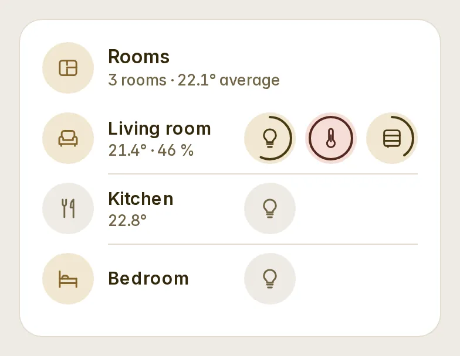
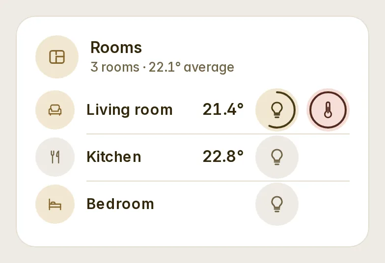
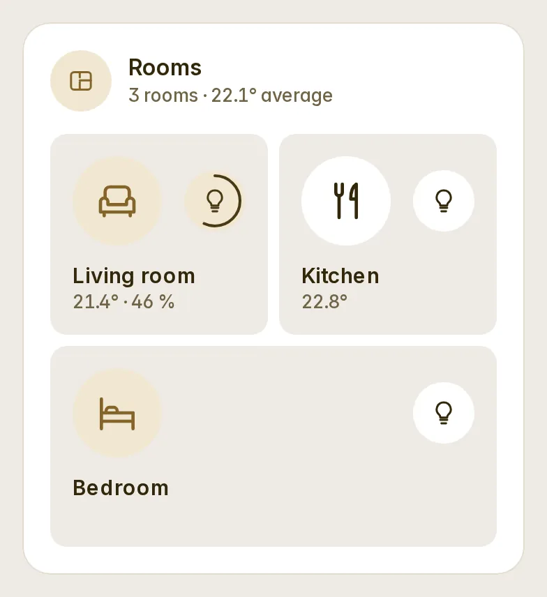

<!-- Generated by `pnpm docs:cards` from the card’s editor, its example in tools/docs/src/gallery.ts and its guide in tools/docs/guides/: change those, not this page. -->

# Rooms

Every room in one card: its icon, its name, its temperature and humidity, and its quick actions at its end; a tap opens the room’s page.

`custom:fluvy-rooms-card` · [Try it live](https://acosta290.github.io/fluvy/?card=rooms) · [All cards](../cards.md#rooms-and-the-map)

<picture><source media="(prefers-color-scheme: dark)" srcset="../images/cards/rooms-dark.webp"></picture>

## Example

```yaml
type: custom:fluvy-rooms-card
rooms:
  - rm_living
  - rm_kitchen
  - rm_bedroom
default_actions:
  - lights
  - climate
  - covers
```

The picture above, on the demo house: put your own entities in place of its.

## Layouts

`variant` chooses the layout. The picture above is `rows`, the default; each of the others is the example plus the line over it, and opens in the live demo.

<table>
<tbody><tr>
<td align="center" valign="top" width="50%"><code>variant: compact</code><br><a href="https://acosta290.github.io/fluvy/?card=rooms&amp;layout=compact"><picture><source media="(prefers-color-scheme: dark)" srcset="../images/cards/rooms.compact-dark.webp"></picture></a></td>
<td align="center" valign="top" width="50%"><code>variant: tiles</code><br><a href="https://acosta290.github.io/fluvy/?card=rooms&amp;layout=tiles"><picture><source media="(prefers-color-scheme: dark)" srcset="../images/cards/rooms.tiles-dark.webp"></picture></a></td>
</tr></tbody>
</table>

## All options

```yaml
type: custom:fluvy-rooms-card
variant: rows
show_head: true
# title:
# icon:
show_average: true
show_icon: auto
name_lines: 1
show_climate: true
show_count: false
show_arrow: true
# max_rooms:
default_actions:
  - lights
  - climate
  - covers
rooms:
  - rm_living
  - rm_kitchen
  - rm_bedroom
# tone:
# color:
# card_color:
# card_opacity: 100
# card_border: true
# exact_colors: false
# unavailable: dashed
# light_colors: false
# tap_action:
# hold_action:
#   action: none
# double_tap_action:
#   action: none
# icon_tap_action:
#   action: none
# icon_hold_action:
#   action: none
# icon_double_tap_action:
#   action: none
```

## Options

| Option | Default | What it does |
| --- | --- | --- |
| `variant` | `rows` | The card’s layout. `rows` · `compact` · `tiles`. |
| `show_head` | `true` | Shows the head: its title, its icon, how many rooms and their average temperature. |
| `title` |  | The title at the top of the card. |
| `icon` |  | The card’s icon, in place of the entity’s own. |
| `show_average` | `true` | Says the rooms’ average temperature on the head’s line. |
| `show_climate` | `true` | Shows the room’s temperature and humidity. |
| `show_count` | `false` | Says how many of each room’s devices are on, after its readings. |
| `show_arrow` | `true` | Shows the arrows that say the room opens. |
| `max_rooms` |  | Draws this many rooms at most, the first in their order. 1 to 99. |
| `default_actions` | none | The quick actions of every room that names none of its own, each where the room has it: its lights, its thermostat, its blinds, its fans, its players. Any of `lights` · `climate` · `covers` (Blinds) · `fans` · `media`. |
| `light_colors` | `false` | Shows each light that is on in its bulb’s own colour. |
| `light_whites` | `temperature` | Draws a lit white by its colour temperature, or as the palette’s light. `palette` (The theme’s light) · `temperature` (The bulb’s white). |
| [`rooms`](#rooms) |  | The rooms, in this order; left out, every area with something to show, in the house’s order. A list: [its items](#rooms). |

<details>
<summary>Its look and its actions, as on every card</summary>

| Option | Default | What it does |
| --- | --- | --- |
| `show_icon` | `auto` | Shows the icon, hides it, or lets the card decide. `auto` · `always` · `never`. |
| `name_lines` | `1` | Lets the name in the card’s head take two balanced lines where one would cut it; the head is a line taller whatever the name. 0 hides the name: the head keeps its circle and its line. `0` · `1` · `2`. |
| `tone` | the card’s own | The card’s colour from the palette’s tones; left out, the tone of what it shows. `accent` · `light` · `heat` · `cool` · `dry` · `fan` · `water` · `solar` · `grid` · `media` · `presence` · `armed` · `battery` · `house` · `gas` · `vehicle` (Car) · `neutral` · `ok` (Good) · `warning` · `danger`. |
| `color` |  | The card’s colour: its circle, its accents and its tints wear it. Left out, the colour of what it shows. |
| `card_color` |  | Paints the card’s surface in a colour of your own. |
| `card_opacity` | `100` | How solid the card’s surface is, in percent: under 100 the view’s background shows through. Left out, the house’s. 0 % to 100 %, in steps of 5. |
| `card_border` | `true` | Whether the card draws its hairline border. Left out, the house’s. |
| `card_blur` | `true` | Whether what shows through a see-through card is blurred. Left out, the house’s, and none at 0 %. |
| `exact_colors` | `false` | Wears the colours the card names as Home Assistant draws them and a hex as typed, not the palette’s tones. Left out, the house’s. |
| `unavailable` | `dashed` | How the card looks while its entity is unavailable: dashed, or quiet as when it is off. Left out, the house’s. `dashed` · `quiet` (As when off). |
| **Interactions** |  |  |
| `tap_action` | the card’s own | What a tap on the card does. |
| `hold_action` | `none` | What a long press on the card does. |
| `double_tap_action` | `none` | What two taps on the card do. |
| `icon_tap_action` | `none` | What a tap on the icon does. |
| `icon_hold_action` | `none` | What a long press on the icon does. |
| `icon_double_tap_action` | `none` | What two taps on the icon do. |

More about them in [Options every card takes](../customising.md#options-every-card-takes).

</details>

## Lists

### `rooms`

An item is a map with `area` and any of these fields.

| Field | What it does |
| --- | --- |
| `area` | The room: its area. |
| `name` | The item’s own name, in place of the one the card would give it. |
| `icon` | The item’s own icon, in place of the one the card would give it. |
| `tone` | The item’s colour from the palette’s tones. `accent` · `light` · `heat` · `cool` · `dry` · `fan` · `water` · `solar` · `grid` · `media` · `presence` · `armed` · `battery` · `house` · `gas` · `vehicle` (Car) · `neutral` · `ok` (Good) · `warning` · `danger`. |
| `color` | The item’s colour, in place of the one the card gives it. |
| `temperature_entity` | The room’s temperature sensor, or a thermostat; left out, the area’s. |
| `humidity_entity` | The room’s humidity sensor, or a thermostat or a humidifier; left out, the area’s. |
| `quick_actions` | The rounds at the room’s end: its lights, blinds, fans, players or thermostat by their words, or any entity; left out, the card’s default actions. |
| `path` | Where a tap on the room goes, before its page on the automatic dashboard. |
| **Interactions** |  |
| `tap_action` | What a tap on the item does. |
| `hold_action` | What a long press on the item does. |
| `double_tap_action` | What two taps on the item do. |

## Guide

Every room in one card: a row each with the room's icon, its name, its temperature and humidity, and its rounds at
the end. Left without a list, it shows every area with something in it, in the house's order of its rooms.

```yaml
type: custom:fluvy-rooms-card
default_actions: [lights, climate, covers] # each room's lights, thermostat and blinds
rooms: # left out: every area, in the house's order
  - living_room
  - area: kids_room
    name: Mia's room
    color: pink
    quick_actions: # this room's own, over default_actions
      - lights
      - climate
      - entity: media_player.kids_speaker
        icon: mdi:music
      - entity: vacuum.kids_room # its own tap and hold
        tap_action:
          action: toggle
        hold_action:
          action: more-info
```

- An area's icon from Home Assistant (`mdi:sofa`, `mdi:bed`, `mdi:stove`) is drawn as Fluvy's room; `icon` sets
  another.
- A tap opens the room's own `path`, else its page on the Rooms dashboard (or Home's Rooms view) where the house has
  one, else the area's settings for an administrator; a room's own `tap_action` and `hold_action` come first.
- `variant`: `rows`, `compact` (48 px rows, the temperature at their end) or `tiles` (two a row from a phone's width).
- The rooms' quick actions stand in columns, the lights under the lights: a room without blinds or a thermostat
  leaves that place empty. Where a quick action says its state (`show_state`), they stand packed.
- A quick action's tap switches a room's set, or an entity that is safe to switch (a light, a switch, a blind, a fan;
  a lock asks first), and opens the details of anything else; its hold opens its details. Each may have its own
  `tap_action`, `hold_action` and `double_tap_action`, a set by its word too (`group: covers`), in YAML or in the
  room's form in the editor.
- What does not fit a row gives way in order: the arrows, then the rounds from the end, then the circles.
- To fold the card away under a head, put it in an [Expander](expander.md): it remembers whether it was open.

<details>
<summary>Older names the card still reads</summary>

| Older name | Read as |
| --- | --- |
| `layout` | `variant` |
| `view` | `variant` |
| `accent` | `color` |

</details>
