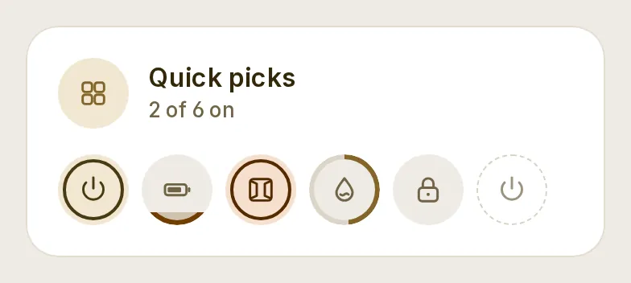
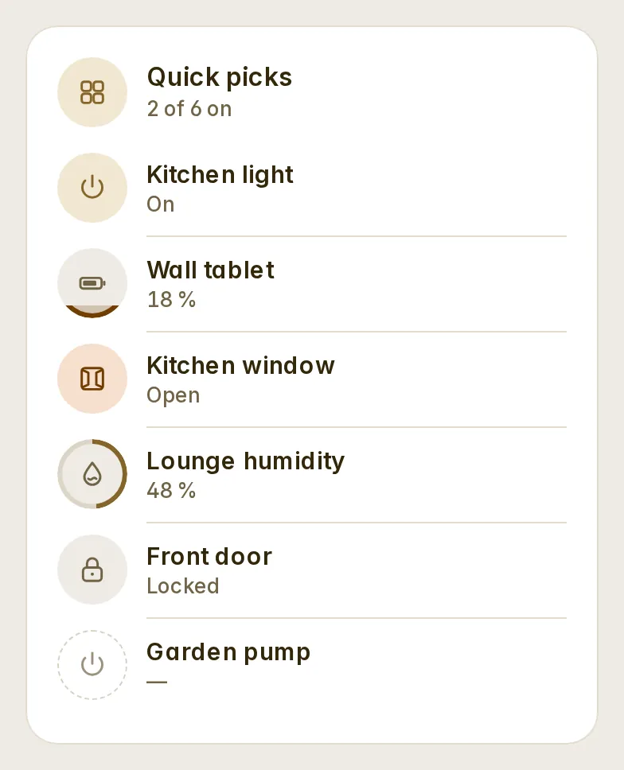
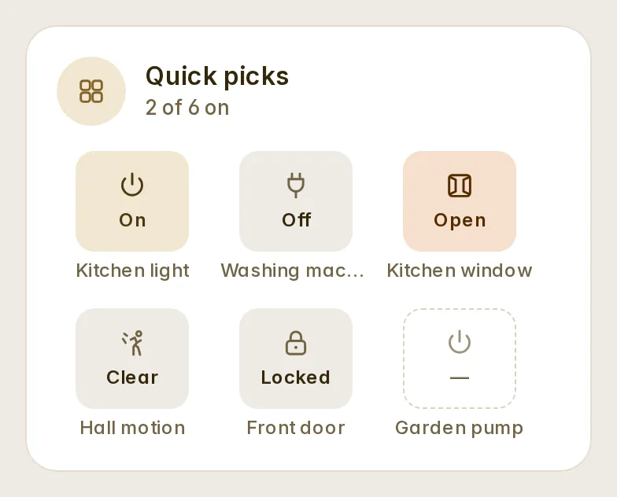

<!-- Generated by `pnpm docs:cards` from the card’s editor, its example in tools/docs/src/gallery.ts and its guide in tools/docs/guides/: change those, not this page. -->

# Rounds

Any entities as round buttons, each lit while it is on: a tap switches what is safe to switch, a hold opens its details, with an optional head saying how many are on.

`custom:fluvy-rounds-card` · [Try it live](https://acosta290.github.io/fluvy/?card=rounds) · [All cards](../cards.md#everyday)

<picture><source media="(prefers-color-scheme: dark)" srcset="../images/cards/rounds-dark.webp"></picture>

## Example

```yaml
type: custom:fluvy-rounds-card
title: Quick picks
items:
  - switch.kitchen_light
  - switch.washer
  - binary_sensor.kitchen_window
  - binary_sensor.motion_hall
  - lock.front_door
  - switch.ghost
```

The picture above, on the demo house: put your own entities in place of its.

## Layouts

`variant` chooses the layout. The picture above is `rounds`, the default; each of the others is the example plus the lines over it, and opens in the live demo.

<table>
<tbody><tr>
<td align="center" valign="top" width="50%"><code>variant: row</code><br><a href="https://acosta290.github.io/fluvy/?card=rounds&amp;layout=row"><picture><source media="(prefers-color-scheme: dark)" srcset="../images/cards/rounds.row-dark.webp"></picture></a></td>
<td align="center" valign="top" width="50%"><code>variant: labels</code><br><code>show_names: true</code><br><a href="https://acosta290.github.io/fluvy/?card=rounds&amp;layout=labels"><picture><source media="(prefers-color-scheme: dark)" srcset="../images/cards/rounds.labels-dark.webp"></picture></a></td>
</tr></tbody>
</table>

## All options

```yaml
type: custom:fluvy-rounds-card
title: Quick picks
# icon:
variant: rounds
show_count: true
show_icon: auto
name_lines: 1
show_names: false
# columns:
align: fill
items:
  - switch.kitchen_light
  - switch.washer
  - binary_sensor.kitchen_window
  - binary_sensor.motion_hall
  - lock.front_door
  - switch.ghost
names: full
# tone:
# color:
# card_color:
# card_opacity: 100
# card_border: true
# exact_colors: false
# unavailable: dashed
# tap_action:
#   action: none
# hold_action:
#   action: none
# double_tap_action:
#   action: none
# icon_tap_action:
#   action: none
# icon_hold_action:
#   action: none
# icon_double_tap_action:
#   action: none
```

## Options

| Option | Default | What it does |
| --- | --- | --- |
| `title` |  | The title at the top of the card. |
| `icon` |  | The card’s icon, in place of the entity’s own. |
| `variant` | `rounds` | The card’s layout. `rounds` · `row` · `labels` (With their states). |
| `show_count` | `true` | Says on the head’s line how many are on. |
| `show_names` | `false` | Shows each round’s name under it. |
| `columns` |  | How many rounds stand on a line, at most as many as the width holds. 1 to 12. |
| `align` | `fill` | Where the rounds stand on their line: in equal shares of it (rounds alone from its start), from its start, in its middle, or from edge to edge. `fill` (Evenly) · `start` (From the start) · `center` (In the middle) · `spread` (Edge to edge). |
| `names` | `full` | How a row is named where it has no name of its own: the entity’s full name, its own, or its device’s. `full` · `entity` · `device`. |
| `light_colors` | `false` | Shows each light that is on in its bulb’s own colour. |
| `light_whites` | `temperature` | Draws a lit white by its colour temperature, or as the palette’s light. `palette` (The theme’s light) · `temperature` (The bulb’s white). |
| [`items`](#items) |  | The entities the card draws as rounds, in this order. A list: [its items](#items). |

<details>
<summary>Its look and its actions, as on every card</summary>

| Option | Default | What it does |
| --- | --- | --- |
| `show_icon` | `auto` | Shows the icon, hides it, or lets the card decide. `auto` · `always` · `never`. |
| `name_lines` | `1` | Lets the name in the card’s head take two balanced lines where one would cut it; the head is a line taller whatever the name. 0 hides the name: the head keeps its circle and its line. `0` · `1` · `2`. |
| `tone` | the card’s own | The card’s colour from the palette’s tones; left out, the tone of what it shows. `accent` · `light` · `heat` · `cool` · `dry` · `fan` · `water` · `solar` · `grid` · `media` · `presence` · `armed` · `battery` · `house` · `gas` · `vehicle` (Car) · `neutral` · `ok` (Good) · `warning` · `danger`. |
| `color` |  | The card’s colour: its circle, its accents and its tints wear it. Left out, the colour of what it shows. |
| `card_color` |  | Paints the card’s surface in a colour of your own. |
| `card_opacity` | `100` | How solid the card’s surface is, in percent: under 100 the view’s background shows through. Left out, the house’s. 0 % to 100 %, in steps of 5. |
| `card_border` | `true` | Whether the card draws its hairline border. Left out, the house’s. |
| `card_blur` | `true` | Whether what shows through a see-through card is blurred. Left out, the house’s, and none at 0 %. |
| `exact_colors` | `false` | Wears the colours the card names as Home Assistant draws them and a hex as typed, not the palette’s tones. Left out, the house’s. |
| `unavailable` | `dashed` | How the card looks while its entity is unavailable: dashed, or quiet as when it is off. Left out, the house’s. `dashed` · `quiet` (As when off). |
| **Interactions** |  |  |
| `tap_action` | `none` | What a tap on the card does. |
| `hold_action` | `none` | What a long press on the card does. |
| `double_tap_action` | `none` | What two taps on the card do. |
| `icon_tap_action` | `none` | What a tap on the icon does. |
| `icon_hold_action` | `none` | What a long press on the icon does. |
| `icon_double_tap_action` | `none` | What two taps on the icon do. |

More about them in [Options every card takes](../customising.md#options-every-card-takes).

</details>

## Lists

### `items`

An item is an entity id, or a map with `entity` and any of these fields.

| Field | What it does |
| --- | --- |
| `entity` | The entity the item shows. |
| `name` | The item’s own name, in place of the one the card would give it. |
| `icon` | The item’s own icon, in place of the one the card would give it. |
| `tone` | The item’s colour from the palette’s tones. `accent` · `light` · `heat` · `cool` · `dry` · `fan` · `water` · `solar` · `grid` · `media` · `presence` · `armed` · `battery` · `house` · `gas` · `vehicle` (Car) · `neutral` · `ok` (Good) · `warning` · `danger`. |
| `color` | The item’s colour, in place of the one the card gives it. |
| `show_state` | Shows this round’s state under its icon, or hides it, whatever the layout says. `true` (On) · `false` (Off). |
| **Interactions** |  |
| `tap_action` | What a tap on the item does. |
| `hold_action` | What a long press on the item does. |
| `double_tap_action` | What two taps on the item do. |

## Guide

Any entities as rounds: lit while on, its ring the level of a light, a blind or a fan, the dashed ring out of reach.

```yaml
type: custom:fluvy-rounds-card
title: Quick picks # left out, no head: the rounds stand alone
items:
  - switch.kitchen_light
  - binary_sensor.kitchen_window
  - lock.front_door
  - entity: sensor.lounge_humidity
    show_state: true # its state under its icon
  - entity: scene.movie_night
    tap_action:
      action: perform-action
      perform_action: scene.turn_on
```

- A tap flips lights, switches, fans, blinds, valves, humidifiers, sirens, automations, remotes and groups. A lock locks
  at once and asks before it unlocks. Anything else opens its details: give it a `tap_action` to run it.
- A hold opens the details.
- `variant`: `rounds` (in lines), `labels` (each with its state under it) or `row` (a list row each, the row its tap).
- `columns` caps the rounds a line; `align` stands them from the start, in the middle or from edge to edge.

<details>
<summary>Older names the card still reads</summary>

| Older name | Read as |
| --- | --- |
| `entities` | `items` |
| `layout` | `variant` |
| `view` | `variant` |
| `accent` | `color` |

</details>
