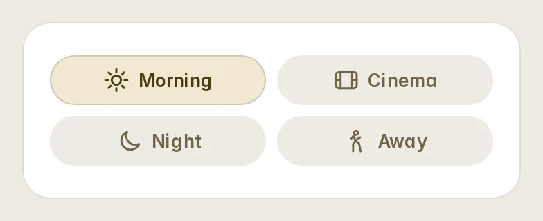

<!-- Generated by `pnpm docs:cards` from the card’s editor, its example in tools/docs/src/gallery.ts and its guide in tools/docs/guides/: change those, not this page. -->

# Scenes

A grid of scenes and scripts.

`custom:fluvy-scenes-card` · [Try it live](https://acosta290.github.io/fluvy/?card=scenes) · [All cards](../cards.md#scenes-actions-and-helpers)

<picture><source media="(prefers-color-scheme: dark)" srcset="../images/cards/scenes-dark.webp"></picture>

## Example

```yaml
type: custom:fluvy-scenes-card
scenes:
  - entity: scene.am_morning
    icon: sun
  - entity: scene.am_cinema
    icon: film
  - entity: scene.am_night
    icon: moon
    subtitle: All off
  - entity: scene.am_away
    icon: away
    subtitle: Lock & arm
```

The picture above, on the demo house: put your own entities in place of its.

## Layouts

`variant` chooses the layout. The picture above is `tiles`, the default; each of the others is the example plus the line over it, and opens in the live demo.

<table>
<tbody><tr>
<td align="center" valign="top" width="50%"><code>variant: chips</code><br><a href="https://acosta290.github.io/fluvy/?card=scenes&amp;layout=chips"><picture><source media="(prefers-color-scheme: dark)" srcset="../images/cards/scenes.chips-dark.webp"></picture></a></td>
<td align="center" valign="top" width="50%"></td>
</tr></tbody>
</table>

## All options

```yaml
type: custom:fluvy-scenes-card
# title:
variant: tiles
columns: auto
scenes:
  - entity: scene.am_morning
    icon: sun
  - entity: scene.am_cinema
    icon: film
  - entity: scene.am_night
    icon: moon
    subtitle: All off
  - entity: scene.am_away
    icon: away
    subtitle: Lock & arm
names: full
group_by: none
# color:
# card_color:
# card_opacity: 100
# card_border: true
# unavailable: dashed
# tint: 'on'
# empty_text:
hide_empty: false
# hold_action:
#   action: more-info
# double_tap_action:
#   action: none
```

## Options

| Option | Default | What it does |
| --- | --- | --- |
| `title` |  | The title at the top of the card. |
| `variant` | `tiles` | The card’s layout. `tiles` · `chips`. |
| `columns` | `auto` | How many scenes stand in a row. `auto` · `1` · `2`. |
| `names` | `full` | How a row is named where it has no name of its own: the entity’s full name, its own, or its device’s. `full` · `entity` · `device`. |
| `group_by` | `none` | Groups the items under the name of their room or their floor. `none` · `area` · `floor`. |
| `group_order` | `auto` | The order of the groups: the house’s order of its rooms, or by name. `auto` · `name`. |
| `short_names` | `true` | Shortens a name inside a group by the group’s own name. |
| `tint` | `on` | When each scene’s tile shows its colour. `on` (When on) · `always`. |
| `empty_text` |  | What the card says while it has nothing to show. |
| `hide_empty` | `false` | Hides the whole card while it has nothing to show. |
| [`scenes`](#scenes) |  | The scenes, in the order they are drawn. A list: [its items](#scenes). |

<details>
<summary>Its look and its actions, as on every card</summary>

| Option | Default | What it does |
| --- | --- | --- |
| `color` |  | The card’s colour: its circle, its accents and its tints wear it. Left out, the colour of what it shows. |
| `card_color` |  | Paints the card’s surface in a colour of your own. |
| `card_opacity` | `100` | How solid the card’s surface is, in percent: under 100 the view’s background shows through. Left out, the house’s. 0 % to 100 %, in steps of 5. |
| `card_border` | `true` | Whether the card draws its hairline border. Left out, the house’s. |
| `unavailable` | `dashed` | How the card looks while its entity is unavailable: dashed, or quiet as when it is off. Left out, the house’s. `dashed` · `quiet` (As when off). |
| **Interactions** |  |  |
| `hold_action` | `more-info` | What a long press on the card does. |
| `double_tap_action` | `none` | What two taps on the card do. |

More about them in [Options every card takes](../customising.md#options-every-card-takes).

</details>

## Lists

### `scenes`

An item is an entity id, or a map with `entity` and any of these fields. Between its items, `type: section` with a `label` heads a group.

| Field | What it does |
| --- | --- |
| `entity` | The entity the item shows. A `scene`, `script`, `button`, `input_button` or `automation`. |
| `name` | The item’s own name, in place of the one the card would give it. |
| `icon` | The item’s own icon, in place of the one the card would give it. |
| `subtitle` | The line under the scene’s name. |
| `color` | The item’s colour, in place of the one the card gives it. |
| **Interactions** |  |
| `tap_action` | What a tap on the item does. |
| `hold_action` | What a long press on the item does. |
| `double_tap_action` | What two taps on the item do. |

<details>
<summary>Older names the card still reads</summary>

| Older name | Read as |
| --- | --- |
| `entities` | `scenes` |
| `scenes[].label` | `scenes[].name` |
| `scenes[].sub` | `scenes[].secondary` |
| `scenes[].meta` | `scenes[].subtitle` |
| `layout` | `variant` |
| `view` | `variant` |
| `accent` | `color` |

</details>
