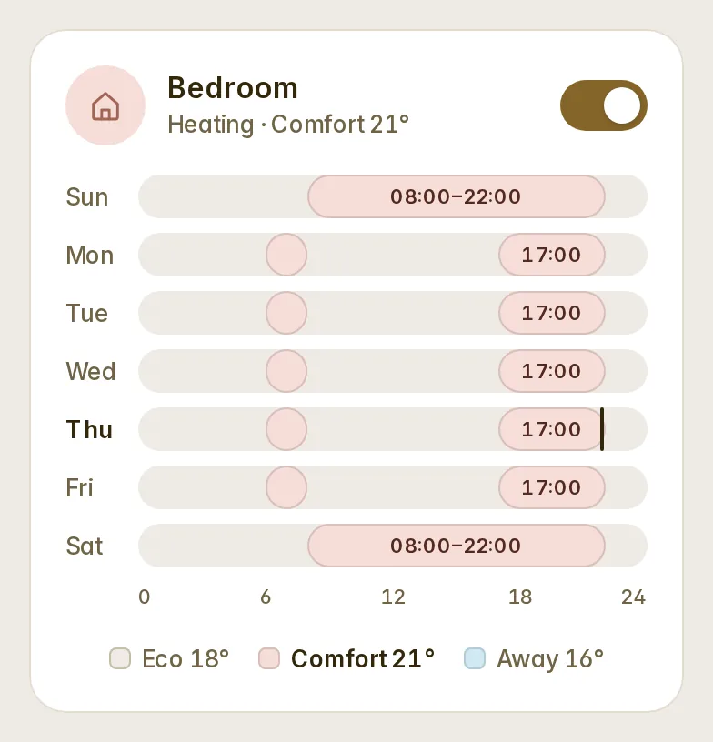
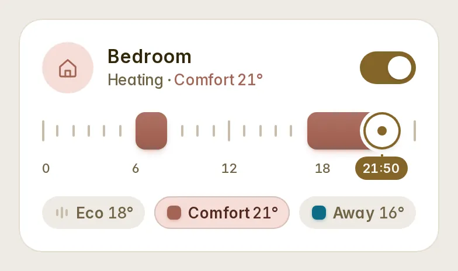
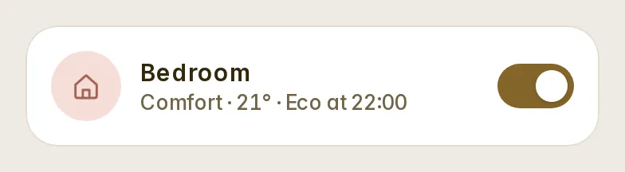

<!-- Generated by `pnpm docs:cards` from the card’s editor, its example in tools/docs/src/gallery.ts and its guide in tools/docs/guides/: change those, not this page. -->

# Heating schedule

A room’s heating week on Home Assistant’s own schedule helper: a timeline a day in its presets’ colours, Comfort, Eco and Away with their temperatures, its times edited, a day copied to others, the schedule on or off.

`custom:fluvy-schedule-card` · [Try it live](https://acosta290.github.io/fluvy/?card=schedule) · [All cards](../cards.md#everyday)

<picture><source media="(prefers-color-scheme: dark)" srcset="../images/cards/schedule-dark.webp"></picture>

## Example

```yaml
type: custom:fluvy-schedule-card
entity: climate.bedroom_radiator
```

The picture above, on the demo house: put your own entities in place of its.

## Layouts

`variant` chooses the layout. The picture above is `week`, the default; each of the others is the example plus the line over it, and opens in the live demo.

<table>
<tbody><tr>
<td align="center" valign="top" width="50%"><code>variant: today</code><br><a href="https://acosta290.github.io/fluvy/?card=schedule&amp;layout=today"><picture><source media="(prefers-color-scheme: dark)" srcset="../images/cards/schedule.today-dark.webp"></picture></a></td>
<td align="center" valign="top" width="50%"><code>variant: row</code><br><a href="https://acosta290.github.io/fluvy/?card=schedule&amp;layout=row"><picture><source media="(prefers-color-scheme: dark)" srcset="../images/cards/schedule.row-dark.webp"></picture></a></td>
</tr></tbody>
</table>

## All options

```yaml
type: custom:fluvy-schedule-card
entity: climate.bedroom_radiator
# schedule:
# name:
# icon:
variant: week
first_weekday: language
show_head: true
show_presets: true
show_switch: true
show_icon: auto
name_lines: 1
# tone:
# color:
# card_color:
# card_opacity: 100
# card_border: true
# exact_colors: false
# unavailable: dashed
# tap_action:
# hold_action:
#   action: more-info
# double_tap_action:
#   action: none
# icon_tap_action:
#   action: none
# icon_hold_action:
#   action: none
# icon_double_tap_action:
#   action: none
# presets:
```

## Options

| Option | Default | What it does |
| --- | --- | --- |
| `entity` | **required** | The thermostat the schedule sets. A `climate`. |
| `schedule` |  | The schedule helper the card draws and writes; left out, the one its automation follows. A `schedule`. |
| `name` |  | The name the card shows, in place of the entity’s own. |
| `icon` |  | The card’s icon, in place of the entity’s own. |
| `variant` | `week` | The week, a line a day; today’s line alone; or a row: the room, the preset in force, its target and the next change. `week` · `today` · `row`. |
| `first_weekday` | `language` | The day the weeks and the months start on. `language` (As the language does) · `sunday` · `monday` · `tuesday` · `wednesday` · `thursday` · `friday` · `saturday`. |
| `show_head` | `true` | Shows the head: the room, what the thermostat is doing, the preset in force and the schedule’s switch. |
| `show_presets` | `true` | Shows the presets and their temperatures under the hours. |
| `show_switch` | `true` | Shows the switch that turns the schedule on and off. |
| [`presets`](#presets) |  | How a preset looks on this card: its name, icon and colour, by its key. A list: [its items](#presets). |

<details>
<summary>Its look and its actions, as on every card</summary>

| Option | Default | What it does |
| --- | --- | --- |
| `show_icon` | `auto` | Shows the icon, hides it, or lets the card decide. `auto` · `always` · `never`. |
| `name_lines` | `1` | Lets the name in the card’s head take two balanced lines where one would cut it; the head is a line taller whatever the name. 0 hides the name: the head keeps its circle and its line. `0` · `1` · `2`. |
| `tone` | the card’s own | The card’s colour from the palette’s tones; left out, the tone of what it shows. `accent` · `light` · `heat` · `cool` · `dry` · `fan` · `water` · `solar` · `grid` · `media` · `presence` · `armed` · `battery` · `house` · `gas` · `vehicle` (Car) · `neutral` · `ok` (Good) · `warning` · `danger`. |
| `color` |  | The card’s colour: its circle, its accents and its tints wear it. Left out, the colour of what it shows. |
| `card_color` |  | Paints the card’s surface in a colour of your own. |
| `card_opacity` | `100` | How solid the card’s surface is, in percent: under 100 the view’s background shows through. Left out, the house’s. 0 % to 100 %, in steps of 5. |
| `card_border` | `true` | Whether the card draws its hairline border. Left out, the house’s. |
| `card_blur` | `true` | Whether what shows through a see-through card is blurred. Left out, the house’s, and none at 0 %. |
| `exact_colors` | `false` | Wears the colours the card names as Home Assistant draws them and a hex as typed, not the palette’s tones. Left out, the house’s. |
| `unavailable` | `dashed` | How the card looks while its entity is unavailable: dashed, or quiet as when it is off. Left out, the house’s. `dashed` · `quiet` (As when off). |
| **Interactions** |  |  |
| `tap_action` | the card’s own | What a tap on the card does. |
| `hold_action` | `more-info` | What a long press on the card does. |
| `double_tap_action` | `none` | What two taps on the card do. |
| `icon_tap_action` | `none` | What a tap on the icon does. |
| `icon_hold_action` | `none` | What a long press on the icon does. |
| `icon_double_tap_action` | `none` | What two taps on the icon do. |

More about them in [Options every card takes](../customising.md#options-every-card-takes).

</details>

## Lists

### `presets`

An item is a map with `preset` and any of these fields.

| Field | What it does |
| --- | --- |
| `preset` | The preset’s key: comfort, eco, away, home, sleep, boost, activity, or the name of one of your own. |
| `name` | The item’s own name, in place of the one the card would give it. |
| `icon` | The item’s own icon, in place of the one the card would give it. |
| `tone` | The item’s colour from the palette’s tones. `accent` · `light` · `heat` · `cool` · `dry` · `fan` · `water` · `solar` · `grid` · `media` · `presence` · `armed` · `battery` · `house` · `gas` · `vehicle` (Car) · `neutral` · `ok` (Good) · `warning` · `danger`. |
| `color` | The item’s colour, in place of the one the card gives it. |

## Guide

The week lives in Home Assistant, not in the card, and runs with every browser closed. It is two things you can see
in Settings:

- **A schedule helper** (Settings → Devices & services → Helpers), Home Assistant's own: the heating times of each day,
  each with the preset it heats to (`preset: comfort` in its data). Between the times, the base preset (Eco).
- **An automation** (Settings → Automations), named "Heating schedule · Bedroom": it holds the presets and their
  temperatures, and sets the thermostat each time the helper changes, and when Home Assistant starts.

```yaml
type: custom:fluvy-schedule-card
entity: climate.bedroom
variant: today          # one day's line, for a small space
first_weekday: monday
presets:                # how a preset looks on this card
  - preset: away
    icon: mdi:bag-suitcase
    tone: cool
```

**Making one.** On a thermostat with no schedule, "Create a schedule" opens the sheet on a week to start from:
workdays 06:30–08:30 and 17:00–22:30 in Comfort, weekends 08:00–23:00, Eco between. Save writes the helper (named
after the room) and its automation; Cancel writes nothing.

**Changing it.** A tap on a day opens the sheet on that day: add, move or remove its times, choose each one's preset,
copy the day to others, set the presets' temperatures, add one of your own. Two times that overlap are refused. The
switch in the head turns the automation off and on. Where the schedule was changed in Home Assistant while the sheet
was open, Save writes nothing and says so; Reload opens it again as it is now.

**When it sets the thermostat.** Saving a plan, or switching it on, sets the thermostat at once to what the plan says
for this moment, and the automation sets it again at every start of Home Assistant, as well as at each change of the
plan. A temperature set by hand lasts until the next of these.

- `schedule`: the helper, where the card should not find it by its automation.
- "Use the thermostat's own presets" sets the thermostat's own Comfort, Eco or Away (`preset_mode`) where it has
  them, instead of a temperature. A unit that only keeps a range heats to the preset and never cools.
- Only administrators change the schedule; everyone else reads it and may switch it.
- An automation edited by hand in Home Assistant is its own from then on: the card shows the week and says where to
  change it. A helper kept in YAML is changed in YAML.

<details>
<summary>Older names the card still reads</summary>

| Older name | Read as |
| --- | --- |
| `layout` | `variant` |
| `view` | `variant` |
| `accent` | `color` |

</details>
