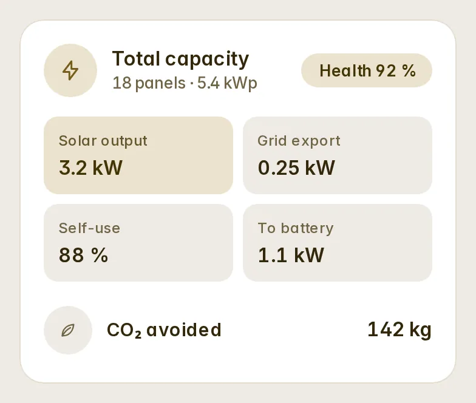

<!-- Generated by `pnpm docs:cards` from the card’s editor, its example in tools/docs/src/gallery.ts and its guide in tools/docs/guides/: change those, not this page. -->

# Stat tiles

A headline value and a grid of stat tiles.

`custom:fluvy-stat-tiles-card` · [Try it live](https://acosta290.github.io/fluvy/?card=stat-tiles) · [All cards](../cards.md#energy)

<picture><source media="(prefers-color-scheme: dark)" srcset="../images/cards/stat-tiles-dark.webp"></picture>

## Example

```yaml
type: custom:fluvy-stat-tiles-card
title: Total capacity
subtitle: '18 panels · 5.4 kWp'
icon: bolt
tone: solar
badge_entity: sensor.so_health
badge_label: Health
tiles:
  - entity: sensor.so_solar_power
    name: Solar output
    icon: sun
    tone: solar
    highlight: true
  - entity: sensor.so_grid_export
    name: Grid export
    icon: bolt
    tone: grid
  - entity: sensor.so_self_use
    name: Self-use
    icon: home
    tone: accent
  - entity: sensor.so_battery_charge
    name: To battery
    icon: battery
    tone: water
rows:
  - entity: sensor.so_co2
    icon: leaf
    secondary: This month
```

The picture above, on the demo house: put your own entities in place of its.

## Layouts

`variant` chooses the layout. The picture above is `full`, the default; each of the others is the example plus the line over it, and opens in the live demo.

<table>
<tbody><tr>
<td align="center" valign="top" width="50%"><code>variant: compact</code><br><a href="https://acosta290.github.io/fluvy/?card=stat-tiles&amp;layout=compact"><picture><source media="(prefers-color-scheme: dark)" srcset="../images/cards/stat-tiles.compact-dark.webp"></picture></a></td>
<td align="center" valign="top" width="50%"></td>
</tr></tbody>
</table>

## All options

```yaml
type: custom:fluvy-stat-tiles-card
title: Total capacity
subtitle: '18 panels · 5.4 kWp'
icon: bolt
show_icon: auto
name_lines: 1
tone: solar
# color:
# card_color:
# card_opacity: 100
# card_border: true
# unavailable: dashed
variant: full
columns: 2
tiles:
  - entity: sensor.so_solar_power
    name: Solar output
    icon: sun
    tone: solar
    highlight: true
  - entity: sensor.so_grid_export
    name: Grid export
    icon: bolt
    tone: grid
  - entity: sensor.so_self_use
    name: Self-use
    icon: home
    tone: accent
  - entity: sensor.so_battery_charge
    name: To battery
    icon: battery
    tone: water
# entity:
# name:
badge_entity: sensor.so_health
badge_label: Health
rows:
  - entity: sensor.so_co2
    icon: leaf
    secondary: This month
names: full
# empty_text:
hide_empty: false
# unit: auto
# decimals: auto
# tap_action:
#   action: more-info
# hold_action:
#   action: more-info
# double_tap_action:
#   action: none
# icon_tap_action:
#   action: none
# icon_hold_action:
#   action: none
# icon_double_tap_action:
#   action: none
```

## Options

| Option | Default | What it does |
| --- | --- | --- |
| `title` |  | The title at the top of the card. |
| `subtitle` |  | The line under the title: your own words, an entity’s state or a template. |
| `icon` |  | The card’s icon, in place of the entity’s own. |
| `variant` | `full` | The card’s layout. `full` · `compact`. |
| `columns` | `2` | How many tiles stand in a row. `auto` · `2` · `3`. |
| `entity` |  | An entity whose value stands large over the tiles. |
| `name` |  | The name the card shows, in place of the entity’s own. |
| `badge_entity` |  | An entity whose value the head’s badge shows. |
| `badge_label` |  | The words before the badge entity’s value ("Health 92 %"). |
| `names` | `full` | How a row is named where it has no name of its own: the entity’s full name, its own, or its device’s. `full` · `entity` · `device`. |
| `empty_text` |  | What the card says while it has nothing to show. |
| `hide_empty` | `false` | Hides the whole card while it has nothing to show. |
| `tint` | `off` | When the card shows its colour beyond its circle: never, while it is on or active, or at rest too. `off` (Never) · `on` (Past a threshold). |
| `unit` | `auto` | The unit the figures are written in; automatic keeps the sensor’s. `auto` · `W` · `kW` · `MW` · `Wh` · `kWh` · `MWh` · `L` · `m³` · `gal` · `ft³`, or your own. |
| `decimals` | `auto` | How many decimals the figures have; automatic decides by their size. `auto` · `0` · `1` · `2` · `3`. |
| [`tiles`](#tiles) |  | The figures as tiles, in this order. A list: [its items](#tiles). |
| [`rows`](#rows) |  | Rows under the tiles. A list: [its items](#rows). |

<details>
<summary>Its look and its actions, as on every card</summary>

| Option | Default | What it does |
| --- | --- | --- |
| `show_icon` | `auto` | Shows the icon, hides it, or lets the card decide. `auto` · `always` · `never`. |
| `name_lines` | `1` | Lets the name in the card’s head take two balanced lines where one would cut it; the head is a line taller whatever the name. `1` · `2`. |
| `tone` | the card’s own | The card’s colour from the palette’s tones; left out, the tone of what it shows. `accent` · `light` · `heat` · `cool` · `dry` · `fan` · `water` · `solar` · `grid` · `media` · `presence` · `armed` · `battery` · `house` · `gas` · `vehicle` (Car) · `neutral` · `ok` (Good) · `warning` · `danger`. |
| `color` |  | The card’s colour: its circle, its accents and its tints wear it. Left out, the colour of what it shows. |
| `card_color` |  | Paints the card’s surface in a colour of your own. |
| `card_opacity` | `100` | How solid the card’s surface is, in percent: under 100 the view’s background shows through. Left out, the house’s. 0 % to 100 %, in steps of 5. |
| `card_border` | `true` | Whether the card draws its hairline border. Left out, the house’s. |
| `unavailable` | `dashed` | How the card looks while its entity is unavailable: dashed, or quiet as when it is off. Left out, the house’s. `dashed` · `quiet` (As when off). |
| **Interactions** |  |  |
| `tap_action` | `more-info` | What a tap on the card does. |
| `hold_action` | `more-info` | What a long press on the card does. |
| `double_tap_action` | `none` | What two taps on the card do. |
| `icon_tap_action` | `none` | What a tap on the icon does. |
| `icon_hold_action` | `none` | What a long press on the icon does. |
| `icon_double_tap_action` | `none` | What two taps on the icon do. |

More about them in [Options every card takes](../customising.md#options-every-card-takes).

</details>

## Lists

### `tiles`

An item is an entity id, or a map with `entity` and any of these fields.

| Field | What it does |
| --- | --- |
| `entity` | The entity the item shows. |
| `name` | The item’s own name, in place of the one the card would give it. |
| `icon` | The item’s own icon, in place of the one the card would give it. |
| `tone` | The item’s colour from the palette’s tones. `accent` · `light` · `heat` · `cool` · `dry` · `fan` · `water` · `solar` · `grid` · `media` · `presence` · `armed` · `battery` · `house` · `gas` · `vehicle` (Car) · `neutral` · `ok` (Good) · `warning` · `danger`. |
| `highlight` | Fills the tile with its tone: the one figure that matters most. `true` or `false`. |
| `unit` | The unit the figure is written in. `auto` · `W` · `kW` · `MW` · `Wh` · `kWh` · `MWh` · `L` · `m³` · `gal` · `ft³`, or your own. |
| `decimals` | How many decimals the figure has. `auto` · `0` · `1` · `2` · `3`. |
| `thresholds` | Thresholds of the item’s own: values past which its reading takes a colour. |
| **Interactions** |  |
| `tap_action` | What a tap on the item does. |
| `hold_action` | What a long press on the item does. |
| `double_tap_action` | What two taps on the item do. |

### `rows`

An item is an entity id, or a map with `entity` and any of these fields.

| Field | What it does |
| --- | --- |
| `entity` | The entity the item shows. |
| `name` | The item’s own name, in place of the one the card would give it. |
| `icon` | The item’s own icon, in place of the one the card would give it. |
| `secondary` | The line under the item’s name. |
| `tone` | The item’s colour from the palette’s tones. `accent` · `light` · `heat` · `cool` · `dry` · `fan` · `water` · `solar` · `grid` · `media` · `presence` · `armed` · `battery` · `house` · `gas` · `vehicle` (Car) · `neutral` · `ok` (Good) · `warning` · `danger`. |
| `color` | The item’s colour, in place of the one the card gives it. |
| `thresholds` | Thresholds of the item’s own: values past which its reading takes a colour. |
| **Interactions** |  |
| `tap_action` | What a tap on the item does. |
| `hold_action` | What a long press on the item does. |
| `double_tap_action` | What two taps on the item do. |

<details>
<summary>Older names the card still reads</summary>

| Older name | Read as |
| --- | --- |
| `entities` | `tiles` |
| `rows[].label` | `rows[].name` |
| `rows[].sub` | `rows[].secondary` |
| `rows[].meta` | `rows[].subtitle` |
| `tiles[].label` | `tiles[].name` |
| `tiles[].sub` | `tiles[].secondary` |
| `tiles[].meta` | `tiles[].subtitle` |
| `sub` | `subtitle` |
| `meta` | `subtitle` |
| `layout` | `variant` |
| `view` | `variant` |
| `accent` | `color` |

</details>
