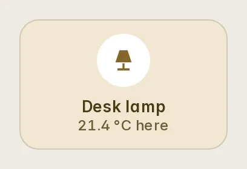
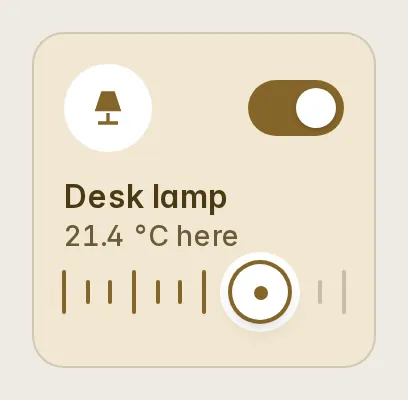

<!-- Generated by `pnpm docs:cards` from the card’s editor, its example in tools/docs/src/gallery.ts and its guide in tools/docs/guides/: change those, not this page. -->

# Template

A tile whose name, line, icon, colour and fill are templates, with or without an entity; a Mushroom template card pastes in.

`custom:fluvy-template-card` · [Try it live](https://acosta290.github.io/fluvy/?card=template) · [All cards](../cards.md#everyday)

<picture><source media="(prefers-color-scheme: dark)" srcset="../images/cards/template-dark.webp"></picture>

## Example

```yaml
type: custom:fluvy-template-card
entity: light.tp_desk
icon: '{{ ''mdi:lamp'' if is_state(entity, ''on'') else ''mdi:lamp-outline'' }}'
secondary: '{{ states(''sensor.tp_temperature'') }} °C here'
```

The picture above, on the demo house: put your own entities in place of its.

## Layouts

`variant` chooses the layout. The picture above is `compact`, the default; each of the others is the example plus the line over it, and opens in the live demo.

<table>
<tbody><tr>
<td align="center" valign="top" width="50%"><code>variant: mini</code><br><a href="https://acosta290.github.io/fluvy/?card=template&amp;layout=mini"><picture><source media="(prefers-color-scheme: dark)" srcset="../images/cards/template.mini-dark.webp"></picture></a></td>
<td align="center" valign="top" width="50%"><code>variant: large</code><br><a href="https://acosta290.github.io/fluvy/?card=template&amp;layout=large"><picture><source media="(prefers-color-scheme: dark)" srcset="../images/cards/template.large-dark.webp"></picture></a></td>
</tr></tbody>
</table>

## All options

```yaml
type: custom:fluvy-template-card
entity: light.tp_desk
# name:
icon: '{{ ''mdi:lamp'' if is_state(entity, ''on'') else ''mdi:lamp-outline'' }}'
secondary: '{{ states(''sensor.tp_temperature'') }} °C here'
# since:
variant: compact
active: auto
name_lines: 1
switch_style: toggle
# tone:
# color:
# card_color:
# card_opacity: 100
# card_border: true
# unavailable: dashed
# tint: 'on'
# tap_action:
# hold_action:
#   action: more-info
# double_tap_action:
#   action: none
# icon_tap_action:
# icon_hold_action:
#   action: none
# icon_double_tap_action:
#   action: none
```

## Options

| Option | Default | What it does |
| --- | --- | --- |
| `entity` |  | The entity the card is about: what it shows, and what its controls act on. |
| `name` |  | The name the card shows, in place of the entity’s own. |
| `icon` |  | The card’s icon, in place of the entity’s own. |
| `secondary` | `none` | The line under the name: a keyword, your own words, or a template. `state` · `area` · `last-changed` · `none`, or your own. |
| `since` | none | Where the time of the last change is read from, in place of Home Assistant’s own. |
| `variant` | `compact` | The card’s layout. `compact` · `mini` · `large`. |
| `active` | `auto` | Decides when the card looks on: its colour and its switch follow it. `auto` · `always` · `never`, or your own. |
| `show_switch` | `true` | Shows the switch. `true` (Shown) · `false` (Hidden) · `value` (Its value instead). |
| `switch_style` | `toggle` | Draws the switch as a toggle, or as a wall rocker that only switches. `toggle` · `rocker` (Wall rocker). |
| `tint` | `on` | When the card shows its colour beyond its circle: never, while it is on or active, or at rest too. `on` (When on) · `always`. |
| [`readouts`](#readouts) |  | Sensors shown as readouts on the tile, in this order. A list: [its items](#readouts). |

<details>
<summary>Its look and its actions, as on every card</summary>

| Option | Default | What it does |
| --- | --- | --- |
| `name_lines` | `1` | Lets the tile’s name take two lines where one would cut it, the tile a line taller. `1` · `2`. |
| `tone` | the card’s own | The card’s colour from the palette’s tones; left out, the tone of what it shows. `accent` · `light` · `heat` · `cool` · `dry` · `fan` · `water` · `solar` · `grid` · `media` · `presence` · `armed` · `battery` · `house` · `gas` · `vehicle` (Car) · `neutral` · `ok` (Good) · `warning` · `danger`. |
| `color` |  | The card’s colour: its circle, its accents and its tints wear it. Left out, the colour of what it shows. |
| `card_color` |  | Paints the card’s surface in a colour of your own. |
| `card_opacity` | `100` | How solid the card’s surface is, in percent: under 100 the view’s background shows through. Left out, the house’s. 0 % to 100 %, in steps of 5. |
| `card_border` | `true` | Whether the card draws its hairline border. Left out, the house’s. |
| `unavailable` | `dashed` | How the card looks while its entity is unavailable: dashed, or quiet as when it is off. Left out, the house’s. `dashed` · `quiet` (As when off). |
| **Interactions** |  |  |
| `tap_action` | the card’s own | What a tap on the card does. |
| `hold_action` | `more-info` | What a long press on the card does. |
| `double_tap_action` | `none` | What two taps on the card do. |
| `icon_tap_action` | the card’s own | What a tap on the icon does. |
| `icon_hold_action` | `none` | What a long press on the icon does. |
| `icon_double_tap_action` | `none` | What two taps on the icon do. |

More about them in [Options every card takes](../customising.md#options-every-card-takes).

</details>

## Lists

### `readouts`

An item is an entity id, or a map with `entity` and any of these fields.

| Field | What it does |
| --- | --- |
| `entity` | The entity the item shows. A `sensor`. |
| `name` | The item’s own name, in place of the one the card would give it. |
| `unit` | The unit the figure is written in. `auto` · `W` · `kW` · `MW` · `Wh` · `kWh` · `MWh` · `L` · `m³` · `gal` · `ft³`, or your own. |
| `decimals` | How many decimals the figure has. `auto` · `0` · `1` · `2` · `3`. |

## Guide

A tile whose `name`, `secondary`, `icon`, `color` and `active` may each be a Home Assistant template. With an `entity`
it is that entity's tile, and `entity` in the templates; without one it is your words alone.

```yaml
type: custom:fluvy-template-card
entity: sensor.washer_power
name: "{{ 'Washing' if states(entity) | float > 10 else 'Washer' }}"
secondary: "{{ states(entity) | round }} W"
icon: mdi:washing-machine
color: "{{ 'blue' if states(entity) | float > 10 else 'grey' }}"
active: "{{ states(entity) | float > 10 }}" # when the tile looks on
```

- `active`: `auto` (as its entity), `always`, `never`, or a template (on unless it gives `off`, `false`, `no`, `0`).
- `color` takes a colour or a tone (`warning`, `heat`); `tint: always` keeps it at rest. A template colour goes in YAML.
- Without an entity, a tap runs only an action that needs none: `navigate`, `url`, `perform-action`, `assist`.

### From Mushroom

A Mushroom template card pastes in. Change its type, and keep it still if it should be: Fluvy's tile toggles a light
or a switch on a tap, and opens its details on a hold.

```yaml
type: custom:fluvy-template-card # was custom:mushroom-template-card
entity: light.kitchen
primary: "{{ 'Cooking' if is_state(entity, 'on') else 'Kitchen' }}" # read as name
icon_color: "{{ 'amber' if is_state(entity, 'on') else 'grey' }}"   # read as color
layout: vertical             # the mini tile (vertical: true too)
tap_action: { action: none } # as Mushroom: no tap until you give one
hold_action: { action: none }
```

`fill_container`, `multiline_secondary`, `double_tap_action` and `entity_id` are dropped when the editor saves.

<details>
<summary>Older names the card still reads</summary>

| Older name | Read as |
| --- | --- |
| `primary` | `name` |
| `icon_color` | `color` |
| `layout` | `variant` (some of its values) |
| `vertical` | `variant` (some of its values) |
| `view` | `variant` |
| `accent` | `color` |

</details>
