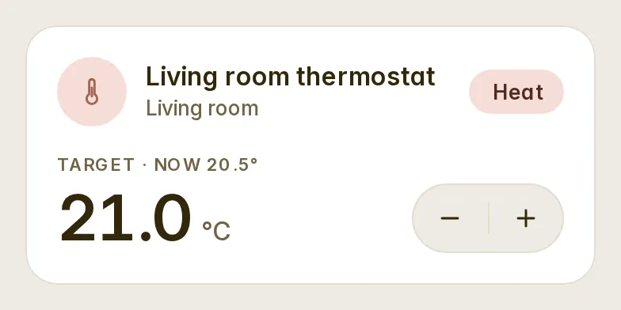
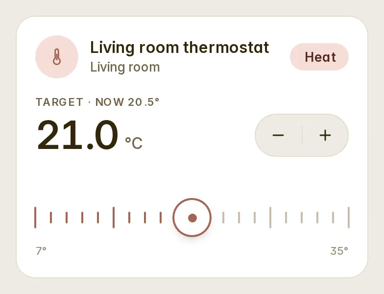
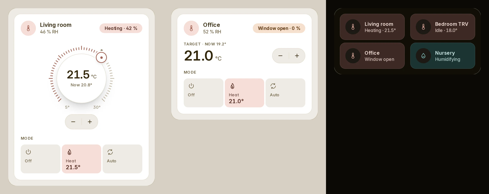

<!-- Generated by `pnpm docs:cards` from the card’s editor, its example in tools/docs/src/gallery.ts and its guide in tools/docs/guides/: change those, not this page. -->

# Thermostat

Climate, water heater or humidifier on a dial, with modes, presets and fan speeds.

`custom:fluvy-thermostat-card` · [Try it live](https://acosta290.github.io/fluvy/?card=thermostat) · [All cards](../cards.md#everyday)

<picture><source media="(prefers-color-scheme: dark)" srcset="../images/cards/thermostat-dark.webp"></picture>

## Example

```yaml
type: custom:fluvy-thermostat-card
entity: climate.living
```

The picture above, on the demo house: put your own entities in place of its.

## Layouts

`variant` chooses the layout. The picture above is `dial`, the default; each of the others is the example plus the line over it, and opens in the live demo.

<table>
<tbody><tr>
<td align="center" valign="top" width="50%"><code>variant: compact</code><br><a href="https://acosta290.github.io/fluvy/?card=thermostat&amp;layout=compact"><picture><source media="(prefers-color-scheme: dark)" srcset="../images/cards/thermostat.compact-dark.webp"></picture></a></td>
<td align="center" valign="top" width="50%"><code>variant: ruler</code><br><a href="https://acosta290.github.io/fluvy/?card=thermostat&amp;layout=ruler"><picture><source media="(prefers-color-scheme: dark)" srcset="../images/cards/thermostat.ruler-dark.webp"></picture></a></td>
</tr></tbody>
</table>

## All options

```yaml
type: custom:fluvy-thermostat-card
entity: climate.living
# name:
# icon:
# image:
# subtitle:
show_icon: auto
show_badge: true
name_lines: 1
variant: dial
show_stepper: true
show_modes: true
modes_style: tiles
# modes:
show_current: true
show_presets: true
preset_style: full
show_fan: true
fan_style: full
when_off: all
# state_entity:
show_valve: false
# valve_entity:
# valve_attribute:
show_window: false
# window_entity:
show_battery: false
# battery_entity:
# humidity_entity:
# tone:
# color:
# card_color:
# card_opacity: 100
# card_border: true
# unavailable: dashed
# tint: 'off'
# state_colors:
# tap_action:
#   action: more-info
# hold_action:
#   action: more-info
# double_tap_action:
#   action: none
# icon_tap_action:
#   action: none
# icon_hold_action:
#   action: none
# icon_double_tap_action:
#   action: none
```

## Options

| Option | Default | What it does |
| --- | --- | --- |
| `entity` | **required** | The entity the card is about: what it shows, and what its controls act on. A `climate`, `water_heater` or `humidifier`. |
| `name` |  | The name the card shows, in place of the entity’s own. |
| `icon` |  | The card’s icon, in place of the entity’s own. |
| `image` |  | A picture of your own in the dial’s circle: an address, or an entity whose picture it is. |
| `subtitle` |  | The line under the title: your own words, an entity’s state or a template. |
| `variant` | `dial` | The card’s layout. `dial` · `compact` · `ruler`. |
| `show_stepper` | `true` | Shows the − and + buttons. |
| `show_modes` | `true` | Shows the modes to choose from. |
| `modes_style` | `tiles` | How the modes are drawn. `tiles` · `chips` · `full`. |
| `modes` | what the device offers | The modes the card offers, in this order; left out, every mode the device has. Any of `off` · `heat` · `cool` · `heat_cool` (Auto) · `auto` · `dry` · `fan_only` (Fan). |
| `show_current` | `true` | Shows the room’s temperature beside the target. |
| `show_presets` | `true` | Shows the presets. |
| `preset_style` | `full` | Draws the presets as chips that fill the row, or as content-sized chips. `full` · `chips`. |
| `show_fan` | `true` | Shows the fan speeds. |
| `fan_style` | `full` | Draws the fan speeds as chips that fill the row, or as content-sized chips. `full` · `chips`. |
| `when_off` | `all` | What the card shows while the device is off: everything, or only what turns it on. `all` · `essentials` (The essentials). |
| `tint` | `off` | When the card shows its colour beyond its circle: never, while it is on or active, or at rest too. `off` (Never) · `on` (When active) · `always`. |
| `tint_style` | `wash` | How the colour is shown: a wash over the card, the card’s edge, or the control alone. `wash` · `edge` · `control`. |
| `state_colors` |  | A colour for each of the device’s states, held under this key: a tone, none, or a colour of your own. Its keys: `heating` · `cooling` · `drying` · `fan` · `humidifying` · `idle` · `off`. |
| **What it is doing** |  |  |
| `state_entity` |  | Another entity whose state says what the thermostat is doing. A `sensor`, `binary_sensor`, `switch` or `input_boolean`. |
| `show_valve` | `false` | Shows how far the valve is open beside what it is doing. |
| `valve_entity` |  | A sensor of the valve’s opening. A `sensor` or `number`. |
| `valve_attribute` |  | The climate’s attribute that holds the valve’s opening. |
| `show_window` | `false` | Says "Window open" while a window of the room is. |
| `window_entity` |  | The window sensor the card reads. A `binary_sensor`. |
| `show_battery` | `false` | Warns of a low battery on the head’s line. |
| `battery_entity` |  | The battery sensor the card reads its charge from. A `sensor`. |
| `humidity_entity` |  | The humidity sensor the card reads, where it is not the one found by itself. |

<details>
<summary>Its look and its actions, as on every card</summary>

| Option | Default | What it does |
| --- | --- | --- |
| `show_icon` | `auto` | Shows the icon, hides it, or lets the card decide. `auto` · `always` · `never`. |
| `show_badge` | `true` | Shows the badge at the end of the head, such as the card’s state or a count. |
| `name_lines` | `1` | Lets the name in the card’s head take two balanced lines where one would cut it; the head is a line taller whatever the name. `1` · `2`. |
| `tone` | the card’s own | The card’s colour from the palette’s tones; left out, the tone of what it shows. `accent` · `light` · `heat` · `cool` · `dry` · `fan` · `water` · `solar` · `grid` · `media` · `presence` · `armed` · `battery` · `house` · `gas` · `vehicle` (Car) · `neutral` · `ok` (Good) · `warning` · `danger`. |
| `color` |  | The card’s colour: its circle, its accents and its tints wear it. Left out, the colour of what it shows. |
| `card_color` |  | Paints the card’s surface in a colour of your own. |
| `card_opacity` | `100` | How solid the card’s surface is, in percent: under 100 the view’s background shows through. Left out, the house’s. 0 % to 100 %, in steps of 5. |
| `card_border` | `true` | Whether the card draws its hairline border. Left out, the house’s. |
| `unavailable` | `dashed` | How the card looks while its entity is unavailable: dashed, or quiet as when it is off. Left out, the house’s. `dashed` · `quiet` (As when off). |
| **Interactions** |  |  |
| `tap_action` | `more-info` | What a tap on the card does. |
| `hold_action` | `more-info` | What a long press on the card does. |
| `double_tap_action` | `none` | What two taps on the card do. |
| `icon_tap_action` | `none` | What a tap on the icon does. |
| `icon_hold_action` | `none` | What a long press on the icon does. |
| `icon_double_tap_action` | `none` | What two taps on the icon do. |

More about them in [Options every card takes](../customising.md#options-every-card-takes).

</details>

## Guide



The badge says what the device is doing (Heating, Idle, Preheating, Defrosting), not its mode. Where the entity says
no action, it shows the mode.

### What it is doing

Each is off until asked for, and none makes the card taller.

| Key | Says | Found on |
| --- | --- | --- |
| `show_valve: true` | "Heating · 42 %" | The climate (ZHA, Netatmo), a valve sensor of its device, or Better Thermostat's valves |
| `show_window: true` | "Window open" | The climate (Better Thermostat too), or a window sensor of its device |
| `show_battery: true` | "Battery 8 %", at 20 % or less | The battery sensor of its device |

Where nothing is found, name it: `valve_entity` (or `valve_attribute`), `window_entity`, `battery_entity`.

```yaml
# a room behind Better Thermostat
type: custom:fluvy-thermostat-card
entity: climate.bedroom
show_valve: true
show_window: true
show_battery: true
```

```yaml
# a thermostat that reports no action: its heater's switch says it
type: custom:fluvy-thermostat-card
entity: climate.hallway
state_entity: switch.hallway_heater   # or a sensor whose state is heating, idle …
humidity_entity: sensor.hallway_humidity
```

### On tiles and rooms

```yaml
type: custom:fluvy-tiles-card
show_action: true # "Heating · 21.5°" on each climate or humidifier tile
tiles:
  - climate.living_room
  - entity: humidifier.nursery
    show_action: false # this one keeps its state
```

The room card takes `show_action` for its climate row; on the automatic dashboards it is
[`thermostat_state: detailed`](../automatic-dashboard.md#options).

<details>
<summary>Older names the card still reads</summary>

| Older name | Read as |
| --- | --- |
| `show_state` | `show_badge` |
| `sub` | `subtitle` |
| `meta` | `subtitle` |
| `layout` | `variant` |
| `view` | `variant` |
| `accent` | `color` |

</details>
