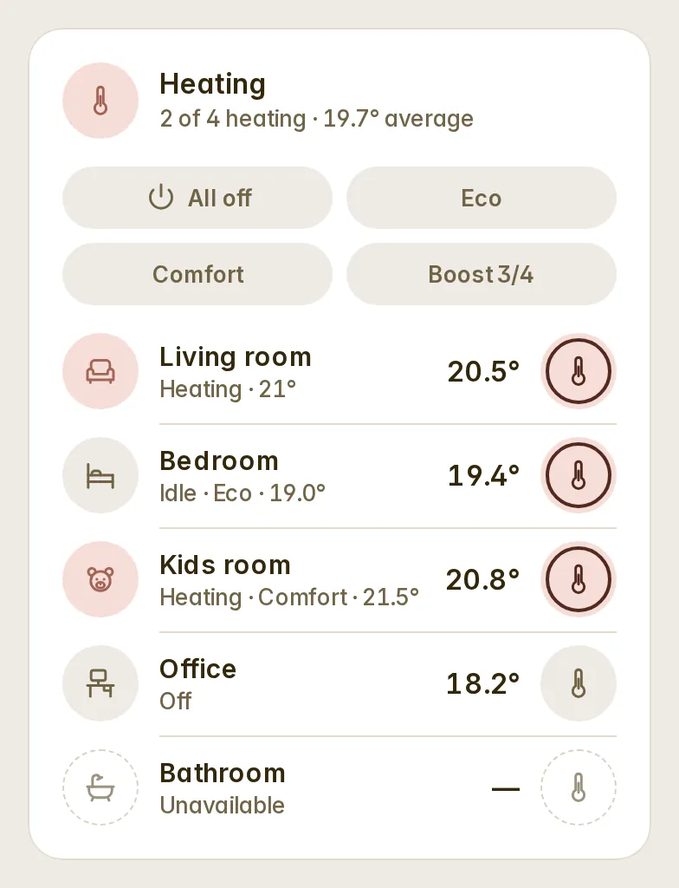
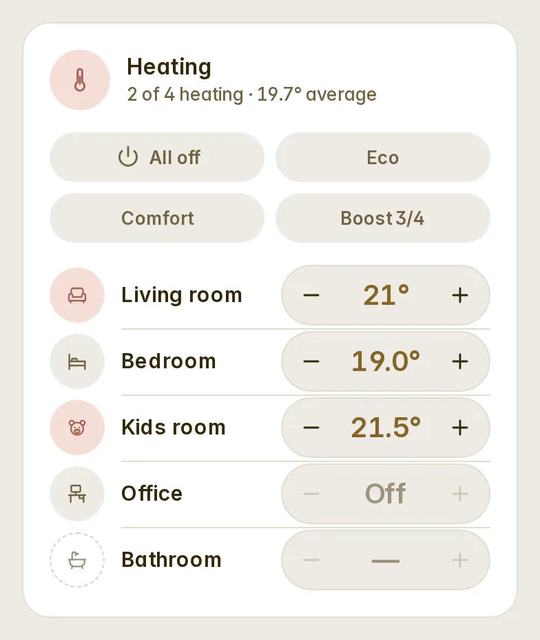
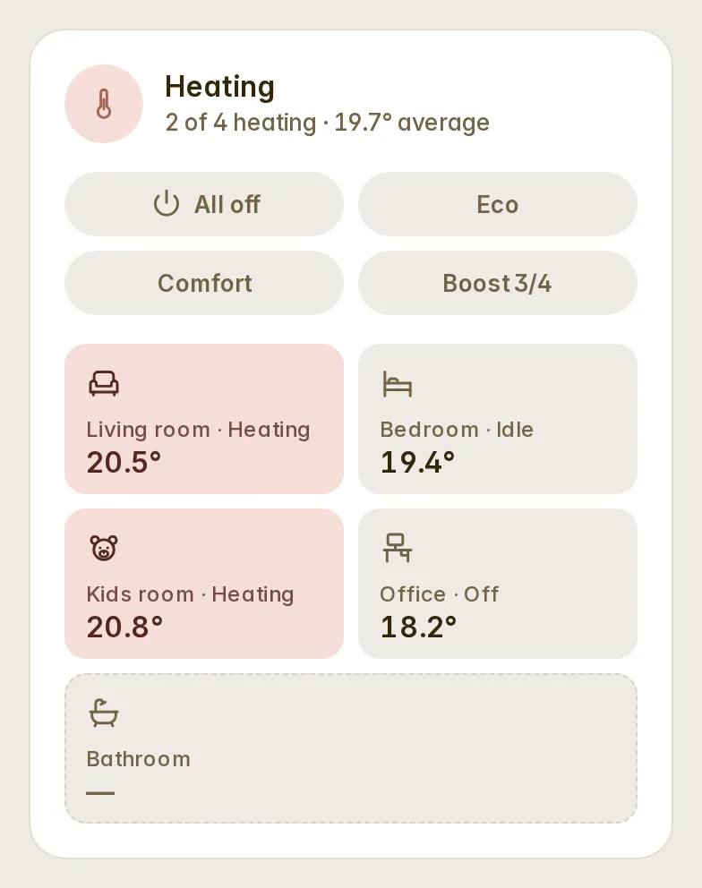

<!-- Generated by `pnpm docs:cards` from the card’s editor, its example in tools/docs/src/gallery.ts and its guide in tools/docs/guides/: change those, not this page. -->

# Thermostats

Every thermostat of the house or a room in one card: each room’s temperature, what it is doing, its preset and its target, round buttons and optional − and +, with All off and the presets for the whole house.

`custom:fluvy-thermostats-card` · [Try it live](https://acosta290.github.io/fluvy/?card=thermostats) · [All cards](../cards.md#everyday)

<picture><source media="(prefers-color-scheme: dark)" srcset="../images/cards/thermostats-dark.webp"></picture>

## Example

```yaml
type: custom:fluvy-thermostats-card
title: Heating
show_count: true
show_average: true
house_actions:
  - all_off
  - presets
thermostats:
  - climate.ts_living_heat_pump
  - climate.ts_bedroom
  - climate.ts_kids_room
  - climate.ts_office
  - climate.ts_bathroom
```

The picture above, on the demo house: put your own entities in place of its.

## Layouts

`variant` chooses the layout. The picture above is `rows`, the default; each of the others is the example plus the lines over it, and opens in the live demo.

<table>
<tbody><tr>
<td align="center" valign="top" width="50%"><code>variant: compact</code><br><code>control: stepper</code><br><a href="https://acosta290.github.io/fluvy/?card=thermostats&amp;layout=compact"><picture><source media="(prefers-color-scheme: dark)" srcset="../images/cards/thermostats.compact-dark.webp"></picture></a></td>
<td align="center" valign="top" width="50%"><code>variant: tiles</code><br><a href="https://acosta290.github.io/fluvy/?card=thermostats&amp;layout=tiles"><picture><source media="(prefers-color-scheme: dark)" srcset="../images/cards/thermostats.tiles-dark.webp"></picture></a></td>
</tr></tbody>
</table>

## All options

```yaml
type: custom:fluvy-thermostats-card
title: Heating
# icon:
show_count: true
show_average: true
show_icon: auto
name_lines: 1
variant: rows
control: none
show_round: true
house_actions:
  - all_off
  - presets
thermostats:
  - climate.ts_living_heat_pump
  - climate.ts_bedroom
  - climate.ts_kids_room
  - climate.ts_office
  - climate.ts_bathroom
names: area
# tone:
# color:
# card_color:
# card_opacity: 100
# card_border: true
# exact_colors: false
# unavailable: dashed
# tap_action:
#   action: none
# hold_action:
#   action: none
# double_tap_action:
#   action: none
# icon_tap_action:
#   action: none
# icon_hold_action:
#   action: none
# icon_double_tap_action:
#   action: none
```

## Options

| Option | Default | What it does |
| --- | --- | --- |
| `area` |  | Lists the climates of this area where the card lists none; left out, every one of the house. |
| `title` |  | The title at the top of the card. |
| `icon` |  | The card’s icon, in place of the entity’s own. |
| `show_count` | `false` | Says on the head’s line how many heat (or cool, else are on) of those that can be read. |
| `show_average` | `false` | Says on the head’s line the average of what the rooms measure. |
| `variant` | `rows` | The card’s layout. `rows` · `compact` · `tiles`. |
| `control` | `none` | What each row ends in: the room’s temperature, or the target between − and + (the room’s temperature then leads its line). `none` (The room’s temperature) · `stepper` (The target, with − and +). |
| `show_round` | `true` | Ends each row in a round that opens its details, before the row’s own rounds. |
| `house_actions` | none | Chips over the list for every thermostat at once, in this order: All off, which asks first, and the presets they offer. Any of `all_off` · `presets` (Their presets). |
| `names` | `area` | How a row is named where it has no name of its own: by its area where it is the card’s only one there, else as Home Assistant says it; or by the entity’s full name, its own, or its device’s. `area` · `full` · `entity` · `device`. |
| [`thermostats`](#thermostats) |  | The thermostats, in this order; left out, every climate of the area, else of the house. A list: [its items](#thermostats). |

<details>
<summary>Its look and its actions, as on every card</summary>

| Option | Default | What it does |
| --- | --- | --- |
| `show_icon` | `auto` | Shows the icon, hides it, or lets the card decide. `auto` · `always` · `never`. |
| `name_lines` | `1` | Lets the name in the card’s head take two balanced lines where one would cut it; the head is a line taller whatever the name. 0 hides the name: the head keeps its circle and its line. `0` · `1` · `2`. |
| `tone` | the card’s own | The card’s colour from the palette’s tones; left out, the tone of what it shows. `accent` · `light` · `heat` · `cool` · `dry` · `fan` · `water` · `solar` · `grid` · `media` · `presence` · `armed` · `battery` · `house` · `gas` · `vehicle` (Car) · `neutral` · `ok` (Good) · `warning` · `danger`. |
| `color` |  | The card’s colour: its circle, its accents and its tints wear it. Left out, the colour of what it shows. |
| `card_color` |  | Paints the card’s surface in a colour of your own. |
| `card_opacity` | `100` | How solid the card’s surface is, in percent: under 100 the view’s background shows through. Left out, the house’s. 0 % to 100 %, in steps of 5. |
| `card_border` | `true` | Whether the card draws its hairline border. Left out, the house’s. |
| `card_blur` | `true` | Whether what shows through a see-through card is blurred. Left out, the house’s, and none at 0 %. |
| `exact_colors` | `false` | Wears the colours the card names as Home Assistant draws them and a hex as typed, not the palette’s tones. Left out, the house’s. |
| `unavailable` | `dashed` | How the card looks while its entity is unavailable: dashed, or quiet as when it is off. Left out, the house’s. `dashed` · `quiet` (As when off). |
| **Interactions** |  |  |
| `tap_action` | `none` | What a tap on the card does. |
| `hold_action` | `none` | What a long press on the card does. |
| `double_tap_action` | `none` | What two taps on the card do. |
| `icon_tap_action` | `none` | What a tap on the icon does. |
| `icon_hold_action` | `none` | What a long press on the icon does. |
| `icon_double_tap_action` | `none` | What two taps on the icon do. |

More about them in [Options every card takes](../customising.md#options-every-card-takes).

</details>

## Lists

### `thermostats`

An item is an entity id, or a map with `entity` and any of these fields.

| Field | What it does |
| --- | --- |
| `entity` | The entity the item shows. A `climate`, `water_heater` or `humidifier`. |
| `name` | The item’s own name, in place of the one the card would give it. |
| `icon` | The item’s own icon, in place of the one the card would give it. |
| `tone` | The item’s colour from the palette’s tones. `accent` · `light` · `heat` · `cool` · `dry` · `fan` · `water` · `solar` · `grid` · `media` · `presence` · `armed` · `battery` · `house` · `gas` · `vehicle` (Car) · `neutral` · `ok` (Good) · `warning` · `danger`. |
| `color` | The item’s colour, in place of the one the card gives it. |
| `rounds` | Rounds of its own after the one that opens it, each an entity with its own icon and actions: a schedule’s view, a window. |
| **Interactions** |  |
| `tap_action` | What a tap on the item does. |
| `hold_action` | What a long press on the item does. |
| `double_tap_action` | What two taps on the item do. |

## Guide

Every thermostat of the house, of a room or of a list, a row each: its room's icon and name, what it is doing, its
preset and its target, what the room measures, and the round that opens its details.

```yaml
type: custom:fluvy-thermostats-card
title: Heating
show_count: true # "2 of 4 heating"
show_average: true # "19.7° average"
house_actions: [all_off, presets]
thermostats: # left out, every climate of `area`, else of the house
  - climate.living_room
  - entity: climate.bedroom
    rounds: # after the one that opens it
      - entity: schedule.heating
        icon: mdi:calendar-clock
        tap_action:
          action: navigate
          navigation_path: /dashboard-home/climate
```

- A row is named by its room where it is the only thermostat of the card there; `names` (or its own `name`) names it
  by its entity instead.
- `control: stepper` ends each row in the target between − and +, each unit with its own step and range, sent once
  the taps settle; the room's temperature then leads the line. Where a row cannot hold it, every row ends in the
  room's temperature again.
- `house_actions`: `all_off` asks first, then turns off each thermostat that is on (its own off, else its Off mode);
  `presets` are the presets the thermostats offer between them, each saying how many offer it ("Boost 3/4"), and a
  tap sets that preset on each one that is on and offers it. A preset never turns one on.
- A thermostat out of reach keeps its row, greyed with "—", counted nowhere and left out of the house's actions.
- What it does not do yet: boosts, timers and scenes of its own temperatures. A schedule is the Heating schedule
  card's; give a row a round that goes to it.

<details>
<summary>Older names the card still reads</summary>

| Older name | Read as |
| --- | --- |
| `entities` | `thermostats` |
| `layout` | `variant` |
| `view` | `variant` |
| `accent` | `color` |

</details>
