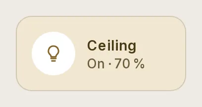
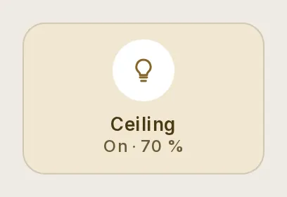

<!-- Generated by `pnpm docs:cards` from the card’s editor, its example in tools/docs/src/gallery.ts and its guide in tools/docs/guides/: change those, not this page. -->

# Tile

A light, switch, cover, fan, player, number or sensor as a tile: large with a precision ruler or two readouts, compact row, or mini.

`custom:fluvy-tile-card` · [Try it live](https://acosta290.github.io/fluvy/?card=tile) · [All cards](../cards.md#everyday)

<picture><source media="(prefers-color-scheme: dark)" srcset="../images/cards/tile-dark.webp"></picture>

## Example

```yaml
type: custom:fluvy-tile-card
entity: light.ceiling
```

The picture above, on the demo house: put your own entities in place of its.

## Layouts

`size` chooses the layout. The picture above is `large`, the default; each of the others is the example plus the line over it, and opens in the live demo.

<table>
<tbody><tr>
<td align="center" valign="top" width="50%"><code>size: compact</code><br><a href="https://acosta290.github.io/fluvy/?card=tile&amp;layout=compact"><picture><source media="(prefers-color-scheme: dark)" srcset="../images/cards/tile.compact-dark.webp"></picture></a></td>
<td align="center" valign="top" width="50%"><code>size: mini</code><br><a href="https://acosta290.github.io/fluvy/?card=tile&amp;layout=mini"><picture><source media="(prefers-color-scheme: dark)" srcset="../images/cards/tile.mini-dark.webp"></picture></a></td>
</tr></tbody>
</table>

## All options

```yaml
type: custom:fluvy-tile-card
entity: light.ceiling
# name:
# icon:
size: large
show_switch: true
switch_style: toggle
# since:
# tone:
# color:
# card_color:
# card_opacity: 100
# card_border: true
# unavailable: dashed
# tint: 'on'
# light_colors: false
# readouts:
# tap_action:
# hold_action:
#   action: more-info
# double_tap_action:
#   action: none
# icon_tap_action:
# icon_hold_action:
#   action: none
# icon_double_tap_action:
#   action: none
# thresholds:
```

## Options

| Option | Default | What it does |
| --- | --- | --- |
| `entity` | **required** | The entity the card is about: what it shows, and what its controls act on. |
| `name` |  | The name the card shows, in place of the entity’s own. |
| `icon` |  | The card’s icon, in place of the entity’s own. |
| `size` | `large` | The tile’s size. `large` · `compact` · `mini`. |
| `show_switch` | `true` | Shows the switch. `true` (Shown) · `false` (Hidden) · `value` (Its value instead). |
| `switch_style` | `toggle` | Draws the switch as a toggle, or as a wall rocker that only switches. `toggle` · `rocker` (Wall rocker). |
| `show_action` | `false` | Says on its line what a climate is doing and what it is set to. |
| `since` | none | Where the time of the last change is read from, in place of Home Assistant’s own. |
| `tint` | `on` | When the card shows its colour beyond its circle: never, while it is on or active, or at rest too. `on` (When on) · `always`. |
| `light_colors` | `false` | Shows each light that is on in its bulb’s own colour. |
| `light_whites` | `temperature` | Draws a lit white by its colour temperature, or as the palette’s light. `palette` (The theme’s light) · `temperature` (The bulb’s white). |
| `slider_style` | `house` | The slider’s style; left out, the style set for every slider. `house` · `ruler` · `bar` · `liquid` · `fill`. |
| `slider_words` | `ends` | Writes the words at the slider’s ends, or none. `ends` · `none`. |
| `readouts_layout` | `line` | Where a compact tile’s readouts stand: on its line, or as columns at its end. `line` (On the line) · `end` (Columns at the end). |
| `line_readouts` | `first` | How many readouts the tile’s line says: the first, or every one that can be read. `first` (The first) · `all`. |
| [`readouts`](#readouts) |  | Sensors shown as readouts on the tile, in this order. A list: [its items](#readouts). |
| [`thresholds`](#thresholds) |  | Values past which the reading takes a colour, each with its tone, and a label and an icon of its own. A list: [its items](#thresholds). |

<details>
<summary>Its look and its actions, as on every card</summary>

| Option | Default | What it does |
| --- | --- | --- |
| `name_lines` | `1` | Lets the tile’s name take two lines where one would cut it, the tile a line taller. `1` · `2`. |
| `tone` | the card’s own | The card’s colour from the palette’s tones; left out, the tone of what it shows. `accent` · `light` · `heat` · `cool` · `dry` · `fan` · `water` · `solar` · `grid` · `media` · `presence` · `armed` · `battery` · `house` · `gas` · `vehicle` (Car) · `neutral` · `ok` (Good) · `warning` · `danger`. |
| `color` |  | The card’s colour: its circle, its accents and its tints wear it. Left out, the colour of what it shows. |
| `card_color` |  | Paints the card’s surface in a colour of your own. |
| `card_opacity` | `100` | How solid the card’s surface is, in percent: under 100 the view’s background shows through. Left out, the house’s. 0 % to 100 %, in steps of 5. |
| `card_border` | `true` | Whether the card draws its hairline border. Left out, the house’s. |
| `unavailable` | `dashed` | How the card looks while its entity is unavailable: dashed, or quiet as when it is off. Left out, the house’s. `dashed` · `quiet` (As when off). |
| **Interactions** |  |  |
| `tap_action` | the card’s own | What a tap on the card does. |
| `hold_action` | `more-info` | What a long press on the card does. |
| `double_tap_action` | `none` | What two taps on the card do. |
| `icon_tap_action` | the card’s own | What a tap on the icon does. |
| `icon_hold_action` | `none` | What a long press on the icon does. |
| `icon_double_tap_action` | `none` | What two taps on the icon do. |

More about them in [Options every card takes](../customising.md#options-every-card-takes).

</details>

## Lists

### `readouts`

An item is an entity id, or a map with `entity` and any of these fields.

| Field | What it does |
| --- | --- |
| `entity` | The entity the item shows. A `sensor`. |
| `name` | The item’s own name, in place of the one the card would give it. |
| `unit` | The unit the figure is written in. `auto` · `W` · `kW` · `MW` · `Wh` · `kWh` · `MWh` · `L` · `m³` · `gal` · `ft³`, or your own. |
| `decimals` | How many decimals the figure has. `auto` · `0` · `1` · `2` · `3`. |

### `thresholds`

An item is a map with `tone` and any of these fields.

| Field | What it does |
| --- | --- |
| `tone` | The item’s colour from the palette’s tones. `none` · `accent` · `light` · `heat` · `cool` · `dry` · `fan` · `water` · `solar` · `grid` · `media` · `presence` · `armed` · `battery` · `house` · `gas` · `vehicle` (Car) · `neutral` · `ok` (Good) · `warning` · `danger`. |
| `value` | Where the threshold starts: a figure, an entity’s reading or a template’s answer, in the reading’s unit. |
| `below` | The threshold claims what is under its value. `true` or `false`. |
| `color` | The item’s colour, in place of the one the card gives it. |
| `label` | What the band is called, said beside the reading so that colour is never all that says it. |
| `icon` | The item’s own icon, in place of the one the card would give it. |

<details>
<summary>Older names the card still reads</summary>

| Older name | Read as |
| --- | --- |
| `accent` | `color` |

</details>
