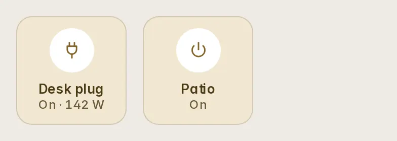
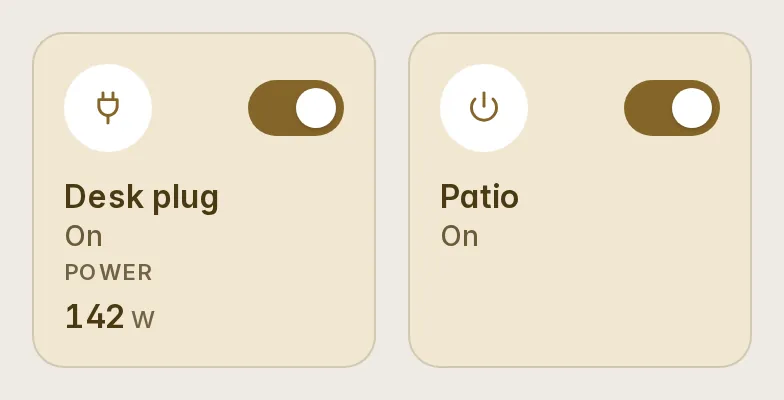

<!-- Generated by `pnpm docs:cards` from the card’s editor, its example in tools/docs/src/gallery.ts and its guide in tools/docs/guides/: change those, not this page. -->

# Tiles

A group of compact or mini tiles, two to four per row, 8 px apart.

`custom:fluvy-tiles-card` · [Try it live](https://acosta290.github.io/fluvy/?card=tiles) · [All cards](../cards.md#everyday)

<picture><source media="(prefers-color-scheme: dark)" srcset="../images/cards/tiles-dark.webp"></picture>

## Example

```yaml
type: custom:fluvy-tiles-card
tiles:
  - entity: switch.desk_plug
    readouts:
      - sensor.desk_plug_power
  - entity: switch.patio
```

The picture above, on the demo house: put your own entities in place of its.

## Layouts

`size` chooses the layout. The picture above is `compact`, the default; each of the others is the example plus the line over it, and opens in the live demo.

<table>
<tbody><tr>
<td align="center" valign="top" width="50%"><code>size: mini</code><br><a href="https://acosta290.github.io/fluvy/?card=tiles&amp;layout=mini"><picture><source media="(prefers-color-scheme: dark)" srcset="../images/cards/tiles.mini-dark.webp"></picture></a></td>
<td align="center" valign="top" width="50%"><code>size: large</code><br><a href="https://acosta290.github.io/fluvy/?card=tiles&amp;layout=large"><picture><source media="(prefers-color-scheme: dark)" srcset="../images/cards/tiles.large-dark.webp"></picture></a></td>
</tr></tbody>
</table>

## All options

```yaml
type: custom:fluvy-tiles-card
tiles:
  - entity: switch.desk_plug
    readouts:
      - sensor.desk_plug_power
  - entity: switch.patio
names: full
size: compact
columns: 2
group_by: none
name_lines: 1
switch_style: toggle
# tone:
# color:
# card_color:
# card_opacity: 100
# card_border: true
# unavailable: dashed
# tint: 'on'
readouts_layout: line
# empty_text:
hide_empty: false
```

## Options

| Option | Default | What it does |
| --- | --- | --- |
| `names` | `full` | How a row is named where it has no name of its own: the entity’s full name, its own, or its device’s. `full` · `entity` · `device`. |
| `size` | `compact` | The tiles’ size. `compact` · `mini` · `large`. |
| `columns` | `2` | How many items stand side by side in a row. `1` · `2` · `3` · `4` · `auto`. |
| `group_by` | `none` | Groups the items under the name of their room or their floor. `none` · `area` · `floor`. |
| `group_order` | `auto` | The order of the groups: the house’s order of its rooms, or by name. `auto` · `name`. |
| `short_names` | `true` | Shortens a name inside a group by the group’s own name. |
| `show_switch` | `true` | Shows the switch. `true` (Shown) · `false` (Hidden) · `value` (Its value instead). |
| `switch_style` | `toggle` | Draws the switch as a toggle, or as a wall rocker that only switches. `toggle` · `rocker` (Wall rocker). |
| `show_action` | `false` | Says on its line what a climate is doing and what it is set to. |
| `tint` | `on` | When the card shows its colour beyond its circle: never, while it is on or active, or at rest too. `on` (When on) · `always`. |
| `light_colors` | `false` | Shows each light that is on in its bulb’s own colour. |
| `light_whites` | `temperature` | Draws a lit white by its colour temperature, or as the palette’s light. `palette` (The theme’s light) · `temperature` (The bulb’s white). |
| `slider_style` | `house` | The slider’s style; left out, the style set for every slider. `house` · `ruler` · `bar` · `liquid` · `fill`. |
| `slider_words` | `ends` | Writes the words at the slider’s ends, or none. `ends` · `none`. |
| `readouts_layout` | `line` | Where a compact tile’s readouts stand: on its line, or as columns at its end. `line` (On the line) · `end` (Columns at the end). |
| `line_readouts` | `first` | How many readouts the tile’s line says: the first, or every one that can be read. `first` (The first) · `all`. |
| `empty_text` |  | What the card says while it has nothing to show. |
| `hide_empty` | `false` | Hides the whole card while it has nothing to show. |
| [`tiles`](#tiles) |  | The tiles, in the order they are drawn. A list: [its items](#tiles). |

<details>
<summary>Its look and its actions, as on every card</summary>

| Option | Default | What it does |
| --- | --- | --- |
| `name_lines` | `1` | Lets each tile’s name take two lines where one would cut it, every tile a line taller. `1` · `2`. |
| `tone` | the card’s own | The card’s colour from the palette’s tones; left out, the tone of what it shows. `accent` · `light` · `heat` · `cool` · `dry` · `fan` · `water` · `solar` · `grid` · `media` · `presence` · `armed` · `battery` · `house` · `gas` · `vehicle` (Car) · `neutral` · `ok` (Good) · `warning` · `danger`. |
| `color` |  | The card’s colour: its circle, its accents and its tints wear it. Left out, the colour of what it shows. |
| `card_color` |  | Paints the card’s surface in a colour of your own. |
| `card_opacity` | `100` | How solid the card’s surface is, in percent: under 100 the view’s background shows through. Left out, the house’s. 0 % to 100 %, in steps of 5. |
| `card_border` | `true` | Whether the card draws its hairline border. Left out, the house’s. |
| `unavailable` | `dashed` | How the card looks while its entity is unavailable: dashed, or quiet as when it is off. Left out, the house’s. `dashed` · `quiet` (As when off). |

More about them in [Options every card takes](../customising.md#options-every-card-takes).

</details>

## Lists

### `tiles`

An item is an entity id, or a map with `entity` and any of these fields. Between its items, `type: section` with a `label` heads a group.

| Field | What it does |
| --- | --- |
| `entity` | The entity the item shows. |
| `name` | The item’s own name, in place of the one the card would give it. |
| `icon` | The item’s own icon, in place of the one the card would give it. |
| `tone` | The item’s colour from the palette’s tones. `accent` · `light` · `heat` · `cool` · `dry` · `fan` · `water` · `solar` · `grid` · `media` · `presence` · `armed` · `battery` · `house` · `gas` · `vehicle` (Car) · `neutral` · `ok` (Good) · `warning` · `danger`. |
| `color` | The item’s colour, in place of the one the card gives it. |
| `readouts` | Sensors shown as readouts on the tile. |
| `thresholds` | Thresholds of the item’s own: values past which its reading takes a colour. |
| `since` | Where the time of the last change is read from. |
| `unavailable` | How the tile looks while its entity is unavailable. `dashed` · `quiet` (As when off). |
| `show_switch` | Shows the tile’s switch, hides it, or shows its level in its place. `true` (Shown) · `false` (Hidden) · `value` (Its value instead). |
| `switch_style` | Draws the tile’s switch as a toggle, or as a wall rocker. `toggle` · `rocker` (Wall rocker). |
| `show_action` | Says what a climate is doing on the tile’s line. `true` (On) · `false` (Off). |
| **Interactions** |  |
| `tap_action` | What a tap on the item does. |
| `hold_action` | What a long press on the item does. |
| `double_tap_action` | What two taps on the item do. |
| `icon_tap_action` | What a tap on the tile’s icon does. |
| `icon_hold_action` | What a long press on the tile’s icon does. |
| `icon_double_tap_action` | What two taps on the tile’s icon do. |

<details>
<summary>Older names the card still reads</summary>

| Older name | Read as |
| --- | --- |
| `entities` | `tiles` |
| `tiles[].label` | `tiles[].name` |
| `tiles[].sub` | `tiles[].secondary` |
| `tiles[].meta` | `tiles[].subtitle` |
| `accent` | `color` |

</details>
