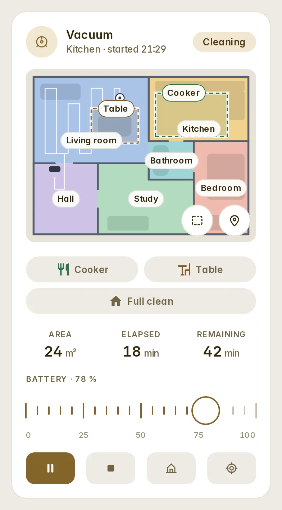
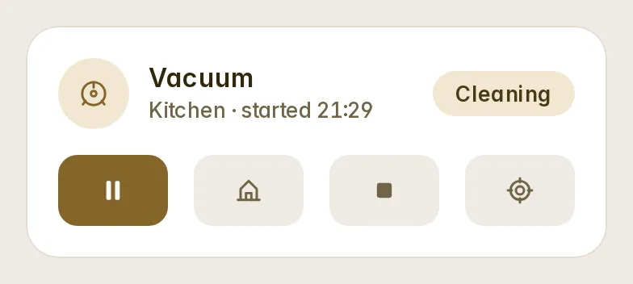
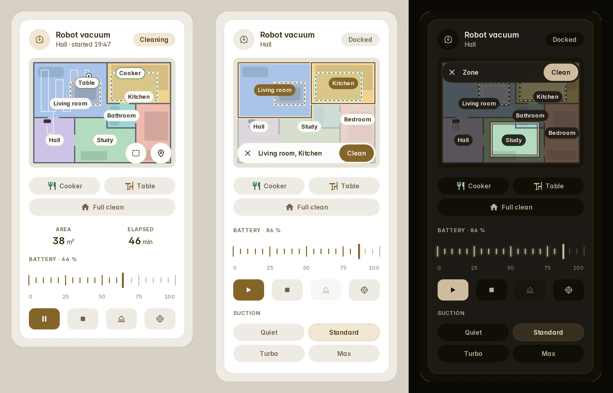

<!-- Generated by `pnpm docs:cards` from the card’s editor, its example in tools/docs/src/gallery.ts and its guide in tools/docs/guides/: change those, not this page. -->

# Vacuum

Robot vacuum or mower: battery, start · stop · dock · locate, suction, a drive pad, its map with presets.

`custom:fluvy-vacuum-card` · [Try it live](https://acosta290.github.io/fluvy/?card=vacuum) · [All cards](../cards.md#everyday)

<picture><source media="(prefers-color-scheme: dark)" srcset="../images/cards/vacuum-dark.webp"></picture>

## Example

```yaml
type: custom:fluvy-vacuum-card
entity: vacuum.robot
subtitle: Kitchen · started 21:29
battery_entity: sensor.robot_battery
area_entity: sensor.robot_area
duration_entity: sensor.robot_elapsed
remaining_entity: sensor.robot_remaining
show_suction: false
map:
  image: camera.robot_map
presets:
  - name: Cooker
    icon: mdi:silverware-fork-knife
    color: teal
    zone:
      - 29700
      - 26980
      - 32700
      - 28780
    repeats: 2
  - name: Table
    icon: mdi:table-chair
    color: amber
    zone:
      - 27020
      - 26700
      - 28980
      - 28140
  - name: Full clean
    icon: mdi:home
```

The picture above, on the demo house: put your own entities in place of its.

## Layouts

`variant` chooses the layout. The picture above is `full`, the default; each of the others is the example plus the line over it, and opens in the live demo.

<table>
<tbody><tr>
<td align="center" valign="top" width="50%"><code>variant: compact</code><br><a href="https://acosta290.github.io/fluvy/?card=vacuum&amp;layout=compact"><picture><source media="(prefers-color-scheme: dark)" srcset="../images/cards/vacuum.compact-dark.webp"></picture></a></td>
<td align="center" valign="top" width="50%"></td>
</tr></tbody>
</table>

## All options

```yaml
type: custom:fluvy-vacuum-card
entity: vacuum.robot
# name:
# icon:
show_icon: auto
show_badge: true
name_lines: 1
subtitle: Kitchen · started 21:29
variant: full
show_battery: true
battery_entity: sensor.robot_battery
area_entity: sensor.robot_area
duration_entity: sensor.robot_elapsed
remaining_entity: sensor.robot_remaining
suction_style: full
show_suction: false
map:
  image: camera.robot_map
show_map: true
show_presets: true
presets_style: full
show_rows: true
# rows:
# drive_entity:
# drive:
# tone:
# color:
# card_color:
# card_opacity: 100
# card_border: true
# exact_colors: false
# unavailable: dashed
# tint: 'off'
# state_colors:
# tap_action:
#   action: more-info
# hold_action:
#   action: more-info
# double_tap_action:
#   action: none
# icon_tap_action:
#   action: none
# icon_hold_action:
#   action: none
# icon_double_tap_action:
#   action: none
presets:
  - name: Cooker
    icon: mdi:silverware-fork-knife
    color: teal
    zone:
      - 29700
      - 26980
      - 32700
      - 28780
    repeats: 2
  - name: Table
    icon: mdi:table-chair
    color: amber
    zone:
      - 27020
      - 26700
      - 28980
      - 28140
  - name: Full clean
    icon: mdi:home
```

## Options

| Option | Default | What it does |
| --- | --- | --- |
| `entity` | **required** | The entity the card is about: what it shows, and what its controls act on. A `vacuum` or `lawn_mower`. |
| `name` |  | The name the card shows, in place of the entity’s own. |
| `icon` |  | The card’s icon, in place of the entity’s own. |
| `subtitle` |  | The line under the title: your own words, an entity’s state or a template. |
| `variant` | `full` | The card’s layout. `full` · `compact`. |
| `show_battery` | `true` | Shows the robot’s battery. |
| `battery_entity` |  | The battery sensor the card reads its charge from. A `sensor`. |
| `area_entity` |  | The robot’s sensor of the area it has cleaned, shown as a readout. A `sensor`. |
| `duration_entity` |  | The robot’s sensor of how long it has been cleaning, shown as a readout. A `sensor`. |
| `remaining_entity` |  | The robot’s sensor of the time left, shown as a readout. A `sensor`. |
| `suction_style` | `full` | Draws the suction speeds as chips that fill the row, or as content-sized chips. `full` · `chips`. |
| `show_suction` | `true` | Shows the suction’s chips. |
| `map` |  | The robot’s map under the head, as a block: its picture (`image`: a camera, an image entity or an address), its `calibration`, its shape (`aspect_ratio`), its `rooms`, what stands on it (`controls`) and how many times a pick is cleaned (`repeats`). Its keys: `image` · `calibration` · `aspect_ratio` · `controls` · `` · `rooms` · `room_action` · `zone_action` · `point_action`. |
| `show_map` | `true` | Shows the map; off, it is hidden and stays written. |
| `show_presets` | `true` | Shows the presets. |
| `presets_style` | `full` | Draws the presets as chips that fill their row, or as content-sized ones. `full` · `chips`. |
| `show_rows` | `true` | Shows the rows under the main control. |
| `tint` | `off` | When the card shows its colour beyond its circle: never, while it is on or active, or at rest too. `off` (Never) · `on` (When active) · `always`. |
| `tint_style` | `wash` | How the colour is shown: a wash over the card, the card’s edge, or the control alone. `wash` · `edge` · `control`. |
| `state_colors` |  | A colour for each of the device’s states, held under this key: a tone, none, or a colour of your own. Its keys: `cleaning` · `mowing` · `returning` · `paused` · `idle` · `docked` · `error`. |
| [`presets`](#presets) |  | Cleaning presets as chips, under the map where there is one: each cleans what it names, and one that names nothing is a full clean. `presets: areas` is one for each area the robot has mapped in Home Assistant. A list: [its items](#presets). |
| [`rows`](#rows) |  | Rows of other entities, such as the select that picks a floor’s map: under the map, or at the card’s foot where it has none. A list: [its items](#rows). |
| **Drive pad** |  |  |
| `show_drive` | `false` | Shows the drive pad that moves the robot by hand. |
| `drive_speed` | `normal` | How far a press on the drive pad moves the robot. `slow` · `normal` · `fast`. |
| `drive_style` | `card` | Opens the drive pad on the card, or in a sheet. `card` (In the card) · `sheet` (In a sheet). |
| `drive_entity` |  | The robot the drive pad moves, where it is not the card’s own entity. A `vacuum` or `lawn_mower`. |
| `drive` |  | The actions that start, move and stop a robot whose integration Fluvy does not know. |

<details>
<summary>Its look and its actions, as on every card</summary>

| Option | Default | What it does |
| --- | --- | --- |
| `show_icon` | `auto` | Shows the icon, hides it, or lets the card decide. `auto` · `always` · `never`. |
| `show_badge` | `true` | Shows the badge at the end of the head, such as the card’s state or a count. |
| `name_lines` | `1` | Lets the name in the card’s head take two balanced lines where one would cut it; the head is a line taller whatever the name. 0 hides the name: the head keeps its circle and its line. `0` · `1` · `2`. |
| `tone` | the card’s own | The card’s colour from the palette’s tones; left out, the tone of what it shows. `accent` · `light` · `heat` · `cool` · `dry` · `fan` · `water` · `solar` · `grid` · `media` · `presence` · `armed` · `battery` · `house` · `gas` · `vehicle` (Car) · `neutral` · `ok` (Good) · `warning` · `danger`. |
| `color` |  | The card’s colour: its circle, its accents and its tints wear it. Left out, the colour of what it shows. |
| `card_color` |  | Paints the card’s surface in a colour of your own. |
| `card_opacity` | `100` | How solid the card’s surface is, in percent: under 100 the view’s background shows through. Left out, the house’s. 0 % to 100 %, in steps of 5. |
| `card_border` | `true` | Whether the card draws its hairline border. Left out, the house’s. |
| `card_blur` | `true` | Whether what shows through a see-through card is blurred. Left out, the house’s, and none at 0 %. |
| `exact_colors` | `false` | Wears the colours the card names as Home Assistant draws them and a hex as typed, not the palette’s tones. Left out, the house’s. |
| `unavailable` | `dashed` | How the card looks while its entity is unavailable: dashed, or quiet as when it is off. Left out, the house’s. `dashed` · `quiet` (As when off). |
| **Interactions** |  |  |
| `tap_action` | `more-info` | What a tap on the card does. |
| `hold_action` | `more-info` | What a long press on the card does. |
| `double_tap_action` | `none` | What two taps on the card do. |
| `icon_tap_action` | `none` | What a tap on the icon does. |
| `icon_hold_action` | `none` | What a long press on the icon does. |
| `icon_double_tap_action` | `none` | What two taps on the icon do. |

More about them in [Options every card takes](../customising.md#options-every-card-takes).

</details>

## Lists

### `presets`

An item is a map with `name` and any of these fields.

| Field | What it does |
| --- | --- |
| `name` | The preset’s name, on its chip and on the map. |
| `icon` | An icon before its name. |
| `color` | The preset’s colour: its icon’s, its zone’s on the map, and its chip’s while the map shows it. |
| `zone` | A rectangle the preset cleans, as the robot counts: `[x1, y1, x2, y2]`. |
| `zones` | Several rectangles the preset cleans in one go: `[[x1, y1, x2, y2], …]`. |
| `rooms` | The rooms the preset cleans, by the robot’s own numbers for them: `[16, 17]`. |
| `areas` | The areas of Home Assistant the preset cleans (`vacuum.clean_area`). |
| `point` | A place the preset sends the robot to: `[x, y]`. |
| `repeats` | How many times it cleans what it names; once where it says none. 1 to 3. |
| `confirmation` | Asks before the preset runs, in Home Assistant’s own dialog. `true` or `false`. |
| `on_map` | Draws the preset’s zone or point on the map; `false` leaves it to its chip. `true` (On) · `false` (Off). |
| **Interactions** |  |
| `tap_action` | What a tap does in the place of cleaning what it names; a call’s data may ask `[[selection]]`, `[[point_x]]`, `[[point_y]]` and `[[repeats]]`. |
| `hold_action` | What a long press does in the place of showing the preset on the map. |
| `double_tap_action` | What two taps on the item do. |

### `rows`

An item is an entity id, or a map with `entity` and any of these fields.

| Field | What it does |
| --- | --- |
| `entity` | The entity the item shows. |
| `name` | The item’s own name, in place of the one the card would give it. |
| `icon` | The item’s own icon, in place of the one the card would give it. |
| `secondary` | The line under the item’s name. `area` · `last-changed` · `state` · `none`, or your own. |
| `since` | Where the time of the last change is read from. |
| `options` | The select’s options offered, in this order. A list. |
| `labels` | Names of your own for the options. |
| `tone` | The item’s colour from the palette’s tones. `accent` · `light` · `heat` · `cool` · `dry` · `fan` · `water` · `solar` · `grid` · `media` · `presence` · `armed` · `battery` · `house` · `gas` · `vehicle` (Car) · `neutral` · `ok` (Good) · `warning` · `danger`. |
| `color` | The item’s colour, in place of the one the card gives it. |
| **Interactions** |  |
| `tap_action` | What a tap on the item does. |
| `hold_action` | What a long press on the item does. |
| `double_tap_action` | What two taps on the item do. |

## Guide



### The map

`map` draws the robot's map under the head. Tap a room or a saved zone to pick it, several at once, then Clean; the
two rounds mark a zone by hand and pick a point to go to. Two fingers enlarge and move the map (Ctrl and the wheel,
or a double click, with a mouse); one finger scrolls the page.

```yaml
# Xiaomi with Xiaomi Cloud Map Extractor, Dreame or a Valetudo camera: the camera says its calibration and its rooms
type: custom:fluvy-vacuum-card
entity: vacuum.robot
map:
  image: camera.robot_map
```

```yaml
# Roborock (Home Assistant's own): its map is an image entity that says no calibration, so three points by hand
type: custom:fluvy-vacuum-card
entity: vacuum.roborock_s8
map:
  image: image.roborock_s8_ground_floor
  calibration:
    - { vacuum: { x: 25500, y: 25500 }, map: { x: 60, y: 214 } } # the dock, and where it is on the picture
    - { vacuum: { x: 26500, y: 25500 }, map: { x: 110, y: 214 } }
    - { vacuum: { x: 25500, y: 26500 }, map: { x: 60, y: 164 } }
  rooms:
    - id: 16
      name: Hall
      area: hall # Home Assistant's area, for vacuum.clean_area
      outline: [[24620, 22900], [27300, 22900], [27300, 25860], [24620, 25860]]
```

```yaml
# a plain floor plan: its own pixels are its measure, and an action of your own takes the numbers
type: custom:fluvy-vacuum-card
entity: vacuum.downstairs
map:
  image: /local/floor.png
  calibration: image
  controls: [names, zone]
  zone_action:
    action: perform-action
    perform_action: script.clean_spot
    data:
      zones: '[[selection]]'
      times: '[[repeats]]'
```

- `calibration`: left out, the map entity's own `calibration_points`; an entity id reads another's; three points fix
  a flat map, four one seen at an angle; `image` is a plain picture. A map that is not calibrated still shows, and
  its presets still run: only drawing and picking on it need it.
- `rooms`: left out, those the map's entity says. A room's `area` is Home Assistant's, cleaned by `vacuum.clean_area`
  where the robot takes it.
- `aspect_ratio` is the plate's shape, 4:3 by default: the card's height never comes from the picture.
- `controls: [names, zone, point]` chooses what stands on the map, `repeats` how many times a pick is cleaned.
- A Valetudo robot takes `topic: valetudo/robot`.

| Integration | Rooms | A zone | A point |
| --- | --- | --- | --- |
| Home Assistant | `vacuum.clean_area`, by area | | |
| Xiaomi Miio | `xiaomi_miio.vacuum_clean_segment` | `xiaomi_miio.vacuum_clean_zone` | `xiaomi_miio.vacuum_goto` |
| Roborock | `vacuum.send_command` with `app_segment_clean` | `app_zoned_clean`; one zone once, `roborock.set_vacuum_zoned_cleaning` | `roborock.set_vacuum_goto_position` |
| Dreame (HACS) | `dreame_vacuum.vacuum_clean_segment` | `dreame_vacuum.vacuum_clean_zone` | `dreame_vacuum.vacuum_goto` |
| Xiaomi Miot Auto (HACS), a Roborock | `xiaomi_miot.send_command` with `app_segment_clean` | `app_zoned_clean` | `app_goto_target` |
| Valetudo, with `topic` | `mqtt.publish` to `MapSegmentationCapability` | `ZoneCleaningCapability` | `GoToLocationCapability` |

- Untested on real robots: reports are welcome. A round the robot has no call for is not drawn.
- `room_action`, `zone_action` and `point_action` under `map` are calls of your own in the integration's place.

### Presets

`presets` are chips under the map, and work on a card with no map too. A tap runs one; a long press shows it on the
map, where it is drawn in its colour.

```yaml
type: custom:fluvy-vacuum-card
entity: vacuum.robot
map:
  image: camera.robot_map
presets:
  - name: Kitchen
    zone: [25500, 25000, 26500, 26500] # or zones, rooms: [16, 17], areas: [kitchen], point: [x, y]
    color: teal
    icon: mdi:silverware-fork-knife
    repeats: 2
    confirmation: true # asks first
  - name: Full clean # names nothing: starts the robot
  - name: Around the table
    tap_action:
      action: perform-action
      perform_action: vacuum.send_command
      data:
        command: app_zoned_clean
        params: '[[selection]]' # what is picked on the map, as numbers
```

- `[[selection]]`, `[[point_x]]`, `[[point_y]]`, `[[repeats]]` and `[[entity_id]]` are filled in by the card: numbers
  it computed and the card's own robot, nothing else.
- `presets: areas` is one chip for each area the robot has mapped in Home Assistant (its entity's settings).
- `show_presets`, `show_map` and `show_suction` hide a part; `presets_style: chips` sizes the chips by their words.

### Rows

`rows` adds other entities as rows, such as the select that picks a floor's map: under the map, before the presets,
or at the card's foot where it has no map.

```yaml
type: custom:fluvy-vacuum-card
entity: vacuum.robot
map:
  image: camera.robot_map
rows:
  - entity: select.robot_floor
    secondary: none
```

### The drive pad


`show_drive: true` adds a Drive command where the robot can be driven by hand. A tap is a short step; held, the robot
moves until you let go. Driving ends with Done, or after ten seconds without a press.

```yaml
type: custom:fluvy-vacuum-card
entity: vacuum.robot
show_drive: true
drive_speed: slow  # slow, normal (the default), fast
drive_style: sheet # the pad in a sheet, not in the card
```

| Integration | Drives with |
| --- | --- |
| Xiaomi Miio | `xiaomi_miio.vacuum_remote_control_*` |
| Roborock | `vacuum.send_command` with `app_rc_*` (not a Q7 or Q10) |
| Dreame (HACS) | `dreame_vacuum.vacuum_remote_control_move_step` |
| Xiaomi Miot Auto (HACS) | `xiaomi_miot.set_miot_property` (Dreame-made) or `send_command` (Roborock) |

- Untested on real robots: reports are welcome. Drive where you can see the robot.
- With Xiaomi Miot Auto a refused command is only logged, so the pad seems to do nothing.
- Ecovacs, iRobot and SharkIQ have no remote control in Home Assistant.

```yaml
# the same robot through a second integration: shown by one, driven by the other
type: custom:fluvy-vacuum-card
entity: vacuum.robot             # Xiaomi Home
drive_entity: vacuum.robot_miio  # Xiaomi Miio
show_drive: true
```

### Any other robot

`drive` names its calls: `move`, and `start` and `stop` where needed. In their data, `{{ velocity }}` (forward,
negative back), `{{ rotation }}` (left, negative right), `{{ seq }}` and `{{ random }}` are filled in by the card.

```yaml
type: custom:fluvy-vacuum-card
entity: vacuum.hallway
show_drive: true
drive:
  start:
    action: script.robot_manual_start
  move:
    action: script.robot_manual_move
    data:
      velocity: '{{ velocity }}' # 0.2 forward, -0.2 back
      rotation: '{{ rotation }}' # 45 left, -45 right
  stop:
    action: script.robot_manual_stop
  velocity: 0.2 # a full one; slow halves it, fast adds half
  rotation: 45
```

```yaml
# a Dreame-made robot on Xiaomi Miot Auto whose model the card does not tell
type: custom:fluvy-vacuum-card
entity: vacuum.robot_cleaner
show_drive: true
drive:
  move:
    action: xiaomi_miot.set_miot_property
    data:
      siid: 4
      piid: 15
      value: '{"spdv":{{ velocity }},"spdw":{{ rotation }},"audio":"false","random":{{ random }}}'
  stop:
    action: vacuum.stop
  velocity: 200
  rotation: 60
```

<details>
<summary>Older names the card still reads</summary>

| Older name | Read as |
| --- | --- |
| `sub` | `subtitle` |
| `meta` | `subtitle` |
| `layout` | `variant` |
| `view` | `variant` |
| `accent` | `color` |

</details>
