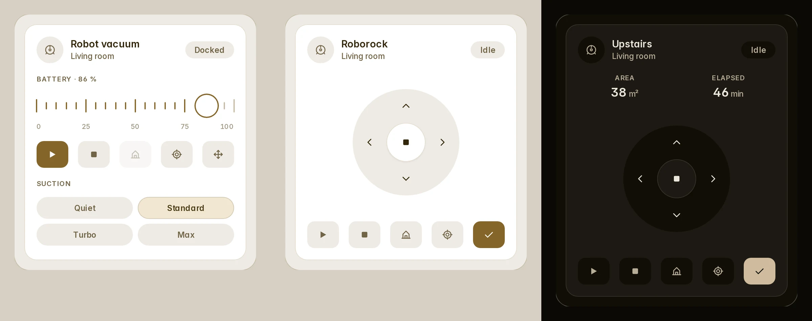

<!-- Generated by `pnpm docs:cards` from the card’s editor, its example in tools/docs/src/gallery.ts and its guide in tools/docs/guides/: change those, not this page. -->

# Vacuum

Robot vacuum or mower: battery, start · stop · dock · locate, suction, a drive pad.

`custom:fluvy-vacuum-card` · [Try it live](https://acosta290.github.io/fluvy/?card=vacuum) · [All cards](../cards.md#everyday)

<picture><source media="(prefers-color-scheme: dark)" srcset="../images/cards/vacuum-dark.webp"></picture>

## Example

```yaml
type: custom:fluvy-vacuum-card
entity: vacuum.robot
subtitle: Kitchen · started 21:29
battery_entity: sensor.robot_battery
area_entity: sensor.robot_area
duration_entity: sensor.robot_elapsed
remaining_entity: sensor.robot_remaining
```

The picture above, on the demo house: put your own entities in place of its.

## Layouts

`variant` chooses the layout. The picture above is `full`, the default; each of the others is the example plus the line over it, and opens in the live demo.

<table>
<tbody><tr>
<td align="center" valign="top" width="50%"><code>variant: compact</code><br><a href="https://acosta290.github.io/fluvy/?card=vacuum&amp;layout=compact"><picture><source media="(prefers-color-scheme: dark)" srcset="../images/cards/vacuum.compact-dark.webp"></picture></a></td>
<td align="center" valign="top" width="50%"></td>
</tr></tbody>
</table>

## All options

```yaml
type: custom:fluvy-vacuum-card
entity: vacuum.robot
# name:
# icon:
show_icon: auto
show_badge: true
name_lines: 1
subtitle: Kitchen · started 21:29
variant: full
show_battery: true
battery_entity: sensor.robot_battery
area_entity: sensor.robot_area
duration_entity: sensor.robot_elapsed
remaining_entity: sensor.robot_remaining
suction_style: full
# drive_entity:
# drive:
# tone:
# color:
# card_color:
# card_opacity: 100
# card_border: true
# unavailable: dashed
# tint: 'off'
# state_colors:
# tap_action:
#   action: more-info
# hold_action:
#   action: more-info
# double_tap_action:
#   action: none
# icon_tap_action:
#   action: none
# icon_hold_action:
#   action: none
# icon_double_tap_action:
#   action: none
```

## Options

| Option | Default | What it does |
| --- | --- | --- |
| `entity` | **required** | The entity the card is about: what it shows, and what its controls act on. A `vacuum` or `lawn_mower`. |
| `name` |  | The name the card shows, in place of the entity’s own. |
| `icon` |  | The card’s icon, in place of the entity’s own. |
| `subtitle` |  | The line under the title: your own words, an entity’s state or a template. |
| `variant` | `full` | The card’s layout. `full` · `compact`. |
| `show_battery` | `true` | Shows the robot’s battery. |
| `battery_entity` |  | The battery sensor the card reads its charge from. A `sensor`. |
| `area_entity` |  | The robot’s sensor of the area it has cleaned, shown as a readout. A `sensor`. |
| `duration_entity` |  | The robot’s sensor of how long it has been cleaning, shown as a readout. A `sensor`. |
| `remaining_entity` |  | The robot’s sensor of the time left, shown as a readout. A `sensor`. |
| `suction_style` | `full` | Draws the suction speeds as chips that fill the row, or as content-sized chips. `full` · `chips`. |
| `tint` | `off` | When the card shows its colour beyond its circle: never, while it is on or active, or at rest too. `off` (Never) · `on` (When active) · `always`. |
| `tint_style` | `wash` | How the colour is shown: a wash over the card, the card’s edge, or the control alone. `wash` · `edge` · `control`. |
| `state_colors` |  | A colour for each of the device’s states, held under this key: a tone, none, or a colour of your own. Its keys: `cleaning` · `mowing` · `returning` · `paused` · `idle` · `docked` · `error`. |
| **Drive pad** |  |  |
| `show_drive` | `false` | Shows the drive pad that moves the robot by hand. |
| `drive_speed` | `normal` | How far a press on the drive pad moves the robot. `slow` · `normal` · `fast`. |
| `drive_style` | `card` | Opens the drive pad on the card, or in a sheet. `card` (In the card) · `sheet` (In a sheet). |
| `drive_entity` |  | The robot the drive pad moves, where it is not the card’s own entity. A `vacuum` or `lawn_mower`. |
| `drive` |  | The actions that start, move and stop a robot whose integration Fluvy does not know. |

<details>
<summary>Its look and its actions, as on every card</summary>

| Option | Default | What it does |
| --- | --- | --- |
| `show_icon` | `auto` | Shows the icon, hides it, or lets the card decide. `auto` · `always` · `never`. |
| `show_badge` | `true` | Shows the badge at the end of the head, such as the card’s state or a count. |
| `name_lines` | `1` | Lets the name in the card’s head take two balanced lines where one would cut it; the head is a line taller whatever the name. `1` · `2`. |
| `tone` | the card’s own | The card’s colour from the palette’s tones; left out, the tone of what it shows. `accent` · `light` · `heat` · `cool` · `dry` · `fan` · `water` · `solar` · `grid` · `media` · `presence` · `armed` · `battery` · `house` · `gas` · `vehicle` (Car) · `neutral` · `ok` (Good) · `warning` · `danger`. |
| `color` |  | The card’s colour: its circle, its accents and its tints wear it. Left out, the colour of what it shows. |
| `card_color` |  | Paints the card’s surface in a colour of your own. |
| `card_opacity` | `100` | How solid the card’s surface is, in percent: under 100 the view’s background shows through. Left out, the house’s. 0 % to 100 %, in steps of 5. |
| `card_border` | `true` | Whether the card draws its hairline border. Left out, the house’s. |
| `unavailable` | `dashed` | How the card looks while its entity is unavailable: dashed, or quiet as when it is off. Left out, the house’s. `dashed` · `quiet` (As when off). |
| **Interactions** |  |  |
| `tap_action` | `more-info` | What a tap on the card does. |
| `hold_action` | `more-info` | What a long press on the card does. |
| `double_tap_action` | `none` | What two taps on the card do. |
| `icon_tap_action` | `none` | What a tap on the icon does. |
| `icon_hold_action` | `none` | What a long press on the icon does. |
| `icon_double_tap_action` | `none` | What two taps on the icon do. |

More about them in [Options every card takes](../customising.md#options-every-card-takes).

</details>

## Guide



### The drive pad

`show_drive: true` adds a Drive command where the robot can be driven by hand. A tap is a short step; held, the robot
moves until you let go. Driving ends with Done, or after ten seconds without a press.

```yaml
type: custom:fluvy-vacuum-card
entity: vacuum.robot
show_drive: true
drive_speed: slow  # slow, normal (the default), fast
drive_style: sheet # the pad in a sheet, not in the card
```

| Integration | Drives with |
| --- | --- |
| Xiaomi Miio | `xiaomi_miio.vacuum_remote_control_*` |
| Roborock | `vacuum.send_command` with `app_rc_*` (not a Q7 or Q10) |
| Dreame (HACS) | `dreame_vacuum.vacuum_remote_control_move_step` |
| Xiaomi Miot Auto (HACS) | `xiaomi_miot.set_miot_property` (Dreame-made) or `send_command` (Roborock) |

- Untested on real robots: reports are welcome. Drive where you can see the robot.
- With Xiaomi Miot Auto a refused command is only logged, so the pad seems to do nothing.
- Ecovacs, iRobot and SharkIQ have no remote control in Home Assistant.

```yaml
# the same robot through a second integration: shown by one, driven by the other
type: custom:fluvy-vacuum-card
entity: vacuum.robot             # Xiaomi Home
drive_entity: vacuum.robot_miio  # Xiaomi Miio
show_drive: true
```

### Any other robot

`drive` names its calls: `move`, and `start` and `stop` where needed. In their data, `{{ velocity }}` (forward,
negative back), `{{ rotation }}` (left, negative right), `{{ seq }}` and `{{ random }}` are filled in by the card.

```yaml
type: custom:fluvy-vacuum-card
entity: vacuum.hallway
show_drive: true
drive:
  start:
    action: script.robot_manual_start
  move:
    action: script.robot_manual_move
    data:
      velocity: '{{ velocity }}' # 0.2 forward, -0.2 back
      rotation: '{{ rotation }}' # 45 left, -45 right
  stop:
    action: script.robot_manual_stop
  velocity: 0.2 # a full one; slow halves it, fast adds half
  rotation: 45
```

```yaml
# a Dreame-made robot on Xiaomi Miot Auto whose model the card does not tell
type: custom:fluvy-vacuum-card
entity: vacuum.robot_cleaner
show_drive: true
drive:
  move:
    action: xiaomi_miot.set_miot_property
    data:
      siid: 4
      piid: 15
      value: '{"spdv":{{ velocity }},"spdw":{{ rotation }},"audio":"false","random":{{ random }}}'
  stop:
    action: vacuum.stop
  velocity: 200
  rotation: 60
```

<details>
<summary>Older names the card still reads</summary>

| Older name | Read as |
| --- | --- |
| `sub` | `subtitle` |
| `meta` | `subtitle` |
| `layout` | `variant` |
| `view` | `variant` |
| `accent` | `color` |

</details>
