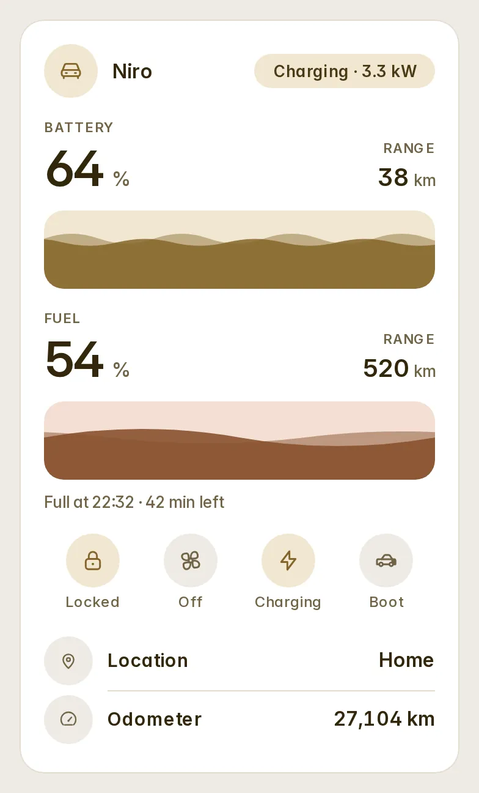
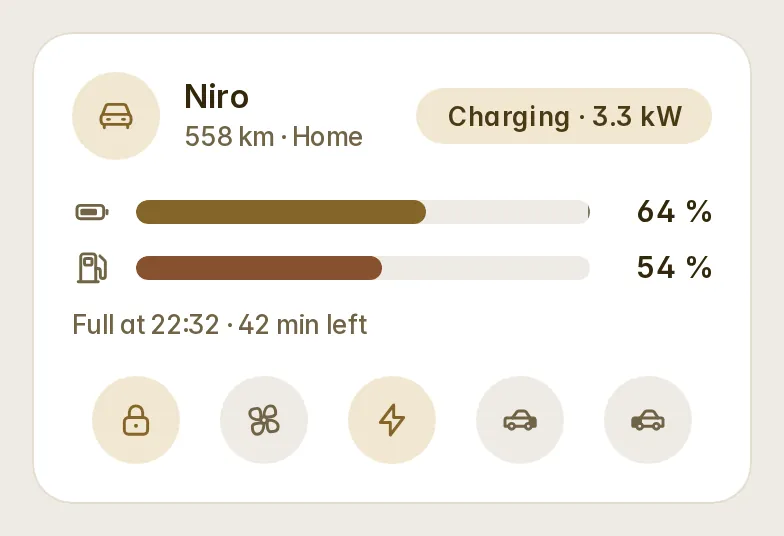
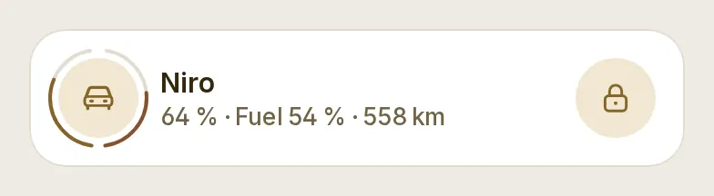

<!-- Generated by `pnpm docs:cards` from the card’s editor, its example in tools/docs/src/gallery.ts and its guide in tools/docs/guides/: change those, not this page. -->

# Vehicle

A car, electric, petrol, diesel or plug-in hybrid: its battery or tank, range and charge limit, when it is full, where it is, and its lock, climate, charging, boot and windows in one row. Tesla, BMW, Renault, Volvo, Kia, Hyundai, Volkswagen, Škoda, Polestar, MG, Toyota, Ford, Mercedes-Benz, Peugeot and more.

`custom:fluvy-vehicle-card` · [Try it live](https://acosta290.github.io/fluvy/?card=vehicle) · [All cards](../cards.md#everyday)

<picture><source media="(prefers-color-scheme: dark)" srcset="../images/cards/vehicle-dark.webp"></picture>

## Example

```yaml
type: custom:fluvy-vehicle-card
device: d-niro
energy: hybrid
```

The picture above, on the demo house: put your own entities in place of its.

## Layouts

`variant` chooses the layout. The picture above is `full`, the default; each of the others is the example plus the line over it, and opens in the live demo.

<table>
<tbody><tr>
<td align="center" valign="top" width="50%"><code>variant: compact</code><br><a href="https://acosta290.github.io/fluvy/?card=vehicle&amp;layout=compact"><picture><source media="(prefers-color-scheme: dark)" srcset="../images/cards/vehicle.compact-dark.webp"></picture></a></td>
<td align="center" valign="top" width="50%"><code>variant: mini</code><br><a href="https://acosta290.github.io/fluvy/?card=vehicle&amp;layout=mini"><picture><source media="(prefers-color-scheme: dark)" srcset="../images/cards/vehicle.mini-dark.webp"></picture></a></td>
</tr></tbody>
</table>

## All options

```yaml
type: custom:fluvy-vehicle-card
device: d-niro
# entity:
scan: true
# name:
# icon:
show_icon: auto
show_badge: true
name_lines: 1
variant: full
energy: hybrid
# tank_size:
# image:
show_range: true
show_limit: true
show_status: true
show_controls: true
show_rows: true
show_tyres: false
# low_range:
stale_after: 30
range_unit: auto
range_decimals: auto
power_unit: auto
power_decimals: auto
# tone:
# color:
# card_color:
# card_opacity: 100
# card_border: true
# unavailable: dashed
# tap_action:
#   action: more-info
# hold_action:
#   action: more-info
# double_tap_action:
#   action: none
# icon_tap_action:
#   action: none
# icon_hold_action:
#   action: none
# icon_double_tap_action:
#   action: none
# hero_tap_action:
# hero_hold_action:
# hero_double_tap_action:
#   action: none
# controls:
# rows:
# roles:
```

## Options

| Option | Default | What it does |
| --- | --- | --- |
| `device` |  | The device the card reads: every entity it has is found on it. |
| `entity` |  | An entity of the car, where its device is not named: the device is found from it. |
| `scan` | `true` | Searches the device for the rest of its entities; off, the card reads only those named. |
| `name` |  | The name the card shows, in place of the entity’s own. |
| `icon` |  | The card’s icon, in place of the entity’s own. |
| `variant` | `full` | The card’s layout. `full` · `compact` · `mini`. |
| `energy` | `auto` | What the car runs on: its battery, its tank, or both; automatic, its tank where it has one and no battery, else its battery. `auto` · `electric` · `fuel` · `hybrid` (Plug-in hybrid). |
| `tank_size` |  | The tank’s size, so that a car which says only how much is in it shows its level. 0 to 500. |
| `hero` | `ruler` | Draws the battery or the tank on a ruler, or as a ring. `ruler` · `ring`. |
| `image` |  | A picture of the car: an address, an entity whose picture it is, or the integration’s own. |
| `image_position` | `hero` | Where the car’s picture stands: over its battery or its tank, or in the head. `hero` (Over the battery) · `head` (The head). |
| `show_range` | `true` | Shows the range. |
| `show_limit` | `true` | Marks the charge limit on the battery’s ruler. |
| `show_status` | `true` | Shows the line under the battery or the tank: when it is full, why it is not charging, a low range. |
| `show_controls` | `true` | Shows the buttons. |
| `show_rows` | `true` | Shows the rows under the main control. |
| `show_tyres` | `false` | Shows the tyres’ pressures. |
| `low_range` |  | The range below which the car reads low; left out, a charge of 20 % or less does. 0 to 1000. |
| `stale_after` | `30` | Says when the car last reported, once it has said nothing for this many minutes. 0 to 1440. |
| `range_unit` | `auto` | The unit the range is written in. `auto` · `km` · `mi`. |
| `range_decimals` | `auto` | How many decimals the range has. `auto` · `0` · `1` · `2`. |
| `power_unit` | `auto` | The unit the charging power is written in. `auto` · `W` · `kW`. |
| `power_decimals` | `auto` | How many decimals the charging power has. `auto` · `0` · `1` · `2`. |
| `hero_tap_action` | the card’s own | What a tap on the battery or the tank does. |
| `hero_hold_action` | the card’s own | What a long press on the battery or the tank does. |
| `hero_double_tap_action` | `none` | What two taps on the battery or the tank do. |
| [`controls`](#controls) |  | The car’s controls, each a round that acts on it. A list: [its items](#controls). |
| [`rows`](#rows) |  | The rows of readings under the battery or the tank, in this order. A list: [its items](#rows). |
| [`roles`](#roles) |  | Entities named by hand for a part the card does not find on the device, or should read otherwise. A list: [its items](#roles). |

<details>
<summary>Its look and its actions, as on every card</summary>

| Option | Default | What it does |
| --- | --- | --- |
| `show_icon` | `auto` | Shows the icon, hides it, or lets the card decide. `auto` · `always` · `never`. |
| `show_badge` | `true` | Shows the badge at the end of the head, such as the card’s state or a count. |
| `name_lines` | `1` | Lets the name in the card’s head take two balanced lines where one would cut it; the head is a line taller whatever the name. `1` · `2`. |
| `tone` | the card’s own | The card’s colour from the palette’s tones; left out, the tone of what it shows. `accent` · `light` · `heat` · `cool` · `dry` · `fan` · `water` · `solar` · `grid` · `media` · `presence` · `armed` · `battery` · `house` · `gas` · `vehicle` (Car) · `neutral` · `ok` (Good) · `warning` · `danger`. |
| `color` |  | The card’s colour: its circle, its accents and its tints wear it. Left out, the colour of what it shows. |
| `card_color` |  | Paints the card’s surface in a colour of your own. |
| `card_opacity` | `100` | How solid the card’s surface is, in percent: under 100 the view’s background shows through. Left out, the house’s. 0 % to 100 %, in steps of 5. |
| `card_border` | `true` | Whether the card draws its hairline border. Left out, the house’s. |
| `unavailable` | `dashed` | How the card looks while its entity is unavailable: dashed, or quiet as when it is off. Left out, the house’s. `dashed` · `quiet` (As when off). |
| **Interactions** |  |  |
| `tap_action` | `more-info` | What a tap on the card does. |
| `hold_action` | `more-info` | What a long press on the card does. |
| `double_tap_action` | `none` | What two taps on the card do. |
| `icon_tap_action` | `none` | What a tap on the icon does. |
| `icon_hold_action` | `none` | What a long press on the icon does. |
| `icon_double_tap_action` | `none` | What two taps on the icon do. |

More about them in [Options every card takes](../customising.md#options-every-card-takes).

</details>

## Lists

### `controls`

An item is a map with `control` and any of these fields.

| Field | What it does |
| --- | --- |
| `control` | What the control switches. `lock` · `climate` · `charging` · `charge_port` · `trunk` (Boot) · `frunk` (Front boot) · `windows` · `doors` · `sentry`. |
| `name` | The item’s own name, in place of the one the card would give it. |
| `icon` | The item’s own icon, in place of the one the card would give it. |
| `color` | The item’s colour, in place of the one the card gives it. |
| `confirm` | Asks before the control acts. `true` or `false`. |
| **Interactions** |  |
| `tap_action` | What a tap on the item does. |
| `hold_action` | What a long press on the item does. |
| `double_tap_action` | What two taps on the item do. |

### `rows`

An item is a map with `row` and any of these fields.

| Field | What it does |
| --- | --- |
| `row` | Which reading the row shows. `location` · `odometer` · `inside` · `outside` · `charge_power` (Charging power) · `charge_rate` · `charge_limit` · `time_to_full` · `software` · `speed` · `fuel` · `fuel_range` · `fuel_volume` (In the tank) · `adblue` · `oil` · `service` (Next service). |
| `entity` | The entity the item shows. |
| `name` | The item’s own name, in place of the one the card would give it. |
| `icon` | The item’s own icon, in place of the one the card would give it. |
| `color` | The item’s colour, in place of the one the card gives it. |
| **Interactions** |  |
| `tap_action` | What a tap on the item does. |
| `hold_action` | What a long press on the item does. |
| `double_tap_action` | What two taps on the item do. |

### `roles`

An item is a map with `role` and any of these fields.

| Field | What it does |
| --- | --- |
| `role` | What the entity is to the car. `battery` · `range` · `charging` · `plugged` (Cable plugged in) · `charge_power` (Charging power) · `charge_rate` · `time_to_full` · `charge_limit` · `charge_switch` (Charging switch) · `charge_start` (Start charging) · `charge_stop` (Stop charging) · `charge_port` · `climate` · `climate_switch` · `climate_start` (Start the climate) · `climate_stop` (Stop the climate) · `climate_running` · `inside` · `outside` · `lock` · `trunk` (Boot) · `frunk` (Front boot) · `windows` · `sentry` · `odometer` · `location` · `address` · `software` · `state` (Car state) · `shift` (Gear) · `speed` · `moving` · `updated` (Last update) · `fuel` · `fuel_range` · `fuel_volume` (In the tank) · `fuel_low` (Low fuel warning) · `adblue` · `oil` · `service` (Next service) · `service_time` (Time to service) · `tyre_fl` (Front left) · `tyre_fr` (Front right) · `tyre_rl` (Rear left) · `tyre_rr` (Rear right). |
| `entity` | The entity the item shows. |

## Guide

Give the card the car's `device` (or one `entity` of it). It reads Tesla Fleet, Teslemetry, Tessie, Renault, Volvo and
Škoda from Home Assistant; Kia and Hyundai, MySkoda, Polestar, MG, Volkswagen and BMW CarData from HACS. Any other car
is read by what its entities are.

```yaml
type: custom:fluvy-vehicle-card
device: 7c1e…             # or entity: one of its entities
image: /local/model-y.png # or auto: its integration's picture
controls: [lock, climate, charging, trunk, frunk]
rows: [location, odometer, inside]
show_tyres: true
low_range: 50             # in the range's unit
```

- Controls that matter ask first: unlocking, the boot, the windows, stopping a charge, sentry off.
- Nothing that could move, wake or sound the car (horn, lights, keyless driving, remote start) is ever a control.
- `roles` names an entity the card did not find; with `scan: false` only those count.

A car with no device (a Nissan Leaf on Home Assistant's integration), named by hand:

```yaml
type: custom:fluvy-vehicle-card
scan: false
name: Leaf
roles:
  - { role: battery, entity: sensor.leaf_charge }
  - { role: range, entity: sensor.leaf_range }
  - { role: plugged, entity: binary_sensor.leaf_plug_status }
  - { role: charging, entity: binary_sensor.leaf_charging_status }
  - { role: climate_switch, entity: switch.leaf_climate_control }
```

### A car that burns fuel


A petrol or diesel car draws its tank in the battery's place, and warns of a low tank, AdBlue, oil or a service due.

```yaml
type: custom:fluvy-vehicle-card
device: 3f9a… # an Octavia diesel on MySkoda
rows: [location, adblue, service, odometer]
low_range: 80 # km: low under this, whatever the car says
```

```yaml
type: custom:fluvy-vehicle-card
device: 51c2… # an XC60 plug-in hybrid on Volvo's
energy: hybrid # auto (the default), electric, fuel, hybrid
tank_size: 71  # litres, where the car says only what is in it
rows: [location, fuel_volume, oil, service]
```

- The tank is also found on Toyota, Ford, Mercedes-Benz and Stellantis (HACS), else by ids ending `_fuel_level`,
  `_fuel_range`, `_adblue_range`, `_oil_level`, `_distance_to_service`, else by `roles`.
- Low: the car's own warning, else under `low_range`, else 15 %.

<details>
<summary>Older names the card still reads</summary>

| Older name | Read as |
| --- | --- |
| `layout` | `variant` |
| `view` | `variant` |
| `accent` | `color` |

</details>
