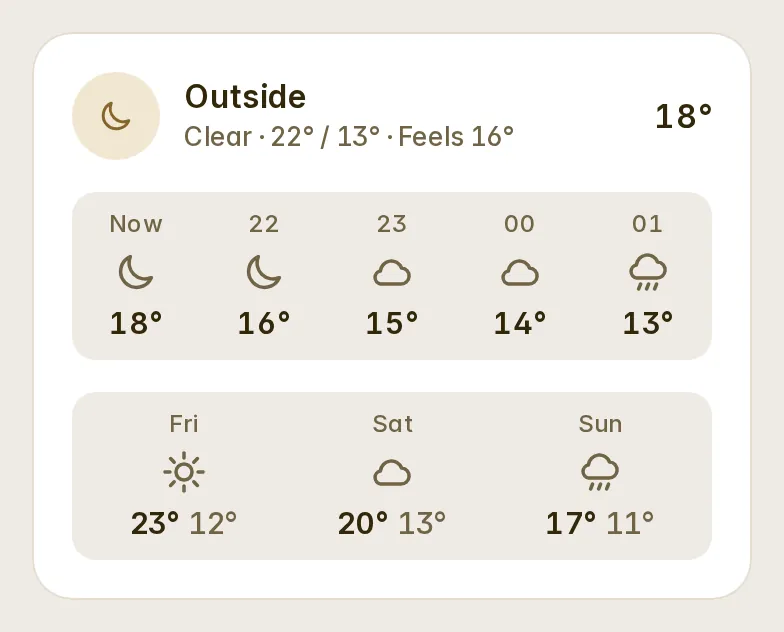

<!-- Generated by `pnpm docs:cards` from the card’s editor, its example in tools/docs/src/gallery.ts and its guide in tools/docs/guides/: change those, not this page. -->

# Weather

Condition, temperature, feels-like, wind and the daily or hourly forecast.

`custom:fluvy-weather-card` · [Try it live](https://acosta290.github.io/fluvy/?card=weather) · [All cards](../cards.md#everyday)

<picture><source media="(prefers-color-scheme: dark)" srcset="../images/cards/weather-dark.webp"></picture>

## Example

```yaml
type: custom:fluvy-weather-card
entity: weather.am_home
forecast: both
days: 3
```

The picture above, on the demo house: put your own entities in place of its.

## Layouts

`variant` chooses the layout. The picture above is `full`, the default; each of the others is the example plus the line over it, and opens in the live demo.

<table>
<tbody><tr>
<td align="center" valign="top" width="50%"><code>variant: compact</code><br><a href="https://acosta290.github.io/fluvy/?card=weather&amp;layout=compact"><picture><source media="(prefers-color-scheme: dark)" srcset="../images/cards/weather.compact-dark.webp"></picture></a></td>
<td align="center" valign="top" width="50%"></td>
</tr></tbody>
</table>

## All options

```yaml
type: custom:fluvy-weather-card
entity: weather.am_home
# name:
# icon:
show_name: true
show_icon: auto
variant: full
forecast: both
days: 3
show_forecast: true
# hourly_step:
# color:
# card_color:
# card_opacity: 100
# card_border: true
# unavailable: dashed
# tap_action:
#   action: more-info
# hold_action:
#   action: more-info
# double_tap_action:
#   action: none
# icon_tap_action:
#   action: none
# icon_hold_action:
#   action: none
# icon_double_tap_action:
#   action: none
```

## Options

| Option | Default | What it does |
| --- | --- | --- |
| `entity` | **required** | The weather entity the card shows. A `weather`. |
| `name` |  | The name the card shows, in place of the entity’s own. |
| `icon` |  | The card’s icon, in place of the entity’s own. |
| `show_name` | `true` | Shows the entity’s name; hidden, the condition says what the card is. |
| `variant` | `full` | The card’s layout. `full` · `compact`. |
| `forecast` | `daily` | What the forecast under the weather shows: days, hours, or both. `daily` · `hourly` · `both` (Daily and hourly). |
| `days` |  | How many days the forecast shows. 1 to 10. |
| `show_forecast` | `true` | Shows the forecast; hidden, the card is the weather now alone. |
| `hourly_step` |  | How many hours apart the hour columns stand. 1 to 6. |

<details>
<summary>Its look and its actions, as on every card</summary>

| Option | Default | What it does |
| --- | --- | --- |
| `show_icon` | `auto` | Shows the icon, hides it, or lets the card decide. `auto` · `always` · `never`. |
| `name_lines` | `1` | Lets the name in the card’s head take two balanced lines where one would cut it; the head is a line taller whatever the name. `1` · `2`. |
| `color` |  | The card’s colour: its circle, its accents and its tints wear it. Left out, the colour of what it shows. |
| `card_color` |  | Paints the card’s surface in a colour of your own. |
| `card_opacity` | `100` | How solid the card’s surface is, in percent: under 100 the view’s background shows through. Left out, the house’s. 0 % to 100 %, in steps of 5. |
| `card_border` | `true` | Whether the card draws its hairline border. Left out, the house’s. |
| `unavailable` | `dashed` | How the card looks while its entity is unavailable: dashed, or quiet as when it is off. Left out, the house’s. `dashed` · `quiet` (As when off). |
| **Interactions** |  |  |
| `tap_action` | `more-info` | What a tap on the card does. |
| `hold_action` | `more-info` | What a long press on the card does. |
| `double_tap_action` | `none` | What two taps on the card do. |
| `icon_tap_action` | `none` | What a tap on the icon does. |
| `icon_hold_action` | `none` | What a long press on the icon does. |
| `icon_double_tap_action` | `none` | What two taps on the icon do. |

More about them in [Options every card takes](../customising.md#options-every-card-takes).

</details>

<details>
<summary>Older names the card still reads</summary>

| Older name | Read as |
| --- | --- |
| `forecast` | `show_forecast` (some of its values) |
| `layout` | `variant` |
| `view` | `variant` |
| `accent` | `color` |

</details>
