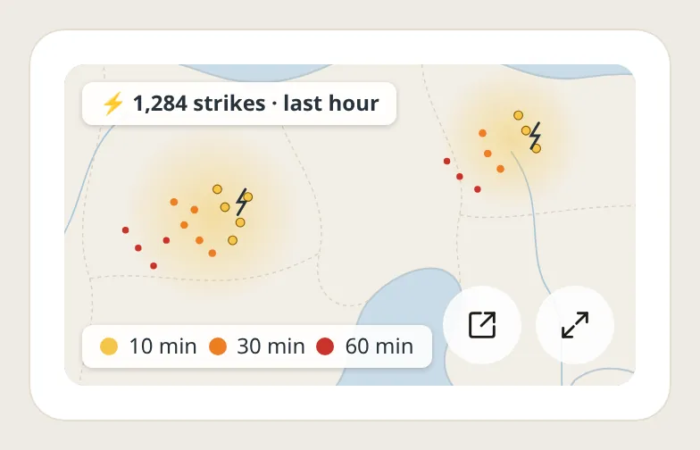
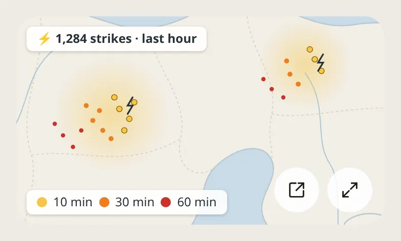

<!-- Generated by `pnpm docs:cards` from the card’s editor, its example in tools/docs/src/gallery.ts and its guide in tools/docs/guides/: change those, not this page. -->

# Web page

A web page on a plate — a map, a chart, a site of your own — under a head, in a frame or bare; sandboxed as Home Assistant’s iframe card is.

`custom:fluvy-web-card` · [Try it live](https://acosta290.github.io/fluvy/?card=web) · [All cards](../cards.md#structure-and-navigation)

<picture><source media="(prefers-color-scheme: dark)" srcset="../images/cards/web-dark.webp"></picture>

## Example

```yaml
type: custom:fluvy-web-card
url: /web/radar.html
title: Lightning
subtitle: Live strikes
```

The picture above, on the demo house: put your own entities in place of its.

## Layouts

`variant` chooses the layout. The picture above is `plate`, the default; each of the others is the example plus the line over it, and opens in the live demo.

<table>
<tbody><tr>
<td align="center" valign="top" width="50%"><code>variant: frame</code><br><a href="https://acosta290.github.io/fluvy/?card=web&amp;layout=frame"><picture><source media="(prefers-color-scheme: dark)" srcset="../images/cards/web.frame-dark.webp"></picture></a></td>
<td align="center" valign="top" width="50%"><code>variant: bare</code><br><a href="https://acosta290.github.io/fluvy/?card=web&amp;layout=bare"><picture><source media="(prefers-color-scheme: dark)" srcset="../images/cards/web.bare-dark.webp"></picture></a></td>
</tr></tbody>
</table>

## All options

```yaml
type: custom:fluvy-web-card
url: /web/radar.html
variant: plate
title: Lightning
# icon:
show_icon: auto
name_lines: 1
subtitle: Live strikes
aspect_ratio: '16:9'
# height:
scale: 1
refresh: 0
look: page
sandbox: standard
allow_open_top_navigation: false
allow: fullscreen
show_open: true
show_fullscreen: true
show_reload: false
# tone:
# color:
# card_color:
# card_opacity: 100
# card_border: true
# tap_action:
#   action: none
# hold_action:
#   action: none
# double_tap_action:
#   action: none
# icon_tap_action:
#   action: none
# icon_hold_action:
#   action: none
# icon_double_tap_action:
#   action: none
```

## Options

| Option | Default | What it does |
| --- | --- | --- |
| `url` | **required** | The address of the page the card embeds. |
| `variant` | `plate` | The card’s layout. `plate` (Head and page) · `frame` (Page in a frame) · `bare` (Page alone). |
| `title` |  | The title over the page. |
| `icon` |  | The card’s icon, in place of the entity’s own. |
| `subtitle` |  | The line under the title: your own words, an entity’s state or a template. |
| `aspect_ratio` | `16:9` | The page’s shape inside the card. `16:9` · `4:3` · `3:2` · `1:1` · `2:1` · `21:9` · `fill`, or your own. |
| `height` |  | The page’s height in pixels: it wins over the shape. 68 to 2000, in steps of 4. |
| `scale` | `1` | How large the page is drawn inside the card, as a factor. 0.5 to 1, in steps of 0.05. |
| `refresh` | `0` | Loads the page again every this many minutes; 0 never does. 0 to 1440. |
| `look` | `page` | Shows the page as it is, inverted to dark, or following the card’s mode. `page` (The page’s own) · `dark` · `auto`. |
| `sandbox` | `standard` | How much the embedded page is allowed to do. `standard` · `strict` · `off`. |
| `allow_open_top_navigation` | `false` | Lets a link in the page send the whole browser tab elsewhere. |
| `allow` | `fullscreen` | What the embedded page is allowed, as an iframe’s permissions policy (fullscreen by default). |
| `show_open` | `true` | Shows the button that opens the page in a new tab. |
| `show_fullscreen` | `true` | Shows the button that opens it full screen. |
| `show_reload` | `false` | Shows the button that loads the page again. |

<details>
<summary>Its look and its actions, as on every card</summary>

| Option | Default | What it does |
| --- | --- | --- |
| `show_icon` | `auto` | Shows the icon, hides it, or lets the card decide. `auto` · `always` · `never`. |
| `name_lines` | `1` | Lets the name in the card’s head take two balanced lines where one would cut it; the head is a line taller whatever the name. `1` · `2`. |
| `tone` | the card’s own | The card’s colour from the palette’s tones; left out, the tone of what it shows. `accent` · `light` · `heat` · `cool` · `dry` · `fan` · `water` · `solar` · `grid` · `media` · `presence` · `armed` · `battery` · `house` · `gas` · `vehicle` (Car) · `neutral` · `ok` (Good) · `warning` · `danger`. |
| `color` |  | The card’s colour: its circle, its accents and its tints wear it. Left out, the colour of what it shows. |
| `card_color` |  | Paints the card’s surface in a colour of your own. |
| `card_opacity` | `100` | How solid the card’s surface is, in percent: under 100 the view’s background shows through. Left out, the house’s. 0 % to 100 %, in steps of 5. |
| `card_border` | `true` | Whether the card draws its hairline border. Left out, the house’s. |
| **Interactions** |  |  |
| `tap_action` | `none` | What a tap on the card does. |
| `hold_action` | `none` | What a long press on the card does. |
| `double_tap_action` | `none` | What two taps on the card do. |
| `icon_tap_action` | `none` | What a tap on the icon does. |
| `icon_hold_action` | `none` | What a long press on the icon does. |
| `icon_double_tap_action` | `none` | What two taps on the icon do. |

More about them in [Options every card takes](../customising.md#options-every-card-takes).

</details>

## Guide

```yaml
type: custom:fluvy-web-card
url: https://www.lightningmaps.org/?lang=en#m=oss;t=3;s=0;o=0;b=;ts=0;y=41.39;x=2.17;z=8;d=2;dl=2;dc=0
title: Lightning
aspect_ratio: 4:3 # or fill (the view's height), or height in px
scale: 0.75       # the page drawn smaller, so a map shows more
refresh: 5        # minutes, while on screen
```

- `variant`: `plate` (under a head), `frame` (alone on the card) or `bare` (no card).
- `look: dark` inverts a page with no dark look (pictures too); `auto` only in dark mode.
- A page that refuses to be framed loads blank; the open round is the way out.
- An http page never loads on an https dashboard.

| `sandbox` | The page may |
| --- | --- |
| `standard` (the default) | What Home Assistant's iframe card allows |
| `strict` | Run scripts and take input, without cookies, storage, pop-ups or downloads |
| `off` | Anything: only for a page of your own |

Home Assistant's `type: iframe` card pastes in: `hide_background` is read as `variant: bare`, `disable_sandbox` as
`sandbox: off`.

<details>
<summary>Older names the card still reads</summary>

| Older name | Read as |
| --- | --- |
| `hide_background` | `variant` (some of its values) |
| `disable_sandbox` | `sandbox` (some of its values) |
| `sub` | `subtitle` |
| `meta` | `subtitle` |
| `layout` | `variant` |
| `view` | `variant` |
| `accent` | `color` |

</details>
