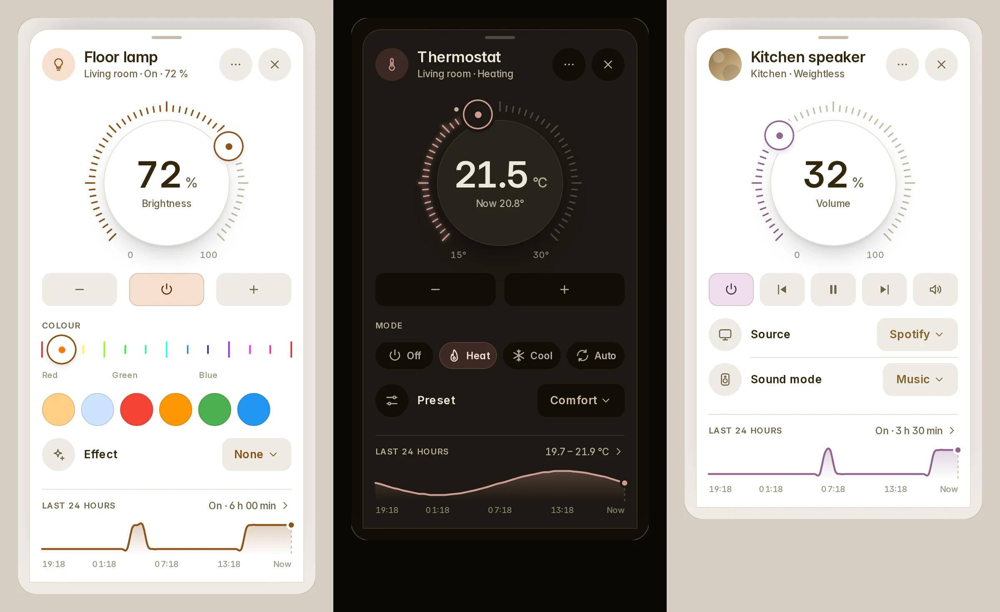
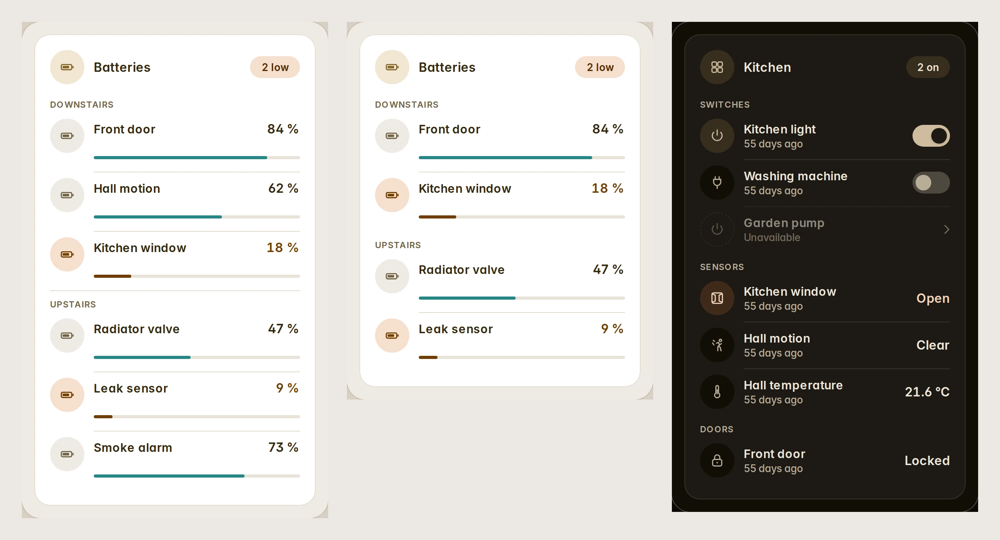

# Customising the cards

What every Fluvy card shares, and the options that work the same way on many of them. Each card's own page lists
every key it takes; [the cards](cards.md) has them all.

## Options every card takes

A card is its type, its entity and any option its editor offers. The editor shows an option only where it acts, with
its default, and never writes a default into the configuration.

```yaml
type: custom:fluvy-tile-card
entity: light.living_room_lamp
```

| Option | What it does | Example |
| --- | --- | --- |
| `name` | Your own words, or Home Assistant's parts (below). Left out: the friendly name. | `name: Sofa` |
| `icon` | An `mdi:` icon or a Fluvy glyph's name ([the list](theme.md#fluvys-icons)). | `icon: fluvy:living-room` |
| `title` | The head of a card that lists items. | `title: Batteries` |
| `tap_action`, `hold_action`, `double_tap_action` | Home Assistant's actions: `more-info` (the default), `toggle`, `navigate`, `url`, `perform-action`, `assist`, `fire-dom-event`, `none`. | `tap_action: { action: toggle }` |
| `icon_tap_action`, `icon_hold_action`, `icon_double_tap_action` | Makes the head's circle a button of its own. | `icon_tap_action: { action: toggle }` |
| `tone` | A colour from the palette's tones. | `tone: heat` |
| `color` | A colour name or `#rrggbb`. | `color: teal` |
| `card_color` | The card's surface in a quiet wash of a colour ([theme](theme.md#a-colour-per-card-and-per-item)). | `card_color: '#2a9d8f'` |
| `card_opacity` | 0 to 100; under 100 the view's background shows through. | `card_opacity: 80` |
| `card_border` | `false` leaves out the hairline. | `card_border: false` |
| `card_blur` | Under 100, whether what shows through is blurred. | `card_blur: false` |
| `exact_colors` | `true`: the colours the card names as Home Assistant draws them and a hex as typed, not the palette's tones ([theme](theme.md#exact-colours)). | `exact_colors: true` |
| `unavailable` | Out of reach: `dashed` (the default) or `quiet` (as when off). The card keeps its size either way. | `unavailable: quiet` |
| `show_icon` | The head's circle: `auto`, `always` or `never`. | `show_icon: never` |
| `name_lines` | `2`: the name may take two lines; the head is a line taller whatever the name. `0` hides the name; the head keeps its circle and its line. | `name_lines: 2` |
| `show_badge` | `false` hides the badge (a state or a count). Your own `badge` still shows. | `show_badge: false` |
| `names` | How a list names items with no `name`: `full`, `entity`, `device`, or Home Assistant's parts. | `names: entity` |
| `slider_style`, `slider_words` | `ruler`, `bar`, `liquid`, `fill` (a tile) or `house`; the figures under the slider: `ends` or `none`. | `slider_style: bar` |
| `empty_text`, `hide_empty` | What an empty list says; `hide_empty: true` hides the card until something is listed. | `empty_text: All closed` |

- Left out, `card_opacity`, `card_border`, `card_blur`, `exact_colors`, `unavailable` and `slider_style` are the
  house's ([settings panel](settings-panel.md#cards)).
- **A card at 0 %** is clear: nothing of it is frosted, whatever the house's blur, so only its words, its circles and
  its hairline stand on the view (`card_border: false` takes the hairline too). A lit tile and a light card lit in its
  light's colour stay solid, and the cards an [Expander](cards/expander.md), a [Swipe](cards/swipe.md) card or a
  [sidebar](sidebar.md) holds wear its surface, not their own. `card_blur: true` frosts a card at any opacity, 0
  included; a device in Lite blurs nothing.

```yaml
type: custom:fluvy-room-card
area: living_room
card_opacity: 0     # clear: no fill, no frost
# card_blur: true   # a frosted pane with no fill of its own
```
- **Exact colours** (1.25): every colour the card names (its `color` and `card_color`, an item's, a state's, a
  threshold's, a chart's series, the house's set of series colours, a lit bulb's) is worn as named: Home Assistant's
  own `#ffc107` for `amber`, a hex as typed. Lines, bars, glyphs and fills are the colour itself (a tint palette's fill
  is a fifth of it over the card, as Home Assistant's tile draws it); words on a fill are black or white, whichever
  reads, and a figure written in the colour is taken only as much lighter or deeper as it needs to read.

```yaml
type: custom:fluvy-tiles-card
exact_colors: true
tiles:
  - entity: light.kitchen_pendant
    color: amber        # Home Assistant's #ffc107
  - entity: light.bedside_lamp
    color: '#e91e63'    # as typed
```
- `show_badge`: the lock, alarm, cover, vacuum, thermostat, appliance, 3D printer, vehicle, humidity, timer, updates,
  gauge, distribution, bars, energy balance, grid, car charger, batteries, energy devices, energy usage and production
  cards (the thermostat's older `show_state` still works).
- `names`: Entities, Tiles, Room lights, Openings, Bars, Readouts, Stat tiles, Distribution, Helpers, Actions, Scenes,
  Cameras, Updates, Thermostats (whose rows are named by their room by default, `names: area`, where a room holds one
  of them).
- `slider_style`: the light, slider, tile, tiles, lights, media, fan, cover and helpers cards.
- `hide_empty` helps a list filled by [auto-entities](troubleshooting.md#a-list-filled-by-auto-entities).
- To fold a card away under a head (a [Room](cards/room.md), [Rooms](cards/rooms.md) or any other), put it in an
  [Expander](cards/expander.md): a tap opens it, and it remembers whether it was open.


**A name from Home Assistant's parts**: `entity`, `device`, `area`, `floor`, or `{ type: text, text: … }`, one or a
list joined by a space.

```yaml
name: { type: entity } # a light "Baum" on the device "EG_GA_L_Baum": "Baum", not "EG_GA_L_Baum Baum"
# name: [{ type: entity }, { type: area }]  ->  "Baum Garten"
```

An item's own `name` always wins; a helper (no device) keeps its name. Two items that read alike stay alike, so name
those yourself. On the automatic dashboards, see [names](automatic-dashboard.md#names).

**An icon left out** is the one set for the entity in Home Assistant, else Fluvy's glyph for its kind (a door drawn
open or shut; a battery's charge, a signal's bars and a valve open or shut where the house's icons show their level,
[*Appearance › Cards*](settings-panel.md#cards)), else its integration's.

**Taps.** The head is the card's button: a tap runs `tap_action`, a still press `hold_action`. A switch or a "…" in
the head, and the body's controls, keep their own taps. With a keyboard: Enter taps, Shift+F10 holds. An action with
a `confirmation` asks first.

**A lock locks at one tap and asks before it unlocks**, wherever a tap toggles it (a tile, a round, a row): Home
Assistant's own dialog, its words naming the service. An action's own `confirmation` asks in its place, and
`confirmation: false` unlocks at once:

```yaml
tap_action:
  action: toggle
  confirmation: false # this lock unlocks without asking
```

A row's switch (the Entities and Water & gas cards) and a round of the [Rounds](cards/rounds.md) card, where it names
no tap, flip only what a second tap undoes: lights, switches, fans, blinds, valves, humidifiers, sirens, automations,
remotes, groups (and a lock, as above). A vacuum, a player, a scene, a script and a button open their details there; a
room's quick action, and an entity among a [Vehicle](cards/vehicle.md) card's controls or quick actions, runs what it
stands for (a scene, a vacuum, a player, a script).

## Details sheets

A `more-info` on a Fluvy card (a head's tap, a row's tap, a tile's hold) opens Fluvy's own sheet for these kinds. Any
other entity, or a card that is not Fluvy's, opens Home Assistant's dialog.



| Kind | The dial | Under it |
| --- | --- | --- |
| Light | Brightness | −, switch, +; colour or temperature ruler, quick colours, **Effect** |
| Climate, water heater, humidifier | The target | −, +; modes; **Preset**, **Fan**, **Swing** |
| Cover, valve | Position | Open, stop, close; **Tilt** |
| Media player | Volume | Power, previous, play, next, mute; **Source**, **Sound mode** |
| Fan | Speed | −, switch, +; **Oscillate**, **Direction**, **Preset** |

Its **…** opens Home Assistant's details; its foot shows the last 24 hours, and a tap there opens
[History](pages.md#history). The house turns the sheets off in the settings panel (Appearance → Cards), and chooses
there which kinds keep their last 24 hours (*Sheets show their last 24 hours*: every kind until chosen). One action
chooses with `details` and `history`:

```yaml
type: custom:fluvy-tile-card
entity: light.floor_lamp
tap_action:
  action: more-info
  details: home-assistant # this tile keeps Home Assistant's dialog; `fluvy` asks for the sheet
```

```yaml
type: custom:fluvy-tile-card
entity: media_player.kitchen_speaker
tap_action:
  action: more-info
  history: false # its sheet without the last 24 hours; `true` shows them where the house does not
```

A sheet without its last 24 hours asks Home Assistant's recorder nothing.

A card of your own opens the same, by the house's choice: Fluvy's sheet where it has one, else Home Assistant's
dialog. Pass your card's element as `from`, so the focus comes back to it, and `history` to say whether its last 24
hours show:

```js
window.__fluvy?.openDetails('climate.living_room', { from: this });
window.__fluvy?.openDetails('media_player.kitchen_speaker', { from: this, history: false });
```

## Customisation

Every card lets you choose what it shows:

- `show_*` keys show or hide a part (`show_fan`, `show_presets`).
- Subset lists pick and order a row's items: `modes: [off, heat, cool]`.
- `variant` (on a tile, `size`) picks another layout.
- Chip rows fill their row; `preset_style: chips`, `fan_style: chips` or `suction_style: chips` makes them
  content-sized.
- `modes_style: icons` draws a thermostat's modes as one row of 44 tiles, an icon over each word.
- `when_off: essentials` keeps an off thermostat to its head, value and modes, and an off fan to its switch and ruler.
- A bars row is low under its `low` and high over its `high` (a battery or a soil's moisture: under 20 %).

A row of choices always shows the value in force, first and chosen, even when your list leaves it out:


### Tiles: two lines and readouts


```yaml
type: custom:fluvy-tile-card
entity: switch.nas
size: compact
name_lines: 2       # compact 88 px instead of 76, mini 124 instead of 108
line_readouts: all  # every readout on the line: "On · CPU 55 °C · Disk 41 °C · 0.12 kW"
readouts:
  - entity: sensor.nas_cpu_temperature
    name: CPU       # its label, before its figure
  - entity: sensor.nas_disk_temperature
    name: Disk
  - entity: sensor.nas_power
    unit: kW
    decimals: 2
```

- Without `line_readouts: all`, a compact or mini tile says only the first readout; a large tile shows them in its foot.
- `readouts_layout: end` stands a compact tile's readouts at its row's end, as columns.
- The sensor card names its readouts by their measure; `label` names its own sensor, an entry its `name`.

### Charts

A chart uses the house's style ([settings panel](settings-panel.md#charts)) unless the card sets `chart`:

| `chart` | Looks like |
| --- | --- |
| `classic` | The factory style |
| `soft` | A soft fill, hairlines at the quarters, a knob at the end |
| `glow` | A glowing line |
| `minimal` | A thin line ending in a dot |
| `step` | Each reading held across its slot |
| `bars`, `columns` | Up to 24 bars: what a meter gained, or the slot's mean (sensors that add up only) |

```yaml
type: custom:fluvy-sensor-card
entity: sensor.living_room_temperature
chart: soft
line_width: thin # fine keys: curve, fill, line_width, glow, show_points, show_grid, show_axis, highlight
hours: 24        # the house's window (12 hours) unless the card says; the Chart card says `span`
points: 30m      # a point every 30 minutes, each Home Assistant's reading then
```

- The card's key wins over the house's setting. `animate: false` draws it still.
- The energy, history bars, production, distribution and bars cards take `chart` too ([energy cards](energy.md)).

### Gauges

`gauge` on a gauge card: `ticks` (the default), `dial` (the thermostat's), `ring`, or one that moves with what it
reads:

| `gauge` | For | Moves |
| --- | --- | --- |
| `liquid` | A percentage, a humidity | Two slow waves |
| `thermo` | A temperature | A sky: snow, sun, a desert from 35 °C |
| `tank` | A volume or level | Bubbles while it fills |
| `battery` | A charge | A level, the bolt while charging |
| `pulse` | Power | Rings, faster with more |
| `air` | Wind, airflow | Streamlines |
| `sun` | Solar power | Rays |

```yaml
type: custom:fluvy-gauge-card
entity: sensor.terrace_temperature
gauge: thermo
stats: [max, average] # the row under it; show_stats: false leaves it out
```

A moving gauge on a sensor it does not fit draws the ticks; `animate: false` rests it. The humidity card takes
`ticks`, `ruler` or `liquid`.

### Lights

```yaml
type: custom:fluvy-light-card
entity: light.sofa_lamp
show_brightness: when_on       # true (the default), false (the head alone), when_on
tint: on                       # the card in the light's colour while it is on; always: at rest too
tint_strength: full_brightness # full (the default), soft, brightness, full_brightness
colors:                        # quick colours, in this order
  - warm
  - color: "#ff2d55"
    name: Lila
  - color: [0, 128, 128]
  - deep-purple
  - picker                     # the browser's colour picker
```

- A white shows its warmth, a candle's warmest; `light_whites: palette` uses the palette's lit colour.
- `light_colors: true` puts the bulbs' colours on tiles, a room's tiles and entities rows (the room lights card does by
  default).
- Which colour a light wears: its own `color`, its `tone`, the bulb's colour, the card's `color`, the card's `tone`.
- Left out, `tint` is the house's (settings panel → Appearance → Lights).

`show_color: true` on the room lights card adds a colour round that colours every light of the room at once
(`color_control: wheel` for a wheel):

```yaml
type: custom:fluvy-lights-card
area: living_room
show_color: true
colors: [warm, cool, red, orange, '#8e44ad', picker]
```

`lamp_switches: true` on the room lights and room cards counts an area's lamps on plugs among its lights: a switch whose
name says it is a lamp (Workbench lamp, 工作室 电灯), read in every language as the automatic dashboards read it. A
kettle on its plug stays out. A list of your own `lights` wins.

### History bars

The history bars card reads a sensor's long-term statistics: `days` bars of a `period` (days, weeks, months). `head`
and `facts` list what to say: `total`, `average`, `highest`, `lowest`, `today`, `co2` (× `co2_factor`), `trees`, `km`,
`money` (× `price`), `share` (`of` another sensor), `template`.

```yaml
type: custom:fluvy-history-bars-card
entity: sensor.grid_export_energy
price: 0.19
facts:
  - kind: share
    of: sensor.solar_energy
    name: Share of production
  - kind: money
    name: Revenue (est.)
```

```yaml
# a counter that starts again from zero: read by its own readings
type: custom:fluvy-history-bars-card
entity: sensor.rain_this_month
days: 28
include_today: true
reset: month  # day, week, month, year; never for a lifetime meter
unit: in
```

- `stat: state` draws each bar as the reading at its end: a monthly rain gauge with `period: month` shows each month's
  rain.
- The equivalents are rough and yours to set: 0.4 kg of CO₂ a kWh (`co2_factor`), 22 kg a tree a year, 5 km a kWh.
- A sensor with no state class has no statistics: its bars come from the recorder (`source: history`).

## Templates in row text

In any list of rows (entities, lock, alarm, camera, bars, stat tiles, actions, helpers), `secondary` may be a Home
Assistant template, kept live. `entity` is the row's entity, `user` the person looking.

```yaml
type: custom:fluvy-entities-card
rows:
  - entity: climate.living
    secondary: "{{ state_attr('climate.living', 'current_temperature') }} °C · {{ states('sensor.humidity') }} %"
```

A row's "2 h ago" is Home Assistant's `last_changed`, which a restart resets. `since` reads the real one from a
timestamp sensor or `attribute:<name>`; the openings card names one for every row with `since_pattern`.

```yaml
type: custom:fluvy-openings-card
since_pattern: sensor.{id}_real_last_changed # {id}: the row's object id; {entity}: its whole id
rows:
  - binary_sensor.front_door
  - entity: binary_sensor.garage_door
    since: attribute:last_opened # a row's own wins
```

## Sections and rows on a condition

The Bars and Entities cards' rows can stand in sections, and each row can show only on a condition.



```yaml
type: custom:fluvy-bars-card
title: Batteries
show_rows_when: { below: 30 }   # every row that names no condition
empty_text: Nothing under 30 %
rows:
  - type: section
    label: Downstairs
  - sensor.front_door_battery
  - entity: sensor.kitchen_window_battery
    show_when: { below: 50 }    # a row's own
  - type: divider               # a hairline alone
  - section: Upstairs           # the short form
    line: true                  # a hairline over the label
  - sensor.leak_sensor_battery
  - entity: sensor.guest_room_battery
    show_when: { entity: input_boolean.guests, state: 'on' }
```

- `show_when` takes `above`, `below`, `state` (a word or a list), `state_not`, and `entity` to read another entity.
  Every part must hold; it is plain data, never a template.
- A section with no row showing is not drawn. The head's count reads only the rows that show.

## Groups by room

The Tiles and Scenes cards can show their items in groups, each under a quiet label.

```yaml
type: custom:fluvy-scenes-card
variant: chips       # the scenes as pills on one card
group_by: area       # or floor; group_order: name sorts them A to Z
scenes:
  - scene.living_room_relax
  - scene.kitchen_cooking
  - entity: scene.kitchen_dinner
    name: Dinner for two # your own words are never shortened
  - scene.good_night     # in no room: under "Other"
```

```yaml
type: custom:fluvy-tiles-card
tiles:
  - section: Kitchen     # a section of your own
  - light.kitchen_pendant
  - section: Evening
  - light.living_room_floor_lamp
```

- Rooms follow the house's order ([settings panel](settings-panel.md#rooms-in-order)). While `group_by` is set, your
  own sections are not read.
- In a room's group, names drop the room ("Kitchen Pendant" reads "Pendant") and a first word they all share.
  `short_names: false` keeps them whole.
- A Heading card with `heading_style: label` is the same label on a dashboard of your own.

## Pictures of your own

The thermostat, media and appliance cards take `image`: an address (`/local/tv.png` for a file in Home Assistant's
`www` folder) or an entity with a picture (an image entity, a camera, a person).

```yaml
type: custom:fluvy-media-card
entity: media_player.lounge_tv
image: /local/lounge-tv.png # or image.lounge_tv
image_mode: fallback        # only while there is no artwork; always for always
```

## A device's state in colour

The lock, cover, alarm, vacuum, fan and thermostat cards can show their state's colour beyond the circle.


```yaml
type: custom:fluvy-lock-card
entity: lock.front_door
tint: always        # off (the default), on (while active), always (at rest too)
tint_style: control # wash (the default), edge, control
state_colors:       # by Home Assistant's state: a tone, a colour or none
  unlocked: danger
  locked: ok
```

- Active means unlocked, open or moving, armed, cleaning, on, heating or cooling.
- Left out, `tint` and `tint_style` are the house's ([settings panel](settings-panel.md#cards)).

## Thresholds

The gauge, sensor, readouts, stat tiles, tile and tiles cards, a room's tiles and the Chart card can colour a reading
past a figure.


```yaml
type: custom:fluvy-gauge-card
entity: sensor.grid_voltage
thresholds:
  - value: 230                # from 230 V up
    tone: warning
    label: High               # said beside the colour
  - value: sensor.max_voltage # or an entity, or a template
    tone: danger
    label: Too high
    icon: mdi:flash-alert
tint: on                      # the card itself in the band's colour
tint_style: wash              # or edge
```

- `below: true` colours under the value. `tone: none` ends a band. `color` is a colour of your own.
- The reading takes the nearest threshold it is past. A value that cannot be read is left out.
- On a list, a row takes its own `thresholds`:

```yaml
type: custom:fluvy-readouts-card
rows:
  - entity: sensor.phone_battery
    thresholds:
      - { value: 20, below: true, tone: danger, label: Low }
```

The colour changes the moment a reading crosses. For an alert that must not flap, give the card a threshold helper's
state.
